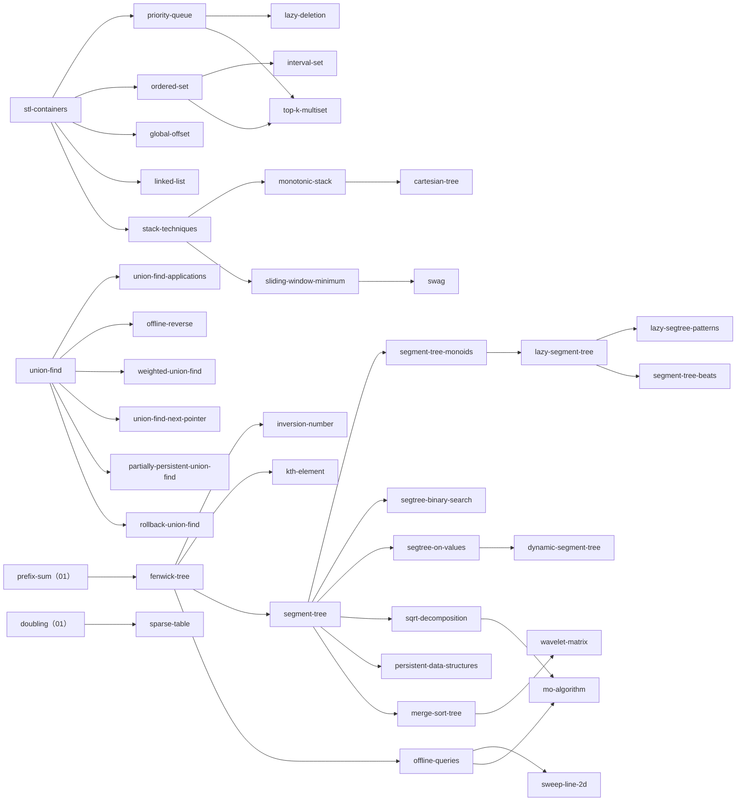

# 05 データ構造（ds）調査レポート

工程2（調査）の成果物。担当は「データ構造」（STL コンテナの応用、スタック・キュー、Union-Find、BIT・セグ木・遅延セグ木、静的な区間クエリ、クエリ処理の工夫、平方分割・Mo、永続・平衡二分木などの発展）。項目一覧の機械可読版は [05-ds.topics.yaml](05-ds.topics.yaml)。

- 作成日：2026-10-21
- 規模：項目 47（うち単独ページ案 31、他ページの節 10、発展の概要 6。レベル別は基礎 6・水 17・青 11・黄 3・発展 10）、例題・練習問題の候補 154 問（延べ 180 行）、付録に裏付け済みの追加候補 58 問
- 問題 ID・タイトル・difficulty はすべて `python3 tools/ap.py show` で確かめた。表の diff はその出力（AtCoder Problems の補正後の値。「参考値」は推定が不安定なもの、「なし」はレーティング対象外）
- 問題の内容と手法は第三者の解説記事（けんちょん・kmjp・ikatakos などのブログ、Qiita、Zenn、作問者や書籍の GitHub）で確かめ、URL を表に残した。atcoder.jp とそのサブドメインのページは開いていない
- **調査の制約**：途中で WebSearch の共有予算（全エージェント共有）が尽きた。以後は検索エンジンを使わず、既知の第三者ページ（けんちょんのブログのカテゴリ一覧・個別記事、kmjp の日付アーカイブ、cp-algorithms、USACO Guide、GitHub）を直接取得して裏付けを取った。そのため、2025〜2026 年の問題の一部（AAL Contest 001 など）は内容を確かめられていない（§7.6）

## 1. 調べた資料

### 1.1 一次資料・ライブラリ

| 資料 | URL・場所 | 何の参考にしたか |
| --- | --- | --- |
| AC Library ドキュメント（日本語） | `~/lib/ac-library-master/document_ja/`（segtree.md, lazysegtree.md, fenwicktree.md, dsu.md, appendix.md） | API・制約・計算量、max_right / min_left の条件（f(e()) = true、単調性）、遅延セグ木の条件（恒等写像・合成で閉じる・準同型）、無限集合を扱うときの厳密な要件 |
| AC Library のソース | `~/lib/ac-library-master/atcoder/`（segtree.hpp, lazysegtree.hpp, fenwicktree.hpp, dsu.hpp） | 自作の要点（配列の持ち方、prod の左右の積み方、max_right の登って降りる手順、push / all_apply / update、BIT の内部 1-indexed と符号なし整数、DSU の parent_or_size） |
| AC Library の使用例 | `~/lib/ac-library-master/test/example/`（segtree_practice.cpp, lazyseg_practice1.cpp, lazyseg_practice2.cpp） | practice2_j・k・l の S / F の設計（アフィン、反転と転倒数） |
| ei1333 のライブラリ索引 | https://ei1333.github.io/library/ | データ構造の名前の網羅（双対セグ木・永続 UF・Undo UF・Wavelet・Beats・Range Tree・Priority Sum Structure など） |
| Library Checker の問題一覧 | https://github.com/yosupo06/library-checker-problems/tree/master/data_structure | 自作ライブラリの検証に使える問題名（§7.5） |
| 『競技プログラミングの鉄則』の GitHub | https://github.com/E869120/kyopro-tessoku | 第8章「データ構造とクエリ処理」の問題（A51〜A60, B51〜B59）と解答コードで内容を確認 |
| 競プロ典型90問の GitHub | https://github.com/E869120/kyopro_educational_90 | 典型90の解答コードで手法を確認 |

### 1.2 英語・中国語の資料

| 資料 | URL | 何の参考にしたか |
| --- | --- | --- |
| cp-algorithms：Disjoint Set Union | https://cp-algorithms.com/data_structures/disjoint_set_union.html | 計算量（経路圧縮だけ・union by size だけ・両方）、偶奇つき UF、次の空きへ飛ぶ UF、small-to-large |
| cp-algorithms：Fenwick Tree | https://cp-algorithms.com/data_structures/fenwick.html | 0/1-indexed の式、線形構築、区間加算（BIT 2 本の式）、2 次元、接頭辞 min の制限 |
| cp-algorithms：Segment Tree | https://cp-algorithms.com/data_structures/segment_tree.html | 載せられるものの例（最大値と個数、gcd、k 番目の 0、最大部分和）、マージソート木、Fractional Cascading、遅延伝搬、2 次元、永続、動的 |
| cp-algorithms：Sparse Table | https://cp-algorithms.com/data_structures/sparse-table.html | 冪等な演算で O(1)、配列の持ち方、Disjoint Sparse Table への言及 |
| cp-algorithms：Sqrt Decomposition | https://cp-algorithms.com/data_structures/sqrt_decomposition.html | バケット法、区間更新、Mo の並べ方と計算量、奇偶で r の向きを変える工夫 |
| cp-algorithms：Minimum stack / Minimum queue | https://cp-algorithms.com/data_structures/stack_queue_modification.html | 最小値つきキューの 3 方式（単調 deque・添字つき・スタック 2 本）とスライド最小値 |
| cp-algorithms：Deleting from a data structure in O(T(n) log n) | https://cp-algorithms.com/data_structures/deleting_in_log_n.html | オフライン削除（時間軸のセグ木）、ロールバックでならし計算量が崩れること |
| USACO Guide（Gold / Platinum / Advanced の各モジュール） | https://usaco.guide/gold, https://usaco.guide/plat, https://usaco.guide/adv | 項目の網羅の確認（Stacks, Sliding Window, Point Update Range Sum, Sparse Segment Trees, 2D Range Queries, Divide & Conquer - SRQ, Counting Minimums with Segment Tree, Segment Tree Beats, Persistent Data Structures, Wavelet Tree, Treaps, Offline Deletion） |
| USACO Guide：Counting Minimums / DC-SRQ / Offline Deletion / Segment Tree Beats / Wavelet / Persistent / Sparse Segtree / PURS / 2DRQ | https://usaco.guide/adv/count-min ほか | 各手法の要点と計算量（Beats の break / tag 条件、O((N+Q) log N) と log² の区別など） |
| OI Wiki：数据结构・杂项 | https://oi-wiki.org/ds/, https://oi-wiki.org/misc/ | 中国語圏の項目の網羅（分块、单调栈、单调队列、ST 表、线段树合并、可持久化、树套树、珂朵莉树、CDQ、整体二分、莫队の変種） |
| orlp：Two-Stack Sliding-Window Aggregation | https://orlp.net/blog/two-stack-sliding-window-aggregation/ | SWAG が非可換でも動くこと（検索結果の要約で確認） |
| Codeforces のブログ（Segment Tree Beats ほか） | https://codeforces.com/blog/entry/57319 ほか | 名前と所在のみ（Codeforces のページは取得できず、検索結果で存在だけを確認） |

### 1.3 日本語の資料

| 資料 | URL | 何の参考にしたか |
| --- | --- | --- |
| E869120「レッドコーダーが教える、競プロ・AtCoder上達のガイドライン」中級編・上級編 | https://qiita.com/e869120/items/eb50fdaece12be418faa, https://qiita.com/e869120/items/acba3dd8649d913102b5 | 色ごとの通説（水色に Union-Find、黄色に BIT・セグ木（遅延を含む）・平方分割）。2020 年の記事で、現在の ABC では BIT・セグ木が水〜青で出る点に注意 |
| けんちょん「AtCoder 版！蟻本」初級編・中級編 | https://qiita.com/drken/items/e77685614f3c6bf86f44, https://qiita.com/drken/items/2f56925972c1d34e05d8 | 蟻本の 2-4（ヒープ・二分探索木・UF）と 3-3（セグ木・BIT・平方分割）に対応する AtCoder の問題 |
| けんちょんの競プロ精進記録（カテゴリ一覧） | https://drken1215.hatenablog.com/ （例：/archive/category/遅延評価セグメント木） | 手法→問題の索引と、各問題の解説（例題の裏付けの多く）。カテゴリ「データ構造テク：全体に反映させる値を別にもつ」「「次の要素」へのポインタを求める」「second best を管理する」なども項目の洗い出しに使った |
| けんちょん「重み付き Union-Find とそれが使える問題のまとめ」 | https://qiita.com/drken/items/cce6fc5c579051e64fab | 重み付き UF の経路圧縮と併合の式、牛ゲーとの関係 |
| けんちょん「k 番目を取り出すデータ構造」 | https://qiita.com/drken/items/1b7e6e459c24a83bb7fd | k 番目の求め方の比較（kth-element） |
| noshi91「UnionFindTree に関する知見の諸々」「二部グラフ判定を UnionFindTree で」 | https://noshi91.hatenablog.com/entry/2018/05/30/191943, https://noshi91.hatenablog.com/entry/2018/04/17/183132 | 計算量、部分永続・全永続、ポテンシャルの一般化、頂点倍化 |
| betrue12「AtCoder Library の Lazy Segtree の使い方」「チートシート」「行列を載せるセグ木」 | https://betrue12.hateblo.jp/entry/2020/09/22/194541, https://betrue12.hateblo.jp/entry/2020/09/23/005940, https://betrue12.hateblo.jp/entry/2020/03/30/220421 | 区間の長さを S に持つ理由、代入の id の番兵、6 つの基本型 |
| traP「セグメント木・遅延セグメント木を考える」 | https://trap.jp/post/2356/ | モノイドと作用での説明、長さが要る作用 |
| InTheDayDream「min_left と max_right の仕組みと実装を理解する」 | https://inthebloom.github.io/post/binarysearch-on-segmenttree/ | セグ木上の二分探索の登る・降りる段階 |
| 西懸のメモ帳「ACL のセグ木上の二分探索の条件判定には prod の結果が使われる」 | https://blog.nishigake.net/posts/20250120/ | max_right / min_left の誤用例 |
| hibit（Qiita）：セグ木上の二分探索の入門、データ構造の得意・不得意の比較、IntervalSet | https://qiita.com/hibit/items/e0ed4e6d2604ff6cec49, https://qiita.com/hibit/items/dee03a16c2d82003f6be, https://qiita.com/hibit/items/7e27a41212f849179a79 | 使い分けの材料、区間を set で管理の名前 |
| 区間を set で管理（satanic0258・kkt89・けんちょんのカテゴリ） | https://satanic0258.github.io/snippets/data-structure/SegmentMap.html, https://kkt89.hatenablog.com/entry/2020/10/14/std::set%E3%81%A7%E5%8C%BA%E9%96%93%E3%82%92%E7%AE%A1%E7%90%86%E3%81%99%E3%82%8B%E5%A5%B4 | 区間の分割・併合の手順とならし計算量 |
| SWAG（motsu-xe・Shirotsume・ikatakos） | https://motsu-xe.hatenablog.com/entry/2019/12/06/192424, https://qiita.com/Shirotsume/items/4a2837b5895ef9a7aeb1, https://ikatakos.com/pot/programming_algorithm/data_structure/slide_min | スタック 2 本のキュー、非可換モノイドでの積む向き、deque 版 |
| 単調スタック（awesam・kuuso1）、けんちょん「Cartesian Tree の O(N) 構築」 | https://qiita.com/awesam/items/458fb6330be4ab75c815, https://qiita.com/kuuso1/items/318d42cd089a49eeb332, https://drken1215.hatenablog.com/entry/2023/10/19/025800 | 単調スタックの不変条件、ヒストグラム最大長方形、Cartesian tree との関係 |
| Mo（ei1333・snuke）、平方分割（traP・クエリ平方分割） | https://ei1333.hateblo.jp/entry/2017/09/11/211011, https://snuke.hatenablog.com/entry/2016/07/01/000000, https://trap.jp/post/2683/, https://sigma1113.hatenablog.com/entry/2020/12/15/225256 | Mo の計算量と並べ方、平方分割の型 |
| マージソート木〜Wavelet Matrix（convexineq）、永続セグ木（37zigen）、Beats（smijake3）、Treap（ikatakos）、平衡二分木の代わりのテク（nebocco）、pb_ds | https://qiita.com/convexineq/items/70f36585ae76f70e3abf, https://37zigen.com/persistent-segment-tree/, https://smijake3.hatenablog.com/entry/2019/04/28/021457, https://ikatakos.com/pot/programming_algorithm/data_structure/balancing_binary_search_tree/treap, https://qiita.com/nebocco/items/638da118cd621d2628d1, https://xuzijian629.hatenablog.com/entry/2018/12/01/000010 | 発展の概要ページの材料 |
| 集合のハッシュ（traP・yamate11） | https://trap.jp/post/1594/, https://yamate11.github.io/blog/posts/2022/02-13-zobrist-hash/ | Zobrist hash、多重集合は和を使う |
| rikimaru「青色コーダーになる！カテゴリ別良問 500 選」 | https://note.com/rikimarublack/n/n3074b0955e95 | カテゴリ別の問題一覧（ヒストグラム最大長方形・Mo・平方分割・双対セグ木・動的セグ木・Cartesian Tree などの分類の裏付け） |
| AtCoder Tags | https://atcoder-tags.herokuapp.com/tags/Data-Structure | タグ別の問題一覧（補助。タグだけで内容を確かめたものは確度を下げた） |

### 1.4 書籍（目次の対応だけ）

- 『プログラミングコンテストチャレンジブック』（蟻本）：2-4（priority_queue・二分探索木・Union-Find）、3-3（セグ木・BIT・平方分割）、4-4（スタック・deque によるスライド最小値）。AtCoder の対応問題はけんちょんの「AtCoder 版！蟻本」で確認した
- 『競技プログラミングの鉄則』：第8章「データ構造とクエリ処理」（スタック・キュー・優先度付きキュー・map・set・文字列のハッシュ・ダブリング・セグ木 RMQ / RSQ・単調スタックの Stock Price）。Union-Find は第9章（A66 Connect Query）

## 2. 分野の全体像

### 2.1 サブ分野の構造

データ構造は「何をしたいか（操作）」と「どの順で操作が来るか（オンラインかオフラインか）」で整理すると、使い分けが見通しやすい。

1. **標準コンテナとその応用**（基礎〜水）：STL の使い分け、ヒープの貪欲・上位 K 個の列挙、遅延削除、2 つの multiset、set の前後の要素・mex、区間を set で管理、全体への操作のオフセット、連結リスト
2. **列の端を扱う構造**（基礎〜水）：スタック（括弧・履歴）、単調スタック、スライド最小値（単調 deque）、SWAG（発展）
3. **集合の併合**（基礎〜水、発展）：Union-Find、成分の情報、逆順処理、重み付き、次の空きへ飛ぶ、部分永続・ロールバック・並列二分探索（発展）
4. **区間クエリ**（水〜青、発展）：累積和（01）→ BIT → セグ木 → セグ木のモノイド設計 → セグ木上の二分探索 → 遅延セグ木 → 載せ方の型 → Beats（発展）。静的なら Sparse Table。値を添字にするセグ木・k 番目
5. **クエリの処理順を変える**（水〜黄）：クエリ先読み、平面走査＋BIT、平方分割、Mo
6. **発展**：永続、マージソート木・Wavelet Matrix、平衡二分木・pb_ds、Binary Trie、Cartesian tree、動的セグ木、行列を載せるセグ木、併合可能ヒープ、その他の名前の一覧

### 2.2 前提関係（知識マップの骨格）

### 2.3 混同されやすいもの

- **BIT とセグ木**：BIT は「接頭辞の和」（逆元が要る）の構造で、区間 min には使えない。セグ木は任意のモノイド。
- **遅延セグ木と双対セグ木と差分 BIT**：区間の総積が要るかどうか。一点の値だけなら遅延は要らない。
- **遅延セグ木と Beats**：区間 chmin＋区間和は「作用が総積に直接効く」条件を満たさないので遅延セグ木に載らない。
- **単調スタックとスライド最小値**：前者は「左右で初めて大きい」（幅が決まっていない）、後者は「単調に動く窓」。
- **区間を set で管理と UF の次ポインタ**：塗った区間の値を持ち続けるか、飛ばすだけか。
- **逆順処理・ロールバック・部分永続**：削除を追加にできるか、直前から順に戻すだけか、過去の時点を何度も問うか。
- **永続とロールバック**：任意の過去の版へのアクセス（永続）と、後入れ先出しの取り消し（ロールバック）。
- **オフライン（先読み）とオンライン強制**：前の答えで次の入力が変わる問題では先読みが使えない。サインとして見落としやすい。
- **priority_queue と multiset**：任意削除・両端・前後が要るかどうか。
- **Mo とオフライン BIT**：種類数・x 以下の個数のように BIT に載る量ならオフライン BIT のほうが速い。

## 3. 項目一覧

レベルは「その知識が主に必要になる問題の difficulty 帯」（手引き §2）。根拠の diff は ap.py の値。前提のうちほかの分野の key（prefix-sum・coordinate-compression・binary-search・doubling・trie など）は推測。詳細は [05-ds.topics.yaml](05-ds.topics.yaml)。

| 項目 | key | レベル | 根拠の問題と diff | 前提 | ACL | ページ案 |
| --- | --- | --- | --- | --- | --- | --- |
| STL コンテナの使い分けと落とし穴 | stl-containers | 基礎 | 容器の使い分けは灰〜緑で必須（abc253_c diff 518、abc233_d 726、abc166_e 1062）。上位の手法の部品 | — | — | own |
| 優先度付きキューの応用（貪欲・上位 K 個の列挙） | priority-queue | 水 | 容器としては茶（abc234_d 503）。ソート＋ヒープの貪欲・上位 K 個の列挙が水で必須（abc137_d 1313、abc325_d 1367、abc123_d 1489）、青まで続く（abc214_e 1835） | stl-containers, greedy | — | own |
| 削除できるヒープ（遅延削除） | lazy-deletion | 水 | abc170_e（diff 1502）で必須。C++ では multiset で代用できる | priority-queue | — | section-of:priority-queue |
| 2 つのヒープ・2 つの multiset（中央値・上位 K 個の和） | top-k-multiset | 水 | abc306_e（1268）・abc281_e（1334）で必須、abc127_f（2003）は中央値の発展 | ordered-set, priority-queue | — | own |
| set / multiset / map の応用（前後の要素・mex・パレート境界） | ordered-set | 基礎 | lower_bound で前後を取る基本は緑（abc217_d 802、abc370_d 1088、abc241_d 1177）。応用は水〜黄（abc245_e 1571、abc308_g 2008） | stl-containers | — | own |
| 区間を set で管理する | interval-set | 水 | 単純な塗り・被覆は緑〜水（abc435_e 982、abc380_e 1230）。値つきの区間の分割・統合は黄〜発展（abc430_g 2371、abc255_h 2430、abc256_h 2531） | ordered-set | — | own |
| 全体への操作を変数で持つ（オフセット・反転フラグ） | global-offset | 基礎 | 茶〜緑で頻出（abc278_d 559、abc158_d 610、abc379_d 745、abc212_d 775） | stl-containers | — | own |
| 配列で作る連結リスト | linked-list | 基礎 | 茶〜緑（abc237_d 544、abc344_e 973） | stl-containers | — | own |
| スタック・キュー・deque の使いどころ | stack-techniques | 基礎 | 括弧・打ち消し系は茶（abc328_d 555、abc240_d 570、abc307_d 666）。交差判定は水（abc338_e 1220）、ARC では黄（arc076_c 2180） | stl-containers | — | own |
| 単調スタック | monotonic-stack | 水 | 「見える数」は緑（abc372_d 901）、最近の大小を使う応用が水〜青（abc359_e 1275、abc379_f 1659、agc005_b 1828） | stack-techniques | — | own |
| スライド最小値（単調 deque） | sliding-window-minimum | 水 | ABC で必須の例は少ない（abc352_d 714 は multiset でも可）。DP の遷移の高速化（02）で青帯に現れる | stack-techniques, two-pointers | — | section-of:monotonic-stack |
| SWAG（2 つのスタックで作る総積つきキュー） | swag | 発展 | ABC で必須の問題は見つからなかった（Library Checker の Queue Operate All Composite で練習） | sliding-window-minimum, segment-tree | — | section-of:sliding-window-minimum |
| Union-Find（基本と実装） | union-find | 基礎 | 茶〜緑で頻出（abc288_c 436、abc292_d 579、abc177_d 732、abc350_d 773） | graph-basics | atcoder::dsu | own |
| Union-Find の応用（成分に情報を持たせる・併合で寄与を数える） | union-find-applications | 水 | 水が中心（abc372_e 1042、abc214_d 1341、abc238_e 1577、abc183_f 1586）、言い換え系は青（abc355_f 1924、arc065_b 1996） | union-find | atcoder::dsu | own |
| 削除を逆順の追加にする | offline-reverse | 水 | 水（abc229_e 1015、abc264_e 1229、abc120_d 1355） | union-find | atcoder::dsu | own |
| 重み付き Union-Find（ポテンシャル） | weighted-union-find | 水 | 易しい問題は DFS で足りる（abc327_d 709、abc373_d 765）。オンラインの矛盾判定で必須（arc090_b 1452、abc328_f 1477）、応用は青（abc280_f 1819） | union-find | — | own |
| 「次の空き」へ飛ぶ Union-Find | union-find-next-pointer | 水 | 水（abc228_d 1035、abc380_e 1230）、応用は青（abc364_f 1878）。set で代用できることが多い | union-find | — | section-of:union-find-applications |
| 部分永続 Union-Find | partially-persistent-union-find | 発展 | agc002_d（2514）。ABC で必須の例は見つからなかった | union-find, binary-search | — | overview |
| 並列二分探索 | parallel-binary-search | 発展 | agc002_d（2514）。ABC で必須の例は見つからなかった | binary-search, union-find | — | section-of:partially-persistent-union-find |
| Undo 可能 Union-Find とオフライン動的連結性 | rollback-union-find | 発展 | abc302_h（2407）。オフライン動的連結性が必須の ABC の問題は見つからなかった | union-find, segment-tree | — | overview |
| BIT（Fenwick Tree） | fenwick-tree | 水 | 道具としては緑〜水（abc185_f 1053、abc340_e 1157）。値で座圧して数える型が水で頻出（abc351_f 1253、abc221_e 1515、abc231_f 1580）、平面走査と組むと青 | prefix-sum, bit-operations | atcoder::fenwick_tree | own |
| 転倒数 | inversion-number | 水 | BIT で数えて差分更新する型が水（abc190_f 1321、abc396_f 1479、abc261_f 1587）、期待値・尺取りと組むと青（arc075_c 1979、abc380_g 1995） | fenwick-tree, coordinate-compression | atcoder::fenwick_tree | own |
| k 番目の値を求めるデータ構造（BIT 上の二分探索ほか） | kth-element | 水 | 水〜青（abc281_e 1334、abc392_f 1395、arc033_3 1641 参考値）、更新つき上位 K 和は黄（abc287_g 2180） | fenwick-tree, ordered-set | — | own |
| セグメント木（モノイド・一点更新・区間取得） | segment-tree | 水 | 一点更新・区間集約そのものは水の入口（abc341_e 1223、abc157_e 1443） | fenwick-tree | atcoder::segtree | own |
| セグ木に何を載せるか（モノイドの設計） | segment-tree-monoids | 青 | 何を載せるかを考えさせる問題は青が中心（abc309_f 1619、abc223_f 1641、abc331_f 1666、abc283_f 1771） | segment-tree | atcoder::segtree | own |
| セグ木上の二分探索（max_right / min_left） | segtree-binary-search | 青 | 入門は茶〜緑（abc382_c 476、abc330_e 1004）、必須になるのは青〜黄（abc389_f 1642、abc307_f 2139） | segment-tree, binary-search | atcoder::segtree::max_right | own |
| 遅延セグメント木（作用付きモノイド） | lazy-segment-tree | 青 | 簡単なものは水（abc382_f 1443）、S・F を設計する本体は青（abc327_f 1624、abl_e 1706） | segment-tree, segment-tree-monoids | atcoder::lazy_segtree | own |
| 遅延セグ木の載せ方の型と言い換え | lazy-segtree-patterns | 青 | 型の当てはめは青（abc332_f 1786、abc357_f 1793、abc322_f 1806）、言い換えと組むと黄（abc237_g 2088、abc371_f 2109） | lazy-segment-tree | atcoder::lazy_segtree | own |
| 双対セグ木（区間作用・一点取得） | dual-segment-tree | 青 | 青〜黄（abc179_f 1713、abc342_g 2107）。区間加算・一点取得だけなら緑（abc340_e 1157） | segment-tree | — | section-of:lazy-segment-tree |
| 値を添字にする BIT・セグ木（座標圧縮との組み合わせ） | segtree-on-values | 水 | 値を添字にした区間 max の DP は緑〜水（abc339_e 1109、abl_d 1283）、上位 K 和・動的セグ木は黄（abc403_g 2028、abc287_g 2180） | segment-tree, coordinate-compression | atcoder::segtree | own |
| 動的セグ木 | dynamic-segment-tree | 黄 | abc403_g（2028）でオンライン強制のため必要 | segment-tree | — | section-of:segtree-on-values |
| Sparse Table（と Disjoint Sparse Table） | sparse-table | 青 | 構造そのものを作らせる abc282_f（1734）。区間 min/max はセグ木で足りることが多い | doubling | — | own |
| クエリ先読み（オフライン処理） | offline-queries | 水 | 水〜青（abc235_e 1304、abc174_f 1495、abc253_f 1756、abc128_e 1840） | fenwick-tree, sorting | — | own |
| 平面走査＋BIT（2 次元の数え上げ） | sweep-line-2d | 青 | 青（abc327_f 1624、abc186_f 1833）、黄〜発展まで（abc346_g 2166、abc136_f 2334、abc360_f 2563） | fenwick-tree, offline-queries | atcoder::fenwick_tree | own |
| 平方分割（バケット法・根号で場合分け・クエリの平方分割） | sqrt-decomposition | 黄 | 入口は青（abc335_f 1690）、必須の中心は黄（abc365_g 2254、abc219_g 2287） | segment-tree | — | own |
| Mo's algorithm | mo-algorithm | 青 | 青（abc293_g 1753、abc242_g 1828）〜黄（abc477_g 2226、abc384_g 2343、abc405_g 2354） | sqrt-decomposition, offline-queries | — | own |
| 永続データ構造（版の木・永続セグ木） | persistent-data-structures | 青 | 版の木は青（abc273_e 1624）、永続セグ木は青（abc453_g 1735） | segment-tree, stack-techniques | — | own |
| マージソート木（区間の x 以下の個数・和をオンラインで） | merge-sort-tree | 青 | abc339_g（1792）でオンライン強制の区間の x 以下の和に使う | segment-tree, binary-search | — | own |
| Wavelet Matrix | wavelet-matrix | 発展 | abc324_g（2501）。abc339_g（1792）はマージソート木でも解ける | merge-sort-tree, bit-operations | — | overview |
| Segment Tree Beats | segment-tree-beats | 発展 | abc256_h（2531）。区間を map で管理する別解もある | lazy-segment-tree | — | overview |
| 平衡二分探索木（treap など）と pb_ds の tree | balanced-bst | 発展 | ABC で必須の問題は見つからなかった（k 番目は BIT・set で足りる：abc241_d 1177、arc033_3 1641 参考値） | ordered-set | — | overview |
| Binary Trie | binary-trie | 青 | abc281_f（1714）・abc308_g（2008）。abc308_g の主解は multiset | trie, bit-operations | — | own |
| 行列を載せるセグ木（動的 DP） | dynamic-dp | 発展 | abc246_h（2677） | segment-tree-monoids, matrix-power | atcoder::segtree | section-of:segment-tree-monoids |
| 集合・多重集合のハッシュ（Zobrist hash） | hashing-for-sets | 水 | 水（abc250_e 1421、abc367_f 1540） | rolling-hash | — | own |
| Cartesian Tree | cartesian-tree | 黄 | abc435_f（1385）はセグ木の再帰でも可。必須の中心は黄（arc189_d 2006、abc311_g 2265） | monotonic-stack | — | section-of:monotonic-stack |
| 併合可能なヒープ（skew heap・leftist heap） | meldable-heap | 発展 | ABC で必須の問題は見つからなかった | priority-queue | — | section-of:advanced-ds-catalog |
| 発展的なデータ構造の名前と用途の一覧 | advanced-ds-catalog | 発展 | ABC で必須の問題は見つからなかったもの（CDQ・セグ木マージ・2 次元セグ木・K-D tree・Link-Cut Tree など） | segment-tree | — | overview |

## 4. 項目ごとのメモ

各項目について、何ができるか・なぜ動くか、自作の要点（保つ性質・各操作の手順・境界）、つまずき、図・動く図の案、確認問題の案、問題のサイン、似た手法との使い分けを、分かる範囲で書く。問題の例は §5 の表を参照。

### 4.A 標準コンテナとその応用

#### stl-containers：STL コンテナの使い分けと落とし穴（基礎）

- **要点**：「どの操作を速くしたいか」でコンテナを選ぶ。初歩の説明は省き、選び方と落とし穴に絞る。

| コンテナ | 速い操作 | 遅い・できない操作 |
| --- | --- | --- |
| vector | 末尾の追加・削除（ならし O(1)）、添字アクセス O(1) | 途中への挿入・削除 O(N) |
| deque | 両端の追加・削除 O(1)、添字アクセス O(1) | 途中への挿入・削除 O(N) |
| list | 位置（イテレータ）を持っていれば挿入・削除 O(1) | 添字アクセス・探索 O(N) |
| stack / queue | 端の追加・削除 O(1) | 中を見られない |
| priority_queue | 追加・最大の取り出し O(log N)、最大を見る O(1) | 任意要素の削除・値の変更 |
| set / multiset / map | 追加・削除・検索・lower_bound O(log N)、順序つきの走査 | k 番目（標準ではない → pb_ds や BIT） |
| unordered_set / map | 平均 O(1) | 最悪 O(N)（衝突を狙った入力）、順序がない |

- **落とし穴**：multiset の erase(x) は x を全部消す（1 個だけなら erase(find(x))）。multiset の count は O(log N + 個数)。std::lower_bound(s.begin(), s.end(), x) は set では O(N)（メンバ関数 s.lower_bound を使う）。begin の前・end の参照は未定義動作。map の operator[] は存在確認だけでも要素を作る。size() は符号なしなので size() − 1 が空のとき巨大な値。vector の再確保でイテレータ・参照が無効になる。priority_queue は既定で最大を取り出す（最小は greater<>）。unordered_map はハックされうるので AtCoder 以外では注意（AtCoder ではまれ）。
- **型（map で数える）**：累積和の値や、式を i 側と j 側に分けた片側の値を map で数えながら走査する（和が K の区間の数、j − i = A_i + A_j を満たす組の数）。01 の累積和・式変形と組む。
- **図**：操作×コンテナの計算量の早見表（横断の早見表へ）。
- **確認問題案**：「multiset から値 x を 1 つだけ消すには」「set で x 未満の最大の要素を得るには」。

#### priority-queue：優先度付きキューの応用（水）

- **型**：
  1. 締切・開始時刻でソートし、「今使えるもの」をヒープに入れて最良を取る貪欲（区間スケジュール・締切つきの仕事の選択）。ソートの軸とヒープの軸が別になるのが要点。
  2. 上位 K 個の列挙（best-first）：最良の状態から始め、取り出した状態の「次の候補」を入れていく。重複を set で防ぐ。ソート済みの配列の組から和の大きい順に K 個、など。
  3. 接頭辞の K 番目に大きい値：サイズ K の最小ヒープを保つ。
  4. 全体に加算する操作との組み合わせ：オフセット変数を持ち、入れるときに引き、出すときに足す（global-offset）。
  5. ダイクストラ・プリム（03 の担当）。
- **自作の要点（二分ヒープ）**：完全二分木を配列で持ち、「親 ≤ 子」（最小ヒープ）を保つ。push は末尾に置いて親と比べて上げる、pop は根と末尾を入れ替えて末尾を消し、根を子の小さい方と比べて下げる。どちらも O(log N)。配列全体の heapify は O(N)。
- **つまずき**：最大・最小の向き、pair の比較順、取り出したものが古い情報か（ダイクストラの「古いエントリを捨てる」と同じ考え方）。
- **サイン**：「K 番目に大きい」「毎回いちばん～なものを選ぶ」「締切」「上位 K 個の和の大きい順」。
- **使い分け**：任意削除や最小・最大の両方が要るなら multiset。K が小さく値の範囲が狭いなら別の方法も。
- **確認問題案**：「締切つきの貪欲で、ソートの軸とヒープの軸がなぜ別になるのか」「上位 K 個の列挙で重複を除かないと何が起きるか」。

#### lazy-deletion：削除できるヒープ（遅延削除）（水）

- priority_queue は任意の要素を消せない。「消したいもの」を別のヒープ（または個数の map）に入れておき、top が消したいものと一致したら両方から捨てる。全体の計算量は O((追加回数) log N)。
- multiset で代用できるが、ヒープのほうが定数倍が軽い。最大・最小の両方が要るなら multiset が簡単。
- 例：各グループの最大値の集合の最小値（グループ間の移動で最大値が変わる）。
- **サイン**：「任意の要素を消しつつ最大・最小を取る」「イベントで追加と削除が起きる」。
- **確認問題案**：「削除予定のヒープにある値が本体の top より大きい（最大ヒープなら小さい）とき、なぜ放っておいてよいか」。

#### top-k-multiset：2 つのヒープ・2 つの multiset（中央値・上位 K 個の和）（水）

- **何ができるか**：要素の追加・削除がある多重集合で、「小さいほうから K 個の和」「中央値」「上位 K 個の和」を各操作 O(log N) で保つ。
- **手順**：小さい K 個を L、残りを R に分け、L の和を持つ。追加は L の最大と比べてどちらかへ入れ、L の個数が K を超えたら L の最大を R へ、足りなければ R の最小を L へ移す（移すたびに和を更新）。削除はどちらにあるかを見て消し、同じように調整する。
- **中央値**：L と R の個数の差を 1 以内に保つ。削除がなければ 2 つのヒープでよい。|x − a_i| の和を最小にする x は a の中央値で、そのときの値は (R の和 − R の個数·中央値) + (L の個数·中央値 − L の和)。
- **つまずき**：同じ値が L と R の両方にあるときの削除先、K が途中で変わる場合、和の更新漏れ。
- **使い分け**：値の範囲を座標圧縮できるなら「値のセグ木＋セグ木上の二分探索」でも書ける（オンラインでもクエリ先読みでも）。slope trick（02）の土台でもある。
- **確認問題案**：「L の個数を K に保つために、1 回の追加・削除で何個まで移せばよいか」「|x − a_i| の和が中央値で最小になる理由」。

#### ordered-set：set / multiset / map の応用（基礎）

- **型**：
  1. 前後の要素：lower_bound と、その 1 つ前（prev）で「x 以上の最小」「x 未満の最大」。番兵（−∞ と +∞）を入れておくと端の場合分けが消える。
  2. k 番目付近：lower_bound から k 歩進む・戻る（k が小さいとき）。
  3. 出てこない値の集合で mex を管理：0〜N の「まだ出ていない値」を set に入れておき、最小が mex。個数の配列と合わせて追加・削除に対応する。
  4. 行・列ごとの set：グリッドで「同じ行で x の右にある最初の壁」などを行ごと・列ごとの set で求め、消すときは両方から消す。
  5. 単調な点集合（パレート境界）：(a, b) の組で「a も b も上回られていない点」だけを map に残すと、b が単調に並ぶ。追加のたびに支配される点を消す（各点は一度しか消えないのでならし O(log N)）。USACO Guide の「Max Suffix Query with Insertions Only」と同じ考え方。
  6. 隣接する組の集合：ソート順で隣り合う 2 要素の組（差・XOR など）を別の multiset で持ち、要素の追加・削除のたびに前後の組を差し替える（最小の XOR は、ソートで隣り合う組の中にある）。
- **つまずき**：multiset の erase、end や begin の前の参照、イテレータの無効化（消した要素のイテレータだけが無効）。
- **サイン**：「x 以上で最小の」「最も近い」「まだ使われていない最小の値」「追加と削除のあとで最小値・最大値」。
- **確認問題案**：「set で x 未満の最大の要素を得る手順は」「番兵を入れると何の場合分けが消えるか」。

#### interval-set：区間を set で管理する（水）

- **何ができるか**：互いに重ならない区間 [l, r)（値つきでもよい）を、左端をキーにした set / map で持つ。点 x を含む区間の検索、区間の追加（重なる区間と併合）、区間の削除（端の区間を分割）、区間への代入（l と r で分割してから中を消して 1 つ入れる）が O(log N)（ならし）。
- **なぜならしで速いか**：1 回の追加・代入で新しくできる区間は O(1) 個で、消える区間はそれぞれ一度しか消えない。したがって、全体の区間の生成・削除の回数は操作回数の定数倍。ただし「区間の中を走査するだけで併合しない」操作が混ざると、この評価は成り立たない（いわゆる ODT／珂朵莉树が乱数のデータでしか速くないのはこのため）。
- **自作の要点**：番兵の区間を両端に入れる。x を含む区間は upper_bound(x) の 1 つ前。分割の関数 split(x)（x を左端とする区間を作る）を先に書き、代入は split(l), split(r) のあと間を消す。
- **応用**：mex の管理、塗り分け（区間ごとの色）、区間の和集合の長さ、「区間の値の種類ごとの合計」の差分更新（代入の前後で消える区間の寄与を引き、入る区間の寄与を足す）。
- **図・動く図**：数直線上の区間の帯が、代入で分割・併合されるステップ送り。
- **サイン**：「区間を塗る・塗りつぶす」「連続した同じ値の塊」「区間を追加・削除して、点 x が覆われているか」、座標が 10^9 で座圧が面倒。
- **使い分け**：塗った区間を「飛ばすだけ」なら UF の次ポインタ（union-find-next-pointer）が簡単。区間代入と区間和の両方が要るなら遅延セグ木（座標が小さいとき）。
- **確認問題案**：「代入を Q 回したとき、区間の総数が O(N + Q) で抑えられる理由」「代入しないで区間を走査するだけの操作が混ざると、なぜ遅くなりうるか」。

#### global-offset：全体への操作を変数で持つ（基礎）

- **何ができるか**：「全要素に x を足す」「全体を反転する」「全体を回転する」を、要素を書き換えずに変数（オフセット・反転フラグ・回転量）で持つ。新しく入れる要素は「今のオフセットを引いた値」で入れ、取り出すときに足す。
- **例**：ヒープ＋全体加算、deque＋全体反転のフラグ（反転中は前後の追加先を入れ替え、最後に向きを直す）、配列の回転は先頭位置の添字で表す。
- **型**：オフセット（入れるときに引き、出すときに足す）、反転フラグ（追加する側を入れ替える）、全体代入＋個別の差分（全体代入のときに差分の map を空にする。消す回数は入れた回数以下なのでならし）、回転は添字の読み替え。
- **つまずき**：反転フラグ中の先頭・末尾の取り違え、最後に向きを直し忘れる、オフセットの累積があふれる。
- **サイン**：「全要素に加算」「全体を代入」「全体を反転」「回転」。
- **つながり**：遅延セグ木の「遅延評価」は、この考え方を区間ごとに行うもの。
- **確認問題案**：「全体加算のオフセット d を持つヒープに新しい値 v を入れるとき、何を入れるか」。

#### linked-list：配列で作る連結リスト（基礎）

- next / prev の配列（値が大きいなら map）で双方向リストを持つと、「x の直後に y を挿入」「x を削除」が O(1)。値が重複しないことが前提。先頭・末尾に番兵を置くと場合分けが減る。
- 例：値で位置を指定する挿入・削除、列車の連結・切り離し。
- **つまずき**：値が重複すると値で節点を特定できない、削除した節点の next / prev を残したまま使う、最後に先頭からたどって出力するのを忘れる。
- **サイン**：「値 x の直後に挿入・x を削除」「列をつなぐ・切る」「最後に列全体を出力」。
- 使い分け：位置（何番目か）で指定するなら連結リストは使えない → 平衡二分木か、オフラインで BIT。逆順に処理すると deque で済む問題もある。
- **確認問題案**：「i 番目（位置）で挿入するとき、なぜ連結リストでは速くならないか」。

#### stack-techniques：スタック・キュー・deque の使いどころ（基礎）

- 括弧の対応（開き括弧の位置を積む）、直前の状態に戻す（Undo）、文字列から特定の並びを繰り返し消す、交差判定（弦の端点を順に見て、対応する端点がスタックの先頭にあるか）。
- deque：両端への追加、0-1 BFS（03 の担当）、真ん中への挿入があるキューは deque を 2 本に分けて長さをそろえる。
- **型**：ランレングス（(値, 個数) を積んで、同じものが k 個そろったら消す）、括弧列の残高と最小値、円を切り開いて括弧列に帰着（弦の交差判定）、親ポインタの木で履歴を持つ（永続スタック。persistent-data-structures）。
- **図**：括弧列を左から読み、スタックが伸び縮みする様子のステップ送り。
- **サイン**：「括弧」「直前と打ち消し合う」「入れ子」「取り消し・元に戻す」「交差するか」。
- **確認問題案**：「括弧列が正しい条件をスタックの言葉で言うと」「ランレングスを積むと消去の判定がなぜ O(1) になるか」。

#### monotonic-stack：単調スタック（水）

- **何ができるか**：各 i について「左（右）で初めて A_i より大きい（小さい）要素の位置」を全体 O(N) で求める。
- **手順**：左から見て、スタックに「まだ自分より大きいものが現れていない添字」を値が単調に並ぶように積む。i を見るとき、A_top ≤ A_i の間 pop し、残った top が答え（なければ −1 などの番兵）、最後に i を積む。各添字は一度ずつ積まれ、一度ずつ降ろされるので O(N)。
- **応用**：ヒストグラムの最大長方形（左右で初めて低い位置）、A_i が最大（最小）になる区間の数 (i − L)(R − i) を使った寄与の数え上げ（部分列の最大値の和など）、見えるビルの数、水位が上がる過程のシミュレーション、Cartesian tree の構築。
- **つまずき**：同じ値があるとき、片側を ≤、もう片側を < にしないと二重に数える。スタックに値ではなく添字を積む。
- **動く図**：棒グラフを左から見ていき、スタックの中身（右肩下がりの列）が積まれ・崩れる様子のステップ送り。
- **サイン**：「左（右）で初めて大きい」「見える」「i が最大となる区間」「すべての部分列の最大値（最小値）の和」。
- **使い分け**：窓の幅が固定ならスライド最小値（単調 deque）。区間の最大値そのものを多数聞くならセグ木・Sparse Table。
- **確認問題案**：「スタックの中身が常に単調に並んでいる理由」「寄与を数えるとき、同じ値で ≤ と < を左右で使い分ける理由」。

#### sliding-window-minimum：スライド最小値（水）

- **何ができるか**：幅 K の窓（または尺取りで両端が単調に動く窓）の最小値を、全体 O(N) で求める。
- **手順**：deque に添字を入れ、値が単調増加になるように保つ。新しい i を入れる前に、末尾から A ≥ A_i のものを捨てる（もう最小になれない）。先頭が窓の外に出たら捨てる。先頭が最小。
- **つまずき**：添字でなく値を入れると窓から外れたかが分からない、≥ と > の選び方（どちらでも最小値は正しいが、個数を数えるときは注意）。
- **サイン**：「長さ K の全区間の最小（最大）」「dp[i] = min(dp[i−K], …, dp[i−1]) + c の形の遷移」。
- **使い分け**：multiset で O(N log N) にしてよいなら簡単。min 以外（和以外の任意のモノイド）なら SWAG。DP の遷移の高速化（02 の担当）にも使う。
- **確認問題案**：「deque の末尾から大きい要素を捨ててよい理由」「各添字は deque に何回出入りするか」。

#### swag：Sliding Window Aggregation（発展）

- キューを 2 つのスタック（前と後ろ）で表し、前のスタックには「その要素から前のスタックの底まで」の総積、後ろのスタックには全体の総積を持つ。pop で前が空なら、後ろの要素をすべて前へ移しながら総積を作り直す。各要素は一度しか移らないので、ならし O(1)。モノイドが非可換でも、積む向きを守れば動く。
- min 以外の演算（gcd、行列積、一次関数の合成）の窓に使える。ABC で必須の問題はまれ（尺取り＋gcd などで別解として使える程度）。
- **確認問題案**：「pop のたびに要素を移すのに、全体がならし O(1) になる理由」。

### 4.B Union-Find とその発展

#### union-find：Union-Find（基礎）

- **何ができるか**：要素を互いに素な集合（グループ）に分けて持ち、「2 つの集合の併合」と「2 要素が同じ集合か（代表元が同じか）」を、ならし O(α(N)) で行う。α は逆アッカーマン関数で、実用上は 4 以下の定数と見てよい（cp-algorithms）。
- **なぜ速いか（2 つの工夫）**：
  1. union by size（または rank）：小さい木の根を大きい木の根の下につなぐ。ある頂点の深さが 1 増えるのは、その頂点を含む木がより大きい木の下につくときだけで、そのたびに属する木の大きさが 2 倍以上になる。だから深さは log₂N 以下。これだけで find は最悪 O(log N)。
  2. 経路圧縮：find で根までたどった頂点をすべて根に直接つなぎ直す。これだけでもならし O(log N)。
  両方で O(α(N))（ACL の dsu は union by size＋経路圧縮。根には −(サイズ) を入れて、親とサイズを 1 本の配列で兼ねる）。
- **自作の要点**：
  - 配列 parent（根なら −サイズ）。find(x)：根なら x、そうでなければ parent[x] = find(parent[x]) を返す（再帰でよい。union by size があれば深さは log N 以下）。
  - merge(a, b)：根 x = find(a), y = find(b)。同じなら何もしない（または辺数だけ数える）。サイズの小さい方を大きい方の下につなぎ、サイズを足す。
  - 成分の情報（サイズ・辺数・最小値・和・上位 k 個など）は根にだけ持ち、併合時に合成する。
  - 成分の数は「併合に成功した回数」を N から引けばよい。
- **ACL**：`dsu d(n)`、`merge(a, b)`（新しい代表元を返す）、`same(a, b)`、`leader(a)`、`size(a)`、`groups()`（O(N)）。
- **つまずき**：根を求めずに子どうしをつなぐ、併合後に古い根の情報を見る、サイズの積を int であふれさせる、成分数を数えるとき代表元以外も数える、自己ループ・多重辺での辺数の数え漏れ。
- **図・動く図**：森の上で merge（小さい木を大きい木の根の下へ）と find の経路圧縮のステップ送り。圧縮の前後で深さが縮む様子を並べる。
- **確認問題案**：「経路圧縮だけでも答えは正しいか、速さはどうか」「union by size だけで高さが log N 以下になるのはなぜか」「辺の削除がオンラインで来たら Union-Find で扱えるか」。
- **サイン**：「辺を追加していく」「グループを合併する」と「同じグループか」「グループの大きさ」が交互に問われる。グリッドの連結成分（BFS でもよいが、塗るクエリが途中に入るなら UF）。
- **使い分け**：グラフが最初から固定なら BFS/DFS でも足りる。辺の追加と問い合わせが交互に来るときに UF が要る。削除があるなら逆順（offline-reverse）。

#### union-find-applications：Union-Find の応用（水）

- **型**：
  1. 成分に情報を持たせる：サイズ・辺数（各成分で辺数 = 頂点数か、閉路があるか）・黒頂点の数・上位 k 個（k が小さければ併合時に 2 つのリストをマージして上位 k 個だけ残す）・値ごとの人数の map（小さい方を大きい方へ移すマージテク。04 の small-to-large と同じ）。
  2. 併合の瞬間に寄与を数える：辺を重みの小さい順に併合し、辺 (u, v, w) を足すとき「u の成分のサイズ × v の成分のサイズ」組のパスの最大値が w になる（全点対のパス上の最大辺の総和）。
  3. 何を頂点にするかの言い換え：区間和の情報は累積和の添字 l−1 と r を結ぶ辺（全体の和が分かる＝0 と N が連結）。点 (x, y) は「x の頂点と y の頂点を結ぶ辺」と見る（二部グラフの UF）。値の置き換え操作は「値を頂点にした UF」。
  4. 閾値ごとに UF を持つ：辺の重みが小さい（≤ 10 など）とき、重みごとに UF を持って MST を差分で更新する。
  5. 2 つの関係の両方で連結：道路の UF と鉄道の UF を作り、(根1, 根2) の組で数える。
- **サイン**：「全頂点対の～の総和」「パス上の最大の辺」「区間和が分かっているか」「値の書き換えで一致させる」「2 種類の辺でともに連結」。
- **使い分け**：成分の情報を「併合だけで更新できる」なら UF、分割が要るなら別の手（逆順・オフライン）。
- **確認問題案**：「辺を重みの昇順に足すとき、併合した瞬間に答えが決まる組の数は」「区間和の情報を UF で扱うとき、何を頂点にするか」。

#### offline-reverse：削除を逆順の追加にする（水）

- 「辺（頂点）を順に削除し、各時点の連結の情報を答える」は、操作を逆から見ると「何もない状態から追加していく」に変わり、UF で扱える。最後の状態から始め、答えを逆順に記録してから反転して出力する。
- オフライン（全部の操作が最初に分かっている）であることが前提。オンラインで削除が来るなら、ロールバック UF・オフライン動的連結性（発展）や、問題ごとの工夫が要る。
- UF 以外にも広がる考え方（ワーシャルフロイドに頂点を足していく、など）。01 の考察系・クエリ先読みと共有の横断項目にしてよい。
- **つまずき**：答えの反転忘れ、「まだ存在しない頂点」への辺を張る、最初の状態（すべて削除後）の作り方。
- **動く図**：時間軸を右から左にたどると「削除」が「追加」に見えるアニメーション。
- **サイン**：「順に崩落」「順に切る」「頂点を番号順に取り除く」と「各時点で」。
- **確認問題案**：「Union-Find が苦手な操作は何か。逆順にするとなぜ解けるのか」。

#### weighted-union-find：重み付き Union-Find（ポテンシャル）（水）

- **何ができるか**：「x_v − x_u = w」の形の情報を順に受け取り、矛盾がないかの判定と、同じ成分の 2 要素の差の取得を行う。
- **自作の要点**：各頂点に「親との差分 diff」を持たせる。find では先に親を根まで圧縮してから、親の（根からの）差分を自分の差分に足し、親を根に付け替える（圧縮後の diff は根からの差そのもの）。merge(u, v, w)（x_v − x_u = w）では根どうしをつなぐので、w に diff(u) を足し diff(v) を引いて「根どうしの差」に直す。サイズで向きを入れ替えたら符号を反転する。同じ成分なら diff(v) − diff(u) と w を比べて矛盾判定。
- **一般化**：差分は加算に限らず群なら載る（XOR なら偶奇、二部グラフ判定）。偶奇は「頂点を 2 倍にする UF」（v の赤と v の青）でも書ける。
- **つまずき**：圧縮の順序（親を先に圧縮）、向きの入れ替え時の符号、成分ごとの「矛盾フラグ」を併合で引き継ぎ忘れる。
- **サイン**：「x_R − x_L = D の情報」「矛盾しないか」「相対位置」「正直者と嘘つき」「2 色に塗れるか」。
- **使い分け**：グラフが最初から固定で一度判定するだけなら DFS で十分（易しい問題）。情報が順に来て途中で矛盾判定が要るときに UF が要る。不等式の制約は最短路（牛ゲー、03）。
- **確認問題案**：「根どうしをつなぐときの重みの式は」「経路圧縮で親を先に圧縮する理由」。

#### union-find-next-pointer：「次の空き」へ飛ぶ Union-Find（水）

- 各位置が「自分以降で最初の未処理の位置」を指すようにし、処理した位置は右隣と併合して代表が常に右側の未処理位置になるようにする。各位置は一度しか処理されないので、全体でほぼ線形。経路圧縮だけで O(log N)、代表とは別に「右端」を持てば union by size も併用できる（cp-algorithms の painting subarrays）。
- 例：環状の配列で右へ最初の空きに書き込む、区間を一度ずつ塗る、区間内の未連結の頂点を飛ばしながらつなぐ。
- **使い分け**：std::set に未処理の位置を入れて lower_bound で探し、処理したら消す、でも同じことができる（O(log N)）。区間の色を管理するなら interval-set。
- **確認問題案**：「経路圧縮だけでも全体が速い理由（各位置は一度しか処理されない）」「set で書く場合との違い」。

#### partially-persistent-union-find：部分永続 Union-Find（発展）

- 経路圧縮をせず（過去の形を壊すため）、union by size だけで高さを O(log N) に保つ。各頂点に「根でなくなった時刻」を記録し、「時刻 t での find」は記録時刻が t 以下の間だけ親へ登る。成分のサイズの履歴は根ごとに (時刻, サイズ) を持ち、二分探索で引く。
- 「x と y が初めて同じ集合になる時刻」は時刻の二分探索で O(log M · log N)。
- 代替：並列二分探索（全クエリの二分探索を同時に進める、オフライン）、併合の過程を表す木（Kruskal 再構成木）＋LCA。
- **確認問題案**：「部分永続でなぜ経路圧縮をしないのか」。

#### rollback-union-find：Undo 可能な Union-Find とオフライン動的連結性（発展）

- 経路圧縮をしない（多くの親を書き換えるので戻すのが高く、ならしの保証も崩れる）。併合のたびに書き換えた場所と元の値をスタックに積み、undo は後入れ先出しで戻す。find は最悪 O(log N)。
- 木の DFS と組む（入るとき併合、出るとき undo）のが ABC での典型。
- オフライン動的連結性：各辺が存在する時刻の区間を、時刻を葉とするセグ木の O(log Q) 個のノードに載せ、DFS で入るとき併合・出るとき undo、葉で答える。O(Q log Q log N)（cp-algorithms "Deleting from a data structure in O(T(n) log n)"）。ABC で必須の例は見つからなかった。
- **確認問題案**：「ロールバックで経路圧縮をするとどうなるか」。

#### parallel-binary-search：並列二分探索（発展）

- 各クエリが「単調な過程（辺を順に足す）のどの時点で条件を満たすか」を二分探索するとき、全クエリの探索区間を同時に持ち、各ラウンドで過程を最初から 1 回だけシミュレーションして、中央の時刻に来たクエリを判定する。ラウンド数 O(log M)。
- 01（二分探索）の発展とも言えるが、UF と組んで出ることが多いので、部分永続 UF と並べて概要に置く案。

### 4.C 区間クエリ（BIT・セグ木・遅延セグ木）

#### fenwick-tree：BIT（Fenwick Tree）（水）

- **何ができるか**：長さ N の列に対して「一点加算」と「接頭辞和（したがって区間和）」を O(log N) で行う。区間和は「r までの和 − l までの和」で出すので、演算に逆元が必要（和・XOR は可、min・max は不可）。
- **なぜ動くか（直感）**：1-indexed で、添字 i の箱は区間 (i − lowbit(i), i] の和を持つ（lowbit(i) = i & −i）。接頭辞 [1, i] は「i から lowbit を引き続ける」と 2 べき長の箱に重ならず分割でき、箱の数は i の立っているビットの数（≤ log N）。加算は「i に lowbit を足し続ける」と、i を含む箱を下から順にすべて通る。
- **自作の要点**：
  - 保つ性質：t[i] = a(i − lowbit(i) + 1) + … + a(i)。
  - add(i, x)：`while (i <= n) { t[i] += x; i += i & -i; }`、sum(i)：`while (i > 0) { s += t[i]; i -= i & -i; }`。
  - ACL は API が 0-indexed・半開区間 [l, r)（内部で +1 して 1-indexed にする）。自作では 1-indexed 内部・0-indexed 外部を最初に決めておく。
  - 線形時間の構築：各 i について t[i] を i + lowbit(i) に足し込むと O(N)。
  - ACL の fenwick_tree は内部を符号なし整数で持つので、オーバーフローしても未定義動作にならず 2^bit を法とした値になる（document_ja/fenwicktree.md）。
- **変種**：
  - 区間加算・一点取得：差分列 d に対する BIT（[l, r) に x を足す＝d[l] += x, d[r] −= x、一点の値＝d の接頭辞和）。
  - 区間加算・区間和：BIT を 2 本使う（cp-algorithms の式：prefix(i) = sum(B1, i)·i − sum(B2, i)）。遅延セグ木の代わりに定数倍が軽い。
  - BIT 上の二分探索（値が非負のとき「接頭辞和が w 以上になる最小の位置」）：pos = 0 から、2 べきの歩幅を大きい順に試し、t[pos + step] < w なら w を減らして進む。O(log N)。多重集合の「k 番目に小さい値」に使う。
  - 2 次元 BIT：ループを入れ子にする。メモリ O(HW)。座標が大きいときはオフラインで圧縮する。
  - 接頭辞 max：値が増える更新だけなら使える（任意の更新の区間 max は不可）。
- **つまずき**：0/1-indexed の混同、i = 0 で add して無限ループ（lowbit(0) = 0）、座標圧縮を忘れて値の上限で配列を取る、区間 min に使おうとする。
- **図・動く図**：添字を 2 進数で並べ、各箱が覆う区間を横棒で描いた図（Fenwick の「階段」）。add と sum で通る箱が順に光るステップ送り。
- **確認問題案**：「t[12] は a の何番目から何番目の和か」「区間 min に BIT を使えない理由は」「BIT 上の二分探索で値に負があるとなぜ壊れるか」。
- **サイン**：一点更新と区間和が混在、N, Q ≤ 2×10^5、「i < j かつ A_i > A_j の個数」、値で数える（座圧して個数の BIT）。
- **使い分け**：更新がなければ累積和。区間 min/max や非可換な演算はセグ木。区間加算・区間和は BIT 2 本でも遅延セグ木でもよい。

#### inversion-number：転倒数（水）

- **何ができるか**：列の転倒数（i < j かつ A_i > A_j の組の数）を O(N log N) で数える。左から見て「これまでに出た値のうち A_j より大きいものの個数」を BIT（値を添字にした個数の BIT）で足し合わせる。
- **典型の言い換え**：隣接 swap でソートする最小回数＝転倒数。順列 P を Q に並べ替える隣接 swap の最小回数＝「Q での位置」に置き換えた列の転倒数。回転（先頭を末尾へ）を繰り返すときは差分で更新（先頭の値 v を末尾に移すと、転倒数は (v より大きい個数) − (v より小さい個数) だけ変わる）。
- **つまずき**：等しい値の扱い（> と ≥）、値の座標圧縮、答えが 32bit を超える（N = 2×10^5 で最大約 2×10^10）、色ごとの転倒数を引くときの重複。
- **図**：棒グラフの列に、i < j で高さが逆転している組を線で結ぶ図。BIT に値が入っていく様子のステップ送り。
- **サイン**：「隣接 swap の最小回数」「バブルソートの交換回数」「i<j かつ A_i>A_j」。
- **使い分け**：分割統治（マージソート）でも数えられるが、BIT のほうが応用（窓の転倒数・回転・色付き）に広げやすい。区間ごとの転倒数を多数聞かれるなら Mo＋BIT（発展）。

#### segment-tree：セグメント木（モノイド・一点更新・区間取得）（水）

- **何ができるか**：モノイド (S, op, e)（結合律と単位元）が載った列で、一点の更新と区間の総積 op(a_l, …, a_{r−1}) の取得を O(log N) で行う（ACL document_ja/segtree.md）。可換でなくてよい（左右の順序を保って畳み込む）。
- **なぜ動くか**：2 べきに区切った区間（ノード）の総積をあらかじめ持ち、任意の区間を高さごとに高々 2 個のノードに分割できる。結合律があるのでノードの値を組み合わせてよく、単位元があるので空の区間・端の処理を一様にできる。
- **自作の要点（ACL と同じ非再帰・ボトムアップ型）**：
  - 配列の作り方：size = N 以上の最小の 2 べき、d[1 .. 2·size−1]、葉は d[size + i]、親子は k と 2k, 2k+1。余った葉は e()。
  - set(p, x)：葉を書き換え、親へ向かって d[k] = op(d[2k], d[2k+1]) を log 回やり直す。
  - prod(l, r)（半開区間）：l += size, r += size とし、左の累積 sml と右の累積 smr を e() で始める。l < r の間、l が奇数なら sml = op(sml, d[l++])、r が奇数なら smr = op(d[−−r], smr)、そして l, r を 1 つ上の段へ。最後に op(sml, smr)。左は左から右へ、右は右から左へ積むので非可換でも順序が保たれる。
  - 再帰型（トップダウン）でも同じ計算量。再帰型は理解しやすく、遅延伝搬・動的セグ木・永続化に拡張しやすい。非再帰型は定数倍が軽い。
  - 計算量：構築 O(N)、set・prod O(log N)、get・all_prod O(1)（ACL）。
- **つまずき**：e() が単位元になっていない（min の e を 0 にする、max の e を −1 にして負の値を扱う）、op が結合的でない（平均・差など）、区間の端が閉区間か半開区間か、INF の足し算でオーバーフロー、非可換な op で左右を逆に積む。
- **図・動く図**：完全二分木の各ノードに区間と値を書いた図。prod で選ばれるノードが段ごとに光るステップ送り（左右の端から 1 段ずつ上がる様子）。set で葉から根までの経路が更新されるアニメーション。
- **確認問題案**：「区間を高々何個のノードに分けられるか」「e() を INF にする理由」「(和, 長さ) を載せると何ができるか」「行列の積を載せたときに左右を入れ替えるとどうなるか」。
- **サイン**：一点更新と区間 min/max/gcd/和、「区間の～を Q 回」、N, Q ≤ 2×10^5〜5×10^5。
- **使い分け**：区間和だけなら BIT で足りる（定数倍が軽い）。更新がないなら累積和・Sparse Table。区間更新が要るなら遅延セグ木。

#### segment-tree-monoids：セグ木に何を載せるか（モノイドの設計）（青）

設計の手順は「答えを出すのに要る情報」を考え、「左右の情報だけから親の情報が作れる」ように情報を足していく。足すたびに結合律と単位元を確かめる。

| やりたいこと | S（ノードが持つもの） | op | e |
| --- | --- | --- | --- |
| 区間和・区間 XOR | 値 | + / xor | 0 |
| 区間 min / max | 値 | min / max | +∞ / −∞ |
| 区間 gcd | 値 | gcd | 0 |
| 区間 min とその個数 | (最小値, 個数) | 小さい方、同じなら個数を足す | (+∞, 0) |
| 最大値と 2 番目（second best） | (最大, 個数, 2 番目, 個数) | 4 つの候補から選び直す | (−∞, 0, −∞, 0) |
| 区間に含まれる文字の種類 | 26bit のマスク | or | 0 |
| 区間がソート済みか | (左端, 右端, ソート済みか) | 左の右端 ≤ 右の左端 も確かめる | 空を表す値 |
| 隣が全部異なるか | (左端, 右端, 条件を満たすか) | 境界の 2 文字も確かめる | 空 |
| 括弧列が正しいか | (和, 接頭辞和の最小。空の接頭辞も含める) | (a.和+b.和, min(a.最小, a.和+b.最小)) | (0, 0) |
| 最大部分配列和 | (和, 最大接頭辞, 最大接尾辞, 最大) | 境界をまたぐ候補を足す | (0, −∞, −∞, −∞) |
| 最長の連続する 1 | (長さ, 接頭辞の連続, 接尾辞の連続, 最長) | 左が全部 1 なら接頭辞をつなぐ、など | (0,0,0,0) |
| 回文判定・文字列比較 | (順方向のハッシュ, 逆方向のハッシュ, 基数^長さ) | ハッシュを連結 | (0, 0, 1) |
| 0/1 列の転倒数 | (0 の数, 1 の数, 転倒数) | 転倒数に 左の1×右の0 を足す | (0,0,0) |
| 一次関数の合成 | (a, b)（x→ax+b） | 合成（順序に注意） | (1, 0) |
| 行列の積（動的 DP） | 小さな行列 | 行列積（非可換） | 単位行列 |

- **非可換の注意**：合成・行列積・ハッシュの連結は順序が大事。ACL の prod は左から右の順序を保つ。
- **「値を添字にする」セグ木**：値を座標圧縮して添字にし、(個数, 和) を載せると「x 以下の個数・和」「上位 K 個の和」（max_right / min_left と組み合わせる）が出る（segtree-on-values）。

#### segtree-binary-search：セグ木上の二分探索（max_right / min_left）（青）

- **何ができるか**：左端 l を固定し、条件 f(op(a_l, …, a_{r−1})) が真である最大の r を O(log N) で求める（ACL の max_right）。min_left は右端を固定して左へ伸ばす版。例：「位置 l 以降で初めて A_i ≥ x となる i」（max のモノイドで f(v) = v < x）、「和が w を超えない最長の区間」（和のモノイド、値が非負）、「k 番目の 1 の位置」。
- **必要な条件**：f は副作用がない。f(e()) = true。f は単調（区間を伸ばすと真→偽に一度だけ変わる）であれば「最大の r」と解釈できる。単調でなければ「境界のどれか 1 つ」が返る（document_ja/segtree.md）。
- **なぜ O(log N) か**：外側で「答えの r を二分探索し、毎回 prod を呼ぶ」と O(log² N)。木の上を「登って、降りる」と O(log N)：
  1. 登る：葉 l から始め、自分が左の子である限り（偶数の間）親へ上がる。そのノードを累積 sm に足しても f が真なら足して右隣へ進む。これを、右端まで食べ尽くす（2 べきの位置に戻る）まで繰り返す。食べ尽くしたら r = N。
  2. 降りる：f が偽になるノードに当たったら、そのノードの左の子を足しても真なら足して右の子へ、偽なら左の子へ、を葉まで繰り返す。止まった葉の位置が r。
- **境界**：l = N のときは N を返す。返り値 r が N なら「最後まで真」。f(e()) が偽になる条件（たとえば「和が 0 より大きい」）はそのまま使えないので、言い換える。
- **つまずき**：min_left に max_right と同じ向きの条件を流用する、単調でない条件（区間の gcd が 1 になるか、のように単調ならよいが「和が偶数」は単調でない）、返り値が「r」なのか「r の 1 つ前」なのかの取り違え、1-indexed の答えへの直し忘れ。
- **動く図**：登る段階と降りる段階を色分けしたステップ送り。sm の値と f の真偽を各ステップで表示する。
- **確認問題案**：「f(e()) = true が要るのはなぜか」「『区間の max が x 未満』は単調か」「和のセグ木で値に負があると何が起きるか」。
- **サイン**：「i 以降で初めて～となる位置」「k 番目の空き」「条件を満たす最長の区間を各 l について」。
- **使い分け**：BIT 上の二分探索（接頭辞和に限る・定数倍が軽い）、外側二分探索＋prod（O(log² N) でよければ簡単）、set::lower_bound（値そのものを探すとき）。

#### lazy-segment-tree：遅延セグメント木（作用付きモノイド）（青）

- **何ができるか**：区間の全要素に写像 f を作用させる操作と、区間の総積の取得を、どちらも O(log N) で行う（ACL の lazy_segtree）。
- **載せられる条件**（ACL document_ja/lazysegtree.md）：
  1. (S, op, e) がモノイド。
  2. 写像の集合 F が恒等写像 id を含む。
  3. F が合成について閉じている（f∘g ∈ F）。→ 保留中の作用を 1 つのタグにまとめられる。
  4. 任意の f ∈ F, x, y ∈ S で f(x·y) = f(x)·f(y)。→ ノードの総積に直接 f を作用させても、子に配ってから積を取り直したのと同じになる。
- **よくある設計の筋道**：「区間加算・区間和」は和だけでは条件 4 を満たさない（x+y に c を足すと 2c 増えるべき）。S に区間の長さを持たせると mapping(c, (和, 長さ)) = (和 + c·長さ, 長さ) で条件を満たす。このように「作用の結果を計算するのに足りない情報を S に足す」のが設計の基本。
- **ACL の約束**：composition(f, g) は「g を先に、f を後に」施した写像 f∘g を返す。mapping(f, x) は f(x)。id() は恒等写像。代入のように順序で結果が変わる作用では、この向きを間違えると誤答になる。
- **自作の要点（ACL と同じ型）**：
  - 配列：d（2·size、値）と lz（size、内部ノードだけ。保留中の作用）。
  - 保つ性質：d[k] は「k より上の祖先にまだ残っている作用」を除いて正しい総積。lz[k] は d[k] には反映済みで、子にはまだ配っていない作用。
  - all_apply(k, f)：d[k] = mapping(f, d[k])、k が内部ノードなら lz[k] = composition(f, lz[k])。
  - push(k)：lz[k] を両方の子に all_apply し、lz[k] = id。
  - 区間操作の手順：(1) 区間の左端・右端の葉に向かう 2 本の経路上の祖先を、上から順に push（端がノードの境界にそろっている段は不要）。(2) 普通のセグ木と同じく区間を O(log N) 個のノードに分け、apply なら各ノードに all_apply、prod なら総積を取る。(3) apply のあとは、2 本の経路上の祖先を下から順に作り直す（d[k] = op(d[2k], d[2k+1])）。
  - 再帰型で書く場合は「ノードに入ったらまず push、出るときに作り直し」。
  - 計算量：各操作 O(log N)。get も O(log N)（ACL の lazy_segtree）。
- **つまずき**：(和) だけを持って区間加算する、代入の id を「0 を代入」と区別しない（番兵が要る）、composition の向き、e() と id() の取り違え、初期値の長さを 0 にしてしまう（葉は長さ 1、e() は長さ 0）、INF への加算でのオーバーフロー、mod の取り忘れ。
- **図・動く図**：各ノードに「値／保留タグ」の 2 段を書いた木。区間加算でタグが付く様子、取得のときにタグが子に降りていく様子のステップ送り。
- **確認問題案**：「区間加算・区間和で長さが要るのはなぜか」「区間代入→区間加算の順に来たときの合成結果は」「区間 chmin・区間和がこの枠組みに乗らない理由は」。
- **サイン**：「区間に一律に～する」と「区間の～を答える」が混在、N, Q ≤ 2×10^5。
- **使い分け**：取得が一点だけなら双対セグ木か差分 BIT。区間加算・区間和だけなら BIT 2 本。作用が条件 3・4 を満たさない（区間 chmin＋区間和、区間の除算）なら Segment Tree Beats や区間 set。区間の反転（並びを逆にする）は平衡二分木が要る。

#### dual-segment-tree：双対セグ木（区間作用・一点取得）（青。遅延セグ木の節）

- 作用だけを木に持ち、一点の値は「根から葉までのタグを合成して初期値に作用させる」。S の総積が要らないので条件 4 が要らない。作用が可換（加算・chmax など）なら push すら不要で、経路上のタグを集めるだけでよい。非可換（代入・アフィン）なら、区間作用の前に経路上のタグを push して順序を守る。
- 応用：区間アフィン・一点取得（確率つきの代入の期待値）、区間 chmax の取り消し（ノードに multiset を持たせ、最大を取り出す）。
- 遅延セグ木で S を「値そのもの（長さ 1 の葉しか見ない）」にしても代用できる。

#### lazy-segtree-patterns：遅延セグ木の載せ方の型（青。言い換えと組むと黄）

| やりたいこと | S | op / e | F | mapping(f, x) | composition(f, g)（g が先） | id |
| --- | --- | --- | --- | --- | --- | --- |
| 区間加算・区間 min | 値 | min / +∞ | 加算量 | x + f | f + g | 0 |
| 区間加算・区間 max | 値 | max / −∞ | 加算量 | x + f | f + g | 0 |
| 区間加算・区間和 | (和, 長さ) | 成分ごとに足す / (0,0) | 加算量 | (和 + f·長さ, 長さ) | f + g | 0 |
| 区間代入・区間 min/max | 値 | min / ±∞ | 代入値か「なし」 | f が「なし」なら x、そうでなければ f | f が「なし」なら g、そうでなければ f | 「なし」 |
| 区間代入・区間和 | (和, 長さ) | 同上 | 代入値か「なし」 | (f·長さ, 長さ) | 同上 | 「なし」 |
| 区間アフィン（x→ax+b）・区間和 | (和, 長さ) | 同上 | (a, b) | (a·和 + b·長さ, 長さ) | (f.a·g.a, f.a·g.b + f.b) | (1, 0) |
| 区間の 0/1 反転・1 の個数 | (1 の数, 長さ) | 足す | 反転するか | 反転なら (長さ − 1 の数, 長さ) | xor | false |
| 区間の 0/1 反転・転倒数 | (0 の数, 1 の数, 転倒数) | 転倒数 = 左 + 右 + 左の1×右の0 | 反転するか | (1 の数, 0 の数, 0の数×1の数 − 転倒数) | xor | false |
| 区間反転・最長の連続する 1 | 0 と 1 それぞれの (接頭辞, 接尾辞, 最長) と長さ | 境界をつなぐ | 反転するか | 0 と 1 の情報を入れ替える | xor | false |
| 区間加算・最小値とその個数 | (最小, 個数) | 小さい方・同じなら個数を足す | 加算量 | (最小 + f, 個数) | f + g | 0 |
| 区間加算・最大値とその位置 | (最大, 位置) | 大きい方 | 加算量 | (最大 + f, 位置) | f + g | 0 |
| 2 列の区間加算・Σ a_i·b_i | (Σa, Σb, Σab, 長さ) | 足す | (da, db) | Σab + da·Σb + db·Σa + da·db·長さ など | 成分ごとに足す | (0, 0) |
| 区間に等差数列を加算・区間和 | (和, 長さ, 添字の和) | 足す | (初項側 c, 公差 d)：位置 i に c + d·i | 和 + c·長さ + d·添字の和 | 成分ごとに足す | (0, 0) |
| 区間 chmin・区間 max | 値 | max / −∞ | chmin の値 | min(f, x) | min(f, g) | +∞ |
| 値の置換（3 値以下）・組の個数 | 各値の個数と順序対の個数 | 対の個数に左×右を足す | 値の写像（置換表） | 個数を写し替える | 表の合成 | 恒等表 |

- 乗らない作用の例：区間 chmin＋区間和（beats）、区間の floor 除算・mod・平方根（beats や「全部同じ値なら代入」で打ち切る工夫）、区間の並べ替え・反転（区間 set＋セグ木のマージ、平衡二分木）。
- 区間代入の「なし」は、実際に代入されうる値と重ならない番兵にする（optional を使う手もある）。

#### kth-element：k 番目の値を求めるデータ構造（水）

- **何をしたいか**：値の追加・削除がある多重集合で「k 番目に小さい値」「x 以下の個数（順位）」を求める。使い分けページの「k 番目」の入口にする。
- **選択肢**：

| 方法 | 計算量 | 条件・向き不向き |
| --- | --- | --- |
| multiset の lower_bound から k 歩進む | O(log N + k) | k が小さい（≤ 5 程度）ときだけ |
| 値を座圧した個数の BIT＋BIT 上の二分探索 | O(log N) | 値を先読みできる（オフライン）か値域が小さい。定数倍が軽い |
| 個数のセグ木＋max_right（和が k 未満の間伸ばす） | O(log N) | BIT と同じ条件。和以外の条件にも広げやすい |
| 外側の二分探索＋BIT の接頭辞和 | O(log² N) | 書きやすい。N, Q ≤ 2×10^5 なら多くは間に合う |
| pb_ds の tree（find_by_order / order_of_key） | O(log N) | オンラインで値域が大きくてよい。重複は (値, 通し番号) にする。GCC 拡張（09） |
| 2 つのヒープ・2 つの multiset | O(log N) | k が固定（中央値・上位 K 個）なら最も簡単（top-k-multiset） |
| Binary Trie | O(ビット数) | 整数で、全体 XOR などと組むとき |
| 平方分割 | O(√N) | ほかが使えないときの逃げ道 |

- **BIT 上の二分探索の手順**：pos = 0、step を N 以下の最大の 2 べきから 1 まで半分ずつにしながら、pos + step ≤ N かつ t[pos + step] < k なら k −= t[pos + step]、pos += step。最後の pos + 1 が「接頭辞和が初めて k 以上になる位置」。値が非負であることが前提。
- **応用**：列への挿入を逆順に処理し「空きのうち P 番目」に置く（空きを 1 とした BIT で k 番目を探す）。
- **確認問題案**：「BIT 上の二分探索で値に負があると何が起きるか」「k が固定のとき 2 つのヒープで足りる理由」。
- **サイン**：「k 番目に小さい（大きい）」「空いている場所の k 番目」「x 以下の個数（順位）」。

#### segtree-on-values：値を添字にする BIT・セグ木（水、応用は黄）

- 値（必要なら座標圧縮した値）を添字にしたセグ木・BIT に「個数」「和」を載せると、「x 以下の個数・和」「上位 K 個の和（境界は max_right で探す）」が O(log N)。値の追加・削除はその位置の個数・和の更新になる。
- DP では「dp[値] = その値で終わる最良」を値の添字で持ち、遷移元の値の範囲 [v − D, v + D] の max を取る（02 の「セグ木による遷移の高速化」と重なる。05 では「値を添字にする」観点で、02 では遷移の観点で書く分担がよい）。
- 「ソートしたときの奇数番目の和」のように、左の個数の偶奇で右の情報の読み方が変わる量は、(個数, 奇数番目の和, 偶数番目の和) を持ち、結合で左の個数が奇数なら右の 2 つを入れ替える。
- 値域が大きく、前の答えで次の入力が決まる（先読みできない）ときは動的セグ木（dynamic-segment-tree）。
- **確認問題案**：「値を添字にするとき、なぜ座標圧縮が要るのか」「上位 K 個の和で、境界の値が複数個あるときの扱い」。

#### dynamic-dp：行列を載せるセグ木（発展。02 との境界）

- 遷移が線形（(max, +) の半環でもよい）なら、各位置の遷移を小さな行列にしてセグ木に載せ、1 か所を書き換えるたびに全体の積から DP の答えを得る。行列の積は非可換なので、prod の左右の順序と、行列を掛ける向き（行ベクトルか列ベクトルか）を最初に決める。
- **確認問題案**：「積の順序を逆にするとどうなるか」。

### 4.D 静的な区間クエリ・クエリ処理の工夫・平方分割

#### sparse-table：Sparse Table（青・短め）

- **何ができるか**：更新のない列で、冪等な演算（min・max・gcd・and・or。x·x = x）の区間クエリを、前処理 O(N log N)・クエリ O(1) で答える。
- **なぜ O(1) か**：st[k][i] = [i, i + 2^k) の総積を持つ。区間 [l, r) の長さを L とし、k = ⌊log₂ L⌋ とすると、[l, l + 2^k) と [r − 2^k, r) の 2 つで区間全体を覆える。重なりがあっても冪等なので答えは変わらない。
- **自作の要点**：st[0] = 元の列、st[k][i] = op(st[k−1][i], st[k−1][i + 2^(k−1)])。log の表を前計算するか、ビット演算（最上位ビット）で求める。配列は [段][位置] の順に持つとキャッシュに優しい（cp-algorithms）。
- **非冪等な演算**：和などは 2 べきの区間に重ならないように分けて O(log N)。O(1) が欲しければ Disjoint Sparse Table（中点から左右へ累積を持つ）や、オフラインなら分割統治（USACO Guide「Divide & Conquer - SRQ」）。
- **ABC での位置**：必須の問題はまれ（区間 min/max はセグ木で足りる）。構造そのものを作らせる対話問題（abc282_f）が「冪等だから重なってよい」を見せる好例。LCA（04、オイラーツアー＋RMQ）やダブリング（01）と考え方が近い。
- **使い分け**：更新がある→セグ木。和だけ→累積和。クエリが 10^6 級で O(1) が欲しい→Sparse Table。
- **確認問題案**：「和の区間クエリで 2 つの重なった区間を使えない理由」「前処理の段数はいくつ要るか」。

#### offline-queries：クエリ先読み（オフライン処理）（水）

- **考え方**：クエリを入力順に答える必要がないなら、答えやすい順に並べ替えて処理し、最後に元の順に並べ直して出力する。
- **型**：
  1. 右端でソートして BIT：区間の種類数は、右端 r まで見たとき「各値の最後の出現位置」にだけ 1 を立てた BIT の [l, r] の和。
  2. しきい値でソート：「重み w 以下の辺だけで連結か」「X 以下の要素の和」は、辺・要素とクエリを値の順に混ぜて処理する（UF・BIT）。
  3. 時間を逆にする：削除を追加にする（offline-reverse）。
  4. 答えを 2 時点の差に分ける：「時刻 t2 の値 − 時刻 t1 の値」と分解し、両方の時刻にクエリを置く。
  5. 先に全部読んで座標圧縮する（値が 10^9 でも BIT・セグ木が使える）。
- **注意**：前の答えで次の入力を復号する「オンライン強制」の問題では使えない。そのときは永続データ構造・マージソート木・Wavelet Matrix・動的セグ木などのオンラインの構造が要る。
- **サイン**：クエリが多く、各クエリが独立。「区間の種類数」「x 以下の個数」「重み w 以下の辺だけで」。
- **確認問題案**：「区間の種類数で、なぜ『最後の出現位置』にだけ 1 を立てるのか」「オンライン強制の問題で先読みが使えない理由」。

#### sweep-line-2d：平面走査＋BIT（2 次元の数え上げ）（青）

- **考え方**：点（または区間を点に直したもの）を x の順に足しながら、y 方向を BIT・セグ木で管理する。「区間 [p, q] に含まれる区間 [l, r] の数」は「p ≤ l かつ r ≤ q」の 2 次元の点の数え上げ。
- **型**：支配点の数え上げ（x と y がともに小さい点の数）、長方形内の点の数（4 つの接頭辞の包除）、固定幅の窓を動かしながら区間加算・区間最大（遅延セグ木）、長方形の和集合の面積（区間加算・最小値とその個数のセグ木）。
- **つまずき**：同じ x のときの処理順（点が先かクエリが先か）、閉区間と半開区間、座標圧縮。
- **サイン**：「長方形内の点の数」「区間に含まれる区間の数」「幅 W・高さ D の枠で最大」。
- **使い分け**：オフラインなら平面走査＋BIT。オンライン強制ならマージソート木・Wavelet Matrix・永続セグ木。点の追加もあるなら 2 次元 BIT（座標が小さいとき）や CDQ（発展）。
- **確認問題案**：「同じ x に点とクエリがあるとき、どちらを先に処理するか」「長方形内の点の数を 4 つの接頭辞で表すと」。

#### sqrt-decomposition：平方分割（黄。入口は青）

3 つの型に分けて書くとよい。

1. **配列のバケット分割**：長さ B ≈ √N のブロックに分け、ブロックごとの集約値（と遅延タグ）を持つ。完全に含まれるブロックはタグで、端のブロックは要素ごとに処理する。区間加算＋区間の「x 以上の個数」のように、セグ木に載せにくい操作の逃げ道になる（ブロックをソートしておき二分探索）。各操作 O(√N) や O(√N log N)。
2. **根号で場合分け（重い・軽い）**：合計が N（M）なら、大きさが B を超えるものは N/B 個しかない。大きいものは前計算・個別処理、小さいものは愚直に処理し、B を √N 付近にして両方を釣り合わせる。次数（heavy/light 頂点）、値の出現回数、歩幅（小さい歩幅は「歩幅ごと・余りごと」の配列で処理）。
3. **クエリの平方分割**：√Q 個のクエリごとに構造を作り直し、ブロック内の未反映のクエリは愚直に補正する。
- **自作の要点**：ブロック番号 = i / B、ブロック内の範囲、端の扱い（l と r が同じブロック）、タグを要素に反映する（押し下げる）タイミング。B は定数にしたほうが速いことが多い。
- **サイン**：「次数の合計が 2M」「各色の個数の合計が N」「歩幅 x ごと」、制限時間が長め、log が 2 つ乗ると厳しい。
- **使い分け**：載せられるならセグ木のほうが速く安全。平方分割は「載らない」「場合分けで計算量を釣り合わせる」ときの道具。
- **確認問題案**：「次数が B を超える頂点が 2M / B 個以下である理由」「B をどう選ぶと全体が釣り合うか」。

#### mo-algorithm：Mo's algorithm（青）

- **何ができるか**：更新のない列への区間クエリを、オフラインで、区間を 1 つ伸ばす・縮める操作だけで答える。クエリを「l のブロック番号、次に r」の順に並べ、前のクエリの区間から 1 要素ずつ伸縮していくと、伸縮の総回数は O(N√Q)（ブロックの大きさ N/√Q 程度）。
- **向いている量**：区間の種類数、同じ値の組の数、出現回数の組合せ（値ごとの個数 c に対する C(c, 2) や C(c, 3) の和）など、左右の情報を合成できない量。1 要素の出入りで差分が O(1)〜O(log N) で更新できることが条件。
- **自作の要点**：伸ばしてから縮める順序（区間が空や逆転を経由しないように）、奇数ブロックで r を逆順にする工夫、取得は Q 回しかないので取得側を重くしてよい（値の平方分割で更新 O(1)・取得 O(√N)）。
- **拡張**：2 つの接頭辞の長さ (X, Y) を 2 次元の点と見る、木上の Mo（04 との境界）、時間付き Mo・ロールバック Mo（発展）。
- **サイン**：静的な列、区間ごとの種類数や組の数、N, Q ≈ 2×10^5、制限時間長め。
- **使い分け**：種類数だけならオフライン BIT のほうが速い。オンライン強制なら使えない。
- **確認問題案**：「ブロックの大きさを B としたとき、l と r の移動量の合計は」「縮める前に伸ばす理由」。

### 4.E 発展的なデータ構造（概要）

#### persistent-data-structures：永続データ構造（青）

- **版の木（永続スタック・永続リスト）**：「末尾に追加」「末尾を削除」「今の状態を保存・読み込み」は、各版を木の頂点にし、追加は子を作る、削除は親へ戻る、保存は「名前 → 頂点」を覚える、で表せる。状態を丸ごとコピーしない。
- **永続配列・永続セグ木（経路コピー）**：更新のたびに根から葉までの O(log N) 個のノードだけを新しく作り、ほかのノードは前の版と共有する。古い根からたどれば古い版が見える。配列の丸ごとコピーは根の指し替えで O(1)。
- **応用**：接頭辞ごとに「値の個数のセグ木」の版を作ると、区間 [l, r) の値の分布が「版 r − 版 l」で見え、区間の k 番目や x 以下の個数がオンラインで O(log N)。
- **部分永続と完全永続**：最新版だけ更新できる（部分永続）か、任意の版から分岐できる（完全永続）か。
- **ABC での位置**：版の木は青の下の方（abc273_e）、永続セグ木は青〜黄に散発（abc453_g）。
- **確認問題案**：「版の木で『削除』が親へ戻るだけで済む理由」「経路コピーで 1 回の更新に作るノードは何個か」。

#### merge-sort-tree / wavelet-matrix：区間の x 以下の個数・和・k 番目をオンラインで（青〜発展）

- **マージソート木**：セグ木の各ノードに区間の要素をソートした列（と累積和）を持つ。区間を O(log N) 個のノードに分け、各ノードで二分探索すると、x 以下の個数・和が O(log² N)。メモリ O(N log N)。静的。
- **Wavelet Matrix**：値を上位ビットから順に安定に 0/1 で振り分けた段を重ね、各段で「0 の個数の累積」を持つ。区間の k 番目・x 未満の個数（和も段ごとの累積和で）を O(log σ) で答える。静的。発展。
- **使い分け**：オフラインでよければ平面走査＋BIT。オンライン強制なら、まずマージソート木（実装が素直）、速さが要るなら Wavelet Matrix か永続セグ木。
- **確認問題案**：「各要素は何個のノードに含まれるか（メモリの見積もり）」。

#### segment-tree-beats：Segment Tree Beats（発展）

- 区間 chmin / chmax と区間和のように、遅延セグ木の条件（作用が総積に直接効く）を満たさない更新を、「効かないなら止める（break）・最大値だけが変わるならタグで済ませる（tag）・それ以外は子へ降りる」の 3 分岐で処理する。ノードは最大値・真に 2 番目の最大値・最大値の個数・和を持つ。chmin＋和だけならならし O((N+Q) log N)、区間加算が混ざると O((N+Q) log² N)（USACO Guide）。
- 区間の割り算・mod・平方根のように「値が単調に潰れていく」操作では、「区間の max と min が等しければ代入として処理」の打ち切りでならし計算量を抑える同系統の手法がある。区間を set で管理する手法（同じ値の連続を塊として扱う）でも書ける問題がある。
- **確認問題案**：「chmin の値が 2 番目の最大値より大きいとき、なぜ子に降りなくてよいか」。

#### balanced-bst：平衡二分探索木（発展）

- treap（キーで二分探索木、ランダムな優先度でヒープ）・RBST・splay など。split / merge を基本操作にすると、位置（部分木の大きさ）で分割する implicit treap で「列の途中への挿入・削除」「区間の反転」「区間の総積」が O(log N)（期待）。
- ABC で必須の問題は見つからなかった。k 番目は BIT 上の二分探索・pb_ds の tree、値で指定する挿入は連結リスト、位置で指定する挿入は逆順処理＋BIT で代替されることが多い。
- **pb_ds の tree**（GCC 拡張。09 との境界）：`order_of_key(x)`（x 未満の個数）と `find_by_order(k)`（k 番目）が O(log N)。重複を扱うには (値, 通し番号) の組にする。
- **確認問題案**：「treap の深さが期待 O(log N) になるのはなぜか」。

#### binary-trie：Binary Trie（青。08 との境界）

- 整数を 2 進数の上位ビットから Trie に入れ、各ノードに部分木の個数を持たせる。「x と XOR を取ったときの最小値」「k 番目に小さい値」「全体に XOR をかける（ビットごとの反転フラグ）」が O(ビット数)。
- 文字列の Trie（08）と構造は同じなので、08 に Trie のページを置き、05 の k 番目・XOR の文脈から相互リンクする案。
- **確認問題案**：「全体に XOR をかけたとき、木のどこを入れ替えればよいか」。

#### meldable-heap：併合可能なヒープ（発展）

- skew heap・leftist heap・ランダム化ヒープ（cp-algorithms "Randomized Heap"）は 2 つのヒープの併合が O(log N)。マージテク（小さい方の要素を大きい方に入れ直す）で std::priority_queue を併合しても O(N log² N) で足りることが多い。
- **確認問題案**：「マージテクで priority_queue を併合したときの計算量は」。

#### cartesian-tree：Cartesian Tree（黄。単調スタックの節）

- 列の最大値（最小値）を根にし、左右を再帰的に同じように木にしたもの。単調スタックで O(N) で作れる。「最大値の位置で区間を左右に割る再帰」の構造そのもの。
- **確認問題案**：「単調スタックで作るとき、pop された要素は新しい要素の何の子になるか」。

#### dynamic-segment-tree：動的セグ木（黄。値を添字にするセグ木の節）

- 添字の範囲が 10^9〜10^18 と大きいとき、必要になったノードだけを作るセグ木。Q 回の操作で O(Q log C) 個のノード。オフラインなら座標圧縮で普通のセグ木に戻せるので、先にそれを考える。オンライン強制のときに要る。
- **確認問題案**：「オフラインなら動的セグ木を使わずに済む理由」。

#### hashing-for-sets：集合・多重集合のハッシュ（水。08 との境界）

- 値ごとに 64 bit の乱数を割り当て、集合は XOR、多重集合は和（2^64 を法とする）で表すと、2 つの集合（多重集合）が等しいかを確率的に O(1) で比べられる。接頭辞・区間のハッシュは累積で求まる（集合の接頭辞は「初めて出た値のときだけ」XOR する）。
- **つまずき**：多重集合に XOR を使うと個数の偶奇しか見えない。乱数のシードを固定すると狙って衝突させられる（ハックのある場では特に注意）。
- 衝突確率の説明はローリングハッシュ（08）に任せ、05 では「集合の一致判定」の道具として扱う案。
- **確認問題案**：「多重集合で XOR がだめで和ならよい理由」。

#### advanced-ds-catalog：発展的なデータ構造の名前と用途の一覧（発展）

ABC で必須の例は見つからなかったが、解説で名前に出会ったときに引けるよう、1 行ずつの一覧ページにする案。

| 名前 | 何ができるか（1 行） | 代わりになる手 |
| --- | --- | --- |
| CDQ 分割統治 | 時刻で分割統治し、前半の更新が後半の質問に与える影響をまとめて数える（3 次元の支配点の数え上げなど） | 2 次元 BIT（座圧） |
| セグ木のマージ・分割 | 値域セグ木どうしを併合する（ならし O(N log N)）。区間ソートの再現など | 区間 set＋値域セグ木 |
| 2 次元セグ木・セグ木の入れ子・領域木 | 点の更新つきの長方形クエリ | 平面走査（オフライン）、2 次元 BIT |
| 2 次元 BIT | 座標が小さい点の追加と長方形の和 | オフラインの平面走査 |
| K-D tree | 多次元の点の範囲探索・最近点（最悪計算量は重い） | 平面走査 |
| Link-Cut Tree・Euler Tour Tree・Top Tree | 辺の追加・削除がある木（森）のパス・部分木クエリをオンラインで | オフラインなら時間軸セグ木＋ロールバック UF |
| 析合木（permutation tree） | 順列の「値が連続する区間」を木で表す | — |
| Kinetic Segment Tree | 一次関数の値が時間とともに変わるときの区間最大 | CHT・Li Chao Tree（02） |
| Fractional Cascading | マージソート木の二分探索を 1 回にまとめる | Wavelet Matrix |
| Fast Set（64 分木） | 整数集合の前後の要素を O(log_64 N) で | std::set |
| 時間付き Mo・ロールバック Mo・木上の Mo | 更新つき・追加しかできない量・木のパスに Mo を広げる | 平方分割 |
| Disjoint Sparse Table・Sqrt Tree | 非冪等な演算の静的区間クエリを O(1) | セグ木、オフラインなら分割統治 |
| 併合可能ヒープ（skew・leftist・ランダム化） | ヒープの併合 O(log N)、永続化もしやすい | マージテク（小さい方を入れ直す） |

### 4.F ACL の API と自作の要点のまとめ

手元のドキュメント（`~/lib/ac-library-master/document_ja/`）とソース（`~/lib/ac-library-master/atcoder/`）で確かめた。添字はすべて 0-indexed、区間は半開区間 [l, r)。

| 構造 | 宣言 | おもな操作と計算量 | 要件・注意 |
| --- | --- | --- | --- |
| segtree | `segtree<S, op, e> seg(n)` または `seg(vector<S>)` | `set(p, x)` O(log n)、`get(p)` O(1)、`prod(l, r)` O(log n)、`all_prod()` O(1)、`max_right<f>(l)`・`min_left<f>(r)` O(log n) | (S, op, e) がモノイド。l = r なら prod は e()。max_right は f(e()) = true と副作用なしが必須で、f が単調なら「f(prod(l, r)) が真の最大の r」。単調でなければ境界のどれか 1 つ |
| lazy_segtree | `lazy_segtree<S, op, e, F, mapping, composition, id> seg(n)` | `set` `get` `prod` `apply(p, f)` `apply(l, r, f)` `max_right` `min_left` すべて O(log n)、`all_prod()` O(1) | F は id を含み、合成で閉じ、f(x·y) = f(x)·f(y)。composition(f, g) は「g の後に f」。get も O(log n) |
| fenwick_tree | `fenwick_tree<T> fw(n)` | `add(p, x)`、`sum(l, r)` ともに O(log n) | T は int / uint / ll / ull / modint。内部は符号なしで持ち、あふれても未定義動作にならない（2^bit を法とした値になる） |
| dsu | `dsu d(n)` | `merge(a, b)`（新しい代表元を返す）、`same`、`leader`、`size` ならし O(α(n))、`groups()` O(n) | union by size＋経路圧縮。groups の並び順は未定義 |

- **無限集合を扱うときの厳密な要件**（appendix.md）：int で max を扱い、区間加算をする場合などは、演算の結果がすべて表せる範囲（S′, F′）に収まる限り正しく動く。INF にさらに足すとあふれるので、INF の大きさは「INF + 加算の総和」が型に収まるように選ぶ。
- **自作するときに最初に決めること**：内部の添字（1-indexed か 0-indexed か）と外部の API、区間の端（半開区間にそろえると分割・結合が楽）、単位元と恒等写像の表し方（代入の「なし」）、非可換な演算の左右の順序。
- **自作の動作確認**：Library Checker の対応する問題（§7.5）と、ACL の practice2（practice2_a, b, j, k, l）を通す。

## 5. 例題・練習問題の候補

項目ごとに易しい順に並べた（diff なしは末尾）。「役割」は例題（ページ本文で扱う）か練習。「確度」の注記がないものは、第三者の解説記事で内容と手法を確かめたもの。medium は解説の要約・分類一覧・タグなど間接的な裏付けのもの。同じ問題が複数の項目に出ることがある（観点が違う）。

#### stl-containers（STL コンテナの使い分けと落とし穴）

| 問題ID | タイトル | diff | 役割 | 使う手法 | 何を問う問題か | 裏付け |
| --- | --- | --- | --- | --- | --- | --- |
| abc253_c | C. Max - Min Query | 518 | 例題 | multiset（イテレータで1個ずつ消す）／ヒープ2本＋個数の表で遅延削除 | 多重集合への追加・個数指定の削除と max−min の出力 | https://kyo-pro.hatenablog.com/entry/ABC253C |
| abc233_d | D. Count Interval | 726 | 練習 | 累積和の値の出現回数を map で数えながら走査 | 和が K の連続部分列の個数（確度: medium） | https://drken1215.hatenablog.com/entry/2024/11/23/150237 |
| abc166_e | E. This Message Will Self-Destruct in 5s | 1062 | 練習 | 式を i+A_i=j−A_j に分け、片側の値を map で数える | j−i=A_i+A_j を満たす組の数（確度: medium） | https://drken1215.hatenablog.com/entry/2024/11/23/172436 |
| tessoku_book_bb | A54. Map | なし | 例題 | map<string,int> | 名前ごとの点数の登録と参照のクエリを処理する | https://github.com/E869120/kyopro-tessoku/tree/main/codes/cpp/chap08 |
| tessoku_book_bc | A55. Set | なし | 例題 | set の insert / erase / lower_bound | 整数の追加・削除と「x 以上で最小の値」のクエリを処理する | https://github.com/E869120/kyopro-tessoku/tree/main/codes/cpp/chap08 |

#### priority-queue（優先度付きキューの応用（貪欲・上位 K 個の列挙））

| 問題ID | タイトル | diff | 役割 | 使う手法 | 何を問う問題か | 裏付け |
| --- | --- | --- | --- | --- | --- | --- |
| abc234_d | D. Prefix K-th Max | 503 | 例題 | 大きさ K の最小ヒープを保ち、top が答え | 各接頭辞で K 番目に大きい値を順に答える | https://drken1215.hatenablog.com/entry/2023/10/15/003821 |
| abc141_d | D. Powerful Discount Tickets | 823 | 練習 | 最大ヒープから取り出し半額にして戻す貪欲 | 割引券を1枚ずつ最も高い品に使い支払いを最小化する | https://drken1215.hatenablog.com/entry/2019/09/16/032000 |
| abc137_d | D. Summer Vacation | 1313 | 例題 | 最終日側から、選べるようになった仕事の報酬を最大ヒープに入れ最大を取る | 締切つきの仕事を1日1件選び報酬和を最大化する | https://drken1215.hatenablog.com/entry/2020/12/29/195900 |
| abc325_d | D. Printing Machine | 1367 | 練習 | 時刻順に入った商品の出る時刻を最小ヒープで持ち、早く出るものから印字 | 区間内の整数時刻に1つずつ印字でき、最大何個印字できるか | https://drken1215.hatenablog.com/entry/2023/10/22/184800 |
| abc123_d | D. Cake 123 | 1489 | 例題 | 降順ソート後、添字の組を最大ヒープで広げ、重複は set で除く | 3つの数列から1つずつ選んだ和の上位 K 個を出力する | https://drken1215.hatenablog.com/entry/2019/04/07/001000 |
| abc214_e | E. Packing Under Range Regulations | 1835 | 練習 | L順に処理し、入れられるボールの R を最小ヒープで持ち R の小さい順に置く | 各ボールを区間[L,R]内の別々の箱に入れられるか判定する | https://scrapbox.io/procon-kirokuyou/ABC214_E_-_Packing_Under_Range_Regulations_(500) |

#### lazy-deletion（削除できるヒープ（遅延削除））

| 問題ID | タイトル | diff | 役割 | 使う手法 | 何を問う問題か | 裏付け |
| --- | --- | --- | --- | --- | --- | --- |
| abc253_c | C. Max - Min Query | 518 | 練習 | multiset（イテレータで1個ずつ消す）／ヒープ2本＋個数の表で遅延削除 | 多重集合への追加・個数指定の削除と max−min の出力 | https://kyo-pro.hatenablog.com/entry/ABC253C |
| abc170_e | E. Smart Infants | 1502 | 例題 | 園ごとの multiset と「各園の最大値」の multiset。ヒープなら遅延削除 | 転園のたびに各園の最強レートの最小値を答える | https://drken1215.hatenablog.com/entry/2020/11/15/195000 |
| abc364_f | F. Range Connect MST | 1878 | 練習 | （別解）イベントソート＋削除可能ヒープ | 区間内の全頂点と新しい頂点を結ぶ操作の後の最小全域木のコスト（確度: medium） | https://ikatakos.com/pot/programming_algorithm/contest_history/atcoder/2024/0727_abc364 |

#### top-k-multiset（2 つのヒープ・2 つの multiset（中央値・上位 K 個の和））

| 問題ID | タイトル | diff | 役割 | 使う手法 | 何を問う問題か | 裏付け |
| --- | --- | --- | --- | --- | --- | --- |
| abc306_e | E. Best Performances | 1268 | 例題 | 上位 K 個と残りの2つの multiset、境界の1個を入れ替えて和を差分更新 | 1点更新ごとに大きい方から K 個の和を答える | https://scrapbox.io/ganariya-competitive/AtCoderBeginnerContest306_E%E5%95%8F%E9%A1%8C475%E7%82%B9_%E3%80%8CBest_Performances%E3%80%8D |
| abc281_e | E. Least Elements  | 1334 | 例題 | 窓をずらしつつ下位 K 個と残りの2つの multiset を調整 | 長さ M の各窓で小さい方から K 個の和を答える | https://drken1215.hatenablog.com/entry/2022/12/14/185200 |
| arc074_b | D. 3N Numbers | 1730 | 練習 | 境界ごとに前側の上位 N 個の和・後側の下位 N 個の和をヒープで前計算 | 3N 個から N 個除き、前半和−後半和を最大化する | https://drken1215.hatenablog.com/entry/2019/04/28/114800 |
| abc127_f | F. Absolute Minima | 2003 | 練習 | 中央値を左右2つのヒープで管理（左の最大が中央値） | ／x−a／+b を足していく関数の最小値と最小点を答える | https://drken1215.hatenablog.com/entry/2019/06/15/114700 |

#### ordered-set（set / multiset / map の応用（前後の要素・mex・パレート境界））

| 問題ID | タイトル | diff | 役割 | 使う手法 | 何を問う問題か | 裏付け |
| --- | --- | --- | --- | --- | --- | --- |
| abc217_d | D. Cutting Woods | 802 | 例題 | 切れ目を set に入れ（番兵 0 と L）、lower_bound で前後の切れ目を得る | 木材の切断と、点 x を含む木片の長さの問い合わせ | https://kanpurin.hatenablog.com/entry/2021/09/05/163703 |
| abc330_e | E. Mex and Update | 1004 | 練習 | 個数0の値（N以下）を set で持ち、最小値を取る | 1点更新ごとに数列の mex を答える | https://drken1215.hatenablog.com/entry/2023/11/26/233800 |
| abc370_d | D. Cross Explosion | 1088 | 例題 | 行ごと・列ごとの set を lower_bound して見つけた壁を両方から削除 | 爆弾で上下左右の最も近い壁を壊すシミュレーション | https://drken1215.hatenablog.com/entry/2024/09/14/030141 |
| abc241_d | D. Sequence Query | 1177 | 練習 | multiset の lower_bound/upper_bound からイテレータを k 回動かす | 追加と「x以下で k 番目に大きい」「x以上で k 番目に小さい」に答える | https://kyo-pro.hatenablog.com/entry/ABC241D-cpp |
| abc245_e | E. Wrapping Chocolate | 1571 | 練習 | 縦の降順に処理し、使える箱の横幅を multiset に入れて lower_bound で最小のものを使う | 全チョコを縦横とも収まる別々の箱に入れられるか | https://drken1215.hatenablog.com/entry/2022/03/30/003800 |
| abc308_g | G. Minimum Xor Pair Query | 2008 | 練習 | ソート順で隣り合う組の XOR を multiset で保持（値と XOR の2本） | 追加・削除のたびに任意2要素の XOR の最小値を答える | https://www.acwing.com/solution/content/209512/ |

#### interval-set（区間を set で管理する）

| 問題ID | タイトル | diff | 役割 | 使う手法 | 何を問う問題か | 裏付け |
| --- | --- | --- | --- | --- | --- | --- |
| abc435_e | E. Cover query | 982 | 例題 | 白区間を順序付き集合で持ち重なりを削除・分割（座圧＋遅延セグ木の解も） | 区間を黒く塗るたびに白いマスの数を答える（N は 1e9 まで） | https://qiita.com/omakasessan/items/4d5dfca408ace2f70f7c |
| abc330_e | E. Mex and Update | 1004 | 練習 | まだ出ていない値を set（区間の集合）で持ち、最小を mex とする（けんちょんの分類「区間を set で管理する」） | 1点更新ごとに数列の mex を答える | https://drken1215.hatenablog.com/entry/2023/11/26/233800 |
| abc380_e | E. 1D Bucket Tool | 1230 | 例題 | 同色区間の左端を set で管理（UF で左右端と色を持つ解、遅延セグ木の解も） | 同色の連結部分の塗り替えと、色ごとのマス数 | https://drken1215.hatenablog.com/entry/2024/11/17/035045 |
| abc430_g | G. Range Set Modifying Query | 2371 | 練習 | 値（≤60）ごとに含まれる区間を set で管理し、遅延セグ木（区間加算・最大とその個数） | 区間の各集合への値の追加・削除と、区間内で要素数最大の集合の数（確度: medium） | https://kmjp.hatenablog.jp/entry/2025/11/01/1030 |
| abc255_h | Ex. Range Harvest Query | 2430 | 練習 | 最後に収穫した日が同じ区間を map で持ち、ならしで分割・統合 | 毎日実がなる木々の区間収穫量を答える | https://kmjp.hatenablog.jp/entry/2022/06/12/0930 |
| abc256_h | Ex. I like Query Problem | 2531 | 練習 | 同じ値の連続区間を map で持つ（割り算は値が速く減るのでならし）＋BIT | 区間を x で割る・区間代入・区間和のクエリ | https://kmjp.hatenablog.jp/entry/2022/06/18/0930 |

#### global-offset（全体への操作を変数で持つ（オフセット・反転フラグ））

| 問題ID | タイトル | diff | 役割 | 使う手法 | 何を問う問題か | 裏付け |
| --- | --- | --- | --- | --- | --- | --- |
| arc077_a | C. pushpush | 552 | 練習 | 反転の代わりに追加する側を交互にする deque | 末尾追加と全体反転を繰り返した結果の列 | https://drken1215.hatenablog.com/entry/2025/01/01/174846 |
| abc278_d | D. All Assign Point Add | 559 | 練習 | 全体代入値を別に持ち、個別の加算は map に差分で持って代入時に空にする | 全体代入・1点加算・1点取得のクエリ | https://drken1215.hatenablog.com/entry/2023/05/05/002000 |
| abc158_d | D. String Formation | 610 | 例題 | 反転フラグを持ち deque の反対側へ追加し、最後に必要なら反転 | 文字列の反転と先頭・末尾への追加のクエリ | https://drken1215.hatenablog.com/entry/2020/03/08/144800 |
| abc379_d | D. Home Garden | 745 | 練習 | 成長をオフセットで持ち、古い順に背が高いので queue の先頭から収穫 | 植える・全体が育つ・高さ H 以上を収穫するクエリ | https://drken1215.hatenablog.com/entry/2024/11/10/153300 |
| abc212_d | D. Querying Multiset  | 775 | 例題 | 全体加算をオフセットに足すだけにし、入れるときは offset を引いて保存 | 袋への追加・全体への加算・最小値の取り出し | https://drken1215.hatenablog.com/entry/2025/02/06/101932 |
| typical90_ar | 044. Shift and Swapping（★3） | なし | 練習 | 回転をオフセット変数で表し、添字を (x+shift) mod N に読み替える | 配列の右回転・2要素の交換・参照を高速に処理する | https://raw.githubusercontent.com/E869120/kyopro_educational_90/main/sol/044.cpp |

#### linked-list（配列で作る連結リスト）

| 問題ID | タイトル | diff | 役割 | 使う手法 | 何を問う問題か | 裏付け |
| --- | --- | --- | --- | --- | --- | --- |
| abc337_c | C. Lining Up 2 | 258 | 練習 | 前→自分の対応を作り先頭からたどる | 「自分の前の人」の情報から列全体を復元する（確度: medium） | https://zenn.dev/shinonome81/articles/3e1c0c8a9c00fc |
| abc237_d | D. LR insertion | 544 | 練習 | 逆順に見て deque の両端へ追加、または左右の隣を配列で持つ連結リスト | L/R に従い数を左右へ足していった最終列 | https://kyo-pro.hatenablog.com/entry/ABC237D |
| abc344_e | E. Insert or Erase | 973 | 例題 | 値→次の値・前の値を連想配列で持つ双方向リスト（番兵つき） | 値の直後への挿入と値の削除を繰り返した最終列 | https://programming-hiroba.com/abc344-e/ |

#### stack-techniques（スタック・キュー・deque の使いどころ）

| 問題ID | タイトル | diff | 役割 | 使う手法 | 何を問う問題か | 裏付け |
| --- | --- | --- | --- | --- | --- | --- |
| abc328_d | D. Take ABC | 555 | 例題 | 文字をスタックに積み、末尾3文字が ABC なら pop | ABC を左から取り除き続けた後の文字列 | https://drken1215.hatenablog.com/entry/2023/11/12/191354 |
| abc240_d | D. Strange Balls | 570 | 練習 | (値, 連続数) の組をスタックに積むランレングス | 同じ数 k のボールが k 個続くと消える筒のボール数 | https://drken1215.hatenablog.com/entry/2024/07/05/035530 |
| abc307_d | D. Mismatched Parentheses | 666 | 例題 | '(' の位置をスタックに積み、')' で対応が取れたら区間を削除 | 中に括弧を含まない (…) を消せるだけ消した結果 | https://drken1215.hatenablog.com/entry/2024/06/10/020153 |
| abc338_e | E. Chords | 1220 | 練習 | 円を切り開き、左端で push、右端で top が対応する左端か確認 | 円周上の弦どうしに交差があるか判定する | https://drken1215.hatenablog.com/entry/2024/11/02/202502 |
| arc076_c | E. Connected? | 2180 | 練習 | 両端が周上にある組だけ周に沿って一列に並べ、スタックで括弧対応を確認 | 長方形の周上にある点の組を交差せず結べるか | https://drken1215.hatenablog.com/entry/2024/11/05/012734 |

#### monotonic-stack（単調スタック）

| 問題ID | タイトル | diff | 役割 | 使う手法 | 何を問う問題か | 裏付け |
| --- | --- | --- | --- | --- | --- | --- |
| abc189_c | C. Mandarin Orange | 565 | 練習 | 制約上 O(N^2) で通るが、単調スタックで O(N) | 区間の最小値×長さの最大（ヒストグラム最大長方形）（確度: medium） カテゴリ一覧（ヒストグラム最大長方形・スタック）で分類を確認。N が小さく O(N^2) でも通る | https://note.com/rikimarublack/n/n3074b0955e95 |
| abc372_d | D. Buildings | 901 | 例題 | 右から見て自分より低いものを pop してから push、スタックの大きさが答え | 各ビルについて、右側にある「見える」ビルの数 | https://drken1215.hatenablog.com/entry/2024/09/22/015541 |
| abc359_e | E. Water Tank | 1275 | 例題 | 左側で最も近い高い板を単調スタックで求め、その位置からの量を累積 | 板で仕切られた水槽で各区画に水が入る時刻 | https://drken1215.hatenablog.com/entry/2024/11/04/011552 |
| abc379_f | F. Buildings 2 | 1659 | 練習 | 右から単調スタックを作りながらオフラインで処理し、スタック上を二分探索 | 2 つのビル l<r の両方から見える、r より右のビルの数をクエリごとに答える（確度: medium） カテゴリ一覧（ヒストグラム最大長方形・スタック）で分類を確認。解法の細部は未確認 | https://note.com/rikimarublack/n/n3074b0955e95 |
| agc005_b | B. Minimum Sum | 1828 | 練習 | 各要素が最小になる範囲（左右で最初の小さい要素）をスタックで求め寄与を足す | 全区間の最小値の総和 | https://drken1215.hatenablog.com/entry/2019/04/04/210200 |
| tessoku_book_bh | A60. Stock Price | なし | 例題 | (日, 株価) の単調スタック | 各日について、それより前で株価が高かった最後の日を答える | https://github.com/E869120/kyopro-tessoku/tree/main/codes/cpp/chap08 |

#### sliding-window-minimum（スライド最小値（単調 deque））

| 問題ID | タイトル | diff | 役割 | 使う手法 | 何を問う問題か | 裏付け |
| --- | --- | --- | --- | --- | --- | --- |
| abc352_d | D. Permutation Subsequence | 714 | 例題 | 値の順に位置を並べ、長さ K の窓の最大・最小を deque で O(N)（set でも可） | 連続する値 K 個の位置の max−min の最小値 | https://zenn.dev/atlantis/articles/8a4c3d20c05624 |

#### swag（SWAG（2 つのスタックで作る総積つきキュー））

例題の候補なし（ABC で必須の問題は見つからなかった（Library Checker の Queue Operate All Composite で練習））。

#### union-find（Union-Find（基本と実装））

| 問題ID | タイトル | diff | 役割 | 使う手法 | 何を問う問題か | 裏付け |
| --- | --- | --- | --- | --- | --- | --- |
| abc288_c | C. Don’t be cycle | 436 | 例題 | 辺を順に見て両端がすでに同じ成分なら数える（M−N+成分数） | 閉路をなくすために取り除く辺の最小本数を求める | https://kyo-pro.hatenablog.com/entry/2023/02/04/224004 |
| abc292_d | D. Unicyclic Components | 579 | 練習 | 根に成分の頂点数と辺数を持たせる | すべての連結成分で頂点数と辺数が等しいかを判定する | https://kazun-kyopro.hatenablog.com/entry/ABC/292/D |
| abc177_d | D. Friends | 732 | 例題 | UF の成分サイズの最大値 | 友達どうしを同じ組にしない分け方の最小組数（＝最大の連結成分の大きさ）を求める | https://zenn.dev/dhirabayashi/articles/f09d188b42ed7d |
| abc157_d | D. Friend Suggestions | 1208 | 練習 | 成分サイズ − 次数 − 同じ成分のブロック相手の数 − 1 | 各人について、同じ成分にいて友達でもブロック相手でもない人の数を求める | https://drken1215.hatenablog.com/entry/2020/03/02/022900 |
| practice2_a | A. Disjoint Set Union | なし | 例題 | Union-Find（ACL の dsu） | 辺の追加と、2頂点が連結かの判定のクエリを処理する | https://drken1215.hatenablog.com/entry/2022/12/14/212330 |
| typical90_l | 012. Red Painting（★4） | なし | 練習 | グリッドの UF（(行,列) を1次元の番号にして隣の赤マスと併合） | マスを赤く塗るクエリと、2マスが赤マスだけで行き来できるかのクエリを処理する | https://qiita.com/motoya0118/items/a953c986e97214992cd7 |

#### union-find-applications（Union-Find の応用（成分に情報を持たせる・併合で寄与を数える））

| 問題ID | タイトル | diff | 役割 | 使う手法 | 何を問う問題か | 裏付け |
| --- | --- | --- | --- | --- | --- | --- |
| abc372_e | E. K-th Largest Connected Components | 1042 | 例題 | 根に頂点番号の上位10個を持たせ、併合時にマージして10個に切り詰める | 辺の追加と、ある頂点の成分で k 番目（k≤10）に大きい頂点番号を答えるクエリを処理する | https://drken1215.hatenablog.com/entry/2024/09/22/022522 |
| abc214_d | D. Sum of Maximum Weights | 1341 | 例題 | 重みの小さい順に辺を UF で併合し、w × size(u) × size(v) を足す（寄与で数える） | 木の全頂点対について、パス上の最大の辺の重みの総和を求める | https://blog.hamayanhamayan.com/entry/2021/08/15/034729 |
| abc238_e | E. Range Sums | 1577 | 例題 | 累積和の添字 l−1 と r を UF でつなぎ、0 と N が連結か | いくつかの区間和が分かっているとき、全体の和が一意に決まるかを判定する | https://kazun-kyopro.hatenablog.com/entry/ABC/238/E |
| abc183_f | F. Confluence | 1586 | 練習 | 根ごとに（クラス→人数）の map を持ち、小さい方を大きい方へ移す（マージテク） | 生徒のグループの合流と、グループ内のクラス c の人数を答えるクエリを処理する | https://drken1215.hatenablog.com/entry/2020/12/20/192100 |
| abc355_f | F. MST Query | 1924 | 練習 | 重み c 以下の辺だけを使う UF を c ごとに持つ（クラスカル法の考え方） | 木に辺を1本ずつ足すたびに最小全域木の重みを答える（辺の重みは10以下） | https://ikatakos.com/pot/programming_algorithm/contest_history/atcoder/2024/0525_abc355 |
| arc065_b | D. Connectivity | 1996 | 練習 | 道路用と鉄道用の2つの UF の根のペアを map で数える | 道路でも鉄道でも連結な都市の数を、各都市について求める | https://drken1215.hatenablog.com/entry/2021/07/28/014400 |

#### offline-reverse（削除を逆順の追加にする）

| 問題ID | タイトル | diff | 役割 | 使う手法 | 何を問う問題か | 裏付け |
| --- | --- | --- | --- | --- | --- | --- |
| abc229_e | E. Graph Destruction | 1015 | 例題 | 逆順に頂点を追加し、成分数を +1／併合ごとに −1 で更新 | 頂点を番号順に削除していくとき、各時点の連結成分の個数を求める | https://kyo-pro.hatenablog.com/entry/ABC229E |
| abc264_e | E. Blackout 2 | 1229 | 練習 | 逆順に電線を復旧。発電所を1頂点にまとめ、発電所と同じ成分の都市数を数える | 電線を順に切るたびに、電気が通っている都市の数を答える | https://kazun-kyopro.hatenablog.com/entry/ABC/264/E |
| abc120_d | D. Decayed Bridges | 1355 | 例題 | 逆順に橋を追加し、つながる2成分のサイズの積だけ不便さを減らす | 橋が順に崩落していくとき、各時点で行き来できない島の組の数を求める | https://drken1215.hatenablog.com/entry/2019/03/03/224600 |
| abc040_d | D. 道路の老朽化対策について | 1656 | 練習 | 道路とクエリを年の降順にまとめてソートし、オフラインで UF に辺を足しながら答える | 年 w より後に作られた道路だけで行ける都市の数を、各クエリについて求める | https://pyteyon.hatenablog.com/entry/2019/09/30/110202 |

#### weighted-union-find（重み付き Union-Find（ポテンシャル））

| 問題ID | タイトル | diff | 役割 | 使う手法 | 何を問う問題か | 裏付け |
| --- | --- | --- | --- | --- | --- | --- |
| abc327_d | D. Good Tuple Problem | 709 | 練習 | 頂点を2倍にした UF、または偶奇のポテンシャル（BFS の2色塗りでも可） | 条件を満たす 0/1 列が存在するか（＝グラフが二部グラフか）を判定する | https://drken1215.hatenablog.com/entry/2023/11/05/161745 |
| abc373_d | D. Hidden Weights | 765 | 練習 | 逆辺を −w で張って DFS でポテンシャルを決める（重み付き UF でも可） | 各辺 u→v について x_v − x_u = w となる頂点の値を1つ求める | https://drken1215.hatenablog.com/entry/2024/09/29/022852 |
| arc090_b | D. People on a Line | 1452 | 例題 | 重み付き UF（各頂点に根からの差分を持たせ、同じ成分なら差分を照合） | 「x_R − x_L = D」の形の情報の集まりが矛盾しないかを判定する | https://drken1215.hatenablog.com/entry/2022/12/08/152700 |
| abc328_f | F. Good Set Query | 1477 | 例題 | 重み付き UF によるオンラインの矛盾判定 | 差の条件を順に見て、それまでに採用した条件と矛盾しないものだけを採用する | https://drken1215.hatenablog.com/entry/2023/11/12/040700 |
| abc280_f | F. Pay or Receive | 1819 | 練習 | 重み付き UF で差分を管理し、矛盾（＝正の閉路）が出た成分を inf とする | 逆向きに通ると重みの符号が反転するグラフで、2点間の最長路を答える（nan/inf 判定つき） | https://drken1215.hatenablog.com/entry/2022/12/07/231851 |
| typical90_bp | 068. Paired Information（★5） | なし | 練習 | 符号を交互に反転して和を差に直す。クエリ先読み＋UF（重み付き UF でも可） | 隣り合う2項の和の情報を受け取りながら、A_X = V のときの A_Y を答える（決まらなければ Ambiguous） | https://enakai00.hatenablog.com/entry/2021/09/06/103720 |

#### union-find-next-pointer（「次の空き」へ飛ぶ Union-Find）

| 問題ID | タイトル | diff | 役割 | 使う手法 | 何を問う問題か | 裏付け |
| --- | --- | --- | --- | --- | --- | --- |
| abc228_d | D. Linear Probing | 1035 | 例題 | 埋まった位置を右隣と併合し、根が「次の空き」を指す UF（set の lower_bound でも可） | 環状の配列で、位置 h から右へ最初の空きに値を書き込むクエリと読み出しクエリを処理する | https://kazun-kyopro.hatenablog.com/entry/ABC/228/D |
| abc380_e | E. 1D Bucket Tool | 1230 | 例題 | UF の代表に区間の左端・右端・色を持たせ、塗り替え後に隣の区間と同色なら併合（set や遅延セグ木でも可） | 1列のマスで、同じ色でつながった区間を塗り替えるクエリと、色ごとのマス数のクエリを処理する | https://drken1215.hatenablog.com/entry/2024/11/17/035045 |
| abc364_f | F. Range Connect MST | 1878 | 練習 | コストの小さい順に処理し、すでにつながった区間を「次の未連結位置へのポインタ」で飛ばす | 区間内の全頂点と新しい頂点を結ぶ操作をすべて行った後の最小全域木のコストを求める | https://ikatakos.com/pot/programming_algorithm/contest_history/atcoder/2024/0727_abc364 |

#### partially-persistent-union-find（部分永続 Union-Find）

| 問題ID | タイトル | diff | 役割 | 使う手法 | 何を問う問題か | 裏付け |
| --- | --- | --- | --- | --- | --- | --- |
| agc002_d | D. Stamp Rally | 2514 | 練習 | 部分永続 UF（時刻つきの親とサイズの履歴）＋二分探索 | 最初の t 本の辺で、x と y の成分の頂点数の合計が z 以上になる最小の t を各クエリで答える | https://drken1215.hatenablog.com/entry/2018/09/15/193722 |
| code_thanks_festival_2017_h | H. Union Sets | なし | 例題 | 部分永続 UF＋時刻の二分探索（並列二分探索・マージ過程の木でも可） | 集合の併合操作の列に対し、x と y が初めて同じ集合になる操作番号を答える | https://drken1215.hatenablog.com/entry/2018/09/15/193740 |

#### parallel-binary-search（並列二分探索）

| 問題ID | タイトル | diff | 役割 | 使う手法 | 何を問う問題か | 裏付け |
| --- | --- | --- | --- | --- | --- | --- |
| agc002_d | D. Stamp Rally | 2514 | 例題 | 全クエリの二分探索を同時に進め、各回で辺を先頭から UF に足しながら中央値で判定 | 最初の t 本の辺で、x と y の成分の頂点数の合計が z 以上になる最小の t を各クエリで答える | https://drken1215.hatenablog.com/entry/2018/09/15/193722 |
| code_thanks_festival_2017_h | H. Union Sets | なし | 練習 | 並列二分探索（部分永続 UF でも可） | 集合の併合操作の列に対し、x と y が初めて同じ集合になる操作番号を答える（確度: medium） | https://drken1215.hatenablog.com/entry/2018/09/15/193740 |

#### rollback-union-find（Undo 可能 Union-Find とオフライン動的連結性）

| 問題ID | タイトル | diff | 役割 | 使う手法 | 何を問う問題か | 裏付け |
| --- | --- | --- | --- | --- | --- | --- |
| abc302_h | Ex. Ball Collector | 2407 | 例題 | 値を頂点として UF でつなぎ、DFS で入るとき併合・出るとき undo（経路圧縮なし、union by size） | 木の根から各頂点へのパス上で各頂点のボールの片方を選ぶとき、書かれた値の種類数の最大値を求める | https://drken1215.hatenablog.com/entry/2023/06/10/032900 |

#### fenwick-tree（BIT（Fenwick Tree））

| 問題ID | タイトル | diff | 役割 | 使う手法 | 何を問う問題か | 裏付け |
| --- | --- | --- | --- | --- | --- | --- |
| abc185_f | F. Range Xor Query | 1053 | 例題 | BIT/セグ木の演算を XOR にする（XOR は自分自身が逆元なので BIT で区間が取れる） | 一点を XOR で更新し、区間の XOR を答える | https://drken1215.hatenablog.com/entry/2020/12/14/005700 |
| abc351_f | F. Double Sum | 1253 | 例題 | 座標圧縮 + BIT 2本（自分以下の個数と和） | 全ての i<j について max(A_j−A_i, 0) の総和を求める | https://torus711.hatenablog.com/entry/2024/04/28/182823 |
| abc221_e | E. LEQ | 1515 | 練習 | 座圧 BIT に個数でなく重み 2^{-(i+1)} を載せて和を取る | 先頭≦末尾となる長さ2以上の部分列の個数を数える | https://note.com/syamashi/n/nc5b5876e0514 |
| abc231_f | F. Jealous Two | 1580 | 練習 | A でソート（同値は B 降順）し、B を座圧して BIT で数える。同じ (A,B) はまとめて扱う | A_i≧A_j かつ B_i≦B_j となる (i,j) の組を数える | https://zenn.dev/m193h/articles/20211212sun001912m193habc231 |
| abc285_f | F. Substring of Sorted String | 1876 | 練習 | 文字ごとの BIT 26本で個数、隣接の大小違反を 0/1 の BIT で数える | 一文字更新と、区間が全体をソートした文字列の部分文字列か判定 | https://qiita.com/recuraki/items/38a850c4aad563853149 |
| practice2_b | B. Fenwick Tree | なし | 例題 | BIT（ACL fenwick_tree の add / sum） | 一点加算と区間和のクエリをそのまま処理する | https://drken1215.hatenablog.com/entry/2022/12/14/215822 |

#### inversion-number（転倒数）

| 問題ID | タイトル | diff | 役割 | 使う手法 | 何を問う問題か | 裏付け |
| --- | --- | --- | --- | --- | --- | --- |
| abc190_f | F. Shift and Inversions | 1321 | 例題 | 初期の転倒数を BIT、先頭 a を末尾へ回すと差分は N−1−2a で O(1) 更新 | 順列を巡回シフトした N 通りの列それぞれの転倒数を答える | https://kmjp.hatenablog.jp/entry/2021/01/30/0900 |
| abc396_f | F. Rotated Inversions | 1479 | 練習 | 初期の転倒数を BIT。値が M−1→0 に戻る要素だけ差分（左右の個数）を足す | 全要素に k を足して mod M を取った列の転倒数を各 k で答える | https://kcpc.hatenablog.com/entry/2025/03/09/020000 |
| abc261_f | F. Sorting Color Balls | 1587 | 練習 | 全体の転倒数から色ごとの転倒数を引く（座圧した BIT を使い回す） | 色の違う球の交換だけにコストがかかるソートの最小コスト | https://kyo-pro.hatenablog.com/entry/ABC261F |
| arc075_c | E. Meaningful Mean | 1979 | 練習 | A_i−K の累積和で S_l≦S_r の組を数える。座圧 + BIT | 平均が K 以上の連続区間の個数を数える | https://drken1215.hatenablog.com/entry/2020/04/24/015400 |
| abc380_g | G. Another Shuffle Window | 1995 | 練習 | 窓をずらしながら窓内・窓外の転倒数を BIT で差分更新（窓内はシャッフル後の期待値に置換） | 長さKの区間を一様に選んでシャッフルした後の転倒数の期待値 | https://drken1215.hatenablog.com/entry/2024/11/17/113336 |
| chokudai_S001_j | J. 転倒数 | なし | 例題 | 左から見て「既出のうち自分より大きい数」を BIT で数えて足す | 隣接交換でソートするときの交換回数（転倒数）を求める | https://note.com/vain0x/n/n0037d6468812 |

#### kth-element（k 番目の値を求めるデータ構造（BIT 上の二分探索ほか））

| 問題ID | タイトル | diff | 役割 | 使う手法 | 何を問う問題か | 裏付け |
| --- | --- | --- | --- | --- | --- | --- |
| abc234_d | D. Prefix K-th Max | 503 | 練習 | 優先度付きキュー（BIT 上二分探索でも解ける） | 各接頭辞で K 番目に大きい値を答える（確度: medium） | https://drken1215.hatenablog.com/entry/2023/10/15/003821 |
| abc241_d | D. Sequence Query | 1177 | 練習 | multiset の lower_bound/upper_bound からイテレータを k 回動かす | 追加と「x以下で k 番目に大きい」「x以上で k 番目に小さい」に答える | https://kyo-pro.hatenablog.com/entry/ABC241D-cpp |
| abc281_e | E. Least Elements  | 1334 | 練習 | 座圧 BIT（個数・和）+ BIT 上二分探索で K 番目の境界を探す（multiset 2本でも可） | 長さ M の各窓で小さい方から K 個の和を求める | https://drken1215.hatenablog.com/entry/2022/12/14/185200 |
| abc392_f | F. Insert | 1395 | 例題 | 逆順に処理し「空き位置のうち P_i 番目」を BIT/セグ木上の二分探索で探して埋める | 指定位置への挿入を繰り返した最終的な列を求める | https://yuulis.hatenablog.com/entry/ABC-392-F |
| arc033_3 | C. データ構造 | 1641 | 例題 | 値ごとの個数を BIT に持ち、BIT 上の二分探索で累積個数が k になる位置を探す | 数の追加と「k 番目に小さい数を答えて削除」を処理する | https://drken1215.hatenablog.com/entry/2020/02/29/035900 |
| abc287_g | G. Balance Update Query | 2180 | 練習 | 得点を先読みして座圧し、（枚数, 得点和）の BIT 2本 + BIT 上の二分探索 | 得点ごとの枚数を更新しながら上位 X 枚の得点和の最大を答える | https://kmjp.hatenablog.jp/entry/2023/01/28/0900 |

#### segment-tree（セグメント木（モノイド・一点更新・区間取得））

| 問題ID | タイトル | diff | 役割 | 使う手法 | 何を問う問題か | 裏付け |
| --- | --- | --- | --- | --- | --- | --- |
| abc185_f | F. Range Xor Query | 1053 | 練習 | BIT/セグ木の演算を XOR にする（XOR は自分自身が逆元なので BIT で区間が取れる） | 一点を XOR で更新し、区間の XOR を答える | https://drken1215.hatenablog.com/entry/2020/12/14/005700 |
| abc341_e | E. Alternating String | 1223 | 例題 | 隣接が同じかを 0/1 で持つ列に言い換え、反転は両端2点の更新 + 区間和 | 01列の区間反転と、区間が「隣が全て異なる」列か判定 | https://programming-hiroba.com/abc341-e/ |
| abc157_e | E. Simple String Queries | 1443 | 練習 | 文字集合を 26bit で表し OR のセグ木（別解: 文字ごとの BIT 26本） | 一文字更新と、区間に現れる文字の種類数を答える | https://drken1215.hatenablog.com/entry/2020/03/03/071000 |
| practice2_j | J. Segment Tree | なし | 例題 | max のセグ木。3番目のクエリは max_right（述語「値 < V」） | 一点更新・区間最大・「V 以上になる最初の位置」を処理する | https://drken1215.hatenablog.com/entry/2023/11/14/033300 |
| tessoku_book_bf | A58. RMQ (Range Maximum Queries) | なし | 例題 | 区間 max のセグ木 | 一点の値の変更と区間の最大値のクエリを処理する | https://github.com/E869120/kyopro-tessoku/tree/main/codes/cpp/chap08 |
| dp_q | Q. Flowers | なし | 練習 | 高さを添字にした dp を区間 max のセグ木に載せる | 高さが増加する部分列の美しさの和の最大値 | https://drken1215.hatenablog.com/entry/2021/08/11/000352 |

#### segment-tree-monoids（セグ木に何を載せるか（モノイドの設計））

| 問題ID | タイトル | diff | 役割 | 使う手法 | 何を問う問題か | 裏付け |
| --- | --- | --- | --- | --- | --- | --- |
| abc343_f | F. Second Largest Query | 1370 | 例題 | （最大値, 個数, 2番目の値, 個数）をモノイドにしたセグ木。結合は場合分け | 一点更新と、区間で2番目に大きい値の個数を答える | https://qiita.com/gotoki_no_joe/items/7446ddde2d6a36eae210 |
| abc309_f | F. Box in Box | 1619 | 練習 | 辺をソートして1軸で走査、2軸目を座圧して3軸目の min を持つセグ木（同値の処理順に注意） | 回転してよい箱のうち、別の箱に真に入るものがあるか判定 | https://qiita.com/ZOI_dayo/items/a55cc4342832efdc23ba |
| abc223_f | F. Parenthesis Checking | 1641 | 例題 | ±1 の累積和を区間加算・区間 min の遅延セグ木で持つ（(区間和, 最小接頭和) のセグ木でも可） | 括弧の2文字交換と、区間が正しい括弧列か判定 | https://ikatakos.com/pot/programming_algorithm/contest_history/atcoder/2021/1017_abc223 |
| abc331_f | F. Palindrome Query | 1666 | 例題 | 順方向・逆方向のローリングハッシュ（ハッシュ値, 長さ）をセグ木に載せて比較 | 一文字更新と、区間が回文か判定する | https://note.com/syamashi/n/n8e580d4ce59d |
| abc283_f | F. Permutation Distance | 1771 | 練習 | 絶対値を4通りに外し、走査順で添字、セグ木の添字で値の大小を分けて min を4回 | 各 i について ／P_i−P_j／+／i−j／ の最小値を求める | https://www.cnblogs.com/wushansinger/p/17021389.html |
| abc368_g | G. Add and Multiply Queries | 1841 | 練習 | B≧2 の位置は答えの上限から高々約60個しか効かないので順序つき集合で管理し、間の A の和は BIT/セグ木 | 区間を順に足すか掛けるかを選ぶ最大値を、一点更新つきで答える | https://kmjp.hatenablog.jp/entry/2024/08/24/0900 |

#### segtree-binary-search（セグ木上の二分探索（max_right / min_left））

| 問題ID | タイトル | diff | 役割 | 使う手法 | 何を問う問題か | 裏付け |
| --- | --- | --- | --- | --- | --- | --- |
| abc382_c | C. Kaiten Sushi | 476 | 例題 | 美味しさの min セグ木で max_right（述語「prod > 客の美食度」） | 各客が最初に取る寿司（条件を満たす最左）を答える | https://qiita.com/hibit/items/e0ed4e6d2604ff6cec49 |
| abc330_e | E. Mex and Update | 1004 | 練習 | 値ごとの個数のセグ木で「個数0の最初の位置」を探す（別解: 含まれない値の set の最小） | 一点を書き換えるたびに数列の mex を答える | https://drken1215.hatenablog.com/entry/2023/11/26/233800 |
| abc392_f | F. Insert | 1395 | 練習 | 空きを1とした和のセグ木で、逆順に「和が P_i に達する位置」を max_right で探す | 指定位置への挿入を繰り返した最終的な列を求める | https://yuulis.hatenablog.com/entry/ABC-392-F |
| abc389_f | F. Rated Range | 1642 | 練習 | 初期値順に並べた単調な列へ区間加算し、境界を遅延セグ木上の二分探索で探す | レート条件を満たすと+1される大会を順に経た最終レートを初期値ごとに答える | https://blog.nishigake.net/posts/20250120/ |
| abc307_f | F. Virus 2 | 2139 | 練習 | （日, 距離）のダイクストラ + 「その辺を通せる最初の日」をセグ木上の二分探索 | 日ごとの距離上限で広がる感染について、各頂点が感染する日を求める | https://drken1215.hatenablog.com/entry/2023/06/25/130110 |
| practice2_j | J. Segment Tree | なし | 例題 | max のセグ木で max_right(X, { return v < V; }) | 「位置 X 以降で値が V 以上になる最初の位置」を答える | https://drken1215.hatenablog.com/entry/2023/11/14/033300 |

#### lazy-segment-tree（遅延セグメント木（作用付きモノイド））

| 問題ID | タイトル | diff | 役割 | 使う手法 | 何を問う問題か | 裏付け |
| --- | --- | --- | --- | --- | --- | --- |
| abc382_f | F. Falling Bars | 1443 | 例題 | 下にある棒から順に処理し、列区間の min 取得と区間 chmin（代入）の遅延セグ木 | 横棒を落とし続けたときの各棒の最終的な行を求める | https://merom686.hatenablog.com/entry/2024/12/01/023230 |
| abc327_f | F. Apples | 1624 | 練習 | 時間で走査し、各りんごが効く位置区間に +1/−1、全体の max を取る遅延セグ木 | 時間幅×位置幅の窓に入るりんごの最大個数 | https://drken1215.hatenablog.com/entry/2023/11/11/010900 |
| abl_e | E. Replace Digits | 1706 | 練習 | S=(値 mod, 桁数)、F=代入する数字。d×(1+10+…+10^{len−1}) を前計算 | 数字列の区間を1種類の数字で上書きし、整数としての値 mod を答える | https://drken1215.hatenablog.com/entry/2020/09/27/080500 |
| practice2_k | K. Range Affine Range Sum | なし | 例題 | S=(和, 長さ)、F=(b, c)、f∘g の合成=(b_f b_g, b_f c_g + c_f) | 区間に x→bx+c を作用させ、区間和を答える | https://drken1215.hatenablog.com/entry/2023/11/15/021000 |
| practice2_l | L. Lazy Segment Tree | なし | 例題 | S=(0の個数, 1の個数, 転倒数)、F=反転フラグ（XOR で合成）。反転後の転倒数=0の数×1の数−転倒数 | 01列の区間反転と、区間の転倒数を答える | https://drken1215.hatenablog.com/entry/2023/11/18/030700 |
| typical90_ac | 029. Long Bricks（★5） | なし | 練習 | 区間 max 取得 + 区間代入（chmax でも可）の遅延セグ木。座圧・平方分割でも解ける | 区間にレンガを順に積み、各レンガの上端の高さを答える | https://qiita.com/hossie/items/f8cf08824c8a5acdef10 |

#### lazy-segtree-patterns（遅延セグ木の載せ方の型と言い換え）

| 問題ID | タイトル | diff | 役割 | 使う手法 | 何を問う問題か | 裏付け |
| --- | --- | --- | --- | --- | --- | --- |
| abc332_f | F. Random Update Query | 1786 | 練習 | x→(1−p)x+pX のアフィン作用。一点取得だけなので双対セグ木でも足りる | 区間内の1点を等確率で X に変える操作の後、各要素の期待値を答える | https://merom686.hatenablog.com/entry/2023/12/11/021036 |
| abc357_f | F. Two Sequence Queries | 1793 | 例題 | S=(長さ, ΣA, ΣB, ΣAB)、F=(x, y) の加算。ΣAB += x·ΣB + y·ΣA + x·y·長さ、合成は成分ごとの和 | 2つの数列への区間加算と、区間の Σ A_i B_i を答える | https://drken1215.hatenablog.com/entry/2024/06/09/022229 |
| abc322_f | F. Vacation Query | 1806 | 例題 | S=(左端・右端から続く0/1の長さ, 区間内の0/1の最長, 長さ)、F=反転（0と1の欄を入れ替える） | 01列の区間反転と、区間内で1が連続する最大長を答える | https://drken1215.hatenablog.com/entry/2023/10/08/033507 |
| abc237_g | G. Range Sort Query | 2088 | 練習 | X との大小で 0/1 列にし、区間代入・区間和の遅延セグ木でソートを再現（2通りの閾値の差） | 区間を昇順/降順にソートする操作を繰り返した後の値 X の位置 | https://kmjp.hatenablog.jp/entry/2022/01/31/0900 |
| abc371_f | F. Takahashi in Narrow Road | 2109 | 練習 | X_i−i に変換し、区間代入・区間和の遅延セグ木 + 遅延セグ木上の二分探索で影響範囲を求める | 一列に並ぶ人を順に目的地へ動かすときの総移動回数 | https://ikatakos.com/pot/programming_algorithm/contest_history/atcoder/2024/0914_abc371 |
| abc265_g | G. 012 Inversion | 2436 | 練習 | S=(各値の個数, 各順序対の個数)、F=値の写像（3要素の関数、合成は写像の合成） | 0/1/2 列の区間の転倒数と、区間の値の置換（0,1,2→S,T,U） | https://kmjp.hatenablog.jp/entry/2022/08/23/0900 |

#### dual-segment-tree（双対セグ木（区間作用・一点取得））

| 問題ID | タイトル | diff | 役割 | 使う手法 | 何を問う問題か | 裏付け |
| --- | --- | --- | --- | --- | --- | --- |
| abc340_e | E. Mancala 2 | 1157 | 例題 | 区間加算・一点取得（双対セグ木 / 差分 BIT / 遅延セグ木） | 円環に並ぶ箱の玉を取り出して順に配る操作を繰り返す | https://tayu0110.hatenablog.com/entry/2024/02/11/015113 |
| abc179_f | F. Simplified Reversi | 1713 | 例題 | 各行・各列の「最初の白」の位置を区間 chmin・一点取得で管理 | 盤の端から白石を置く操作の後に残る黒石の数を求める | https://drken1215.hatenablog.com/entry/2020/09/20/081100 |
| abc332_f | F. Random Update Query | 1786 | 練習 | 区間にアフィン作用を積み、最後に各点の値だけ取る（双対セグ木） | 区間内の1点を等確率で X に変える操作の後、各要素の期待値を答える | https://merom686.hatenablog.com/entry/2023/12/11/021036 |
| abc342_g | G. Retroactive Range Chmax | 2107 | 練習 | 各ノードに multiset を持つセグ木。区間を O(log N) 個のノードに登録し、点の値は根までの祖先の max | 区間 chmax の追加・取り消しと、一点の現在値を答える | https://kmjp.hatenablog.jp/entry/2024/02/24/0930 |

#### segtree-on-values（値を添字にする BIT・セグ木（座標圧縮との組み合わせ））

| 問題ID | タイトル | diff | 役割 | 使う手法 | 何を問う問題か | 裏付け |
| --- | --- | --- | --- | --- | --- | --- |
| abc339_e | E. Smooth Subsequence | 1109 | 例題 | 値をそのまま添字にした dp を区間 max のセグ木で（値域が小さく座圧しない） | 隣接要素の差が D 以下の部分列の最大長を求める | https://programming-hiroba.com/abc339-e/ |
| abl_d | D. Flat Subsequence | 1283 | 練習 | 値を添字にした dp を区間 max のセグ木で更新（abc339_e と同型） | 隣接要素の差が K 以下の部分列の最大長を求める | https://drken1215.hatenablog.com/entry/2020/09/27/080300 |
| abc281_e | E. Least Elements  | 1334 | 練習 | 値を座圧した（個数, 和）の BIT/セグ木で、K 個目の境界を二分探索 | 長さ M の各窓で小さい方から K 個の和を求める | https://drken1215.hatenablog.com/entry/2022/12/14/185200 |
| abc403_g | G. Odd Position Sum Query | 2028 | 練習 | 値域上の動的セグ木に (個数, 奇数番目の和, 偶数番目の和) を載せ、左の個数の偶奇で右を入れ替えて結合 | 値を追加するたびに、昇順に並べた奇数番目の和を答える | https://kmjp.hatenablog.jp/entry/2025/04/28/1030 |
| abc287_g | G. Balance Update Query | 2180 | 例題 | クエリを先読みして得点を座圧し、値を添字にした（枚数, 和）の BIT/セグ木 + 二分探索 | 得点ごとの枚数を更新しながら上位 X 枚の得点和の最大を答える | https://kmjp.hatenablog.jp/entry/2023/01/28/0900 |

#### dynamic-segment-tree（動的セグ木）

| 問題ID | タイトル | diff | 役割 | 使う手法 | 何を問う問題か | 裏付け |
| --- | --- | --- | --- | --- | --- | --- |
| abc403_g | G. Odd Position Sum Query | 2028 | 例題 | 値域上の動的セグ木（想定解）。ノードに個数と奇数位置・偶数位置の和を持ち左の個数の偶奇で合成 | 要素を1つずつ追加し、そのたびにソート後の奇数番目の和を答える（オンライン強制）（確度: medium） | https://kmjp.hatenablog.jp/entry/2025/04/28/1030 |

#### sparse-table（Sparse Table（と Disjoint Sparse Table））

| 問題ID | タイトル | diff | 役割 | 使う手法 | 何を問う問題か | 裏付け |
| --- | --- | --- | --- | --- | --- | --- |
| abc282_f | F. Union of Two Sets | 1734 | 例題 | 長さ2^kの区間を全始点に用意し、クエリは重なってよい2区間で覆う（Sparse Table の構造そのもの） | 区間の集合を自分で用意し、各クエリ区間を用意した2区間の和集合で答える対話問題 | https://drken1215.hatenablog.com/entry/2022/12/29/112939 |

#### offline-queries（クエリ先読み（オフライン処理））

| 問題ID | タイトル | diff | 役割 | 使う手法 | 何を問う問題か | 裏付け |
| --- | --- | --- | --- | --- | --- | --- |
| abc235_e | E. MST + 1 | 1304 | 練習 | クエリ辺を元の辺と混ぜて重み順に並べ、クラスカル法の途中で判定（UF） | 各クエリ辺を加えたとき、その辺が最小全域木に使われるかを判定する | https://drken1215.hatenablog.com/entry/2023/06/11/023548 |
| abc174_f | F. Range Set Query | 1495 | 例題 | クエリを右端順に並べ、各値の最後の出現位置だけに1を立てた BIT の区間和 | 区間内の値の種類数を答える | https://scrapbox.io/procon-kirokuyou/ABC174_F_-_Range_Set_Query_(600) |
| abc253_f | F. Operations on a Matrix | 1756 | 例題 | 各取得について直前の行上書きの時刻を先読みし、区間加算 BIT の「今の値−その時刻の値」で答える | 行の上書き・列範囲への加算・1マスの値の取得を処理する | https://qiita.com/recuraki/items/57b9f539511ef0876a5f |
| abc128_e | E. Roadwork | 1840 | 練習 | 工事をイベントとして時刻順に処理し、有効な地点を set で管理（別解: セグ木で区間 chmin） | 時間帯ごとに通行止めになる地点があり、各人が最初に止まる地点を答える | https://drken1215.hatenablog.com/entry/2019/06/15/174200 |
| abc356_f | F. Distance Component Size Query | 2152 | 練習 | クエリを先読みして座標圧縮し、存在を BIT、成分の端を遅延セグ木で管理 | 整数集合への挿入・削除と、差が K 以下でつながる成分の大きさを答える | https://drken1215.hatenablog.com/entry/2024/06/08/024017 |

#### sweep-line-2d（平面走査＋BIT（2 次元の数え上げ））

| 問題ID | タイトル | diff | 役割 | 使う手法 | 何を問う問題か | 裏付け |
| --- | --- | --- | --- | --- | --- | --- |
| abc106_d | D. AtCoder Express 2 | 1319 | 例題 | 区間を2次元の点と見て2次元累積和（N 小）。一般化するとクエリ先読み＋平面走査＋BIT | 区間 [p,q] に完全に含まれる列車の区間の数を多数のクエリで答える | https://drken1215.hatenablog.com/entry/2018/09/06/020200 |
| abc327_f | F. Apples | 1624 | 例題 | 時間で走査し、位置軸に区間加算・全体最大の遅延セグ木 | 時間幅 D・位置幅 W の枠で拾えるリンゴの最大数 | https://drken1215.hatenablog.com/entry/2023/11/11/010900 |
| abc186_f | F. Rook on Grid | 1833 | 練習 | 縦→横で届くマスを数え、横→縦でしか届かないマスを列ごとの走査＋BIT で足す | 障害物のある盤面で、飛車が2手以内に行けるマスの数 | https://drken1215.hatenablog.com/entry/2020/12/20/111600 |
| abc346_g | G. Alone | 2166 | 練習 | 左端を走査し、各値が唯一になる右端の範囲の和集合の長さを遅延セグ木で管理 | ちょうど 1 回だけ現れる値を含む連続部分列の個数を数える | https://kmjp.hatenablog.jp/entry/2024/03/23/1000 |
| abc136_f | F. Enclosed Points | 2334 | 練習 | 点ごとの寄与に分け、4象限の点の数を x 順の走査＋y 座標の BIT で数える | 点の全部分集合について、外接長方形に含まれる点の数の総和 | https://betrue12.hateblo.jp/entry/2019/08/05/212635 |
| abc360_f | F. InterSections | 2563 | 練習 | l を動かしながら r 軸に区間加算・最大値（位置付き）の遅延セグ木 | 与えた区間たちと交差する数が最大になる区間 [l,r] を辞書順最小で求める | https://drken1215.hatenablog.com/entry/2024/07/06/172000 |

#### sqrt-decomposition（平方分割（バケット法・根号で場合分け・クエリの平方分割））

| 問題ID | タイトル | diff | 役割 | 使う手法 | 何を問う問題か | 裏付け |
| --- | --- | --- | --- | --- | --- | --- |
| abc335_f | F. Hop Sugoroku | 1690 | 例題 | 歩幅が √N 以下なら（歩幅, 余り）ごとに加算を予約し、大きければ愚直に配る | マス i から A_i の倍数だけ先へ跳ぶ進み方を数える配る DP | https://torus711.hatenablog.com/entry/2024/01/07/214116 |
| abc403_g | G. Odd Position Sum Query | 2028 | 練習 | （別解）約 √Q 個のバケットで整列を保つ。想定解は動的セグ木 | 要素を1つずつ追加し、そのたびにソート後の奇数番目の和を答える（オンライン強制） | https://kmjp.hatenablog.jp/entry/2025/04/28/1030 |
| abc365_g | G. AtCoder Office | 2254 | 練習 | 人ごとの記録数で閾値を切り、少ない人どうしは記録のマージ、多い人を含む組は前計算 | 入退室の記録から、指定した2人が同時に在室した合計時間を多数答える | https://suzukiapple.tumblr.com/post/758965519503228928/abc365g-atcoder-office |
| abc219_g | G. Propagation | 2287 | 例題 | 次数が √M 以上の頂点は伝播を保留し、自分の最終更新を記録して隣が問い合わせ時に参照 | 頂点の値を隣接頂点へ伝播させるクエリを繰り返した後の全頂点の値 | https://kmjp.hatenablog.jp/entry/2021/09/29/0900 |
| abc259_h | Ex. Yet Another Path Counting | 2406 | 練習 | ラベルの出現数で場合分け（少ない色は2点ペア列挙＋二項係数、多い色は色ごとのグリッド DP） | グリッド上で始点と終点のラベルが等しい右・下移動の経路数の総和 | https://ikatakos.com/pot/programming_algorithm/contest_history/atcoder/2022/0709_abc259 |
| typical90_ce | 083. Colorful Graph（★6） | なし | 練習 | 次数 √(2M) を閾値に大きい頂点と小さい頂点で処理を分ける | 頂点とその隣接頂点を塗り替えるクエリごとに、塗る前の色を答える | https://scrapbox.io/Example0911/%E7%AB%B6%E3%83%97%E3%83%AD%E5%85%B8%E5%9E%8B90%E5%95%8F_083_Colorful_Graph(%E2%98%856) |

#### mo-algorithm（Mo's algorithm）

| 問題ID | タイトル | diff | 役割 | 使う手法 | 何を問う問題か | 裏付け |
| --- | --- | --- | --- | --- | --- | --- |
| abc174_f | F. Range Set Query | 1495 | 練習 | （別解）Mo。主解は右端でソート＋BIT | 区間内の値の種類数を答える（確度: medium） | https://kanpurin.hatenablog.com/entry/2021/04/09/001439 |
| abc293_g | G. Triple Index | 1753 | 例題 | Mo: 値の個数 c について C(c,3) の差分を O(1) で更新 | 区間内で同じ値をもつ3つ組（i<j<k）の個数を答える | https://kmjp.hatenablog.jp/entry/2023/03/12/0900 |
| abc242_g | G. Range Pairing Query | 1828 | 例題 | Mo: 値ごとの個数を持ち、1要素の出入りで答えが ±1 だけ変わる | 区間内で同じ値どうしを組にするとき、作れる組の最大数を答える | https://kazun-kyopro.hatenablog.com/entry/ABC/242/G |
| abc477_g | G. Frequency Query on Tree | 2226 | 練習 | 木上の Mo（DFS の入りと出で長さ 2N の列を作り、奇数回現れる頂点がパス。LCA は別に足す） | 木のパス上で出現回数が A 以上 B 以下の値の種類数を答える | https://kmjp.hatenablog.jp/entry/2026/09/27/0930 |
| abc384_g | G. Abs Sum | 2343 | 練習 | (X,Y) を Mo の区間に見立て、値で圧縮した BIT（個数と和）で増減を O(log N) | 2数列の先頭 X 項と先頭 Y 項の全組について ／A_i−B_j／ の和を答える | https://kmjp.hatenablog.jp/entry/2024/12/14/0900 |
| abc405_g | G. Range Shuffle Query | 2354 | 練習 | Mo＋値の平方分割（更新 O(1)・取得 O(√N) にして Mo の多い更新と釣り合わせる） | 区間内の X 未満の要素を並べ替えてできる列の種類数（多項係数）を答える | https://kmjp.hatenablog.jp/entry/2025/05/10/0900 |

#### persistent-data-structures（永続データ構造（版の木・永続セグ木））

| 問題ID | タイトル | diff | 役割 | 使う手法 | 何を問う問題か | 裏付け |
| --- | --- | --- | --- | --- | --- | --- |
| abc273_e | E. Notebook | 1624 | 例題 | 版を木で持つ永続スタック（追加＝子を作る、削除＝親へ戻る、保存・読込＝頂点番号の記録） | 末尾追加・末尾削除・ページへの保存・読み込みを行い、毎回の末尾を答える | https://scrapbox.io/kani/ABC273_-_E_-_Notebook |
| abc453_g | G. Copy Query | 1735 | 例題 | 永続セグ木（コピー＝根を指し替えるだけ、更新は O(log M) 個の新ノードで経路を作り直す） | 多数の数列について、丸ごとコピー・1点更新・区間和を処理する | https://www.cnblogs.com/CR-J/p/19853087 |
| code_thanks_festival_2017_h | H. Union Sets | なし | 練習 | 部分永続 Union-Find（根でなくなった時刻を記録）＋時刻の二分探索。別解に並列二分探索 | 併合を順に行い、2要素が初めて同じ組になった操作番号を各クエリで答える | https://drken1215.hatenablog.com/entry/2018/09/15/193740 |

#### merge-sort-tree（マージソート木（区間の x 以下の個数・和をオンラインで））

| 問題ID | タイトル | diff | 役割 | 使う手法 | 何を問う問題か | 裏付け |
| --- | --- | --- | --- | --- | --- | --- |
| abc339_g | G. Smaller Sum | 1792 | 例題 | マージソート木（各ノードにソート列と累積和、O(log^2 N)）。Wavelet 行列でも可 | 区間内で X 以下の要素の和を多数のクエリで答える | https://tayu0110.hatenablog.com/entry/2024/02/05/205618 |

#### wavelet-matrix（Wavelet Matrix）

| 問題ID | タイトル | diff | 役割 | 使う手法 | 何を問う問題か | 裏付け |
| --- | --- | --- | --- | --- | --- | --- |
| abc339_g | G. Smaller Sum | 1792 | 例題 | マージソート木（各ノードにソート列と累積和、O(log^2 N)）。Wavelet 行列でも可 | 区間内で X 以下の要素の和を多数のクエリで答える | https://tayu0110.hatenablog.com/entry/2024/02/05/205618 |
| abc324_g | G. Generate Arrays | 2501 | 練習 | 各列を（添字範囲×値範囲）の長方形で表し、Wavelet 行列の矩形内個数＋二分探索で分割位置を求める。別解: 動的2次元 BIT | 順列から始め、「先頭 x 個」「値が x 未満」で列を分割するクエリごとに新しい列の長さを答える | https://drken1215.hatenablog.com/entry/2023/10/15/020209 |

#### segment-tree-beats（Segment Tree Beats）

| 問題ID | タイトル | diff | 役割 | 使う手法 | 何を問う問題か | 裏付け |
| --- | --- | --- | --- | --- | --- | --- |
| abc256_h | Ex. I like Query Problem | 2531 | 例題 | Segment Tree Beats 型（区間が全て同じ値なら一括処理、違えば子へ潜る）。別解: 等しい値の連続を map で管理＋BIT | 区間の各要素を x で割る（切り捨て）・区間代入・区間和のクエリ | https://nyaannyaan.github.io/docs/problems/editorials/ |

#### balanced-bst（平衡二分探索木（treap など）と pb_ds の tree）

| 問題ID | タイトル | diff | 役割 | 使う手法 | 何を問う問題か | 裏付け |
| --- | --- | --- | --- | --- | --- | --- |
| abc241_d | D. Sequence Query | 1177 | 練習 | multiset で足りる（pb_ds の tree でも解ける） | 数の追加と、x 以下（以上）の中で大きい（小さい）方から k 番目の値を答える | https://qiita.com/recuraki/items/993d08d87084fec671ae |
| arc033_3 | C. データ構造 | 1641 | 練習 | BIT 上の二分探索で足りる（平衡二分木でも解ける） | 数の集合への追加と、小さい方から x 番目の数を答えて削除するクエリ | https://drken1215.hatenablog.com/entry/2020/02/29/035900 |

#### binary-trie（Binary Trie）

| 問題ID | タイトル | diff | 役割 | 使う手法 | 何を問う問題か | 裏付け |
| --- | --- | --- | --- | --- | --- | --- |
| abc281_f | F. Xor Minimization | 1714 | 例題 | 上位ビットから0/1で分ける再帰（Binary Trie 上の DFS） | 全要素と x の XOR の最大値を最小にする x を求める | https://drken1215.hatenablog.com/entry/2022/12/13/144200 |
| abc308_g | G. Minimum Xor Pair Query | 2008 | 例題 | ソート順で隣り合う2数の XOR だけを multiset で管理（最小は隣接ペアに現れる）。Binary Trie でも可 | 整数の追加・削除と、集合内の2数の XOR の最小値を答える | https://www.acwing.com/solution/content/209512/ |

#### dynamic-dp（行列を載せるセグ木（動的 DP））

| 問題ID | タイトル | diff | 役割 | 使う手法 | 何を問う問題か | 裏付け |
| --- | --- | --- | --- | --- | --- | --- |
| abc246_h | Ex. 01? Queries | 2677 | 例題 | 部分列数え上げ DP の遷移を3×3行列にし、セグ木で行列の積（順序あり）を管理 | 0/1/? の文字列を1文字ずつ書き換えるたびに、異なる部分列の個数を答える | https://ikatakos.com/pot/programming_algorithm/contest_history/atcoder/2022/0402_abc246 |

#### hashing-for-sets（集合・多重集合のハッシュ（Zobrist hash））

| 問題ID | タイトル | diff | 役割 | 使う手法 | 何を問う問題か | 裏付け |
| --- | --- | --- | --- | --- | --- | --- |
| abc250_e | E. Prefix Equality | 1421 | 例題 | 値ごとに乱数を割り当て、接頭辞の集合ハッシュ（XOR）を前計算して比較（Zobrist hash） | 2数列の先頭 x 項と先頭 y 項の「集合」が等しいかを多数判定する | https://drken1215.hatenablog.com/entry/2022/05/12/105000 |
| abc367_f | F. Rearrange Query | 1540 | 例題 | 値に乱数を割り当てて区間の和（加算）を比較する多重集合ハッシュ | 2数列の区間どうしが並べ替えで一致する（多重集合として等しい）かを判定する | https://yamate11.github.io/blog/posts/2022/02-13-zobrist-hash/ |

#### cartesian-tree（Cartesian Tree）

| 問題ID | タイトル | diff | 役割 | 使う手法 | 何を問う問題か | 裏付け |
| --- | --- | --- | --- | --- | --- | --- |
| abc435_f | F. Cat exercise | 1385 | 例題 | 最大値で区間を割る再帰＝Cartesian 木（スタックで O(N) 構築）。セグ木で最大値の位置を探す再帰でも可 | 最大値の位置で区間を左右に分けて進む過程の移動距離の合計を最大化する（確度: medium） | https://note.com/hip_crow3665/n/ne7a656317cea |
| arc189_d | D. Takahashi is Slime | 2006 | 練習 | 最大値で区間を割る分割統治を Cartesian 木で回す | 各スライムから始めて隣の小さいスライムを吸収し続けたときの最終的な大きさ | https://drken1215.hatenablog.com/entry/2025/01/04/101100 |
| abc311_g | G. One More Grid Task | 2265 | 練習 | 最小値の下限ごとに行のヒストグラム＋単調スタックで極大長方形、または列範囲を固定して Cartesian 木 | 長方形領域の（和×最小値）の最大値を求める | https://drken1215.hatenablog.com/entry/2023/07/23/190400 |

#### meldable-heap（併合可能なヒープ（skew heap・leftist heap））

例題の候補なし（ABC で必須の問題は見つからなかった）。

#### advanced-ds-catalog（発展的なデータ構造の名前と用途の一覧）

例題の候補なし（ABC で必須の問題は見つからなかったもの（CDQ・セグ木マージ・2 次元セグ木・K-D tree・Link-Cut Tree など））。

### 付録 A：裏付けはあるが §5 の表に入れなかった候補

設計・執筆で例題を差し替えるときの予備。「分類」は裏付けを取ったときの観点（この文書の key）。

| 問題ID | タイトル | diff | 分類（key） | 何を問う問題か | 使う手法 | 裏付け | 確度 |
| --- | --- | --- | --- | --- | --- | --- | --- |
| abc394_d | D. Colorful Bracket Sequence | 253 | stack-techniques | 3種類の括弧からなる列が正しく対応しているか | スタックで直前の開き括弧と照合 | https://zenn.dev/shinonome81/articles/b1de75b0849b32 | medium |
| abc389_c | C. Snake Queue | 255 | global-offset | 列の末尾追加・先頭削除と k 番目の頭の座標の問い合わせ | 先頭から抜けた長さの合計をオフセットとして持つ（queue＋累積） | https://zenn.dev/shinonome81/articles/b1de75b0849b32 | medium |
| abc325_c | C. Sensors | 400 | union-find | 8方向で隣り合うセンサーを1つにまとめたときの個数を求める | 連結成分の個数（UF・BFS・DFS のどれでも） | https://drken1215.hatenablog.com/entry/2023/10/22/151450 | high |
| abc264_d | D. "redocta".swap(i,i+1) | 414 | inversion-number | 隣接交換で文字列を atcoder に並べ替える最小回数 | 目標位置への写像に直して転倒数を数える（長さ7なので BFS などでも可） | https://drken1215.hatenablog.com/entry/2023/06/08/002600 | medium |
| abc283_d | D. Scope | 453 | stack-techniques | 括弧の範囲に従い箱へボールを出し入れし、重複が起きないか | 括弧のスタックと箱の中身の集合を併用 | https://drken1215.hatenablog.com/entry/2024/11/01/130905 | high |
| abc269_d | D. Do use hexagon grid | 612 | union-find | 六角形のグリッド上で黒マスの連結成分の個数を数える | 6方向の隣接で UF（座標をずらして番号化） | https://kazun-kyopro.hatenablog.com/entry/ABC/269/D | high |
| arc108_b | B. Abbreviate Fox | 681 | stack-techniques | fox を消せるだけ消した後の長さ | スタックに積み末尾が fox なら pop | https://drken1215.hatenablog.com/entry/2020/11/26/145207 | high |
| abc478_d | D. Range Set Insertion Query | 729 | interval-set | 区間に値を入れる操作の後、各位置にある値の種類数 | 値ごとに区間を結合して重複を除き、いもす法で数える | https://qiita.com/tototti/items/1915baced8ce575d28b2 | medium |
| abc243_d | D. Moves on Binary Tree | 758 | stack-techniques | 完全二分木の上下移動の結果（途中は巨大） | 「子へ行って親へ戻る」を打ち消すようスタックで移動列を簡約 | https://drken1215.hatenablog.com/entry/2024/09/24/123142 | high |
| abc337_d | D. Cheating Gomoku Narabe | 760 | sliding-window-minimum | 行・列の長さ K の窓に x が無いものの中で必要な操作数の最小 | 窓をずらしながら o と x の個数を数え直す | https://zenn.dev/shinonome81/articles/3e1c0c8a9c00fc | medium |
| abc350_d | D. New Friends | 773 | union-find | 友達の友達を友達にする操作を最大何回できるかを求める | 成分サイズ s ごとに s(s−1)/2 を足して M を引く | https://torus711.hatenablog.com/entry/2024/04/21/194000 | high |
| abc420_e | E. Reachability Query | 790 | union-find-applications | 辺の追加と頂点の白黒反転をしながら、ある頂点から黒い頂点に行けるかを答える | 根に成分内の黒頂点の個数を持たせる（併合で合算、反転で根の値を増減） | https://zenn.dev/testcampus/articles/253cc82eb7f980 | high |
| abc323_d | D. Merge Slimes | 852 | priority-queue | 同じ大きさ2匹を合成する操作でスライムの数を最小化する | 大きさの小さい順に処理し、合成でできた大きさをヒープ（または map）へ戻す | https://zenn.dev/shinonome81/articles/3e1c0c8a9c00fc | medium |
| abc206_d | D. KAIBUNsyo | 879 | union-find | 値を別の値に一括で置き換える操作で、数列を回文にする最小回数を求める | 対称位置の値どうしを UF でつなぎ、成分サイズ−1 の和（＝実際に併合した回数） | https://blog.hamayanhamayan.com/entry/2021/06/19/233819 | high |
| abc259_d | D. Circumferences | 947 | union-find | 円周上だけを通って始点から終点へ移動できるかを判定する | 交わる・接する円どうしを UF でつなぐ（距離は2乗で比較） | https://kyo-pro.hatenablog.com/entry/ABC259D | high |
| abc333_e | E. Takahashi Quest | 948 | stack-techniques | ポーションの拾い方を決め、全滅可能か・所持数の最大の最小化 | 種類ごとのスタックで、モンスターに直近に拾ったものを対応付け | https://drken1215.hatenablog.com/entry/2024/11/02/130311 | high |
| abc064_d | D. Insertion | 969 | stack-techniques | 括弧を最小限追加して辞書順最小の正しい括弧列にする | 残高（スタックの高さ）の最小値から先頭・末尾に足す数を決める | https://drken1215.hatenablog.com/entry/2019/02/16/080900 | high |
| abc304_e | E. Good Graph | 971 | union-find | 辺を1本加えたときに、つながってはいけない組がつながらないかを各クエリで判定する | 禁止ペアの根の組を set に入れ、クエリの根の組と照合 | https://drken1215.hatenablog.com/entry/2023/06/06/224500 | high |
| abc217_e | E. Sorting Queries | 986 | priority-queue | 末尾追加・先頭取り出し・全体ソートのクエリを処理する | ソート済みの先頭部分を最小ヒープ、後から来た部分を queue で持つ | https://qiita.com/snsn46/items/4f48057fa1b13f8a7ae5 | high |
| abc302_e | E. Isolation | 988 | ordered-set | 辺の追加と、ある頂点の全辺削除のたびに孤立点の数を答える | 隣接頂点を set で持ち、変化した分だけ数え直す | https://drken1215.hatenablog.com/entry/2023/06/01/020700 | high |
| abc384_e | E. Takahashi is Slime 2 | 1002 | priority-queue | グリッドで条件を満たす隣接スライムを吸収し続けた最大の強さ | 隣接候補を最小ヒープで持ち、弱い順に吸収できる限り吸収（ダイクストラ風） | https://zenn.dev/shinonome81/articles/b1de75b0849b32 | medium |
| abc331_e | E. Set Meal | 1018 | priority-queue | 食べ合わせの悪い組を除いた主菜＋副菜の最高価格 | 価格の大きい組から候補を取り出し、禁止組なら次へ（ヒープで列挙） | https://zenn.dev/shinonome81/articles/3e1c0c8a9c00fc | medium |
| abc376_e | E. Max × Sum | 1063 | priority-queue | K 個選んで max(A)×sum(B) を最小化する | A でソートし、接頭辞の中で B の小さい方 K 個の和を最大ヒープで管理 | https://zenn.dev/shinonome81/articles/b1de75b0849b32 | medium |
| abc194_e | E. Mex Min | 1088 | ordered-set | 長さ M の全区間の mex の最小値 | 窓をずらして値の個数を管理し、個数0になった値で答えを更新（欠けた値の set でも可） | https://blog.hamayanhamayan.com/entry/2021/03/07/000832 | high |
| abc320_e | E. Somen Nagashi | 1096 | priority-queue | 列から抜けた人が一定時間後に戻るそうめん流しのシミュレーション | 戻る時刻を最小ヒープ、列にいる人を順序付き集合（番号最小）で管理 | https://zenn.dev/shinonome81/articles/3e1c0c8a9c00fc | medium |
| abc444_e | E. Sparse Range | 1107 | ordered-set | どの2要素も差が D 以上である連続部分列の個数 | 尺取り法で右端を進め、窓内の値を順序付き集合で持ち近い値の有無を判定 | https://inamori.hateblo.jp/entry/2026/02/09/194520 | medium |
| abc385_d | D. Santa Claus 2 | 1171 | ordered-set | 軸に平行に移動して通過した家の数と最終位置 | x 座標ごと・y 座標ごとの set を lower_bound で走査し、見つけた家を両方から削除 | https://drken1215.hatenablog.com/entry/2024/12/25/040700 | high |
| abc297_e | E. Kth Takoyaki Set | 1176 | priority-queue | N 種を何個でも買うとき、作れる金額のうち K 番目に小さいもの | 最小ヒープ（か set）で小さい金額から1品ずつ足して広げ、重複を除く | https://drken1215.hatenablog.com/entry/2025/02/07/012850 | high |
| abc334_e | E. Christmas Color Grid 1 | 1195 | union-find-applications | ランダムに選んだ赤マス1つを緑にしたときの、緑の連結成分数の期待値を求める | UF で緑の成分を作り、各赤マスに隣接する成分の種類数 k から 1−k を足す | https://bk-cocoa.hatenablog.com/entry/2024/02/05/030149 | high |
| arc107_c | C. Shuffle Permutation | 1223 | union-find | 条件を満たす行どうし・列どうしの交換を繰り返して得られる行列の数を求める | 交換できる行（列）どうしを UF でまとめ、成分サイズの階乗の積 | https://drken1215.hatenablog.com/entry/2020/10/31/234100 | high |
| abc401_e | E. Reachable Set | 1270 | union-find-applications | 各 k について、頂点 1 から到達できる集合をちょうど {1..k} にするための最小削除数を求める | 頂点 1..k の連結を UF で判定し、1..k に隣接する頂点の数を数える | https://yuulis.hatenablog.com/entry/ABC-401-E | high |
| arc097_b | D. Equals | 1270 | union-find | 交換できる位置の組を使って並べ替え、p_i = i となる i の個数を最大化する | 交換の組で結ばれた位置の成分内は自由に並べ替えられる → i と p_i が同じ成分かを UF で判定 | https://ikatakos.com/pot/programming_algorithm/contest_history/atcoder/2018/0512_arc097 | high |
| abc126_e | E. 1 or 2 | 1340 | union-find | 偶奇の関係から全カードの値を知るために、直接調べる最小枚数を求める | 関係でつながるカードの連結成分の個数 | https://drken1215.hatenablog.com/entry/2019/05/19/224500_1 | high |
| abc128_d | D. equeue | 1354 | priority-queue | 両端から宝石を取り出し・戻す操作 K 回で手持ちの価値を最大化する | 左右から取る個数を全探索し、負の宝石を小さい順に戻す（ソートかヒープ） | https://drken1215.hatenablog.com/entry/2019/06/15/142900 | high |
| abc378_e | E. Mod Sigma Problem | 1406 | inversion-number, sweep-line-2d | 全ての区間について区間和 mod M を足し合わせる | 累積和 mod M の列で「前の方が大きい組」の数を BIT で数え、M 倍で補正 | https://drken1215.hatenablog.com/entry/2024/11/04/001044 | high |
| acl1_a | A. Reachable Towns | 1546 | ordered-set, union-find-applications | x も y も大小がそろう点へ移動できる連結成分の大きさ | x 順に走査し、各成分の最小 y を stack/set で管理して Union-Find で併合 | https://drken1215.hatenablog.com/entry/2020/09/23/080100 | high |
| abc391_f | F. K-th Largest Triplet  | 1554 | priority-queue | 3数列から1つずつ選んだ組の評価値で K 番目に大きいものを求める | 降順ソートで単調性を作り、最大の組から隣の添字をヒープで広げる（訪問済み管理） | https://merom686.hatenablog.com/entry/2025/02/02/020402 | medium |
| abc306_f | F. Merge Sets | 1557 | fenwick-tree | 集合の組ごとに併合後の順位の和を足し合わせる | 寄与に分解し、全体を座圧した BIT で「後ろの集合の自分より小さい要素数」を数える | https://qiita.com/gotoki_no_joe/items/df4767ab6ade199f209a | medium |
| abc276_f | F. Double Chance | 1562 | fenwick-tree | 先頭K枚から復元抽出で2枚引いた最大値の期待値を各Kで求める | 値で座圧した BIT で「A_K 以下の個数」と「A_K より大きい和」を管理 | https://qiita.com/gotoki_no_joe/items/a1f1755cfe99192773d6 | high |
| abc409_f | F. Connecting Points | 1580 | union-find-applications | 平面上の頂点の追加・最も近い成分どうしの一括併合・連結判定のクエリを処理する | 全頂点対の距離をヒープに入れ、すでに同じ成分の組は捨てながら UF で併合 | https://ikatakos.com/pot/programming_algorithm/contest_history/atcoder/2025/0607_abc409 | high |
| abc452_f | F. Interval Inversion Count | 1630 | inversion-number | 転倒数がちょうど K の連続部分列の個数を数える | 「K 以下」の個数の差に分解し、尺取り法で窓を動かしつつ BIT で窓内の転倒数を増減 | https://www.cnblogs.com/cutelxy/p/19831149 | high |
| donuts_2015_3 | C. 行列のできるドーナツ屋 | 1661 | monotonic-stack | 各人から前方に見える人の数 | 単調スタックのサイズを出力 | https://drken1215.hatenablog.com/entry/2024/11/02/195011 | high |
| abc116_d | D. Various Sushi | 1712 | priority-queue | 種類数ボーナス付きで K 個選ぶ満足度の最大化 | 種類数を減らしながら入れ替え候補をヒープで管理し差分更新 | https://drken1215.hatenablog.com/entry/2019/05/15/002400 | high |
| abc353_g | G. Merchant Takahashi | 1765 | segment-tree | 移動費を払いながら市場を回るときの最大利益 | 位置で補正した dp 値を max のセグ木（左右2本）に載せて DP 遷移を高速化 | https://drken1215.hatenablog.com/entry/2024/05/13/234955 | high |
| abc359_f | F. Tree Degree Optimization | 1792 | priority-queue | 木の各頂点の次数を決めて Σ d^2 A を最小化する | 次数を1つ増やす増分が小さい頂点をヒープで選ぶ貪欲 | https://drken1215.hatenablog.com/entry/2024/06/23/032101 | medium |
| abc140_e | E. Second Sum | 1873 | ordered-set | 全区間の2番目に大きい値の総和 | 大きい順に位置を set に入れ、左右それぞれ2つ先の位置を取り寄与を計算 | https://betrue12.hateblo.jp/entry/2020/03/28/124002 | high |
| abc131_f | F. Must Be Rectangular! | 1937 | union-find-applications | 長方形の3頂点があれば4頂点目を足す操作を、最大で何回できるかを求める | x 座標と y 座標を頂点とする二部グラフで UF。成分ごとに (x の数)×(y の数) の和 − N | https://drken1215.hatenablog.com/entry/2019/06/23/004700 | high |
| abc181_f | F. Silver Woods | 2009 | union-find-applications | 上下の壁と釘に触れずに通り抜けられる円の最大半径を求める | 半径を二分探索し、近い釘・壁どうしを UF でつないで上下の壁が連結か判定（距離順のクラスカル風でも可） | https://drken1215.hatenablog.com/entry/2020/11/02/013900 | high |
| abc350_g | G. Mediator | 2058 | sqrt-decomposition, union-find-applications | 森への辺の追加と、2頂点の共通の隣接頂点を答えるオンラインクエリを処理する | 小さい方の木を根付け直して大きい方の木につなぐ（マージテク）。親が分かれば共通隣接は O(1) | https://drken1215.hatenablog.com/entry/2024/04/21/014200 | high |
| arc101_b | D. Median of Medians | 2073 | inversion-number | 全ての連続区間の中央値を集めた列の中央値を求める | 答えを二分探索し、±1 の累積和の大小の組（転倒数型）を BIT で数える | https://drken1215.hatenablog.com/entry/2018/09/08/011500 | medium |
| arc068_c | E. Snuke Line | 2307 | fenwick-tree | 各 d について d 刻みで止まる列車が通過する区間の数を求める | 区間を長さ順に入れ、区間加算・一点取得の BIT ＋ d の倍数だけ調べる（調和級数） | https://drken1215.hatenablog.com/entry/2019/04/17/212900 | high |
| arc188_c | C. Honest or Liar or Confused | 2377 | weighted-union-find | 正直者/嘘つきと混乱の有無について、すべての証言と整合する割り当てを求める | 混乱の変数を消去して2変数の XOR 制約に直し、XOR（偶奇）の重み付き UF | https://drken1215.hatenablog.com/entry/2025/01/22/023720 | high |
| arc008_4 | D. タコヤキオイシクナール | 2430 | segment-tree | 一次関数の列を一つずつ差し替えながら合成結果の最大・最小を求める | （傾き, 切片）の合成をモノイドにしたセグ木 + 座標圧縮 | https://drken1215.hatenablog.com/entry/2018/02/14/121239 | high |
| dp_w | W. Intervals | なし | lazy-segment-tree | 01列で、各区間に1があれば得点が入るときの最大得点 | 最後の1の位置を状態にした dp を区間加算・区間 max の遅延セグ木で in-place 更新 | https://drken1215.hatenablog.com/entry/2021/08/11/005634 | medium |
| typical90_ah | 034. There are few types of elements（★4） | なし | sliding-window-minimum | 種類数が K 以下になる最長の連続部分列 | 尺取り法で窓を動かし、窓内の値の個数を map で管理 | https://raw.githubusercontent.com/E869120/kyopro_educational_90/main/sol/034.cpp | high |
| typical90_bi | 061. Deck（★2） | なし | global-offset | 山札の上・下への追加と上から x 番目の参照 | 大きな配列の中央から左右に伸ばす（自作 deque） | https://raw.githubusercontent.com/E869120/kyopro_educational_90/main/sol/061-01.cpp | high |
| typical90_ck | 089. Partitions and Inversions（★7） | なし | inversion-number | 各部分の転倒数が K 以下になる列の分割方法を数える | 尺取り + BIT で各右端に対する左端の限界を求め、累積和 DP で数える | https://emtubasa.hateblo.jp/entry/2021/07/11/192251 | medium |
| typical90_q | 017. Crossing Segments（★7） | なし | inversion-number | 円周上の点を結ぶ線分のうち交差する組の数を数える | 余事象で「交差しない組」を数える。端点でソートし BIT で区間の個数を数える | https://kaage.hatenablog.com/entry/2021/04/21/235030 | high |

### 付録 B：確度が低い候補（第三者の解説で内容を確かめられなかったもの。採用前に要確認）

| 問題ID | タイトル | diff | 分類（key） | 何を問う問題か（推測を含む） | 使う手法（推測を含む） | 手がかり | 確度 |
| --- | --- | --- | --- | --- | --- | --- | --- |
| abc247_d | D. Cylinder | 468 | global-offset | 同じ値をまとめて入れ、先頭から c 個取り出した和を答える | (値, 個数) の組を queue に入れるランレングス管理 | https://atcoder-tags.herokuapp.com/tags/Data-Structure/queue | low |
| abc428_c | C. Brackets Stack Query | 483 | stack-techniques | 括弧の末尾追加・削除のたびに正しい括弧列か判定 | 接頭辞の高さとその最小値を操作の履歴スタックで持つ | (未取得) | low |
| abc225_d | D. Play Train | 778 | linked-list | 電車の連結・分離と、ある車両を含む編成の列挙 | 前と後ろの車両番号を配列で持つ双方向リストをたどる | (未取得) | low |
| abc260_d | D. Draw Your Cards | 1074 | ordered-set | カードを場の山に重ね K 枚で消える操作で、各カードが消える時刻 | 山の一番上の値を set で持ち upper_bound で置き先を探す | https://atcoder-tags.herokuapp.com/tags/Data-Structure/set | low |
| abc226_e | E. Just one | 1327 | union-find | （未確認）各頂点の出次数がちょうど1になる辺の向きの付け方の数を求める | （未確認）成分ごとに頂点数＝辺数を確かめ、2^(成分数) | https://atcoder-tags.herokuapp.com/tags/Data-Structure/Union-Find-Tree | low |
| abc407_f | F. Sums of Sliding Window Maximum | 1740 | monotonic-stack | すべての窓幅について窓の最大値の総和 | 各要素が最大になる範囲を単調スタックで求め、窓幅ごとの寄与を差分配列で加算 | (未取得) | low |
| abc279_f | F. BOX | 1777 | union-find | （未確認）箱の中身の併合・ボールの追加・ボールの所在のクエリを処理する | （未確認）UF と、箱番号↔代表元の対応表 | https://atcoder-tags.herokuapp.com/tags/Data-Structure/Union-Find-Tree | low |
| abc334_f | F. Christmas Present 2 | 1813 | sliding-window-minimum | 容量 K で順に配達するときの総移動距離の最小値 | DP の遷移で直前 K 個の最小値が要る（スライド最小値かセグ木） | (未取得) | low |
| aising2020_e | E. Camel Train | 2133 | priority-queue | 前から K_i 番以内なら L_i、そうでなければ R_i の嬉しさで並べ方を最適化 | L≥R と L<R の2群に分け、締切つき貪欲をヒープで2回 | https://atcoder-tags.herokuapp.com/tags/Data-Structure/priority_queue | low |
| abc177_f | F. I hate Shortest Path Problem | 2291 | interval-set | 各段で通れない区間があるグリッドを下る最短手数を段ごとに答える | 開始列→現在列の対応を map で持ち区間ごと消して寄せ、移動距離を multiset で最小管理 | https://atcoder-tags.herokuapp.com/tags/Data-Structure/set | low |

## 6. 横断ページへの材料

### 6.1 使い分け：「何をしたいか」からデータ構造を選ぶ

使い分けページの中心になる表。左の列で引き、まず第一候補を試し、条件が合わなければ右の列へ進む。

| やりたいこと | 条件・制約 | 第一候補 | 代わりの手・次の候補 | 関連 key |
| --- | --- | --- | --- | --- |
| 区間和 | 更新なし | 累積和（01） | — | — |
| 区間和 | 一点更新あり | BIT | セグ木 | fenwick-tree |
| 区間和 | 区間加算あり | BIT 2 本 | 遅延セグ木 | fenwick-tree, lazy-segment-tree |
| 区間の min / max / gcd | 更新なし・クエリが非常に多い | Sparse Table | セグ木 | sparse-table |
| 区間の min / max / gcd | 一点更新あり | セグ木 | 平方分割 | segment-tree |
| 区間の min / max | 区間加算・区間代入あり | 遅延セグ木 | 平方分割 | lazy-segment-tree |
| 区間代入と区間和 | 座標が小さい | 遅延セグ木 | 区間 set（同じ値の塊を管理） | lazy-segment-tree, interval-set |
| 区間アフィン（ax+b）と区間和 | — | 遅延セグ木 | — | lazy-segtree-patterns |
| 区間に作用・一点の値だけ欲しい | 加算 | 差分 BIT | 双対セグ木 | dual-segment-tree |
| 区間 chmin / chmax と区間和 | — | Segment Tree Beats | 区間 set（値が潰れる操作） | segment-tree-beats |
| 左右の情報を合成できる量（括弧列・最大部分和・最長連続・ハッシュ・行列） | 一点更新 | セグ木（モノイドを設計） | 遅延セグ木 | segment-tree-monoids |
| 位置 l 以降で初めて条件を満たす位置 | 条件が単調 | セグ木上の二分探索（max_right） | 外側二分探索＋prod（O(log²)） | segtree-binary-search |
| 多重集合の k 番目に小さい値 | 値の追加・削除あり | BIT 上の二分探索（座圧） | セグ木 max_right、pb_ds tree、平方分割 | kth-element |
| x 以上で最小の値・最も近い値 | 追加・削除あり | set / multiset の lower_bound | — | ordered-set |
| 最小値の取り出し | 追加と取り出しだけ | priority_queue | multiset | priority-queue |
| 最小値と最大値の両方・任意の削除 | — | multiset | ヒープ＋遅延削除 | lazy-deletion |
| 中央値・小さい方から K 個の和 | 追加・削除あり | 2 つの multiset | 値のセグ木＋二分探索 | top-k-multiset |
| 窓の最小値 | 窓が単調に動く | スライド最小値（単調 deque） | multiset、SWAG（任意のモノイド） | sliding-window-minimum |
| 左右で初めて大きい（小さい）要素 | 全要素について | 単調スタック | セグ木上の二分探索 | monotonic-stack |
| 集合の併合と同じ集合かの判定 | 辺の追加だけ | Union-Find | BFS/DFS（グラフが固定なら） | union-find |
| 連結判定 | 辺の削除あり・オフライン | 逆順に見て Union-Find | オフライン動的連結性 | offline-reverse |
| 2 要素の差の情報と矛盾判定 | 情報が順に来る | 重み付き Union-Find | DFS（一度だけ判定するなら） | weighted-union-find |
| 過去の時点の連結性・初めて連結になる時刻 | — | 部分永続 Union-Find | 並列二分探索、Kruskal 再構成木 | partially-persistent-union-find |
| 次の未処理の位置へ飛ぶ | 各位置は一度だけ処理 | set の lower_bound | 「次」を指す Union-Find | union-find-next-pointer |
| 区間を塗る・同じ値の塊を管理 | 座標が大きい | 区間 set | 遅延セグ木（座標が小さい） | interval-set |
| 区間の種類数 | オフライン | 右端でソート＋BIT | Mo、永続セグ木 | offline-queries |
| 区間内の x 以下の個数・和 | オフライン | 値でソート＋BIT（平面走査） | — | sweep-line-2d |
| 区間内の x 以下の個数・和、区間の k 番目 | オンライン強制 | マージソート木 | Wavelet Matrix、永続セグ木 | merge-sort-tree |
| 区間ごとの「合成できない量」（組の数など） | 静的・オフライン | Mo | — | mo-algorithm |
| 大きいもの・小さいもので計算量が釣り合わない | 合計が N | 根号で場合分け | — | sqrt-decomposition |
| 全要素に加算・全体を反転 | 全体への一様な操作 | オフセット・反転フラグ | — | global-offset |
| 値で指定した要素の前後への挿入・削除 | 値が重複しない | 配列（map）の連結リスト | — | linked-list |
| 位置で指定した挿入・削除・区間反転 | — | 平衡二分木（implicit treap） | オフラインなら逆順＋BIT | balanced-bst |
| 過去の状態に戻る・保存と読み込み | — | 版の木（永続スタック） | 永続セグ木 | persistent-data-structures |
| 集合・多重集合が等しいか | — | 集合のハッシュ（Zobrist） | — | hashing-for-sets |
| XOR の最小・最大 | — | Binary Trie | ソートで隣り合う組（最小 XOR の組） | binary-trie |

### 6.2 似た手法の比較（混同しやすい組）

| 組 | 違い・選び方 |
| --- | --- |
| 累積和 / BIT / セグ木 / Sparse Table | 更新の有無と演算の性質（逆元がある→BIT、冪等→Sparse Table で O(1)、一般のモノイド→セグ木）で選ぶ |
| BIT / セグ木 | BIT は接頭辞の和（逆元が要る）と BIT 上の二分探索に強く、定数倍が軽い。セグ木は任意のモノイド・非可換・max_right |
| 遅延セグ木 / 双対セグ木 / 差分 BIT | 区間の総積が要るか（遅延）、一点の値だけか（双対・差分 BIT） |
| 遅延セグ木 / Segment Tree Beats | 作用が総積に直接効くか（f(x·y) = f(x)·f(y) と合成で閉じる）。効かない chmin＋和は beats |
| 区間 set / 遅延セグ木 / UF の次ポインタ | 座標の大きさ、値つきの塊が要るか、「飛ばすだけ」か |
| priority_queue / multiset | 取り出しだけならヒープ（速い）。任意削除・両端・前後の要素が要れば multiset |
| 単調スタック / スライド最小値 | 「左右で初めて大きい」（窓の幅が決まっていない）か、固定幅（単調に動く窓）か |
| スライド最小値 / SWAG | min・max ならどちらでも。任意のモノイド（gcd・行列）なら SWAG |
| Mo / オフライン BIT / 永続セグ木 | 合成できない量なら Mo。種類数・x 以下の個数ならオフライン BIT が速い。オンライン強制なら永続・マージソート木 |
| 逆順の UF / ロールバック UF / 部分永続 UF | 削除を追加にできるか（逆順）、DFS のように戻る操作か（ロールバック）、過去の時点を問われるか（部分永続） |
| 永続 / ロールバック | 過去の版に何度でもアクセスしたい（永続）か、直前の操作から順に戻すだけ（ロールバック）か |
| 平方分割 / セグ木 | 載せられるならセグ木。載らない操作・場合分けで釣り合わせるときに平方分割 |

### 6.3 逆引き辞典（制約・言い回し → 疑う手法）

- 「i < j かつ A_i > A_j」「隣接 swap の最小回数」→ 転倒数（BIT）
- 「区間の和・最小値」と「一点の更新」が Q 回 → BIT / セグ木
- 「区間に一律に加算（代入・アフィン）」と「区間の和・最小値」→ 遅延セグ木
- 「区間を反転（0/1）」「連続する 1 の最大長」→ 遅延セグ木（反転フラグ、連続長の情報）
- 「位置 i 以降で初めて～」「k 番目の空き」→ セグ木上の二分探索 / BIT 上の二分探索
- 「k 番目に小さい値」＋値の追加・削除 → BIT 上の二分探索 / multiset / pb_ds
- 「上位 K 個の和」「中央値」＋追加・削除 → 2 つの multiset
- 「左（右）で初めて大きい」「見える」「i が最大になる区間」→ 単調スタック
- 「幅 K の区間の最小値をすべて」→ スライド最小値
- 「辺を追加」「グループを合併」と「同じグループか」→ Union-Find
- 「順に削除・崩落」と「各時点で」→ 逆順＋Union-Find
- 「x_R − x_L = D の情報」「矛盾」→ 重み付き Union-Find
- 「右の最初の空き」「各マスは一度しか塗られない」→ set / UF の次ポインタ
- 「区間を塗る」「同じ色の塊」、座標 10^9 → 区間を set で管理
- 「全要素に x を足す」→ オフセット変数
- 「区間の種類数」→ オフライン BIT（右端でソート）/ Mo
- 「区間内の X 以下の和」＋前の答えで入力が変わる（オンライン強制）→ マージソート木 / Wavelet Matrix / 永続セグ木
- 「長方形内の点の数」「区間に含まれる区間の数」→ 平面走査＋BIT
- 「次数の合計が 2M」「出現回数の合計が N」で計算量が偏る → 根号で場合分け
- 静的な列・区間ごとの組の数・N, Q ≤ 2×10^5・制限時間長め → Mo
- 「状態を保存・読み込み」「過去の版に戻る」→ 版の木（永続）
- 「区間 chmin」「区間を x で割る」＋区間和 → Segment Tree Beats（発展）
- 「列の途中に挿入して k 番目」→ 逆順＋BIT 上の二分探索 / 平衡二分木
- 「集合として等しいか」→ 集合のハッシュ

### 6.4 早見表（計算量）

| 構造 | 構築 | 更新 | 取得 | 備考 |
| --- | --- | --- | --- | --- |
| 累積和 | O(N) | 不可 | O(1) | 逆元が要る |
| BIT | O(N)（工夫すれば）/ O(N log N) | 一点 O(log N) | 接頭辞 O(log N) | BIT 上の二分探索 O(log N) |
| セグ木 | O(N) | 一点 O(log N) | 区間 O(log N)、全体 O(1) | max_right / min_left O(log N) |
| 遅延セグ木 | O(N) | 区間 O(log N) | 区間 O(log N)、一点 O(log N) | |
| Sparse Table | O(N log N) | 不可 | 冪等 O(1)、一般 O(log N) | |
| Union-Find | O(N) | 併合 ならし O(α(N)) | 判定 ならし O(α(N)) | 経路圧縮なしなら O(log N) |
| 単調スタック・スライド最小値 | — | — | 全体 O(N) | ならし |
| SWAG | — | push / pop ならし O(1) | 総積 O(1) | |
| 平方分割 | O(N) | O(√N) | O(√N) | |
| Mo | ソート O(Q log Q) | 伸縮 O(N√Q) 回 | — | オフライン |
| マージソート木 | O(N log N) | 不可 | O(log² N) | メモリ O(N log N) |
| Wavelet Matrix | O(N log σ) | 不可 | O(log σ) | |
| 永続セグ木 | — | O(log N)（新ノード O(log N) 個） | O(log N) | |
| set / map / multiset | — | O(log N) | O(log N) | |
| priority_queue | O(N)（heapify） | push / pop O(log N) | top O(1) | |

### 6.5 用語集に入れるべき語

モノイド／結合律／単位元／総積（prod）／作用・写像の合成（composition）／恒等写像（id）／遅延評価・遅延伝搬（push）／双対セグ木／冪等／逆元（群）／半開区間 [l, r)／lowbit（i & −i）／セグ木上の二分探索（max_right・min_left）／ならし計算量／経路圧縮／union by size・union by rank／代表元（leader）／ポテンシャル（重み付き UF）／部分永続・完全永続／ロールバック（undo）／経路コピー／オフライン・オンライン（オンライン強制）／クエリ先読み／平面走査／座標圧縮（01）／転倒数／単調スタック／スライド最小値／SWAG／番兵／区間を set で管理（IntervalSet・ODT）／平方分割・バケット／根号で場合分け（heavy / light）／Mo's algorithm／マージソート木／Wavelet Matrix／Segment Tree Beats／Cartesian Tree／Binary Trie／Zobrist hash／pb_ds（order_of_key・find_by_order）。

## 7. 設計への提言

### 7.1 ページの分け方

- **章の案**：「標準コンテナの応用」「スタックとキュー」「Union-Find」「区間クエリ（BIT・セグ木）」「クエリ処理の工夫（オフライン・平方分割・Mo）」「発展的なデータ構造」の 6 つ。各章の冒頭に「この章で何ができるようになるか」と §6.1 の該当行を置くと、使い分けページと往復しやすい。
- **単独ページにすべきもの**：セグ木は「基本（水）」「モノイドの設計（青）」「セグ木上の二分探索（青）」「遅延セグ木（青）」「遅延セグ木の載せ方の型（青〜黄）」の 5 ページに分ける。1 ページにまとめると、水の学習者が基本だけ読みたいときに青の内容が混ざり、辞書として引きにくい。「載せ方の型」は S・F の表が中心のチートシートとして、問題を解きながら引く用途を想定する。
- **節で足りるもの**：双対セグ木（遅延セグ木の節）、遅延削除（ヒープの節）、スライド最小値・SWAG（単調スタックの節。DP の遷移の高速化は 02 からリンク）、Cartesian tree（単調スタックの節）、次の空きへ飛ぶ UF（UF の応用の節）、並列二分探索（部分永続 UF の概要の節）、動的セグ木（値を添字にするセグ木の節）、行列を載せるセグ木（モノイドの設計の節）。
- **k 番目のページ（kth-element）**は、構造ごとのページとは別に「やりたいこと」から入る小さな使い分けページとして置く（BIT 上の二分探索・max_right・pb_ds・2 つのヒープ・Binary Trie の比較）。同じ形で「区間の x 以下の個数・和」（オフライン BIT／マージソート木／Wavelet／永続セグ木）もまとめると、§6.1 の行から直接飛べる。
- **自作ライブラリ向けの書き方**：BIT・セグ木・遅延セグ木・UF の各ページに「保つ性質（不変条件）」「各操作の手順」「境界（半開区間・空区間・単位元）」の 3 つの小見出しをそろえる。ACL の囲みには宣言と 2〜3 個のメソッド、要件（f(e()) = true、composition の向き）だけを書く。

### 7.2 レベル割り当てで迷う点

1. **ヒープ**：容器としては基礎（diff 500〜800）、ソート＋ヒープの貪欲・上位 K 個の列挙は水（1300〜1500）。ページは水にして、冒頭の短い節で容器の使い方に触れる案。基礎の stl-containers からリンクする。
2. **セグ木の基本（水）とモノイドの設計（青）**：一点更新・区間 min だけなら水の入口（1200〜1450）だが、何を載せるかを考えさせる問題は 1600 以上。ページを分ける理由でもある。
3. **平方分割**：入口の abc335_f は青（1690）、中心は黄（2250〜2300）。ページは黄にし、青の問題を例題の先頭に置く案。
4. **Sparse Table**：ABC で必須になることはまれ（構造そのものを作らせる abc282_f が例外）。青の短いページか、セグ木のページの節か。LCA（04）やダブリング（01）から参照されるので、短い単独ページを推す。
5. **スライド最小値**：ABC で窓の最小値そのものを問う問題は少なく multiset で代用できる。DP の遷移の高速化（02）で青に出る。05 では単調スタックの節にして水、02 の DP 高速化から詳しく参照する案。
6. **値を添字にするセグ木**：DP の高速化として使うと緑〜水、上位 K 個の和の更新や動的セグ木は黄。ページは水にして、黄の応用を節に分ける。
7. **Mo**：入口は青（1750〜1830）、2024〜2026 年の G は黄（2200〜2350）。青のページで、黄の拡張（2 つの接頭辞・木上の Mo）を節に。
8. **重み付き UF**：易しい問題は DFS で解ける（700 台）ため、UF が必須になるのは水（1450〜1500）。
9. **E869120 のガイドライン（2020 年）との差**：記事では BIT・セグ木が黄色の知識とされているが、現在の ABC では E〜F（水〜青）に出る。レベルは問題の difficulty で決める方針どおり水・青にする。

### 7.3 見落としやすい項目

- **全体への操作をオフセットで持つ**（global-offset）：茶〜緑で頻出し、遅延セグ木の「遅延評価」の考え方の入口になる。
- **区間を set で管理する**と**次の空きへ飛ぶ UF**：どちらも水で使い、遅延セグ木と比べる価値が高い。
- **削除を逆順の追加にする**（offline-reverse）：UF 以外（ワーシャルフロイド）にも広がる考え方。01 の考察系と共有の横断項目にしてもよい。
- **オンライン強制の見分け**：「前の答えで次の入力が決まる」形式では先読み・座標圧縮が使えず、動的セグ木・マージソート木・永続が要る。逆引き辞典に「先読みできないサイン」として入れる。
- **版の木（永続スタック）**：abc273_e（青）のように、永続という名前を知らなくても「操作の履歴を木で持つ」で解ける。
- **集合のハッシュ**（Zobrist）：水で出る。08 のローリングハッシュの節にするなら、05 の使い分けからリンクする。
- **second best（最大値と 2 番目）を持つ**：セグ木のモノイド設計の典型。けんちょんのカテゴリにもある。
- **パレート境界を map で持つ**：DP（02）や 2 次元の支配と組む。USACO Guide では独立のモジュール。
- **値を添字にする**：DP の高速化（02）と k 番目（05）の両方の土台。

### 7.4 ほかの分野との境界（意見）

| 項目 | 05 で扱うこと | ほかの分野に任せること |
| --- | --- | --- |
| セグ木・スライド最小値による DP の高速化（dp_q, dp_w, abc339_e, abc353_g, abc334_f） | 「値を添字にする」「DP 配列そのものを載せる」の観点 | 遷移の形と高速化の判断（02） |
| slope trick（abc127_f の発展） | 2 つのヒープで中央値を保つ部分 | 関数の形の管理（02 の DP 高速化） |
| CHT・Li Chao Tree | — | 02 |
| Kruskal 法・二部グラフ判定・ダイクストラのヒープ | UF・ヒープの構造 | 03 |
| マージテク（abc183_f, abc350_g）・オイラーツアー＋BIT・HLD・木上の Mo（abc477_g）・Kruskal 再構成木 | UF の根に持たせた集合の併合は「小さい方を大きい方へ」と一言、木上の Mo は Mo のページの節 | small-to-large・オイラーツアー・HLD（04） |
| 期待値と組む問題（abc276_f, abc332_f, abc380_g, abc334_e） | データ構造の部分 | 期待値の線形性（07） |
| Trie・ローリングハッシュ・回文判定（abc331_f） | Binary Trie（整数の集合）、ハッシュをセグ木に載せる部分、集合のハッシュ | 文字列の Trie・ハッシュの衝突確率（08） |
| pb_ds の tree、ACL のテンプレート引数（ラムダを渡す書き方など）、multiset の erase の落とし穴 | 何ができるかと使いどころ | 書き方と環境の差（09） |
| 並列二分探索 | UF と組む形の概要 | 二分探索の発展としての位置づけ（01） |
| bitset による高速化（typical90_bg） | — | 08 |

### 7.5 自作ライブラリの動作確認に使える問題（Library Checker）

`data_structure/` の問題名（https://github.com/yosupo06/library-checker-problems/tree/master/data_structure で確認。一覧は途中で切れている可能性がある）から、この分野の項目に対応するものを挙げる。

| 項目 | Library Checker の問題 |
| --- | --- |
| union-find / weighted-union-find / 永続 | unionfind, unionfind_with_potential, unionfind_with_potential_non_commutative_group, persistent_unionfind, range_parallel_unionfind |
| オフライン動的連結性 | graph/dynamic_graph_vertex_add_component_sum（GitHub で存在を確認） |
| fenwick-tree | point_add_range_sum, static_range_sum |
| segment-tree（非可換を含む） | point_set_range_composite, point_set_range_composite_large_array（動的セグ木） |
| lazy-segment-tree | range_affine_range_sum, range_affine_range_sum_large_array, range_add_range_min, range_set_range_composite |
| dual-segment-tree | range_affine_point_get |
| segment-tree-beats | range_chmin_chmax_add_range_sum |
| sparse-table | staticrmq |
| sweep-line-2d / 2 次元 | point_add_rectangle_sum, rectangle_sum, rectangle_add_point_get, static_rectangle_add_rectangle_sum, area_of_union_of_rectangles |
| offline-queries / Mo | static_range_count_distinct, static_range_frequency, static_range_inversions_query, static_range_mode_query |
| merge-sort-tree / wavelet-matrix / 永続セグ木 | range_kth_smallest, static_range_sum_with_upper_bound, point_set_range_frequency |
| swag | queue_operate_all_composite, deque_operate_all_composite |
| ordered-set / kth-element / top-k | ordered_set, predecessor_problem, double_ended_priority_queue, associative_array |
| balanced-bst | range_reverse_range_sum, dynamic_sequence_range_affine_range_sum |
| persistent-data-structures | persistent_queue, persistent_range_affine_range_sum |
| binary-trie | set_xor_min |

### 7.6 未確認のまま残した点と、次にやるとよいこと

- **AAL Contest 001「Let's use segtree!」（aalc001、2026-10-12、24 問）**：ap.py で実在と問題名は確かめた（Segment Tree / Lazy Segment Tree / Binary Search on a Segment Tree / Inversion Count / Run / Add and Mod / NAND / Connectivity / K-Inversion Count など）。第三者の解説は見つけられず、各問題の内容は未確認。セグ木の型を体系的に練習するセットらしいので、検索の予算が戻ったら確認し、セグ木の各ページの練習問題と自作ライブラリの検証に使う価値が高い。
- 付録 B の「確度が低い」問題（abc407_f, abc334_f, abc225_d, abc428_c など）は、第三者の解説で内容を確かめてから採用する。
- AtCoder Problems の difficulty は 2026-10-21 のキャッシュの値。最近の問題は値が動くことがある。
