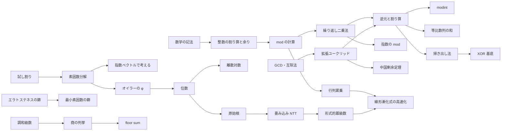

# 06 数学（整数論・代数）調査レポート

担当：06 math-nt。調査日 2026-10-21。項目一覧の機械可読版は [06-math-nt.topics.yaml](06-math-nt.topics.yaml)。

- 問題ID・タイトル・difficulty はすべて `python3 tools/ap.py show` で確認した（2026-10-21 のキャッシュ）。
- 問題の内容の裏付けは第三者の解説記事・作問者の GitHub の解答コード・AtCoder Tags などで取り、URL を §5 に残した。裏付けが取れていないものは「未確認」と明記した。atcoder.jp とそのサブドメインのページは開いていない。
- 計算量・定理・数値は一次資料（ACL のソースとドキュメント、cp-algorithms、OEIS）と、自分で書いた検算スクリプトで確かめた（§6.3）。
- 調査中に Web 検索の回数上限（セッション全体で共有）に何度も達したため、検索に頼らず URL を直接たどれる資料（drken のブログのカテゴリページ、Kazun のブログ、AtCoder Tags、GitHub）を多く使った。未確認の問題は §7.5 にまとめた。
- 裏付けの取り方は2通りある。(1) WebFetch で開いて読んだもの（drken のブログのカテゴリページと Qiita、Kazun、kmjp の ABC291G・333G、miscalc、USACO Guide、cp-algorithms、OI Wiki、Nyaan の解説一覧、AtCoder Tags、GitHub の解答コード、OEIS）。(2) Web 検索の結果の要約で内容を確かめたもの（ABC137F・193E・196F・199F・228E・239B・286F・366G・368F・392G・400C・412E・436G・443G の個別記事）。(2) のサイトは本文を開いていないので、AI 利用の方針を個別には確かめていない。noai 指定のある atcoder.jp と codeforces.com は開いておらず、資料にも使っていない

---

## 1. 調べた資料

### 1.1 日本語

| 資料 | URL | 何の参考にしたか |
| --- | --- | --- |
| drken「AtCoder 版！マスター・オブ・整数（素因数分解編）」 | https://qiita.com/drken/items/a14e9af0ca2d857dad23 | 試し割り・約数列挙・素因数分解の計算量と、500 点以下の整数問題の分類（素数判定／約数列挙／素因数を分け合う／約数の構造／p で何回割れるか） |
| drken「AtCoder 版！マスター・オブ・整数（最大公約数編）」 | https://qiita.com/drken/items/0c88a37eec520f82b788 | 互除法の原理（a ≡ b (mod m) なら gcd(a,m)=gcd(b,m)）、互いに素の7つの性質、ベズー、指数ベクトルで gcd=min・lcm=max、「互除法っぽい操作」の分類 |
| drken「エラトステネスの篩の活用法を総特集！」 | https://qiita.com/drken/items/3beb679e54266f20ab63 | 篩が O(N log log N) になる理由（素数の逆数和）、最小素因数による高速素因数分解（前処理 O(N log log N)、1 個 O(log N)）、約数系のゼータ／メビウス変換、線形篩への言及 |
| drken「「998244353 で割ったあまり」の求め方を総特集！ 〜 逆元から離散対数まで 〜」 | https://qiita.com/drken/items/3b4fdf0a78e7a138cd9a | mod の四則、C++ の `%` が負を返す問題、逆元の2つの求め方の比較と「逆元が存在する条件」の2つの誤解、BSGS、平方剰余、modint、998244353 を使う理由 |
| drken「中国剰余定理 (CRT) の解説と、それを用いる問題のまとめ」 | https://qiita.com/drken/items/ae02240cd1f8edfc86fd | CRT の構成法、法が互いに素でないときの解の存在条件（b1 ≡ b2 mod gcd）、Garner の O(K²) |
| drken「拡張ユークリッドの互除法 〜 一次不定方程式 ax + by = c の解き方 〜」 | https://qiita.com/drken/items/b97ff231e43bce50199a | 解の存在条件 gcd(a,b) \| c、一般解、ラメの定理 |
| drken「フェルマーの小定理の証明と使い方」 | https://qiita.com/drken/items/6b4031ccbb2cab7436f3 | 証明の筋道（a, 2a, …, (p−1)a が 1..p−1 の並べ替え）、逆元・位数・原始根・NTT へのつながり |
| drken「Gauss-Jordan の掃き出し法と、連立一次方程式の解き方」 | https://drken1215.hatenablog.com/entry/2019/03/20/202800 | 掃き出し法と解の個数（F2 を含む） |
| drken「ミラー・ラビンの素数判定法」 | https://drken1215.hatenablog.com/entry/2023/05/23/233000 | Miller–Rabin の背景（フェルマーの小定理）、Library Checker での検証（https://drken1215.hatenablog.com/entry/2023/05/24/003724 ではモンゴメリ乗算も） |
| drken「「Polynomial Taylor Shift」に学ぶ畳み込み芸」 | https://drken1215.hatenablog.com/entry/2023/09/08/003100 | Σ の入れ替えで畳み込みの形にする式変形の典型 |
| drken のブログ「けんちょんの競プロ精進記録」のカテゴリページ | 例：https://drken1215.hatenablog.com/archive/category/中国剰余定理 （他に 原始根／位数の法則／行列累乗／Gauss-Jordanの掃き出し法／floor_sum／Fermatの小定理／ベズーの等式／拡張Euclidの互除法／特殊なmod／素数判定／Euler関数／調和級数／エラトステネスの篩／数量が小さいことの活用：約数の個数／FFT／高速畳み込み計算／FPS(形式的冪級数)の高等演算／Bostan-Mori法／整数値のconcatを考える問題／倍数判定や九去法／x以上の最小のNで割ってr余る整数を求める／各素因数ごとに考える／有理数／XOR（1〜2ページ）／ダブリング／素数／約数／最大公約数／行列／数学(整数問題)（1〜8ページ）／多項式・FPS（1〜2ページ）） | 問題ごとの裏付け（記事タイトルに問題名と色、抜粋とタグに手法）。カテゴリ名そのものが「手法の分類」として目次づくりの参考になる（例：「整数を 10 倍して a を足すで捉える」「K 以下の A の倍数の個数」「操作が Euclid の互除法に対応」） |
| noshi91「modint 構造体を使ってみませんか？ (C++)」 | https://noshi91.hatenablog.com/entry/2019/03/31/174006 | modint の利点と注意（割り算は法が素数前提、テンプレート引数で法を固定すると速い） |
| miscalc「XOR の基底 事実・できることまとめ」 | https://miscalc.hatenablog.com/entry/2024/03/21/235130 | XOR 基底でできること（種類数 2^r、作り方の数 2^(n−r)、k 番目、v 以下の最大、奇数個／偶数個）と問題一覧 |
| ryuhe1「線形漸化的数列のN項目の計算」 | https://qiita.com/ryuhe1/items/da5acbcce4ac1911f47a | Bostan–Mori と Fiduccia の比較（約 2M(d)log N 対 3M(d)log N） |
| Nyaan「解説一覧」 | https://nyaannyaan.github.io/docs/problems/editorials/ | ABC の Ex/G で使われた高度な手法（ラグランジュ補間・分割統治 FFT・Bostan–Mori・乗法的関数の prefix sum・FPS の逆元・ニュートン法など）と問題の対応 |
| Kazun の競プロ記録 | https://kazun-kyopro.hatenablog.com/ （例：/entry/ABC/228/E） | 問題ごとの裏付け（ABC222G・270G・293E・236F・254F・230E・227G・243G は記事を開いて確認、ABC228E・286F は検索結果の要約で確認）。URL は `/entry/ABC/<回>/<記号>` の形 |
| E869120/kyopro_educational_90（典型90問の作問者のリポジトリ） | https://github.com/E869120/kyopro_educational_90 | `sol/` の解答コードで典型90問の手法を確認（005・020・022・025・030・038・046・052・057・065・067・069・075・082・085） |
| E869120/math-algorithm-book（『アルゴリズム×数学』の補足資料） | https://github.com/E869120/math-algorithm-book | 節末問題の解答コード（4.6 節：繰り返し二乗法と割り算、4.7 節：行列累乗）。演習問題集（math_and_algorithm_*）との対応の確認 |
| AtCoder Tags | https://atcoder-tags.herokuapp.com/tags/Mathematics/Number ほか（Mathematics/Matrix・Mathematics/XOR・Dynamic-Programming/Matrix-Power） | 利用者の投票による手法タグと difficulty の一覧。行列累乗・行列・XOR・整数の問題の洗い出し |
| 個別の解説記事 | §5 の表に URL を記載 | はまやん（ABC199F）、kmjp（ABC196F・291G・333G・366G・137F）、nullkara（ABC196F・193E）、flkanjin（ABC193E）、merom686（ABC392G）、kyo-pro（ABC228E）、inamori・gotoki_no_joe（ABC412E）、yuulis・torus711（ABC400C）、programming-hiroba・hyouri（ABC368F）、nagi0724・fjnkt98（ABC239B）、syamashi（ABC286F）、rsk0315（ABC137F）、rui_er（cnblogs、ABC436G）、HackMD（ABC443G、中国語）。kmjp のブログは日付のアーカイブ（例：https://kmjp.hatenablog.jp/archive/2023/02/26 ）から ABC の記事をたどれる |
| AC Library ドキュメントとソース | `~/lib/ac-library-master/document_ja/`（math.md・modint.md・convolution.md・appendix.md）、`atcoder/math.hpp`・`internal_math.hpp`・`modint.hpp`・`convolution.hpp` | API・制約・計算量（§6.5）。ソースで内部実装（Barrett 還元、素数判定の底 {2,7,61}、原始根の求め方、floor_sum の再帰、convolution_ll の 3 素数）を確認 |

### 1.2 英語・中国語

| 資料 | URL | 何の参考にしたか |
| --- | --- | --- |
| cp-algorithms（Algebra / Linear Algebra の目次） | https://cp-algorithms.com/navigation.html | 項目の網羅性の確認（Fundamentals／Prime numbers／Number-theoretic functions／Modular arithmetic／Number systems／Miscellaneous／Matrices） |
| cp-algorithms: Primality tests | https://cp-algorithms.com/algebra/primality_tests.html | Miller–Rabin の決定的な底（64bit：2, 325, 9375, 28178, 450775, 9780504, 1795265022、または最初の 12 素数）、Carmichael 数 |
| cp-algorithms: Integer factorization | https://cp-algorithms.com/algebra/factorization.html | Pollard's rho の期待計算量 O(n^{1/4})（誕生日のパラドックス）、Brent の改良と gcd のまとめ取り、先に素数判定をすべきこと |
| cp-algorithms: Discrete Log | https://cp-algorithms.com/algebra/discrete-log.html | BSGS の計算量（ハッシュで O(√m)）、gcd(a,m)≠1 の場合の処理、最小解の取り方 |
| cp-algorithms: Primitive Root | https://cp-algorithms.com/algebra/primitive-root.html | 存在条件（1, 2, 4, p^k, 2p^k）、個数 φ(φ(n))、判定法（φ(n)/p 乗が 1 でない） |
| cp-algorithms: Euler's totient function | https://cp-algorithms.com/algebra/phi-function.html | Σ_{d\|n} φ(d) = n、篩で φ を全部求める、一般化オイラーの定理（n ≥ log2 m で x^n ≡ x^{φ(m)+(n mod φ(m))}） |
| cp-algorithms: Sieve of Eratosthenes / Linear Sieve | https://cp-algorithms.com/algebra/sieve-of-eratosthenes.html ・ https://cp-algorithms.com/algebra/prime-sieve-linear.html | 計算量の根拠、区間篩の計算量 O((R−L+1) log log R + √R log log √R)、線形篩は lp[] を持つ代わりにメモリが約 32 倍（10^7 程度まで推奨） |
| cp-algorithms: Gauss & System of Linear Equations | https://cp-algorithms.com/linear_algebra/linear-system-gauss.html | O(min(n,m)·n·m)、解なし／一意／無数の判定、部分ピボット選択と EPS、mod 2 は bitset で約 32 倍速 |
| cp-algorithms: Lattice points（floor sum の幾何的説明） | https://cp-algorithms.com/geometry/lattice-points.html | 直線の下の格子点の数え上げと再帰（傾きを 1 未満にして軸を入れ替える） |
| cp-algorithms: FFT | https://cp-algorithms.com/algebra/fft.html | NTT の条件（c·2^k+1 型の素数で長さ 2^k まで）、任意 mod（複数素数＋CRT、または係数を √M で分割）、応用（全ての和の組・ワイルドカード付き文字列照合） |
| USACO Guide（Gold: Divisibility・Modular Arithmetic、Platinum: Matrix Exponentiation、Advanced: Extended Euclidean Algorithm・XOR Basis・FFT・Prefix Sums of Number-Theoretic Functions） | https://usaco.guide/gold/divisibility ・ https://usaco.guide/gold/modular ・ https://usaco.guide/plat/matrix-expo ・ https://usaco.guide/adv/extend-euclid ・ https://usaco.guide/adv/xor-basis ・ https://usaco.guide/adv/fft ・ https://usaco.guide/adv/prefix-sums-nt-1 | 英語圏のカリキュラムでの段階の目安（約数・mod は Gold、行列累乗は Platinum、拡張ユークリッド・XOR 基底・FFT・乗法的関数の和は Advanced）。掲載されている AtCoder の問題（abc420_g・abc340_f・abc141_f・agc045_a） |
| OI Wiki 数学（数论／多项式与生成函数／线性代数） | https://oi-wiki.org/math/ | 網羅性の確認。数論分块（商の列挙）、类欧几里得（floor sum）、升幂引理、阶乘取模、二次剩余、阶&原根、离散对数、高次剩余、狄利克雷卷积、杜教筛、Min_25 筛、素数计数、连分数、Stern–Brocot、Pell、FWT、Chirp Z、多項式の初等関数、常系数齐次线性递推、线性基 など |
| Library Checker（問題一覧） | https://judge.yosupo.jp/ （一覧は https://github.com/yosupo06/library-checker-problems の number_theory・polynomial・linear_algebra・convolution・other・enumerative_combinatorics） | 自作ライブラリの動作確認の対応表（§6.6） |
| OEIS A006880・A002386・A005250 | https://oeis.org/A006880 ・ https://oeis.org/A002386 ・ https://oeis.org/A005250 | π(10^n) の値、最大素数ギャップ（10^9 未満は 282、10^18 未満は 1442） |

---

## 2. 分野の全体像

### 2.1 サブ分野

この分野は、学習者から見て次の6つのかたまりに分かれる。

1. **数学の言葉**：合同式・整除の記号・floor/ceil・Σ の変形・証明の筋道。ほかの全ページの「読むための道具」
2. **整数の基本と mod**：割り算と余り（負の数）→ mod の四則 → 繰り返し二乗法 → 逆元と割り算 → modint。その応用として、指数の mod（フェルマー／オイラー）、等比数列の和、桁と mod（連結・倍数判定）
3. **素数・約数**：試し割り（素数判定・約数列挙・素因数分解、O(√N)）→ 篩（エラトステネス・最小素因数・区間篩）→ 調和級数の計算量 → 指数ベクトルで考える（gcd=min／lcm=max／平方数／ルジャンドル）→ オイラーの φ・乗法的関数 →（発展）Miller–Rabin・Pollard's rho・素数計数
4. **GCD と合同式**：互除法 → gcd の性質（差の gcd・累積 gcd）→ 拡張ユークリッド（ベズー・一次不定方程式・一次合同式）→ CRT →（黄）位数・離散対数・原始根 →（発展）平方剰余
5. **floor と有理数**：商の列挙（floor(N/i) は O(√N) 種類）→ floor sum（ACL）→（発展）Stern–Brocot・連分数。整数の平方根と N 進法もここに近い（「整数として正確に計算する」技術）
6. **代数（線形代数と多項式）**：行列累乗 → 半環上の行列 → 線形漸化式の高速化（きたまさ・Bostan–Mori）／掃き出し法 → XOR 基底（F2）／畳み込み（NTT）→ 任意 mod・XOR 畳み込み・オンライン畳み込み → 形式的冪級数・ラグランジュ補間

### 2.2 前提関係（主なもの）

- 逆元は「フェルマー（繰り返し二乗法）」と「拡張ユークリッド」の2本の矢印を持つ。素数 mod しか扱わないなら前者だけで足りるが、非素数 mod（ABC186 E）や CRT のためには後者が要る
- 原始根 → NTT の矢印は「NTT の正しさの背景」であって、ACL を使うだけなら不要。ページの前提には入れず、「なぜ 998244353 か」の説明で参照するのがよい
- 位数・離散対数・原始根は「φ(m) の約数を調べる」という同じ道具で解けることが多い（ABC222 G・ABC335 G）。3つを1つの章にまとめると見通しがよい

### 2.3 混同されやすいもの

| 混同 | 違い |
| --- | --- |
| 指数の mod（a^(K^N) mod p） | 指数は p ではなく **p−1** で割る（フェルマー）。底が p の倍数なら別扱い（ABC228 E） |
| 逆元が存在する条件 | 「法が素数なら必ず存在」は誤り（a ≡ 0 は不可）。「法が素数でないと存在しない」も誤り（互いに素なら存在） |
| C++ の `%` と数学の mod | `-17 % 5 == -2`。数学の mod は 0 以上。`/` もゼロ方向への切り捨てで、負の数の floor とは違う |
| modint の比較 | mod を取った後の値なので、大小比較や「0 になったかどうか」で元の値の情報は分からない |
| 約数の個数 d(n) と素因数の種類数 ω(n) | 10^18 以下で d(n) ≤ 103680、ω(n) ≤ 15。どちらを数えれば計算量が抑えられるかが違う |
| エラトステネスの篩と調和級数 | 素数の倍数だけを消すと O(N log log N)、全ての i の倍数を回すと O(N log N)（それでも多くの場合は十分速い） |
| 商の列挙と floor sum | 前者は Σ f(⌊N/i⌋) を O(√N) で、後者は Σ ⌊(ai+b)/m⌋ を O(log m) で。対象の式の形が違う |
| 拡張ユークリッドと CRT | CRT は拡張ユークリッドの応用。2式の CRT は一次不定方程式を1回解くことと同じ |
| 位数・原始根・離散対数 | 位数は「a^k ≡ 1 の最小の k」、原始根は「位数が φ(m) の元」、離散対数は「a^x ≡ b の x」 |
| XOR 基底と掃き出し法 | XOR 基底は F2（係数が 0/1）上の掃き出しを整数の bit で行う特別版。mod p の掃き出しは割り算（逆元）が要る |
| 行列累乗ときたまさ法・Bostan–Mori | どれも「線形漸化式の第 N 項」だが、行列累乗は O(K³ log N)、Bostan–Mori は O(K log K log N) |
| FFT と NTT | FFT は複素数（誤差あり、整数の積に使える）、NTT は mod 998244353 などの素数上（誤差なし、mod の値しか出ない） |
| 半環上の行列累乗とダブリング（01 担当） | ダブリングは「関数の合成」を2冪で前計算する一般論。行列累乗はその一種で、行列の積が合成にあたる |

---

## 3. 項目一覧

レベルは「その手法を知らないと解けない問題がまとまって現れ始める diff 帯」。詳細と根拠は §4・§5、機械可読版は topics.yaml。ページの列の「節」は「他ページの節にする」、「概要」は発展の概要ページ。

| key | 項目名 | レベル | 根拠の問題（diff） | 前提 | ACL | ページ |
| --- | --- | --- | --- | --- | --- | --- |
| math-notation | 数学の記法（合同式・整除・floor/ceil・Σ/Π） | 基礎 | abc133_c (592)、abc165_d (600) | — | — | 単独（数学の言葉） |
| sigma-manipulation | Σ の変形（入れ替え・分解・添字の付け替え） | 基礎 | abc230_e (969)、abc356_e (1506) | math-notation | — | 単独（数学の言葉） |
| proof-patterns | 整数の証明の筋道（不変量・互除法・背理法・鳩の巣） | 基礎 | abc118_c (646)、agc018_a (947) | math-notation | — | 単独（数学の言葉） |
| integer-division | 整数の割り算と余り（負の数・切り上げ・区間の倍数の個数） | 基礎 | abc239_b (57)、abc048_b (861)、abc084_c (908) | math-notation | — | 単独 |
| overflow-check | 大きな整数の扱い（積・累乗の上限判定、__int128） | 基礎 | typical90_al、typical90_t | integer-division | — | 節（integer-division、09 と分担） |
| mod-arithmetic | mod の計算の基本（四則・負の数・998244353） | 基礎 | abc266_b (95)、abc275_b (147)、arc111_a (1146) | integer-division | modint | 単独 |
| mod-pow | 繰り返し二乗法 | 基礎 | typical90_bq、abc228_e (1579) | mod-arithmetic | pow_mod / modint::pow | 単独 |
| mod-inverse | 逆元と割り算（フェルマー・拡張ユークリッド・逆元表） | 基礎 | typical90_cd、math_and_algorithm_as、abc357_d (970)、abc186_e (1461) | mod-pow, ext-gcd | inv_mod / modint::inv | 単独 |
| modint | modint（ACL の使い方と自作の設計） | 基礎 | abc357_d (970)、abc281_g (2304) | mod-inverse | static_modint / dynamic_modint | 単独 |
| exponent-mod | 指数の mod（フェルマー・オイラーの定理） | 水 | abc228_e (1579)、abc222_g (2242) | mod-pow, mod-inverse | pow_mod | 単独 |
| geometric-series-mod | 等比数列の和を mod で（逆元・ダブリング・行列） | 水 | abc357_d (970)、abc293_e (1453)、abc129_f (2621) | mod-inverse | — | 単独 |
| digit-and-mod | 桁と mod（倍数判定・数の連結・接尾辞の余り） | 水 | abc164_d (1232)、abc158_e (1866) | mod-arithmetic | — | 単独 |
| primality-trial | 素数判定（試し割り） | 基礎 | abc149_c (172)、arc017_1 (234) | integer-division | — | 節（divisor-enum と1ページ） |
| divisor-enum | 約数列挙と約数の個数・総和 | 基礎 | abc112_d (1025)、abc161_f (1528) | primality-trial | — | 単独 |
| prime-factorization | 素因数分解（試し割り） | 基礎 | arc067_a (967)、abc114_d (1337)、abc110_d (1695) | primality-trial | — | 単独 |
| divisor-count-bound | 約数の個数・素因数の種類数の上界 | 水 | arc167_b (1292)、acl1_b (1785) | divisor-enum | — | 節（divisor-enum）＋早見表 |
| sieve-eratosthenes | エラトステネスの篩 | 基礎 | abc250_d (797)、abc084_d (980) | primality-trial | — | 単独 |
| spf-sieve | 最小素因数の篩（osa_k 法）と高速素因数分解 | 基礎 | abc177_e (1057)、abc368_f (1180) | sieve-eratosthenes, prime-factorization | — | 単独 |
| linear-sieve | 線形篩と乗法的関数の表 | 青 | （必須の問題なし。φ・μ の表を作る場面） | spf-sieve | — | 節（spf-sieve） |
| segmented-sieve | 区間篩 | 水 | abc412_e (1496)、abc227_g (2207) | sieve-eratosthenes | — | 単独 |
| harmonic-sum | 調和級数の計算量（倍数の列挙） | 基礎 | abc134_d (926)、abc170_d (1033)、abc356_e (1506) | sigma-manipulation | — | 単独 |
| legendre-formula | ルジャンドルの公式（n! の素因数の指数） | 基礎 | abc148_e (818)、abc280_d (880) | prime-factorization | — | 節（prime-exponent-vector） |
| prime-exponent-vector | 素因数の指数で考える（gcd/lcm・平方数・べき乗因子） | 水 | abc254_d (1191)、abc152_e (1348)、abc150_d (1534) | prime-factorization | — | 単独 |
| euler-phi | オイラーの φ 関数 | 黄 | abc212_g (2150)、abc222_g (2242) | prime-factorization | — | 単独 |
| multiplicative-function | 乗法的関数・ディリクレ積・その和 | 発展 | abc370_g (3428) | euler-phi, floor-quotient-enum | — | 概要 |
| prime-counting | 素数の個数の数え上げ（Lucy DP など） | 発展 | （ABC での出題は未確認） | floor-quotient-enum | — | 節（multiplicative-function の概要） |
| miller-rabin | Miller–Rabin 素数判定 | 発展 | （ABC での必須例は未確認） | mod-pow, exponent-mod | 内部のみ（32bit） | 概要 |
| pollard-rho | Pollard's rho 素因数分解 | 発展 | （ABC での必須例は未確認） | miller-rabin, gcd-lcm | — | 概要（miller-rabin と1ページ） |
| big-modulus-mul | 64bit の mod での掛け算（__int128・Montgomery） | 発展 | — | mod-arithmetic | — | 節（miller-rabin） |
| gcd-lcm | GCD・LCM とユークリッドの互除法 | 基礎 | abc109_c (542)、abc118_c (646)、abc070_c (697) | integer-division | — | 単独 |
| gcd-properties | GCD の性質（差の gcd・累積 gcd・変化回数 O(log)） | 青 | abc210_e (1618)、agc026_b (1720)、abc254_f (1764) | gcd-lcm | — | 単独 |
| rational-normalization | 分数・傾きを既約にして扱う | 水 | abc248_e (1292) | gcd-lcm | — | 節（gcd-lcm、08 と分担） |
| ext-gcd | 拡張ユークリッドの互除法と一次不定方程式 | 水 | abc186_e (1461)、abc340_f (1516) | gcd-lcm | inv_mod（内部で使用） | 単独 |
| linear-congruence | 一次合同方程式 ax ≡ b (mod m) | 水 | abc186_e (1461) | ext-gcd | — | 節（ext-gcd） |
| crt | 中国剰余定理 | 青 | acl1_b (1785)、abc286_f (1841)、abc193_e (1948) | ext-gcd | crt | 単独 |
| multiplicative-order | 位数（a^k ≡ 1 の最小の k）と周期 | 黄 | abc222_g (2242)、arc042_d (2247)、abc335_g (2614) | euler-phi, divisor-enum, mod-pow | — | 単独（位数・離散対数・原始根で1章） |
| discrete-log | 離散対数（Baby-step Giant-step） | 黄 | abc270_g (2220)、arc042_d (2247) | multiplicative-order | — | 単独 |
| primitive-root | 原始根 | 黄 | abc212_g (2150)、agc047_c (2496) | multiplicative-order | 内部のみ | 単独 |
| mod-sqrt | 平方剰余・mod の k 乗根 | 発展 | （ABC での出題は未確認） | primitive-root | — | 概要 |
| floor-quotient-enum | 商の列挙（floor(N/i) の値は O(√N) 種類） | 水 | abc230_e (969)、arc160_b (1275)、arc060_b (2261) | harmonic-sum | — | 単独 |
| floor-sum | floor sum（Σ⌊(ai+b)/m⌋）と Mod of Linear 系 | 黄 | abc443_g (2268)、abc313_g (2454)、abc283_h (2682) | floor-quotient-enum, gcd-lcm | floor_sum | 単独 |
| stern-brocot | Stern–Brocot 木・連分数・最良有理近似 | 発展 | abc333_g (2536) | gcd-lcm, rational-normalization | — | 概要 |
| integer-root | 整数の平方根・k 乗根と累乗数 | 基礎 | abc193_c (379)、abc400_c (702)、abc361_f (1606) | integer-division | — | 単独 |
| base-conversion | N 進法（負の基数・26 進・基数の二分探索） | 基礎 | abc171_c (560)、abc105_c (1204)、abc192_d (1425) | integer-division | — | 単独 |
| matrix-power | 行列累乗 | 黄 | abc199_f (2065)、abc204_f (2044)、abc256_g (2250) | mod-arithmetic | — | 単独 |
| semiring-matrix | 半環上の行列積（min-plus・max-min・AND/XOR） | 黄 | abc009_4 (2213)、abc236_g (2438) | matrix-power | — | 節（matrix-power） |
| linear-recurrence-fast | 線形漸化式の高速化（きたまさ法・Bostan–Mori・Berlekamp–Massey） | 発展 | abc436_g (2164)、abc300_h (3209) | matrix-power, fps-basics | — | 概要 |
| gaussian-elimination | 掃き出し法（連立一次方程式・ランク・解の個数） | 黄 | abc313_d (1630)、typical90_be、abc366_g (2409) | mod-inverse | — | 単独 |
| xor-basis | XOR 基底（F2 上の線形代数） | 黄 | abc236_f (1943)、agc045_a (2070)、abc283_g (2173)、abc141_f (2342) | gaussian-elimination | — | 単独 |
| determinant | 行列式・行列木定理 | 発展 | abc253_h (2758) | gaussian-elimination | — | 概要（03 と分担） |
| convolution-ntt | 畳み込み（FFT・NTT） | 黄 | abc392_g (1817)、abc291_g (2176)、abc196_f (2274) | mod-arithmetic | convolution | 単独 |
| arbitrary-mod-convolution | 任意 mod・整数の畳み込み（3 素数＋Garner） | 発展 | （ABC での必須例は未確認） | convolution-ntt, crt | convolution_ll | 節（convolution-ntt） |
| hadamard-transform | XOR 畳み込み（アダマール変換） | 発展 | abc212_h (2741)、abc265_h (3319) | convolution-ntt | — | 概要 |
| online-convolution | 分割統治 FFT・オンライン畳み込み | 発展 | abc352_g (2413)、abc213_h (2806)、abc357_g (3159) | convolution-ntt | — | 概要 |
| fps-basics | 形式的冪級数（inv・log・exp・pow、母関数） | 発展 | abc321_f (1645)、abc303_h (2501)、abc345_g (3343) | convolution-ntt | — | 概要（複数節） |
| lagrange-interpolation | ラグランジュ補間とべき乗和 | 発展 | abc137_f (2402)、abc208_f (2772) | mod-inverse | — | 概要 |
| polynomial-ops | 多項式の除算・Taylor shift・多点評価 | 発展 | abc245_d (815)、abc215_g (2276) | convolution-ntt | — | 節（fps-basics の概要） |

---

## 4. 項目ごとのメモ

各項目は「何ができるか・なぜ正しいか」「つまずき」「図・動く図」「確認問題」「問題のサイン」「使い分け」の順に書く。問題IDの詳細は §5。

### 4.1 数学の言葉

#### math-notation 数学の記法（合同式・整除・floor/ceil・Σ/Π）

- **できること**：解説記事の式を読むための約束をまとめる。`a ≡ b (mod m)` は「m | (a−b)」の言い換えで、足し算・引き算・掛け算は両辺に同じ操作をしてよいが、割り算は「割る数と m が互いに素」のときだけよい（逆元が必要）。`a | b`（a は b を割り切る）、`⌊x⌋`・`⌈x⌉`、`Σ`・`Π`、`gcd`・`lcm`、`v_p(n)`（n が p で何回割れるか）を1か所で定義する
- **なぜ**：解説の多くは「余りが等しい」を合同式で書き、変形の正しさを合同式の性質で説明する。記号を知らないと、式は読めても変形の根拠がたどれない
- **つまずき**：`mod` を「演算子（C++ の %）」と「同値関係（合同式の (mod m)）」の両方の意味で使うこと。合同式の両辺を割ってはいけない場面（6x ≡ 6y (mod 4) から x ≡ y は言えない）
- **図**：数直線を m ごとに折り返して円にする（余りの世界＝時計）。合同な数が同じ位置に重なる
- **確認問題**：「2x ≡ 4 (mod 6) の解は x ≡ 2 (mod 6) だけか？」（x ≡ 2 (mod 3)、つまり mod 6 では 2 と 5）
- **サイン**：解説に `≡`、`|`、`⌊ ⌋` が出てきて読めないとき
- **ページの位置づけ**：数学ページ群の入口。「この教材の記法」も兼ねる（記法の統一に使う）

#### sigma-manipulation Σ の変形

- **できること**：Σ の入れ替え（二重和の順序交換）、Σ の分解（線形性）、添字の付け替え（i → N−i、d = gcd）、「i を固定して数える」を「値 v を固定して数える」に変える（主客転倒の式としての姿）
- **なぜ**：Σ_{i=1}^{N} ⌊N/i⌋ を「各 j が何回数えられるか」で見ると Σ_j d(j)（約数の個数の和）になる、のように、同じ量を別の順で数えると計算量が変わる
- **つまずき**：入れ替えたときの添字の範囲（i ≤ j ≤ N を j を外側にすると 1 ≤ i ≤ j）。空の和は 0、空の積は 1
- **図**：二重和を格子点の表にして、行ごとに足す／列ごとに足すを切り替える動く図
- **確認問題**：「Σ_{i=1}^{N} Σ_{j=i}^{N} f(i, j) の順序を入れ替えると？」
- **サイン**：「全ての組について〜の総和」「Σ_{i=1}^{N} ⌊N/i⌋」
- **境界**：考え方としての「寄与・主客転倒」は 01 担当。06 は式の操作の規則を受け持つ（§7.4）

#### proof-patterns 整数の証明の筋道

- **できること**：整数問題の正しさを確かめる定番の筋道を集める。(1) 不変量（操作で gcd が変わらない：ABC118 C、AGC018 A）、(2) 「互いに割り切り合う」ことで等号を示す（互除法の正しさ）、(3) 並べ替え論法（a, 2a, …, (p−1)a が余りの並べ替え → フェルマーの小定理・逆元の存在）、(4) 鳩の巣（余りは m 種類しかないので m+1 個のうち2つは等しい → 周期性・倍数の存在）、(5) 偶奇・mod での矛盾（解が存在しないことの証明）
- **なぜ**：AtCoder の整数問題は「規則を見つける → なぜ正しいかを確かめる」の繰り返しで、確かめ方の型を知っていると実験結果を信じてよいか判断できる
- **つまずき**：小さい例で成り立つ規則をそのまま提出して WA。必要条件しか示していない
- **確認問題**：「1, 11, 111, … の中に、2 でも 5 でも割り切れない任意の m の倍数があるのはなぜか？」（鳩の巣）
- **ページの位置づけ**：数学ページ群の「読み方」。01 の「考察系（不変量・偶奇）」とリンクし、重複は避ける

### 4.2 整数の基本と mod

#### integer-division 整数の割り算と余り

- **できること**：q = ⌊a/b⌋、r = a − bq（0 ≤ r < b）を負の数でも正しく求める。切り上げ ⌈a/b⌉ = ⌊(a+b−1)/b⌋（b>0, a≥0 のとき）。区間 [L, R] にある K の倍数の個数 ⌊R/K⌋ − ⌊(L−1)/K⌋。「x 以上で、m で割って r 余る最小の数」
- **なぜ**：C++ の `/` は 0 方向への切り捨てで、`%` は被除数と同じ符号になる（-7/2 = -3、-7%2 = -1）。数学の floor は -4。負の数の floor は「q を求めてから、余りが負なら q を 1 減らす」で直す
- **つまずき**：`(a+b-1)/b` を負の a に使う。`L=0` のときの `(L-1)/K`。double で割って floor を取る（10^18 で誤差）
- **図**：数直線上に b ごとの目盛りを打ち、a が入る区間の左端が floor、右端が ceil
- **確認問題**：「-7 を 3 で割った商と余りは（数学の定義で）？」「[0, 10] にある 3 の倍数の個数を式で」
- **サイン**：入力に負の数がある割り算、「切り上げ」「x 以上の最小の」「周期的に発車する」
- **使い分け**：余りだけ欲しいなら safe_mod（((a % m) + m) % m）。商も欲しいなら floor_div を用意する

#### overflow-check 大きな整数の扱い（integer-division の節）

- **できること**：a×b が上限 L を超えるかを、掛ける前に `a > L / b` で判定する（典型90 038）。累乗の大小を浮動小数でなく整数で比べる（典型90 020：A < C^B を整数で）。必要なら `__int128` で一時的に広げる
- **なぜ**：long long は約 9.2×10^18 まで。lcm(a,b) = a/gcd×b は割ってから掛ける。log による比較は等号付近で誤差が出る
- **つまずき**：`a*b/gcd` の順で計算してあふれる。`pow` や `sqrt` を double で計算して 1 ずれる
- **境界**：`__int128` の入出力や多倍長の書き方は 09（C++）担当。06 は「どこであふれるか見積もる」と「割り算で比較する」を受け持つ

#### mod-arithmetic mod の計算の基本

- **できること**：足し算・引き算・掛け算は途中で何度余りを取ってもよい（合同式の性質）。負の数は m を足して 0 以上に直す。998244353 は素数で、2 つの余りの和は 32bit、積は 64bit に収まる
- **なぜ**：(a mod m) + (b mod m) ≡ a + b (mod m) が成り立つから、巨大な数を途中で小さくしてよい。割り算だけは成り立たない（4/2 ≡ 2 だが、(4 mod 3)/(2 mod 3) は 1/2 で整数でない）→ 逆元へ
- **つまずき**：引き算の結果が負のまま `%` を取る（ABC266 B）。掛け算の前に両方を mod に収めずにあふれる。最後にだけ mod を取る。「答えを mod で出力」の問題で、mod を取った値で大小比較や最大値を考える
- **なぜ 998244353 か**：素数で、998244353 − 1 = 2^23 × 7 × 17 なので長さ 2^23 までの NTT ができる（§6.3）。10^9+7 − 1 = 2 × 500000003 で NTT には向かない
- **図**：時計（余りの輪）の上で足し算・掛け算をする
- **確認問題**：「(a − b) mod m を C++ で正しく求めるには？」「なぜ最大値を求める問題で途中に mod を取ってはいけないのか？」
- **サイン**：「答えを 998244353 で割った余りを出力」「10^9+7」

#### mod-pow 繰り返し二乗法

- **できること**：a^n mod m を O(log n) で求める。n を 2 進展開し、a, a², a⁴, … を順に作って必要なものを掛ける
- **なぜ**：a^(2k) = (a^k)²、a^(2k+1) = a·(a^k)²。n の bit 数だけ掛け算すればよい。行列・多項式・関数の合成など「結合法則を満たす積」なら同じ方法が使える（→ matrix-power、ダブリング）
- **つまずき**：指数 n を mod してしまう（指数は p−1 で割る → exponent-mod）。0^0 の扱い。int の掛け算であふれる
- **図**：n の 2 進表記の各 bit と、a^(2^k) の列を並べて、1 の bit の項だけを掛けるステップ送り
- **確認問題**：「3^13 を計算するとき掛け算は何回か？」「行列にも使えるのはなぜか？」
- **サイン**：「N ≤ 10^18 回繰り返す」「a^N を mod で」
- **ACL**：`pow_mod(x, n, m)`、`modint::pow(n)`

#### mod-inverse 逆元と割り算

- **できること**：a·x ≡ 1 (mod m) となる x（逆元）を求め、割り算を掛け算に直す。方法は (1) フェルマー：m が素数なら a^(m−2)、(2) 拡張ユークリッド：gcd(a,m)=1 なら ax + my = 1 の x。1..N の逆元をまとめて O(N) で作る（inv[i] = −(m/i)·inv[m mod i]）、階乗の逆元を後ろから作る（07 の二項係数の前処理と共通）
- **なぜ**：互いに素なら a, 2a, …, (m−1)a の余りは全て異なり、どれかが 1 になる（並べ替え論法）
- **つまずき**：「素数 mod なら必ず割れる」と思い込み、割る数が m の倍数になる場合を見落とす（ABC228 E の底、等比級数の公比 r ≡ 1）。非素数 mod でフェルマーを使う
- **図**：mod 7 の掛け算表で、各行に 1 がちょうど1つあることを色付けする
- **確認問題**：「mod 10 で 3 の逆元は？ 4 の逆元は？」「(a/b) mod p を、b を mod p してから逆元を取ってよいのはなぜか？」
- **サイン**：「答えは有理数 P/Q になるので P×Q^(−1) mod 998244353 を出力」、平均・期待値・等比級数の和
- **ACL**：`inv_mod(x, m)`（gcd(x,m)=1 が条件）、`modint::inv()`、`/`
- **境界**：「有理数の mod 表現」の意味づけ（期待値を P/Q で答える理由）は 07 が主に扱い、06 は逆元の計算を受け持つ（§7.4）

#### modint modint

- **できること**：mod を自動で取る型。ACL の `modint998244353`・`modint1000000007`（static_modint）、法が入力で与えられるときの `modint`（dynamic_modint、`set_mod`）
- **ACL の仕様（ソースで確認）**：コンストラクタは負の整数を正しく正規化する。割り算は、static_modint で法が素数なら a^(m−2)、そうでなければ拡張ユークリッドを使い、gcd が 1 でないと assert で落ちる。dynamic_modint の既定の法は 998244353（`set_mod` を忘れても動いてしまう）、`set_mod` は 1 ≤ m ≤ 2×10^9+1000、Barrett 還元で高速化。`raw(x)` は mod を取らない（0 ≤ x < mod を自分で保証）
- **つまずき**：`val()` を取り出さずに出力しようとする。modint 同士の大小比較（定義されていない）。法が入力の問題で static_modint を使う（ABC281 G）。`set_mod` 前に modint を作ってしまう
- **自作するとき**：加減は条件分岐で mod を省く、乗算は 64bit、`pow`・`inv`、入出力、constexpr。noshi91 の記事の論点（テンプレート引数で法を固定すると速い）を参照
- **サイン**：mod 付きの数え上げ全般

#### exponent-mod 指数の mod（フェルマー・オイラーの定理）

- **できること**：a^(K^N) mod p のように指数が巨大なとき、gcd(a,p)=1 なら a^(p−1) ≡ 1 なので指数を p−1 で割った余りに直す（ABC228 E）。一般の m ではオイラーの定理 a^φ(m) ≡ 1。互いに素でない場合も n ≥ log2 m なら x^n ≡ x^(φ(m) + n mod φ(m))（cp-algorithms の一般化）
- **なぜ**：a^k の列は周期 p−1 で繰り返す（フェルマーの小定理）
- **つまずき**：指数を p で割る。底が p の倍数（答えは 0、ただし指数が 0 なら 1）。指数の計算で K^N mod (p−1) を求めるとき p−1 は合成数なので割り算はできない
- **図**：a^0, a^1, a^2, … を mod 7 の円の上でたどり、6 回で戻る様子
- **確認問題**：「3^(10^18) mod 7 は？」「M が 998244353 の倍数のとき M^(K^N) は？」
- **サイン**：「a^(b^c)」、指数にさらに指数、累乗の塔

#### geometric-series-mod 等比数列の和を mod で

- **できること**：S = 1 + r + … + r^(n−1) を mod m で。(1) m が素数で r ≢ 1：(r^n − 1)/(r − 1)、r ≡ 1 なら n。(2) m が素数でない・逆元がない：S(2k) = S(k)(1 + r^k)、S(k+1) = S(k) + r^k の分割（ABC293 E）、または 2×2 行列 [[r,1],[0,1]] の累乗
- **応用**：数 N を M 回連結した値 = N × (1 + 10^d + 10^(2d) + …)（ABC357 D）
- **つまずき**：m が素数でないのに逆元を使う（ABC293 E は M が任意）。r ≡ 1 (mod p) の場合分け漏れ
- **図**：S(2k) = S(k) + r^k S(k) を、長さ 2k の列を半分に折る図で
- **確認問題**：「M = 10 のとき (r^n − 1)/(r − 1) で計算できないのはなぜか？」
- **サイン**：「同じものを M 回繰り返して並べた数」「Σ A^i を M で割った余り」

#### digit-and-mod 桁と mod

- **できること**：10 進数の性質を mod で扱う。(1) 倍数判定：3・9 は桁和、4 は下 2 桁、8 は下 3 桁、11 は交互和（ABC182 C、ABC181 D）。(2) 数の連結：x の後ろに d 桁の y を付けると x·10^d + y（「10 倍して a を足す」）。(3) 部分文字列が P の倍数になる個数：接尾辞の値 mod P を数え、10 と P が互いに素なら「余りが等しい2つの接尾辞」の差が答えになる（ABC164 D）。P が 2 か 5 のときは末尾の桁だけで決まるので別扱い（ABC158 E）。(4) 余りを頂点にした最短路（ABC077 D、グラフ分野と境界）
- **なぜ**：(3) は区間 [l, r) の値 × 10^(N−r) = 接尾辞 l − 接尾辞 r で、10^(N−r) が P と互いに素なら割ってよいから
- **つまずき**：P=2,5 の場合分け漏れ。接尾辞ではなく接頭辞で考えて 10 の累乗の逆元が必要になる
- **図**：文字列の各位置に「接尾辞の余り」を書き、同じ余りの位置どうしを線で結ぶ
- **確認問題**：「ABC164 D の方法が 2019 では使えて 10 では使えないのはなぜか？」
- **サイン**：「部分文字列を整数とみて K の倍数」「数を何回も並べた数」「桁和」
- **境界**：累積和の余りで区間を数える一般形（Candy Distribution：abc105_d、AtCoder Tags の「整数」タグで確認）は 01 の累積和と共通

### 4.3 素数・約数

#### primality-trial / divisor-enum / prime-factorization 試し割り（素数判定・約数列挙・素因数分解）

- **できること**：N の約数 d と N/d は √N を境に対になるので、i = 1..⌊√N⌋ だけ調べれば素数判定・約数列挙・素因数分解が O(√N) でできる。約数の個数は Π(e_i + 1)、約数の総和は Π(1 + p + … + p^e)
- **なぜ**：N が合成数なら √N 以下の素因数を持つ。素因数分解では割れるだけ割るので、残った数が 1 より大きければそれは素数
- **つまずき**：`i*i <= N` を `i <= sqrt(N)`（double）で書いて誤差。i が int で i*i があふれる。平方数で約数 √N を二重に数える。約数をソートし忘れる
- **計算量の目安**：N ≤ 10^12 なら 10^6 回で余裕、N ≤ 10^18 は 10^9 回で厳しい（→ Pollard's rho、または問題の構造を使う）
- **図**：N の約数を d と N/d の組で上下に並べ、√N で折り返す図
- **確認問題**：「N = 36 の約数列挙で、二重に数えやすいのはどれか？」「約数の個数が奇数になる N の特徴は？」（平方数）
- **サイン**：「N ≤ 10^12 の約数」「a × b = N となる組」「約数の個数がちょうど k 個」（ABC106 B・ABC114 D）
- **応用の型**：答えの候補が N の約数に限られる（ABC112 D：和 M を N 個に分けたときの gcd の最大 → M の約数を全部試す）、商と余りが等しい数（diverta2019 D）、割るか引くかの操作（ABC161 F：N と N−1 の約数だけが候補）、積 K = a×b×c の組（典型90 085）

#### divisor-count-bound 約数の個数・素因数の種類数の上界（divisor-enum の節＋早見表）

- **できること**：「約数を全部試す」が間に合うかを見積もる。10^9 以下では約数は最大 1344 個、10^18 以下でも最大 103680 個。素因数の種類数は 10^9 以下で 9 個、10^18 以下で 15 個まで（§6.3 の表は自分で計算して確認した）
- **なぜ使えるか**：約数の組（d1, d2）を全部試しても 1344² ≈ 1.8×10^6 で済む（ACL Contest 1 B：2N = d1×d2 の分け方を全部試して CRT）
- **つまずき**：約数の個数を「√N 個くらい」と見積もって諦める。逆に「約数は少ない」と思って 10^18 の約数を素因数分解なしに列挙しようとする（列挙自体に O(√N) かかる）
- **サイン**：「N の約数ごとに〜」「d | N を満たす d を全て」

#### sieve-eratosthenes エラトステネスの篩

- **できること**：N 以下の素数を全て O(N log log N) で列挙する。区間クエリ（[l, r] の素数の個数）は累積和と組み合わせる（ABC084 D）
- **なぜ**：素数 p の倍数を消す回数は N/p、その和は N × Σ 1/p ≈ N log log N（メルテンスの定理）。p² から消せば十分（それより小さい倍数はより小さい素因数で消えている）
- **つまずき**：`i*i` のオーバーフロー。N = 10^8 で bool 配列（100MB）にしてメモリ超過（vector<bool> なら 12.5MB）
- **図**：1..100 の表で、2 の倍数・3 の倍数・5 の倍数・7 の倍数を順に塗るステップ送り。11 以降は塗る必要がないことを見せる
- **確認問題**：「なぜ √N までの素数で篩えば十分か？」「なぜ p² から消してよいのか？」
- **サイン**：「N ≤ 10^6〜10^7 の素数」「p q³ ≤ N を満たす素数の組」（ABC250 D）、「a² b c² ≤ N」（ABC300 D）
- **使い分け**：1 個だけ判定するなら試し割り、たくさんの数を判定・分解するなら篩

#### spf-sieve 最小素因数の篩（osa_k 法）と高速素因数分解

- **できること**：篩のついでに各数の最小素因数 spf[n] を記録すると、n を spf で割り続けるだけで O(log n) で素因数分解できる。N 個の数をまとめて分解するとき（ABC177 E：pairwise coprime の判定）に使う
- **なぜ**：割るたびに値が 2 以上で割られて半分以下になるので、割る回数は log2 n 以下
- **つまずき**：spf を int で 10^7 個持つと 40MB。素因数の重複（同じ素数を何度も数える）
- **図**：n=360 → 180 → 90 → 45 → 15 → 5 → 1 と spf をたどる鎖
- **確認問題**：「試し割りで 10^6 個の数を分解すると何回かかるか、spf ならどうか？」
- **サイン**：「A_i ≤ 10^6 の各要素を素因数分解」「全ての組が互いに素か」「素因数の個数（重複あり）で Grundy 数」（ABC368 F）

#### linear-sieve 線形篩と乗法的関数の表（spf-sieve の節）

- **できること**：各合成数を「最小素因数 × 残り」でちょうど1回だけ作ることで O(N)。同時に φ・μ・約数の個数などの乗法的関数の表を作れる
- **注意**：ABC で線形篩でなければ間に合わない問題は見当たらない。エラトステネスでも十分で、cp-algorithms も「メモリは約 32 倍、10^7 程度まで」としている。節として「こういう方法もある」程度に書けばよい

#### segmented-sieve 区間篩

- **できること**：L が大きくても R − L が小さい（10^6 程度）とき、√R までの素数で [L, R] を篩う。O((R−L) log log R + √R)
- **応用**：区間の各数の素因数分解（√R までの素数で割った残りが 1 より大きければ素数）。ABC227 G は C(N, K) の分子 N−K+1..N をこの方法で分解する（N ≤ 10^12、K ≤ 10^6）
- **つまずき**：L 以上の最初の p の倍数の求め方（⌈L/p⌉·p、ただし p 自身は素数として残す）。L = 1 の扱い
- **図**：[L, R] の窓に、小さい素数の倍数の印を等間隔に打つ
- **確認問題**：「√R までの素数で十分なのはなぜか？」
- **サイン**：「L ≤ 10^12、R − L ≤ 10^6」「区間の数の約数の個数」

#### harmonic-sum 調和級数の計算量（倍数の列挙）

- **できること**：「各 i について i の倍数を全部見る」二重ループは Σ N/i ≈ N ln N（N = 10^6 で約 1.4×10^7、§6.3）。値の範囲が小さい（A_i ≤ 10^6）ときに、約数・倍数の関係をまとめて処理できる
- **型**：ある値の倍数が配列に何個あるか（ABC170 D）、倍数の箱の和の偶奇を後ろから決める（ABC134 D）、A×B+C = N の数え上げ（ABC179 C）、max/min の floor の総和を値ごとに数える（ABC356 E）
- **つまずき**：「二重ループだから O(N²)」と思い込んで避ける。逆に、倍数ではなく「全ての i, j」を回してしまう
- **図**：i ごとに倍数の点を打つと、1 行目は N 個、2 行目は N/2 個、… と三角形のように減っていく図
- **確認問題**：「N = 10^6 で Σ N/i はおよそいくつか？」「素数の倍数だけを見ると何が変わるか？」（log log へ）
- **サイン**：「A_i ≤ 10^6」「割り切れる」「倍数」「約数の個数の和」
- **境界**：計算量の見積もり一般は 01。調和級数の「数え方」は 06 に置く（約数・倍数と一緒に学ぶ方が自然）

#### legendre-formula ルジャンドルの公式（prime-exponent-vector の節）

- **できること**：n! に含まれる素数 p の個数 v_p(n!) = ⌊n/p⌋ + ⌊n/p²⌋ + …。末尾の 0 の個数（ABC148 E：二重階乗）、K | N! となる最小の N（ABC280 D：二分探索と組み合わせる）
- **なぜ**：1..n のうち p の倍数が ⌊n/p⌋ 個、p² の倍数がさらに 1 個ずつ、… と数える
- **つまずき**：p の倍数の個数だけ数えて p² 以上を忘れる
- **確認問題**：「100! の末尾に 0 はいくつ並ぶか？」

#### prime-exponent-vector 素因数の指数で考える

- **できること**：整数を「素数ごとの指数のベクトル」とみる。積は和、gcd は min、lcm は max、a | b は全成分で ≤、平方数は全成分が偶数、立方数は全成分が 3 の倍数。素数ごとに独立に考えられる
- **型**：積が平方数になる組（ABC254 D・ABC342 D：平方因子を取り除いた「核」が等しい組）、多数の数の lcm を mod で求める（ABC152 E：指数の max を持つ）、2 の指数だけを比べる（ABC150 D）、素因数を分け合う（ABC169 D・CADDi 2018 C）、積が M の数列の数（ABC110 D：素数ごとの重複組合せ）、P-smooth 数（ABC300 G）、立方因子を除いた正規形（AGC003 D）、桁の積は 2^a 3^b 5^c 7^d に限る（典型90 025）
- **なぜ**：素因数分解の一意性（算術の基本定理）
- **つまずき**：lcm を直接計算してあふれる（ABC152 E は lcm が巨大）。核を求めるときの素因数分解の計算量
- **図**：数を「素数ごとの棒グラフ」で描き、gcd は低い方、lcm は高い方をなぞる
- **確認問題**：「a × b が平方数 ⇔ a と b の"平方因子を除いた部分"が等しい、はなぜか？」
- **サイン**：「積が平方数」「lcm を mod で」「割り切れる回数」「積が M」

#### euler-phi オイラーの φ 関数

- **できること**：φ(n) = 1..n で n と互いに素な数の個数 = n Π(1 − 1/p)。篩で 1..N を全部求められる。Σ_{d|n} φ(d) = n。オイラーの定理 a^φ(n) ≡ 1（gcd(a,n)=1）
- **使いどころ**：位数は φ(n) の約数の中にある（ABC222 G：2 を n 個並べた数が K の倍数になる最小の n → 10 の位数を φ の約数から探す）、位数が d の元は φ(d) 個（ABC212 G）、指数の mod（exponent-mod）
- **つまずき**：φ(n) の n が素数のときだけ n−1 になることと、一般の公式の混同。φ を求めるのに n の素因数分解が要ること
- **確認問題**：「φ(12) は？」「Σ_{d|12} φ(d) を計算して 12 になることを確かめよ」
- **サイン**：「n と互いに素な数の個数」「既約分数の個数」「a^k ≡ 1 となる最小の k」

#### multiplicative-function / prime-counting 乗法的関数・ディリクレ積・素数計数（発展の概要）

- **できること**：f(ab) = f(a)f(b)（互いに素）を満たす関数（φ、μ、約数の個数 d、約数の和 σ）。ディリクレ積 (f*g)(n) = Σ_{d|n} f(d)g(n/d) で関係づく（φ * 1 = id など）。和 Σ_{n≤N} f(n) を N^{2/3} や N^{3/4}/log N で求める方法（杜教筛・Lucy DP・Min_25）
- **ABC での位置**：ABC370 G（3428）が「乗法的関数の prefix sum」（Nyaan の解説一覧）。素数計数そのものが必須の ABC 問題は見つからなかった
- **ページ案**：概要ページで、商の列挙（floor-quotient-enum）を前提に「何ができるか」と Library Checker の問題名（Counting Primes、Sum of Totient Function、Sum of Multiplicative Function）を示す
- **境界**：メビウス関数・約数系包除は 07 担当

#### miller-rabin / pollard-rho / big-modulus-mul 大きな数の素数判定と素因数分解（発展の概要）

- **できること**：Miller–Rabin は N−1 = 2^s·d として a^d, a^(2d), …, a^(2^(s−1)d) を順に見て、最初が 1 でなく途中に −1 も現れなければ合成数と判定する（素数なら必ずどちらかが起きる）。決定的な底：32bit なら {2, 7, 61}（ACL の内部実装、4,759,123,141 未満で正しい）、64bit なら {2, 325, 9375, 28178, 450775, 9780504, 1795265022} または最初の 12 素数（cp-algorithms）。Pollard's rho は x ← x² + c の列が mod p で周期に入ることを使い、期待 O(N^{1/4}) で因数を見つける（素数判定と組み合わせる）
- **つまずき**：64bit の法での掛け算があふれる（`__int128` や Montgomery 乗算が要る）。素数に rho を使って止まらない
- **ABC での位置**：10^18 の素数判定・素因数分解が必須の ABC 問題は今回見つからなかった（多くは √N の試し割りか、問題の構造で避けられる）。Library Checker（Primality Test、Factorize）で自作ライブラリの確認に使う
- **ACL**：`atcoder::internal::is_prime_constexpr`（32bit のみ、内部関数）。64bit 版は ACL にない

### 4.4 GCD と合同式

#### gcd-lcm GCD・LCM とユークリッドの互除法

- **できること**：gcd(a, b) = gcd(b, a mod b) を繰り返して O(log min(a,b))。複数の gcd は 0 から順に取る。lcm = a / gcd × b（割ってから掛ける）。C++17 以降は `std::gcd`・`std::lcm`
- **なぜ**：a と b の公約数と、b と a mod b の公約数は同じ集合（a mod b = a − qb）。最悪は隣り合うフィボナッチ数で、64bit でも 90 回程度（§6.3）
- **型**：数直線上を一定幅で移動して全ての点を訪れる最大の幅（ABC109 C）、操作の結果が gcd になる（ABC118 C・ARC105 B）、時計の周期の lcm（ABC070 C）
- **つまずき**：lcm のオーバーフロー（典型90 038）。gcd(0, a) = a を使い忘れる
- **図**：a × b の長方形から正方形を切り取っていく互除法の図（動く図に向く）
- **確認問題**：「gcd(a, b) = gcd(a − b, b) から互除法が導けるのはなぜか？」
- **サイン**：「全員が同時に」「周期」「等間隔」

#### rational-normalization 分数・傾きを既約にして扱う（gcd-lcm の節）

- **できること**：分数 p/q や傾き (dx, dy) を gcd で割り、符号を正規化（例：dx > 0、dx = 0 なら dy > 0）して、map のキーにする。浮動小数を使わずに等しさを判定できる
- **型**：同じ直線上にある点の組（ABC248 E：直線を既約な整数の組で表す、未確認）
- **境界**：幾何の誤差の扱いは 08 担当。06 は「gcd で正規化する」部分を受け持つ

#### gcd-properties GCD の性質

- **できること**：(1) gcd(a, b) = gcd(a, b − a)：差の gcd（ABC254 F：A_i + B_j の矩形の gcd を、隣接差の gcd に帰着して区間 gcd で求める）。(2) 累積 gcd：左右から gcd を前計算して「1 個除いた gcd」を O(1)（ABC125 C）。(3) 区間 gcd の値は、左端を固定すると右端を伸ばすたびに約数に変わるので O(log A) 種類しかない。(4) 線分上の格子点の数は gcd(|dx|, |dy|) + 1。(5) a と b が互いに素なら ax + by（x, y ≥ 0）で表せない最大の数は ab − a − b
- **型**：Ring MST（ABC210 E：mod N で x を足す操作で連結になる条件は gcd）、rng_10s（AGC026 B：周期と gcd）
- **つまずき**：区間 gcd を毎回計算して O(N²)。セグ木・Sparse Table（05 担当）との組み合わせ
- **図**：区間 gcd の値が右に伸ばすたびに段々小さくなる階段グラフ
- **確認問題**：「gcd(a+x, b+x) を x を変えながら考えるとき、何に着目するとよいか？」
- **サイン**：「gcd の区間クエリ」「全体に同じ数を足す」「1 つ除いた gcd」

#### ext-gcd / linear-congruence 拡張ユークリッドの互除法・一次不定方程式・一次合同方程式

- **できること**：ax + by = gcd(a, b) となる (x, y) を互除法の途中経過から求める。ax + by = c は gcd | c のときだけ解があり、一般解は x = x0 + k·b/g、y = y0 − k·a/g。ax ≡ b (mod m) は g = gcd(a, m) | b のときだけ解があり、両辺を g で割ると mod m/g でただ1つ（ABC186 E：円周上を K 個ずつ進んで玉座に着く最小回数）
- **なぜ**：互除法の各段で「余り = a − qb」を a と b の整数係数の組み合わせとして持ち続ける
- **ACL**：`inv_mod` の中身（`internal::inv_gcd` は 0 ≤ x < m/g を返す）。拡張ユークリッドそのものは公開 API にない
- **つまずき**：解の範囲調整（最小の非負解へ）。係数の掛け算のオーバーフロー（|x| ≤ b/g なので通常は 64bit で収まる）。g で割り忘れ
- **図**：互除法の表（商 q、余り r、係数 x、y）を1行ずつ埋めるステップ送り
- **確認問題**：「3x + 5y = 1 の解を1つ」「6x ≡ 4 (mod 10) の解は mod 10 でいくつあるか？」
- **サイン**：「円周上を K ずつ進む」「何回で初めて一致するか」「三角形の面積が 1 になる格子点」（ABC340 F）、「A の倍数を足して B で割った余りを C に」（ABC060 B）
- **境界**：逆元の計算（mod-inverse）はここを前提にする

#### crt 中国剰余定理

- **できること**：x ≡ r1 (mod m1)、x ≡ r2 (mod m2) を満たす x は、r1 ≡ r2 (mod gcd(m1,m2)) のときだけ存在し、mod lcm(m1, m2) でただ1つ。拡張ユークリッドで構成する。Garner のアルゴリズムは、法が互いに素なとき、解を mod 任意の M で求める（巨大な解を作らずに済む）
- **型**：k(k+1)/2 が N の倍数となる最小の k を、2N = d1 × d2 の分け方ごとに CRT で解く（ACL Contest 1 B）、周期の違う複数の条件が同時に成り立つ最初の時刻（ABC193 E）、インタラクティブで互いに素な周期の置換を並べて答えを復元する（ABC286 F）
- **ACL**：`crt(r, m)` は (y, z)（x ≡ y mod z）を返し、解がなければ (0, 0)。lcm が long long に収まることが条件
- **つまずき**：解なしの判定（(0,0) の扱い）。lcm のオーバーフロー
- **図**：mod 3 と mod 5 の表を並べ、15 個のマスに (余り3, 余り5) の組が1回ずつ現れる格子図
- **確認問題**：「x ≡ 1 (mod 4)、x ≡ 2 (mod 6) に解はあるか？」
- **サイン**：「複数の周期が同時に」「mod が素数でない数え上げを素因数ごとに分けて最後に戻す」

#### multiplicative-order / discrete-log / primitive-root 位数・離散対数・原始根

- **できること**：(1) 位数 ord_m(a)：a^k ≡ 1 となる最小の k。φ(m) の約数なので、φ(m) の約数を小さい順に試すか、φ(m) から素因数を取り除いていく（ABC222 G）。(2) 離散対数：a^x ≡ b を満たす x。x = i·n − j と分けて、b·a^j を表に入れ（baby step）、a^(in) を引く（giant step）。n ≈ √m で O(√m)（ABC270 G：一次漸化式 X ← AX + B を不動点で等比数列に直してから離散対数）。(3) 原始根 g：位数が φ(m) の元。存在するのは m = 1, 2, 4, p^k, 2p^k のとき。素数 p では g^0, g^1, …, g^(p−2) が 1..p−1 を1回ずつ取るので、掛け算を「指数の足し算」に直せる（AGC047 C：積の mod を畳み込みに）。位数が d の元はちょうど φ(d) 個（ABC212 G）
- **ACL**：原始根は `convolution` の内部で使う（`internal::primitive_root`）。位数・離散対数の関数はない
- **つまずき**：BSGS で gcd(a, m) ≠ 1 の場合の扱い。最小解の取り方。位数を φ(m) の約数でなく 1..m で探して TLE
- **図**：mod 7 で 3 の累乗が 1..6 を全部回る（原始根）、2 の累乗は {1,2,4} しか回らない（位数 3）円の図
- **確認問題**：「mod 13 で 2 の位数は 12 の約数のどれかになるのはなぜか？」「BSGS で表の大きさを √m にするのはなぜか？」
- **サイン**：「a^x ≡ b となる最小の x」「数を n 個並べた数が K の倍数になる最小の n」「x^n ≡ y を満たす組の数」
- **レベル**：位数・離散対数・原始根のどれも、根拠の問題が diff 2150〜2614 に集まる（黄〜発展）

#### mod-sqrt 平方剰余・mod の k 乗根（発展の概要）

- **できること**：x² ≡ a (mod p) の解（Tonelli–Shanks、Cipolla）、存在判定はオイラーの規準 a^((p−1)/2) ≡ 1。k 乗根は原始根と離散対数を使う
- **ABC での位置**：必須の ABC 問題は見つからなかった。Library Checker の Sqrt Mod・K-th Root (Mod) で確認できる。概要ページで「こういう問題があれば」程度に

### 4.5 floor と有理数・整数の精度

#### floor-quotient-enum 商の列挙

- **できること**：⌊N/i⌋（i = 1..N）の値は高々 2√N 種類。同じ商になる i は区間 [l, N/⌊N/l⌋] にまとまるので、区間ごとに処理すれば Σ f(⌊N/i⌋) が O(√N)（ABC230 E：Σ⌊N/i⌋ を N ≤ 10^12 で）。√N を境に「i が小さい側」と「商が小さい側」で場合分けする考え方（ABC044 D：b ≤ √N は全探索、b > √N は 2 桁なので式で解く）
- **なぜ**：i ≤ √N なら i が √N 通り、i > √N なら商が √N 未満なので √N 通り
- **つまずき**：区間の右端の式 N / (N / l)。N ≤ 10^12 で i を全部回して TLE
- **図**：i を横軸、⌊N/i⌋ を縦軸にした階段グラフで、同じ高さの段をひとまとめにする動く図
- **確認問題**：「N = 10 のとき ⌊10/i⌋ の値の種類と、それぞれの i の範囲は？」
- **サイン**：「Σ ⌊N/i⌋」「N ≤ 10^12 で i を全部試す」「N 進法の桁和」
- **境界**：平方分割（05）や「一部の変数を √N まで固定」（ABC296 D・ARC160 B）とも近い。06 では「商でまとめる」を主題にする

#### floor-sum floor sum

- **できること**：Σ_{i=0}^{n−1} ⌊(ai + b)/m⌋ を O(log m) で（ACL `floor_sum(n, m, a, b)`）。a ≥ m や b ≥ m の部分を式で取り除き、残りを「直線の下の格子点」とみて縦横を入れ替える（互除法と同じ形の再帰）。Σ ((ai+b) mod m) も ⌊⌋ で書き直せば求まる
- **型**：(Ak + B) mod M > k を満たす k の個数を floor の差に直す（ABC443 G）、ビットごとに popcount を floor sum で数える（ABC283 Ex）、山分けの操作を floor sum に帰着（ABC313 G）、一次不等式の格子点の数（ABC372 G、未確認）、Σ ∏ (mod of linear) のような発展形（ABC402 G・429 G・465 G、未確認）
- **ACL の制約**：0 ≤ n < 2^32、1 ≤ m < 2^32、a・b は負でもよい（ソースで負の場合の補正を確認）。答えがあふれたら mod 2^64
- **つまずき**：x mod m = x − m⌊x/m⌋ への書き換えに気づかない。n・m の範囲
- **図**：直線 y = (ax+b)/m の下の格子点を数え、傾きを 1 未満にしてから x と y を入れ替える2段階の図（cp-algorithms の図の考え方）
- **確認問題**：「Σ (ai + b) mod m を floor sum で表すと？」
- **サイン**：「Σ ⌊(ai+b)/m⌋」「(ai + b) mod m を i について和」「一次式の mod」
- **レベル**：ABC443 G（2268）が基本形の直接の応用。それ以外の応用は 2400 以上

#### stern-brocot Stern–Brocot 木・連分数・最良有理近似（発展の概要）

- **できること**：既約分数を全て一度ずつ含む二分木。分母・分子が N 以下で実数 R に最も近い分数を、木を降りながら（同じ方向へまとめて進む＝連分数）求める（ABC333 G：128bit 整数で比較）
- **ABC での位置**：ABC333 G（2536）。Library Checker の Stern-Brocot Tree・Rational Approximation

#### integer-root 整数の平方根・k 乗根と累乗数

- **できること**：⌊√N⌋ を整数で正確に求める（`sqrtl` の結果を ±1 で補正、または二分探索）。a^b ≤ N となる a の上限。累乗数（a^b, b ≥ 2）の個数を数える：b ≥ 3 は列挙、b = 2 は ⌊√N⌋ で、重複を除く（ABC193 C・ABC361 F）。2^a × b² の形の数え上げ（ABC400 C）
- **なぜ**：double の仮数部は 53bit なので、10^18 付近の平方根は ±1 ずれることがある
- **つまずき**：`(long long)sqrt(N)` をそのまま使う。k 乗根で途中の累乗があふれる
- **確認問題**：「sqrt で求めた r を補正するとき、何を確かめればよいか？」（r² ≤ N < (r+1)²）
- **サイン**：「N ≤ 10^18 で平方数」「a^b の形で表せる数」「√ を整数で」（ABC243 G）

#### base-conversion N 進法

- **できること**：N を b 進法に直す（b で割った余りを並べる）、b 進表記を数に戻す（Horner 法）。負の基数（−2 進法：余りを 0 以上に直してから割る、ABC105 C）、1 始まりの 26 進（A..Z, AA..：1 を引いてから割る、ABC171 C）、b 進で見て X 以下になる最大の b（基数の二分探索、オーバーフローに注意、ABC192 D）
- **つまずき**：0 の扱い（空文字列にしない）。負の基数で余りが負になる。基数を大きくしたときの値のオーバーフロー
- **確認問題**：「−2 進法で 6 を表すと？」
- **境界**：bit 演算と 2 進法は 01、ここでは一般の b 進を扱う

### 4.6 線形代数

#### matrix-power 行列累乗

- **できること**：状態ベクトル v が v' = A v で変わるとき（線形漸化式・K 歩の経路数・1 回の操作で期待値が線形に変わる）、K 回後は A^K v。A^K は繰り返し二乗法で O(n³ log K)
- **型**：グラフの K 歩の経路数（EDPC R）、ランダムな辺の操作 K 回後の各頂点の期待値（ABC199 F：N ≤ 100、K ≤ 10^9）、bitDP の遷移を行列にする（ABC204 F：幅 H ≤ 6 の敷き詰め）、オートマトンの遷移を行列にする（ABC305 G）、周上の DP を行列累乗（ABC256 G）、数の連結の総和（ABC129 F：桁数ごとに 3×3 行列）、等比数列の和（ABC293 E の別解）、アフィン変換の合成として座標の回転・反転を扱う（ABC189 E、累乗ではなく積）
- **なぜ**：行列の積は結合法則を満たすので、繰り返し二乗法がそのまま使える
- **つまずき**：状態の作り方（定数項を状態に入れて 1 次元増やす）。積の順序（v' = Av か v' = vA か）。n=100 で n³ log K ≈ 3×10^7 の見積もり
- **図**：漸化式 f(n) = f(n−1) + f(n−2) を「ベクトルに行列を掛ける」図で書き、A² がどの経路数に対応するかを示す
- **確認問題**：「f(n) = 2f(n−1) + 3 を行列で表すには状態に何を入れるか？」「行列の大きさが 100 なら K = 10^18 でも間に合うか？」
- **サイン**：「K ≤ 10^18 回の操作」「漸化式の第 N 項」「N が小さく（≤ 100）、回数が巨大」
- **ページ案**：基本（線形漸化式・経路数）と半環（下の semiring-matrix）を1ページにまとめ、きたまさ法以降は概要へ

#### semiring-matrix 半環上の行列積（matrix-power の節）

- **できること**：行列積の「足し算・掛け算」を別の演算に置き換えても、結合法則と分配法則が成り立てば累乗できる。min-plus（K 本の辺を使う最短路）、max-min（ボトルネック）、AND を掛け算・XOR を足し算とみる（ABC009 D）、OR と AND（到達可能性、ABC236 G はダブリングとの組み合わせ、未確認）
- **つまずき**：零元・単位元の取り方（min-plus の「0」は +∞、「1」は 0）
- **境界**：ダブリングそのものは 01 担当。「どんな演算なら累乗できるか（モノイド）」の説明は 05 のセグ木の説明と揃えるとよい

#### linear-recurrence-fast 線形漸化式の高速化（発展の概要）

- **できること**：K 項の線形漸化式の第 N 項を、行列累乗 O(K³ log N) より速く求める。きたまさ法（x^N mod 特性多項式、素朴に O(K² log N)）、Bostan–Mori（母関数 P/Q の [x^N] を、Q(x)Q(−x) で次数を半分にしていく。O(K log K log N)）、Berlekamp–Massey（数列の最初の 2K 項から漸化式そのものを求める）
- **ABC での位置**：ABC436 G（2164）は「Σ A_i x_i ≤ M の非負整数解の個数」を 1/((1−x)Π(1−x^{A_i})) の係数として求める問題で、解説（rui_er）は母関数と BM／Bostan–Mori を使う。ABC300 Ex（3209）は Bostan–Mori。TDPC T・典型90 005 も同系統
- **ページ案**：概要。「行列累乗で間に合わないときに、こういう方法がある」と ACL にないことを書く。黄 diff でも出始めている点は §7.2

#### gaussian-elimination 掃き出し法（連立一次方程式・ランク・解の個数）

- **できること**：行基本変形で上三角（または簡約形）にし、解なし／一意／無数を判定する。O(n³)。mod p では割り算に逆元、実数では絶対値最大の行をピボットに選ぶ（cp-algorithms）。F2（mod 2）では XOR で消去でき、bitset で約 32〜64 倍速くなる。解の個数は（解があれば）p^(変数の数 − ランク)
- **型**：スイッチと電球（ABC128 C は bit 全探索で足りるが、mod 2 の連立方程式の入門例）、質問の答えを mod 2 の方程式とみて復元する（ABC313 D、インタラクティブ）、条件を満たすスイッチの押し方の数 2^(N−rank)（典型90 057）、隣接頂点の XOR が 0 になる書き込み（ABC366 G）、奇数個の部分長方形の数（Yahoo 2019 E、2585）
- **つまずき**：自由変数の扱い、矛盾する行（0 = 1）の検出。実数での EPS。F2 で解の個数を mod で出す（2 の累乗）
- **図**：行列の掃き出しを1列ずつ進めるステップ送り（ピボットの行を色付け）
- **確認問題**：「F2 上でランクが r のとき、Ax = b の解の個数は？」
- **サイン**：「各スイッチは複数の電球を反転」「偶奇の条件が N 個」「XOR が 0」

#### xor-basis XOR 基底

- **できること**：整数の集合から XOR で作れる値の全体（F2 上の線形空間）を、最上位 bit が互いに異なる r 個の基底で表す。挿入は「基底の各要素と XOR して小さくなるなら置き換える」を繰り返す（1 要素 O(bit 数)）。作れる値は 2^r 種類、各値の作り方は 2^(n−r) 通り、最大値は上の bit から貪欲、k 番目に小さい値は簡約した基底を k の 2 進で選ぶ（miscalc の記事）
- **型**：2 グループの XOR 和の和を最大にする（ABC141 F：全体の XOR で 1 の bit を除いて基底で最大化）、K 番目に小さい部分集合 XOR（ABC283 G）、全ての値を作れる最小コストの集合（ABC236 F：コストの小さい順に、基底に入るものだけ取る＝線形マトロイドの貪欲）、ゲームで先手が 0 にできるか（AGC045 A）、制約付き XOR 最大（ABC249 G）、区間クエリ版（ABC223 Ex、未確認）、グラフの閉路の XOR（ABC451 G、未確認・ZONe 2021 F）
- **なぜ**：XOR は F2 上のベクトルの足し算。掃き出しの結果のランクが次元
- **つまずき**：基底の要素を元の数と取り違える（基底は作れる値の代表であって、選んだ元の集合ではない）。最大化で「上の bit から貪欲」が成り立つ理由（最上位 bit が異なる基底だから）
- **図**：数を 2 進で行に並べ、最上位 bit ごとに掃き出していくステップ送り
- **確認問題**：「{3, 5, 6} から XOR で作れる値は何種類か？」（3^5=6 なのでランク 2、4 種類）
- **サイン**：「部分集合の XOR」「XOR の最大」「XOR で作れる値の個数」
- **使い分け**：「XOR の値そのもの」を扱うなら XOR 基底、「各 bit ごとに独立」に数えるなら bit ごとの寄与（01）、「2 要素の XOR の最小／最大」なら Trie（05／08）

#### determinant 行列式・行列木定理（発展の概要）

- **できること**：掃き出しで上三角にして対角成分の積（行の交換で符号反転）。行列木定理：ラプラシアン行列の余因子＝全域木の個数（ABC253 Ex：部分集合ごとの全域木の数、未確認）
- **境界**：全域木の数え上げはグラフ（03）の文脈で使うので、03 の最小全域木のページからリンクする。06 は「行列式を掃き出しで求める」を受け持つ

### 4.7 畳み込み・多項式

#### convolution-ntt 畳み込み（FFT・NTT）

- **できること**：c_k = Σ_{i+j=k} a_i b_j を O(N log N) で。多項式の積と同じ。値の出現回数の配列どうしを畳み込むと「和が k になる組の数」が全ての k についてまとめて求まる（ABC392 G：中央の B を固定して A + C = 2B の組の数）。片方を反転すると「ずらしたときの一致数」になる（ABC196 F：0/1 文字列のハミング距離をずらし幅ごとに、ABC291 G：回転ごとの OR の和を bit ごとに）
- **ACL**：`convolution<998244353>(a, b)`（法は c·2^k + 1 型の素数で |a|+|b|−1 ≤ 2^k）。`convolution_ll`（整数のまま、|a|+|b|−1 ≤ 2^24、結果が long long に収まること）。min(|a|,|b|) ≤ 60 なら内部で素朴な O(NM) を使う（ソースで確認）
- **なぜ（直感）**：多項式は N 個の点での値で決まる。点での値どうしなら掛け算は O(N)。点を 1 の N 乗根に選ぶと、値への変換と戻しが分割統治で O(N log N)
- **つまずき**：「i+j=k」の形にするための反転（i−j の形は片方を反転）。結果の長さ |a|+|b|−1。値が大きいときの mod（convolution は mod の値しか返さない）
- **図**：2 つの数列を、片方を反転して少しずつずらしながら重なりの積を足す（素朴な畳み込みの動く図）。FFT 自体の図は発展扱い
- **確認問題**：「和が k となる (i, j) の個数を全ての k について求めたい。何と何を畳み込むか？」「i − j = k の形ならどうするか？」
- **サイン**：「全ての k について」「和の組の数」「ずらして一致する数」「多項式の積」
- **レベル**：ABC392 G（1817）・ABC291 G（2176）・ABC196 F（2274）。典型90 065（★7）

#### arbitrary-mod-convolution 任意 mod・整数の畳み込み（convolution-ntt の節）

- **できること**：mod 10^9+7 や整数のままの畳み込みは、NTT に向いた 3 つの素数（ACL は 754974721・167772161・469762049）で計算して CRT（Garner）で復元する。ACL の `convolution_ll` がこれ
- **境界**：CRT（crt）と NTT の組み合わせの例として、両ページからリンクする

#### hadamard-transform XOR 畳み込み（発展の概要）

- **できること**：c_k = Σ_{i XOR j = k} a_i b_j を O(N log N) で（アダマール変換）。Nim の盤面の数え上げ（ABC212 Ex）など
- **境界**：AND・OR 畳み込み（高速ゼータ・メビウス変換）は 07 担当。06 は XOR 版と「添字の演算で畳み込みが変わる」整理を受け持つ

#### online-convolution 分割統治 FFT・オンライン畳み込み（発展の概要）

- **できること**：(1) 多数の多項式の積（Π(1 + a_i x) など）を、次数の小さいものから二つずつ掛けて O(N log² N)（ABC352 G）。(2) dp[i] が dp[0..i−1] と既知の数列の畳み込みで決まる（左から決まっていく）場合を、分割統治で O(N log² N)（ABC213 Ex・ABC281 Ex・ABC357 G）
- **ABC での位置**：いずれも 2400 以上

#### fps-basics 形式的冪級数（発展の概要）

- **できること**：数列を母関数（多項式・冪級数）とみて、逆元 1/f、log、exp、累乗を O(N log N) で計算する。DP の遷移を多項式の掛け算・割り算として見る（ABC321 F：(1 + x^v) を掛ける・割る＝「戻す DP」）、木の次数列の数え上げ（ABC303 Ex：Prüfer 列と FPS の累乗）、多項式の逆元（ABC289 Ex）、ニュートン法（ABC345 G）
- **ページ案**：概要ページ1枚に「母関数の考え方（ここは青でも役立つ）」と「演算の一覧と計算量」「Library Checker の問題名」をまとめる。ABC321 F（1645）は FPS を知らなくても「戻す DP」で解けるので、レベルの根拠にはしない
- **境界**：母関数で数え上げる考え方は 07 とも重なる。06 は「多項式としての演算」、07 は「数え上げの立式」を受け持つ案

#### lagrange-interpolation ラグランジュ補間（発展の概要）

- **できること**：d 次多項式は d+1 点の値で決まる。x = 0..d での値が分かれば、任意の x での値を O(d)（階乗の逆元を前計算）で。べき乗和 Σ_{i=1}^{n} i^k は k+1 次の多項式なので、小さい n で計算して補間する。答えが N の多項式になる DP を、小さい N で計算して補間する（ABC208 F）。mod p で全ての点の値から係数を復元する（ABC137 F）
- **ABC での位置**：ABC137 F（2402）、ABC208 F（2772）

#### polynomial-ops 多項式の除算・Taylor shift・多点評価（fps-basics の節）

- **できること**：多項式の割り算（商と余り、素朴には O(NM)。ABC245 D は割り算の筆算を逆にたどる易しい問題）、f(x + c) の係数（Taylor shift、畳み込み 1 回、ABC215 G の別解）、多点評価・補間（O(N log² N)）
- **ページ案**：fps-basics の概要ページの節

---

## 5. 例題・練習問題の候補

- 役割：例＝例題（ページ本文で扱う）、練＝練習問題。diff の「—」は推定値なし（典型90・EDPC・TDPC・ACL 練習・演習問題集）。「参考値」は ap.py で推定が不安定と表示されたもの
- 状態：確認＝第三者の記事・作問者の解答コードで内容と手法を確認。タグ＝AtCoder Tags や問題一覧ページで手法の分類だけ確認（内容は知識による）。未確認＝裏付けが取れていない
- 1 問が複数の項目にまたがる場合は、主な項目に載せ、他の項目では「（再掲）」とした

### 5.1 数学の言葉

| 問題ID | タイトル | diff | 項目 | 役割 | 何を問う問題か | 裏付け | 状態 |
| --- | --- | --- | --- | --- | --- | --- | --- |
| abc133_c | C. Remainder Minimization 2019 | 592 | math-notation | 例 | 区間から2数を選び積の mod 2019 を最小化。区間が 2019 以上なら必ず 0（合同式と鳩の巣） | https://drken1215.hatenablog.com/entry/2019/07/07/233700 | 確認 |
| abc165_d | D. Floor Function | 600 | math-notation | 練 | ⌊Ax/B⌋ − A⌊x/B⌋ の最大値。floor の性質と周期 B | https://drken1215.hatenablog.com/entry/2020/05/02/225600 | 確認 |
| abc230_e | E. Fraction Floor Sum | 969 | sigma-manipulation | 例 | Σ⌊N/i⌋（N ≤ 10^12）。同じ商をまとめる（商の列挙の例題を兼ねる） | https://kazun-kyopro.hatenablog.com/entry/ABC/230/E | 確認 |
| abc356_e | E. Max/Min | 1506 | sigma-manipulation | 練 | 全ペアの ⌊max/min⌋ の和。値ごとに数え直し、倍数で区切る（調和級数） | https://drken1215.hatenablog.com/entry/2024/06/08/032313 | 確認 |
| abc118_c | C. Monsters Battle Royale | 646 | proof-patterns | 例 | 攻撃を繰り返して残る体力の最小値＝全体の gcd（不変量と互除法） | https://drken1215.hatenablog.com/entry/2019/02/16/224200 | 確認 |
| agc018_a | A. Getting Difference | 947 | proof-patterns | 例 | 差を書き足す操作で K を作れるか（作れる数は gcd の倍数で最大値以下） | https://drken1215.hatenablog.com/entry/2020/03/22/205100 | 確認 |
| arc105_b | B. MAX-=min | 366 | proof-patterns | 練 | 最大から最小を引き続けた結果は gcd | https://drken1215.hatenablog.com/entry/2020/10/12/070100 | 確認 |

### 5.2 整数の基本と mod

| 問題ID | タイトル | diff | 項目 | 役割 | 何を問う問題か | 裏付け | 状態 |
| --- | --- | --- | --- | --- | --- | --- | --- |
| abc239_b | B. Integer Division | 57 | integer-division | 例 | 負もありうる X（\|X\| ≤ 10^18）の ⌊X/10⌋。C++ の `/` は 0 方向に切り捨てる | https://qiita.com/nagi0724/items/0badcef2c9d4f577a77d ・ https://zenn.dev/fjnkt98/articles/adfd2398b4eeeb | 確認 |
| abc345_b | B. Integer Division Returns | 91 | integer-division | 練 | 負もありうる X の ⌈X/10⌉ | — | 未確認 |
| abc048_b | B. Between a and b ... | 861 | integer-division | 例 | [a, b] の x の倍数の個数（a = 0 の境界） | https://drken1215.hatenablog.com/entry/2024/05/29/023425 | 確認 |
| abc131_c | C. Anti-Division | 518 | integer-division | 練 | [A, B] で C でも D でも割り切れない数の個数（倍数の個数と lcm） | https://drken1215.hatenablog.com/entry/2019/06/22/224100 | 確認 |
| abc084_c | C. Special Trains | 908 | integer-division | 練 | 一定間隔で発車する列車を乗り継ぐ到着時刻（切り上げ） | https://drken1215.hatenablog.com/entry/2025/02/03/023357 | 確認 |
| abc432_c | C. Candy Tribulation | 654 | integer-division | 練 | 大小2種の飴の配り方の条件（必要条件と切り上げ） | https://drken1215.hatenablog.com/entry/2025/11/16/160322 | 確認 |
| typical90_al | 038. Large LCM（★3） | — | overflow-check | 例 | 2 数の lcm が 10^18 を超えるか（割り算で比較） | https://github.com/E869120/kyopro_educational_90/blob/main/sol/038.cpp ・ https://drken1215.hatenablog.com/entry/2023/11/21/020301 | 確認 |
| typical90_t | 020. Log Inequality（★3） | — | overflow-check | 練 | log2 a < b log2 c を整数（a < c^b）で判定する | https://github.com/E869120/kyopro_educational_90/blob/main/sol/020.cpp | 確認 |
| abc266_b | B. Modulo Number | 95 | mod-arithmetic | 例 | 負もありうる N を 998244353 で割った余り（0 以上に直す） | — | 未確認 |
| abc275_b | B. ABC-DEF | 147 | mod-arithmetic | 例 | 大きな数の積の差を 998244353 で（途中で mod、負の数） | https://drken1215.hatenablog.com/entry/2024/05/29/045828 | 確認 |
| abc055_b | B. Training Camp | 332 | mod-arithmetic | 練 | N! mod 10^9+7（掛けるたびに余り） | https://drken1215.hatenablog.com/entry/2024/09/22/032616 | 確認 |
| arc111_a | A. Simple Math 2 | 1146 | mod-arithmetic | 練 | ⌊10^N / M⌋ mod M を 10^N mod M² から求める | https://drken1215.hatenablog.com/entry/2022/12/26/195928 | 確認 |
| typical90_bq | 069. Colorful Blocks 2（★3） | — | mod-pow | 例 | K(K−1)(K−2)^(N−2) を N ≤ 10^18 で（繰り返し二乗法） | https://github.com/E869120/kyopro_educational_90/blob/main/sol/069.cpp | 確認 |
| abc228_e | E. Integer Sequence Fair | 1579 | exponent-mod | 例 | M^(K^N) mod 998244353。指数を 998244352 で割る、M が p の倍数は別扱い | https://kazun-kyopro.hatenablog.com/entry/ABC/228/E ・ https://kyo-pro.hatenablog.com/entry/ABC228E | 確認 |
| typical90_cd | 082. Counting Numbers（★3） | — | mod-inverse | 例 | 桁数ごとの等差数列の和を mod 10^9+7 で（2 の逆元） | https://github.com/E869120/kyopro_educational_90/blob/main/sol/082a.cpp | 確認 |
| math_and_algorithm_as | 053. Sum of 4^N | — | mod-inverse | 例 | 4^0 + … + 4^N を (4^(N+1) − 1)/3 で（3 の逆元） | https://github.com/E869120/math-algorithm-book/blob/main/editorial/chap4-6/prob4-6-3.cpp | 確認 |
| abc357_d | D. 88888888 | 970 | geometric-series-mod | 例 | N を N 回連結した数 mod 998244353（10^d を公比とする等比級数） | https://drken1215.hatenablog.com/entry/2024/06/10/000051 | 確認 |
| abc186_e | E. Throne | 1461 | linear-congruence | 例 | 円周上を K ずつ進んで玉座に着く最小回数（一次合同式、法は素数でない） | https://drken1215.hatenablog.com/entry/2020/12/20/015100 | 確認 |
| abc281_g | G. Farthest City | 2304 | modint | 練 | BFS 木の層ごとの数え上げ。法 P が入力で与えられる（dynamic_modint） | https://drken1215.hatenablog.com/entry/2022/12/13/173300 | 確認 |
| abc222_g | G. 222 | 2242 | exponent-mod | 練 | 2 を n 個並べた数が K の倍数になる最小の n（10^n ≡ 1、位数を φ の約数から） | https://kazun-kyopro.hatenablog.com/entry/ABC/222/G | 確認 |
| abc293_e | E. Geometric Progression | 1453 | geometric-series-mod | 例 | Σ A^i mod M（M は任意）。半分に割る漸化式、または行列 | https://kazun-kyopro.hatenablog.com/entry/ABC/293/E | 確認 |
| abc129_f | F. Takahashi's Basics in Education and Learning | 2621 | geometric-series-mod | 練 | 等差数列を連結した数 mod M。桁数ごとに 3×3 行列累乗 | https://drken1215.hatenablog.com/entry/2019/06/10/172000 | 確認 |
| abc182_c | C. To 3 | 292 | digit-and-mod | 例 | 桁を消して 3 の倍数にする最小個数（桁和 mod 3） | https://drken1215.hatenablog.com/entry/2020/11/30/014517 | 確認 |
| abc181_d | D. Hachi | 600 | digit-and-mod | 練 | 並べ替えて 8 の倍数にできるか（下 3 桁） | https://drken1215.hatenablog.com/entry/2020/11/02/023700 | 確認 |
| abc164_d | D. Multiple of 2019 | 1232 | digit-and-mod | 例 | 部分文字列が 2019 の倍数になる個数（接尾辞の余り、10 と 2019 は互いに素） | https://drken1215.hatenablog.com/entry/2020/04/29/171300 | 確認 |
| abc158_e | E. Divisible Substring | 1866 | digit-and-mod | 練 | 同じことを素数 P で。P = 2, 5 の場合分け | https://drken1215.hatenablog.com/entry/2020/03/08/020200 | 確認 |
| arc084_b | D. Small Multiple | 2457 | digit-and-mod | 練 | K の倍数の桁和の最小（余りを頂点、+1 と ×10 の辺で 01-BFS。03 と境界） | https://drken1215.hatenablog.com/entry/2021/07/30/160000 | 確認 |

### 5.3 素数・約数

| 問題ID | タイトル | diff | 項目 | 役割 | 何を問う問題か | 裏付け | 状態 |
| --- | --- | --- | --- | --- | --- | --- | --- |
| abc149_c | C. Next Prime | 172 | primality-trial | 例 | X 以上の最小の素数（試し割りを繰り返す） | https://drken1215.hatenablog.com/entry/2020/01/02/112800 | 確認 |
| arc017_1 | A. 素数、コンテスト、素数 | 234（参考値） | primality-trial | 練 | N が素数か（試し割り） | https://qiita.com/drken/items/a14e9af0ca2d857dad23 （問題集 8-1 に分類） | タグ |
| abc180_c | C. Cream puff | 142 | divisor-enum | 例 | N の約数を全て小さい順に（√N まで） | https://drken1215.hatenablog.com/entry/2020/10/21/194700 | 確認 |
| abc057_c | C. Digits in Multiplication | 904 | divisor-enum | 練 | N = A×B で桁数の大きい方を最小化（約数の組） | https://drken1215.hatenablog.com/entry/2019/09/16/221500 | 確認 |
| abc112_d | D. Partition | 1025 | divisor-enum | 例 | 和 M を N 個に分けたときの gcd の最大（答えは M の約数） | https://drken1215.hatenablog.com/entry/2018/11/06/120600 | 確認 |
| diverta2019_d | D. DivRem Number | 1098 | divisor-enum | 練 | 商と余りが等しい m の総和（N = q(m+1)、m+1 は N の約数） | https://drken1215.hatenablog.com/entry/2019/05/12/004500 | 確認 |
| typical90_cg | 085. Multiplication 085（★4） | — | divisor-enum | 練 | a ≤ b ≤ c、abc = K の組の数（約数の組を全探索） | https://github.com/E869120/kyopro_educational_90/blob/main/sol/085.cpp | 確認 |
| abc161_f | F. Division or Subtraction | 1528 | divisor-enum | 練 | 割るか引くかで 1 になる K の個数（N と N−1 の約数が候補） | https://drken1215.hatenablog.com/entry/2020/04/04/224500 | 確認 |
| abc420_g | G. sqrt(n²+n+X) | 1427 | divisor-enum | 練 | n²+n+X が平方数となる n を全て（4X−1 を 2 数の積に分ける約数列挙） | https://usaco.guide/gold/divisibility （Divisibility の練習問題に掲載） | タグ |
| abc169_d | D. Div Game | 732 | prime-factorization | 例 | 素数冪で割る操作の最大回数（素因数ごとに 1, 2, 3, … と使う） | https://drken1215.hatenablog.com/entry/2020/06/01/010800 | 確認 |
| abc142_d | D. Disjoint Set of Common Divisors | 827 | prime-factorization | 練 | 公約数から互いに素に選べる最大個数（gcd の素因数の個数 + 1） | https://drken1215.hatenablog.com/entry/2019/10/03/175800 | 確認 |
| arc067_a | C. Factors of Factorial | 967 | prime-factorization | 例 | N! の約数の個数 mod 10^9+7（各 i を分解して指数を足す） | https://drken1215.hatenablog.com/entry/2024/05/29/044748 | 確認 |
| typical90_bw | 075. Magic For Balls（★3） | — | prime-factorization | 練 | 素因数の個数（重複込み）から操作回数 ⌈log2⌉ | https://github.com/E869120/kyopro_educational_90/blob/main/sol/075.cpp | 確認 |
| abc114_d | D. 756 | 1337 | prime-factorization | 練 | N! の約数のうち約数が 75 個のもの（指数の組合せ 75 = 3·5·5 など） | https://drken1215.hatenablog.com/entry/2019/05/13/112000 | 確認 |
| abc110_d | D. Factorization | 1695 | prime-factorization | 練 | 積が M になる長さ N の数列の数（素数ごとに重複組合せ、07 と境界） | https://drken1215.hatenablog.com/entry/2018/09/23/224100 | 確認 |
| arc167_b | B. Product of Divisors | 1292 | divisor-count-bound | 例 | A^B の約数の積が A で何回割れるか（約数の個数の公式と指数） | https://drken1215.hatenablog.com/entry/2024/01/31/220502 | 確認 |
| acl1_b | B. Sum is Multiple | 1785 | crt | 例 | 1+…+k が N の倍数となる最小の k。2N = d1·d2 の分け方を全て試して CRT（約数の個数が少ないことを使う） | https://drken1215.hatenablog.com/entry/2020/09/23/080300 | 確認 |
| abc250_d | D. 250-like Number | 797 | sieve-eratosthenes | 例 | p·q³ ≤ N となる素数の組の数（N ≤ 10^18、q ≤ 10^6 の篩） | https://drken1215.hatenablog.com/entry/2022/05/12/010600 | 確認 |
| abc300_d | D. AABCC | 908 | sieve-eratosthenes | 練 | a²·b·c² ≤ N となる素数の組（a < b < c）の数 | https://drken1215.hatenablog.com/entry/2023/05/03/201800 | 確認 |
| abc084_d | D. 2017-like Number | 980 | sieve-eratosthenes | 練 | 区間クエリで「N も (N+1)/2 も素数」の個数（篩＋累積和） | https://drken1215.hatenablog.com/entry/2019/03/28/181318 | 確認 |
| typical90_ad | 030. K Factors（★5） | — | sieve-eratosthenes | 練 | N 以下で異なる素因数が K 個以上の数（素数の倍数に +1 する篩） | https://github.com/E869120/kyopro_educational_90/blob/main/sol/030.cpp | 確認 |
| abc177_e | E. Coprime | 1057 | spf-sieve | 例 | N 個の数が pairwise／setwise coprime か（全ての数を素因数分解） | https://drken1215.hatenablog.com/entry/2020/10/31/203300 | 確認 |
| abc368_f | F. Dividing Game | 1180 | spf-sieve | 練 | 真の約数に置き換えるゲーム。素因数の個数（重複込み）の Nim（07 と境界） | https://programming-hiroba.com/abc368-f/ ・ https://qiita.com/hyouri/items/f80a169412d5a969c25d | 確認 |
| abc412_e | E. LCM Sequence | 1496 | segmented-sieve | 例 | LCM(1..n) が [L, R] で何種類の値をとるか（素数冪の位置を区間篩で） | https://inamori.hateblo.jp/entry/2025/06/30/072920 ・ https://qiita.com/gotoki_no_joe/items/dbd1cf6437edd867afa3 | 確認 |
| abc227_g | G. Divisors of Binomial Coefficient | 2207 | segmented-sieve | 練 | C(N, K) の約数の個数（N ≤ 10^12、K ≤ 10^6。分子の連続区間を √N までの素数で分解） | https://kazun-kyopro.hatenablog.com/entry/ABC/227/G | 確認 |
| abc179_c | C. A x B + C | 283 | harmonic-sum | 例 | A×B+C = N の組の数（Σ (N−1)/A） | https://drken1215.hatenablog.com/entry/2020/09/21/070100 | 確認 |
| abc134_d | D. Preparing Boxes | 926 | harmonic-sum | 例 | 倍数の箱の和の偶奇を後ろから決める | https://drken1215.hatenablog.com/entry/2020/12/25/175400 | 確認 |
| abc170_d | D. Not Divisible | 1033 | harmonic-sum | 例 | 他のどの要素でも割り切れない要素の数（値の倍数に印） | https://drken1215.hatenablog.com/entry/2020/12/30/081500 | 確認 |
| abc356_e | E. Max/Min | 1506 | harmonic-sum | 練 | （再掲）値ごとの個数と倍数の区切り | https://drken1215.hatenablog.com/entry/2024/06/08/032313 | 確認 |
| abc128_f | F. Frog Jump | 2464 | harmonic-sum | 練 | 2 つの歩幅を全探索するが、調和級数で O(N log N) に収まる | https://drken1215.hatenablog.com/entry/2019/06/15/202200 | 確認 |
| abc148_e | E. Double Factorial | 818 | legendre-formula | 例 | N!! の末尾の 0 の個数（5 で割れる回数） | https://drken1215.hatenablog.com/entry/2019/12/22/224100 | 確認 |
| abc280_d | D. Factorial and Multiple | 880 | legendre-formula | 例 | N! が K の倍数になる最小の N（素因数ごとにルジャンドル＋二分探索） | https://drken1215.hatenablog.com/entry/2022/12/05/160400 | 確認 |
| abc342_d | D. Square Pair | 944 | prime-exponent-vector | 例 | 積が平方数になる組の数（平方因子を除いた核でまとめる、0 に注意） | https://drken1215.hatenablog.com/entry/2024/11/23/160056 | 確認 |
| abc254_d | D. Together Square | 1191 | prime-exponent-vector | 練 | i·j が平方数となる組（i, j ≤ N） | https://drken1215.hatenablog.com/entry/2023/05/17/024900 | 確認 |
| abc152_e | E. Flatten | 1348 | prime-exponent-vector | 例 | A_i B_i が全て等しい最小の ΣB_i。巨大な lcm を素因数の最大指数で持つ | https://drken1215.hatenablog.com/entry/2020/01/22/071000 | 確認 |
| abc150_d | D. Semi Common Multiple | 1534 | prime-exponent-vector | 練 | 半公倍数の個数。2 で割れる回数が全て等しいかで決まる | https://drken1215.hatenablog.com/entry/2020/01/12/135000 | 確認 |
| abc300_g | G. P-smooth number | 2343 | prime-exponent-vector | 練 | 素因数が P 以下の数の個数（素数を半分に分けて列挙、二分探索） | https://drken1215.hatenablog.com/entry/2023/05/02/234200 | 確認 |
| agc003_d | D. Anticube | 2608 | prime-exponent-vector | 練 | 積が立方数にならないように選ぶ最大個数（立方因子を除いた正規形） | https://drken1215.hatenablog.com/entry/2018/09/29/011000 | 確認 |
| typical90_y | 025. Digit Product Equation（★7） | — | prime-exponent-vector | 練 | 桁の積の候補は 2^a3^b5^c7^d に限られ少ないので全列挙 | https://github.com/E869120/kyopro_educational_90/blob/main/sol/025.cpp | 確認 |
| abc212_g | G. Power Pair | 2150 | euler-phi | 例 | x^n ≡ y (mod P) となる n がある組の数（位数 d の元は φ(d) 個） | https://drken1215.hatenablog.com/entry/2021/08/01/163600 | 確認 |
| abc370_g | G. Divisible by 3 | 3428 | multiplicative-function | 練 | 乗法的関数の prefix sum を使う発展問題 | https://nyaannyaan.github.io/docs/problems/editorials/ （作問・解説者の一覧に手法名） | タグ |

### 5.4 GCD・合同式

| 問題ID | タイトル | diff | 項目 | 役割 | 何を問う問題か | 裏付け | 状態 |
| --- | --- | --- | --- | --- | --- | --- | --- |
| abc148_c | C. Snack | 63 | gcd-lcm | 例 | 2 数の lcm（a/gcd×b） | https://drken1215.hatenablog.com/entry/2019/12/22/224100_2 | 確認 |
| abc109_c | C. Skip | 542 | gcd-lcm | 例 | 全ての都市を訪れられる最大の移動幅（差の gcd） | https://drken1215.hatenablog.com/entry/2018/09/08/230200 | 確認 |
| abc070_c | C. Multiple Clocks | 697 | gcd-lcm | 練 | 全ての時計が同時に真上を向く時刻（複数の lcm） | https://drken1215.hatenablog.com/entry/2025/01/07/000710 | 確認 |
| typical90_v | 022. Cubic Cake（★2） | — | gcd-lcm | 練 | 直方体を同じ立方体に切る最小回数（3 数の gcd） | https://github.com/E869120/kyopro_educational_90/blob/main/sol/022.cpp | 確認 |
| abc248_e | E. K-colinear Line | 1292 | rational-normalization | 練 | K 点以上を通る直線の数（直線を既約な整数の組で表す） | — | 未確認 |
| abc125_c | C. GCD on Blackboard | 1197 | gcd-properties | 例 | 1 つ書き換えたときの gcd の最大（左右からの累積 gcd） | https://drken1215.hatenablog.com/entry/2019/04/27/224100_1 | 確認 |
| abc210_e | E. Ring MST | 1618 | gcd-properties | 練 | x → x+A mod N の辺で全域木（gcd が減るごとに連結成分が減る） | https://drken1215.hatenablog.com/entry/2023/08/07/001608 | 確認 |
| agc026_b | B. rng_10s | 1720 | gcd-properties | 練 | 在庫の消費と補充が永遠に続くか（gcd と周期） | https://drken1215.hatenablog.com/entry/2018/07/18/083000 | 確認 |
| abc254_f | F. Rectangle GCD | 1764 | gcd-properties | 例 | A_i + B_j の矩形の gcd（隣接差の gcd に帰着して区間 gcd） | https://kazun-kyopro.hatenablog.com/entry/ABC/254/F | 確認 |
| abc060_b | B. Choose Integers | 503 | ext-gcd | 例 | A の倍数の和を B で割って C 余らせられるか（gcd(A,B) \| C） | https://drken1215.hatenablog.com/entry/2024/10/18/025758 | 確認 |
| abc340_f | F. S = 1 | 1516 | ext-gcd | 例 | 2 点と原点で面積 1 の三角形を作る格子点（\|AY − BX\| = 2 を拡張ユークリッドで） | https://usaco.guide/adv/extend-euclid （Extended Euclidean Algorithm の練習問題に掲載） | タグ |
| abc286_f | F. Guess The Number 2 | 1841 | crt | 練 | インタラクティブ。互いに素な長さの巡回置換を並べ、N の各余りを得て CRT | https://kazun-kyopro.hatenablog.com/entry/ABC/286/F ・ https://note.com/syamashi/n/nbc4bc75dc903 | 確認 |
| abc193_e | E. Oversleeping | 1948 | crt | 練 | 電車の周期と睡眠の周期が重なる最初の時刻（範囲を全探索して CRT） | https://flkanjin.hatenablog.com/entry/chineseremainder ・ https://nullkara.jp/2021/02/28/atcoder_abc193/ | 確認 |
| arc042_d | D. あまり | 2247（参考値） | multiplicative-order | 練 | 区間の指数での X^i mod P の最小値（区間が長ければ位数を求めて探索） | https://drken1215.hatenablog.com/entry/2020/11/04/045400 | 確認 |
| abc335_g | G. Discrete Logarithm Problems | 2614 | multiplicative-order | 練 | A_i^k ≡ A_j となる組の数（位数で分類） | https://drken1215.hatenablog.com/entry/2024/01/07/220400 | 確認 |
| abc270_g | G. Sequence in mod P | 2220 | discrete-log | 例 | X ← AX + B (mod P) で G が最初に現れる番号（不動点で等比数列に直して BSGS） | https://kazun-kyopro.hatenablog.com/entry/ABC/270/G | 確認 |
| agc047_c | C. Product Modulo | 2496 | primitive-root | 練 | 全ペアの (A_i A_j mod P) の和（原始根で積を指数の和に直して畳み込み） | https://drken1215.hatenablog.com/entry/2020/11/04/155800 | 確認 |

（ABC222 G・ABC212 G・ABC186 E・ACL1 B は §5.2・§5.3 に掲載）

### 5.5 floor・有理数・整数の精度

| 問題ID | タイトル | diff | 項目 | 役割 | 何を問う問題か | 裏付け | 状態 |
| --- | --- | --- | --- | --- | --- | --- | --- |
| abc230_e | E. Fraction Floor Sum | 969 | floor-quotient-enum | 例 | （再掲）Σ⌊N/i⌋ を商ごとにまとめる | https://kazun-kyopro.hatenablog.com/entry/ABC/230/E | 確認 |
| abc296_d | D. M<=ab | 999 | floor-quotient-enum | 練 | M 以上で a×b（a, b ≤ N）と書ける最小の数（片方を √M まで） | https://drken1215.hatenablog.com/entry/2023/05/16/011100 | 確認 |
| arc160_b | B. Triple Pair | 1275 | floor-quotient-enum | 練 | xy, yz, zx ≤ N の組の数（中央の値を固定し √N で分ける） | https://drken1215.hatenablog.com/entry/2023/05/15/124800 | 確認 |
| arc060_b | D. Digit Sum | 2261 | floor-quotient-enum | 例 | b 進の桁和が s となる最小の b（b ≤ √N は全探索、b > √N は 2 桁の式） | https://drken1215.hatenablog.com/entry/2024/09/14/115435 | 確認 |
| practice2_c | C. Floor Sum | — | floor-sum | 例 | ACL の floor_sum をそのまま使う | https://drken1215.hatenablog.com/entry/2022/12/14/235718 | 確認 |
| abc443_g | G. Another Mod of Linear Problem | 2268 | floor-sum | 例 | (Ak+B) mod M > k となる k の個数を floor の差の和に直す | https://hackmd.io/@cHW2LTvARJKGTUbciR39fQ/SyLDQFiLWl （中国語） | 確認 |
| abc313_g | G. Redistribution of Piles | 2454 | floor-sum | 練 | 皿と袋の間で石を動かしてできる状態の数を floor sum に帰着 | https://drken1215.hatenablog.com/entry/2023/08/06/203145 | 確認 |
| abc283_h | Ex. Popcount Sum | 2682 | floor-sum | 練 | N 以下で mod M が R の数の popcount の和（bit ごとに floor sum） | https://drken1215.hatenablog.com/entry/2022/12/26/125416 | 確認 |
| abc372_g | G. Ax + By < C | 2925 | floor-sum | 練 | 全ての一次不等式を満たす正の整数の組の数（直線の下の格子点） | — （検索結果の要約で問題の形だけ確認） | 未確認 |
| abc402_g | G. Sum of Prod of Mod of Linear | 3381 | floor-sum | 練 | 一次式の mod の積の和（一般化した floor sum） | — | 未確認 |
| abc333_g | G. Nearest Fraction | 2536 | stern-brocot | 例 | 分母分子が N 以下で実数 R に最も近い分数（Stern–Brocot 木を連続した移動でまとめて降りる） | https://kmjp.hatenablog.jp/entry/2023/12/16/0900 | 確認 |
| abc193_c | C. Unexpressed | 379 | integer-root | 例 | a^b（b ≥ 2）で表せない N 以下の数（√N まで列挙して重複を除く） | https://drken1215.hatenablog.com/entry/2021/03/02/140000 | 確認 |
| abc400_c | C. 2^a b^2 | 702 | integer-root | 例 | 2^a × b² で表せる数の個数（a ごとに整数平方根、重複は b を奇数に限って除く） | https://yuulis.hatenablog.com/entry/ABC-400-C ・ https://torus711.hatenablog.com/entry/2025/04/06/190653 | 確認 |
| abc361_f | F. x = a^b | 1606 | integer-root | 練 | N ≤ 10^18 以下の累乗数の個数（平方数は isqrt、b ≥ 3 は列挙して重複除去） | https://drken1215.hatenablog.com/entry/2024/07/07/020716 | 確認 |
| abc243_g | G. Sqrt | 2032 | integer-root | 練 | 前の項の平方根以下を選ぶ数列の数（9×10^18 の正確な isqrt と累積和） | https://kazun-kyopro.hatenablog.com/entry/ABC/243/G | 確認 |
| abc186_c | C. Unlucky 7 | 131 | base-conversion | 例 | 10 進でも 8 進でも 7 を含まない数（8 進への変換） | https://drken1215.hatenablog.com/entry/2020/12/19/224100 | 確認 |
| abc171_c | C. One Quadrillion and One Dalmatians | 560 | base-conversion | 例 | 犬の名前 a..z, aa..（1 始まりの 26 進） | https://drken1215.hatenablog.com/entry/2020/06/21/225500 | 確認 |
| typical90_bo | 067. Base 8 to 9（★2） | — | base-conversion | 練 | 8 進 → 9 進の変換を K 回 | https://github.com/E869120/kyopro_educational_90/blob/main/sol/067.cpp | 確認 |
| abc105_c | C. Base -2 Number | 1204 | base-conversion | 練 | −2 進法への変換 | https://drken1215.hatenablog.com/entry/2018/08/13/123600 | 確認 |
| abc192_d | D. Base n | 1425 | base-conversion | 練 | X を n 進で読んで M 以下になる n の個数（基数の二分探索とオーバーフロー） | https://atcoder-tags.herokuapp.com/tags/Mathematics/Number （「整数」タグ） | タグ |

### 5.6 線形代数

| 問題ID | タイトル | diff | 項目 | 役割 | 何を問う問題か | 裏付け | 状態 |
| --- | --- | --- | --- | --- | --- | --- | --- |
| dp_r | R. Walk | — | matrix-power | 例 | 有向グラフで長さ K（≤ 10^18）の経路の数（隣接行列の K 乗） | https://atcoder-tags.herokuapp.com/tags/Dynamic-Programming/Matrix-Power （「行列累乗」タグ） | タグ |
| math_and_algorithm_aw | 057. Domino Tiling | — | matrix-power | 練 | K×N の盤をドミノで敷き詰める方法の数（列の状態 2^K の遷移行列の累乗） | https://github.com/E869120/math-algorithm-book/blob/main/editorial/chap4-7/prob4-7-4.cpp | 確認 |
| abc189_e | E. Rotate and Flip | 1526 | matrix-power | 練 | 回転・反転の操作列を 3×3 行列（アフィン変換）の積として前計算（累乗ではなく合成） | https://atcoder-tags.herokuapp.com/tags/Mathematics/Matrix （「行列」タグ） | タグ |
| abc305_g | G. Banned Substrings | 1989 | matrix-power | 練 | 禁止文字列を含まない長さ N の文字列の数（オートマトンの遷移行列の累乗） | https://atcoder-tags.herokuapp.com/tags/Dynamic-Programming/Matrix-Power | タグ |
| abc204_f | F. Hanjo 2 | 2044 | matrix-power | 練 | 幅 H ≤ 6 の盤の畳の敷き方（bitDP の遷移行列の累乗） | https://atcoder-tags.herokuapp.com/tags/Dynamic-Programming/Matrix-Power | タグ |
| abc199_f | F. Graph Smoothing | 2065 | matrix-power | 例 | ランダムに辺を選んで両端を平均化する操作を K 回した後の期待値（N ≤ 100 の行列累乗） | https://blog.hamayanhamayan.com/entry/2021/04/25/002525 | 確認 |
| abc256_g | G. Black and White Stones | 2250 | matrix-power | 練 | 正 N 角形の周に石を置く数え上げ（頂点の色を固定した DP を行列累乗） | https://drken1215.hatenablog.com/entry/2023/05/04/181400 | 確認 |
| abc009_4 | D. 漸化式 | 2213（参考値） | semiring-matrix | 例 | AND と XOR の漸化式（AND を積、XOR を和とみた行列累乗） | https://drken1215.hatenablog.com/entry/2023/05/05/102300 | 確認 |
| abc236_g | G. Good Vertices | 2438 | semiring-matrix | 練 | 辺が順に追加されるグラフで長さ L の歩道がいつ存在するか（max-min の行列累乗） | — | 未確認 |
| tdpc_fibonacci | T. フィボナッチ | — | linear-recurrence-fast | 例 | K 項の線形漸化式の第 N 項（きたまさ法・Bostan–Mori） | https://drken1215.hatenablog.com/entry/2023/05/02/160300 | 確認 |
| typical90_e | 005. Restricted Digits（★7） | — | linear-recurrence-fast | 練 | 使える数字が限られた N 桁の B の倍数の数（桁 DP のダブリング、別解に Bostan–Mori） | https://drken1215.hatenablog.com/entry/2021/10/08/231200 ・ https://github.com/E869120/kyopro_educational_90/blob/main/sol/005-03.cpp | 確認 |
| abc436_g | G. Linear Inequation | 2164 | linear-recurrence-fast | 練 | Σ A_i x_i ≤ M の非負整数解の数（有理式の係数を Bostan–Mori／BM で） | https://www.cnblogs.com/ruierqwq/p/19355328/abc436g （中国語） | 確認 |
| abc300_h | Ex. Fibonacci: Revisited | 3209 | linear-recurrence-fast | 練 | 添字の bit 条件付きの漸化式の項の和（Bostan–Mori） | https://drken1215.hatenablog.com/entry/2023/05/02/202900 | 確認 |
| abc128_c | C. Switches | 805 | gaussian-elimination | 例 | スイッチと電球の偶奇条件（bit 全探索で足りる。mod 2 の連立方程式の入門） | https://drken1215.hatenablog.com/entry/2019/06/15/135300 | 確認 |
| abc313_d | D. Odd or Even | 1630 | gaussian-elimination | 練 | 隠れた 0/1 列を K 個の和の偶奇の質問から復元（インタラクティブ） | https://drken1215.hatenablog.com/entry/2023/08/06/010000 | 確認 |
| typical90_be | 057. Flip Flap（★6） | — | gaussian-elimination | 例 | パネルの反転で目標を作る押し方の数（F2 のランク r で 2^(N−r)） | https://github.com/E869120/kyopro_educational_90/blob/main/sol/057.cpp | 確認 |
| abc366_g | G. XOR Neighbors | 2409 | gaussian-elimination | 練 | 隣接頂点の値の XOR が 0 になる書き込み（各 bit で F2 の連立方程式） | https://kmjp.hatenablog.jp/entry/2024/08/16/1000 | 確認 |
| yahoo_procon2019_qual_e | E. Odd Subrectangles | 2585 | gaussian-elimination | 練 | 0/1 行列で和が奇数になる行・列の選び方の数（ランク） | https://drken1215.hatenablog.com/entry/2019/02/10/024200 | 確認 |
| abc236_f | F. Spices | 1943 | xor-basis | 例 | 全ての値を XOR で作れる集合の最小コスト（安い順に基底へ） | https://kazun-kyopro.hatenablog.com/entry/ABC/236/F | 確認 |
| agc045_a | A. Xor Battle | 2070 | xor-basis | 練 | 2 人が XOR するかを選ぶゲームで 0 にできるか（後ろから基底） | https://usaco.guide/adv/xor-basis （XOR Basis の練習問題に掲載） | タグ |
| abc283_g | G. Partial Xor Enumeration | 2173 | xor-basis | 例 | 部分列の XOR として作れる値の L 番目から R 番目（簡約した基底） | https://miscalc.hatenablog.com/entry/2024/03/21/235130 | 確認 |
| abc141_f | F. Xor Sum 3 | 2342 | xor-basis | 例 | 2 グループに分けたときの XOR 和の和の最大 | https://drken1215.hatenablog.com/entry/2019/09/16/213700 | 確認 |
| zone2021_f | F. Encounter and Farewell | 2197 | xor-basis | 練 | XOR で移動できない差の集合があるときの全域木の構成（基底で連結性を判定） | https://atcoder-tags.herokuapp.com/tags/Mathematics/XOR （「XOR」「行列」タグ） | タグ |
| abc249_g | G. Xor Cards | 2756 | xor-basis | 練 | 表の XOR が K 以下という条件で裏の XOR を最大化 | https://miscalc.hatenablog.com/entry/2024/03/21/235130 | 確認 |
| abc223_h | H. Xor Query | 2771 | xor-basis | 練 | 区間の数で XOR して X を作れるか（区間クエリ版の基底） | — | 未確認 |
| abc451_g | G. Minimum XOR Walk | 2221 | xor-basis | 練 | 歩道の重みの XOR の最小が K 以下になる頂点対の数（閉路の XOR 基底） | — （検索結果の要約で問題の形だけ確認） | 未確認 |
| abc253_h | Ex. We Love Forest | 2758 | determinant | 練 | 辺を K 本選んで森になる確率（部分集合ごとの全域木の数、行列木定理） | — | 未確認 |

### 5.7 畳み込み・多項式

| 問題ID | タイトル | diff | 項目 | 役割 | 何を問う問題か | 裏付け | 状態 |
| --- | --- | --- | --- | --- | --- | --- | --- |
| practice2_f | F. Convolution | — | convolution-ntt | 例 | ACL の convolution をそのまま使う | https://drken1215.hatenablog.com/entry/2023/05/24/014903 | 確認 |
| abc143_d | D. Triangles | 686 | convolution-ntt | 練 | 三角形を作る 3 本の棒の数（二分探索で解ける。和の個数を畳み込みで数える別解の入門） | https://drken1215.hatenablog.com/entry/2019/10/20/032700 | 確認 |
| typical90_bm | 065. RGB Balls 2（★7） | — | convolution-ntt | 例 | 色ごとの二項係数の列を畳み込んで組合せを数える | https://github.com/E869120/kyopro_educational_90/blob/main/sol/065-03.cpp | 確認 |
| abc392_g | G. Fine Triplets | 1817 | convolution-ntt | 例 | 集合内の等差 3 項の数（指示関数を自分自身と畳み込み、2B の係数） | https://merom686.hatenablog.com/entry/2025/02/09/020958 | 確認 |
| abc291_g | G. OR Sum | 2176 | convolution-ntt | 例 | A を回転したときの Σ(A_i OR B_i) の最大（bit ごとに反転して畳み込み） | https://kmjp.hatenablog.jp/entry/2023/02/26/0900 | 確認 |
| abc196_f | F. Substring 2 | 2274 | convolution-ntt | 練 | T を S のどこかに重ねたときの最小ハミング距離（T を反転して畳み込み） | https://kmjp.hatenablog.jp/entry/2021/03/20/1000 ・ https://nullkara.jp/2021/03/22/abc196/ | 確認 |
| abc212_h | H. Nim Counting | 2741 | hadamard-transform | 例 | 先手必勝の Nim の盤面の数（XOR 畳み込みをアダマール変換で） | https://drken1215.hatenablog.com/entry/2021/08/01/025200 | 確認 |
| abc265_h | Ex. No-capture Lance Game | 3319 | hadamard-transform | 練 | FFT とアダマール変換を使う発展問題 | https://nyaannyaan.github.io/docs/problems/editorials/ | タグ |
| abc352_g | G. Socks 3 | 2413 | online-convolution | 例 | 一次式の積を分割統治で掛ける（期待値を確率の和に直した後） | https://drken1215.hatenablog.com/entry/2024/05/05/023117 | 確認 |
| abc213_h | H. Stroll | 2806 | online-convolution | 練 | 距離ごとの経路数を左から決める（オンラインの分割統治 FFT） | https://drken1215.hatenablog.com/entry/2021/08/14/184730 | 確認 |
| abc281_h | Ex. Alchemy | 3180 | online-convolution | 練 | 宝石の合成の数え上げ（平方分割＋オンライン分割統治 FFT） | https://drken1215.hatenablog.com/entry/2023/01/07/162412 | 確認 |
| abc357_g | G. Stair-like Grid | 3159 | online-convolution | 練 | 分割統治 FFT を使う発展問題 | https://nyaannyaan.github.io/docs/problems/editorials/ | タグ |
| abc321_f | F. #(subset sum = K) with Add and Erase | 1645 | fps-basics | 例 | 追加・削除のたびに和が K の部分集合の数（(1+x^v) を掛ける・割る＝戻す DP） | https://drken1215.hatenablog.com/entry/2023/09/25/070100 | 確認 |
| abc303_h | Ex. Constrained Tree Degree | 2501 | fps-basics | 練 | 次数が指定集合に入るラベル付き木の数（Prüfer 列と FPS の累乗） | https://drken1215.hatenablog.com/entry/2023/05/28/010200 | 確認 |
| abc318_h | Ex. Count Strong Test Cases | 2785 | fps-basics | 練 | 包除と分割統治 FFT／FPS で数える | https://drken1215.hatenablog.com/entry/2023/09/03/161400 | 確認 |
| abc289_h | Ex. Trio | 3246 | fps-basics | 練 | 多項式の逆元を使う発展問題 | https://nyaannyaan.github.io/docs/problems/editorials/ | タグ |
| abc345_g | G. Sugoroku 5 | 3343 | fps-basics | 練 | ニュートン法・ラグランジュの反転公式を使う発展問題 | https://nyaannyaan.github.io/docs/problems/editorials/ | タグ |
| abc137_f | F. Polynomial Construction | 2402 | lagrange-interpolation | 例 | mod p で p 点の値から係数を復元（1 − (x−i)^(p−1) またはラグランジュ補間、O(p²)） | https://kmjp.hatenablog.jp/entry/2019/08/10/0930 ・ https://rsk0315.hatenablog.com/entry/2019/08/28/235335 | 確認 |
| abc208_f | F. Cumulative Sum | 2772 | lagrange-interpolation | 練 | 累積和を K 回取った値が N の多項式になることを使い、小さい N で求めて補間 | https://nyaannyaan.github.io/docs/problems/editorials/ （手法名「ラグランジュ補間」） | タグ |
| abc245_d | D. Polynomial division | 815 | polynomial-ops | 例 | A(x)B(x) = C(x) から B を求める（割り算の筆算を上の次数からたどる） | https://drken1215.hatenablog.com/entry/2022/03/29/190000 | 確認 |
| abc215_g | G. Colorful Candies 2 | 2276 | polynomial-ops | 練 | 期待値の線形性で解く。式の評価を Taylor shift で速くする別解 | https://drken1215.hatenablog.com/entry/2023/09/04/015942 | 確認 |

候補は全 160 行（再掲 2 行を含み、問題は 158 問）。状態の内訳は §7.5。

---

## 6. 横断ページへの材料

### 6.1 逆引き辞典（制約・言い回し → 手法）

| 制約・言い回し | 疑う手法（key） |
| --- | --- |
| 「答えを 998244353 / 10^9+7 で割った余りを出力」 | mod-arithmetic、modint |
| 「答えは有理数 P/Q になるので P×Q^(−1) を出力」 | mod-inverse（意味づけは 07） |
| 「mod M」で M が入力で与えられる | modint（dynamic_modint）、逆元が使えない可能性（geometric-series-mod・ext-gcd） |
| 入力に負の数があり、割り算・余り・切り上げを使う | integer-division |
| 積・lcm・累乗が 10^18 を超えるかもしれない | overflow-check、integer-root |
| N ≤ 10^18 回の操作、a^N | mod-pow、matrix-power |
| a^(b^c)、指数がさらに巨大 | exponent-mod |
| 同じ数字列を何回も並べた数、1+r+…+r^(n−1) | geometric-series-mod、digit-and-mod |
| 「部分文字列を整数とみて P の倍数」「桁和」「下 3 桁」 | digit-and-mod |
| N ≤ 10^12（10^14 程度まで）の約数・素因数 | divisor-enum、prime-factorization（O(√N)） |
| 「約数がちょうど k 個」「d \| N を全て」 | divisor-enum、divisor-count-bound |
| A_i ≤ 10^6（〜10^7）の各要素を素因数分解 | spf-sieve |
| N ≤ 10^6〜10^7 の素数を全て、「p q³ ≤ N」 | sieve-eratosthenes |
| L が大きく R − L ≤ 10^6 程度 | segmented-sieve |
| 「割り切れる」「倍数」で値が 10^6 以下 | harmonic-sum |
| N! の末尾の 0、「N! が K の倍数」 | legendre-formula |
| 「積が平方数」「lcm を mod で」「各素数の指数」 | prime-exponent-vector |
| N ≤ 10^18 の素数判定・素因数分解 | miller-rabin、pollard-rho（発展。まず問題の構造で避けられないか考える） |
| 「全員が同時に」「周期」 | gcd-lcm、crt |
| 「1 つだけ書き換えて gcd を最大」「区間の gcd」 | gcd-properties |
| 「全体に x を足したときの gcd」「A_i + B_j の gcd」 | gcd-properties（差の gcd） |
| 「ax + by = c」「円周上を K ずつ進む」「何回で一致」 | ext-gcd、linear-congruence |
| 複数の「x ≡ r (mod m)」、複数の周期が重なる時刻 | crt |
| 「a^x ≡ b となる最小の x」 | discrete-log |
| 「n 個並べた数が K の倍数になる最小の n」「a^k ≡ 1」 | multiplicative-order |
| 「x^n ≡ y」、mod p の積を数える | primitive-root |
| Σ⌊N/i⌋、N ≤ 10^12 で i を全部回せない | floor-quotient-enum |
| Σ⌊(ai+b)/m⌋、Σ (ai+b) mod m、直線の下の格子点 | floor-sum |
| 「分母・分子が N 以下で最も近い分数」 | stern-brocot |
| 「a^b の形で表せる数」「N ≤ 10^18 の平方数」 | integer-root |
| 「b 進法」「−2 進法」「a, …, z, aa, …」 | base-conversion |
| 状態数が小さく（≤ 100）、回数が 10^9〜10^18 | matrix-power |
| 「長さ K のパス」「K 本以下の辺で最短」 | matrix-power、semiring-matrix |
| 線形漸化式の第 N 項で、項数 K が数百〜数千 | linear-recurrence-fast |
| 「スイッチ」「偶奇の条件」「XOR が 0」の連立 | gaussian-elimination |
| 「部分集合の XOR」「XOR の最大」「作れる XOR の個数」 | xor-basis |
| 「全ての k について、和が k になる組の数」「ずらして一致する数」 | convolution-ntt |
| 「i XOR j = k」の組を数える | hadamard-transform |
| dp[i] が dp[0..i−1] との畳み込みで決まる | online-convolution |
| 「答えは N の多項式になる」、Σ i^k | lagrange-interpolation |
| 母関数、多項式の逆元・累乗が出てくる解説 | fps-basics |

### 6.2 似た手法の使い分け

| 比べるもの | 選び方 |
| --- | --- |
| 逆元：フェルマー a^(p−2) ／ 拡張ユークリッド | 法が素数ならどちらでも（実装が短いのはフェルマー）。法が素数でない・互いに素だけ保証されているなら拡張ユークリッド。1..N の逆元をまとめて求めるなら逆元の漸化式（O(N)） |
| 素数判定：試し割り ／ 篩 ／ Miller–Rabin | 1 個で N ≤ 10^12〜10^14 なら試し割り、たくさんで値 ≤ 10^7 なら篩、1 個で N ≤ 10^18 なら Miller–Rabin |
| 素因数分解：試し割り ／ 最小素因数の篩 ／ 区間篩 ／ Pollard's rho | 1 個 N ≤ 10^12 程度なら試し割り、多数で値 ≤ 10^7 なら spf、連続区間なら区間篩、1 個 N ≤ 10^18 なら Pollard's rho |
| 篩（log log N）／ 調和級数（log N）／ 線形篩 | 素数の倍数だけ見れば済むなら篩、全ての i の倍数を見る必要があれば調和級数、φ・μ の表を作るなら線形篩（またはエラトステネスの変形） |
| 商の列挙 ／ floor sum | Σ f(⌊N/i⌋)（i が分母）なら商の列挙 O(√N)、Σ ⌊(ai+b)/m⌋（i が分子に一次）なら floor sum O(log m) |
| 等比級数：逆元 ／ 半分に割る ／ 行列 | 法が素数で公比 ≢ 1 なら逆元、法が任意なら半分に割る漸化式か 2×2 行列 |
| 行列累乗 ／ きたまさ・Bostan–Mori ／ ダブリング（01） | 状態数 K ≤ 100 程度で一般の線形遷移なら行列累乗、線形漸化式で K が大きいならきたまさ・Bostan–Mori、遷移が「関数」なら（線形でなくても）ダブリング |
| XOR 基底 ／ mod p の掃き出し ／ bit ごとの寄与 | 「XOR で作れる値の集合」を扱うなら XOR 基底、mod p の方程式なら掃き出し、「各 bit が独立に数えられる」なら寄与（01） |
| FFT（double）／ NTT（mod）／ convolution_ll | 答えが mod の値でよいなら NTT（ACL convolution）、整数のまま欲しくて値が 10^18 程度までなら convolution_ll、浮動小数の FFT は誤差に注意 |
| CRT ／ 拡張ユークリッド | 2 式なら拡張ユークリッドで直接、多数の式なら CRT（ACL crt）、法が互いに素で巨大な解の mod が欲しいなら Garner |
| 位数 ／ BSGS | a^x ≡ 1 なら位数（φ の約数を試す、O(約数の個数 × log)）、a^x ≡ b（b ≠ 1）なら BSGS（O(√m)） |

### 6.3 早見表（自分で計算・一次資料で確認した数値）

**素因数分解・約数の計算量**

| 処理 | 計算量 | 目安 |
| --- | --- | --- |
| 試し割り（素数判定・約数列挙・素因数分解） | O(√N) | N = 10^12 で 10^6 回、10^18 で 10^9 回（厳しい） |
| エラトステネスの篩 | O(N log log N) | N = 10^7 は容易、10^8 は bit 配列（12.5MB）で可 |
| 最小素因数の篩＋分解 | 前処理 O(N log log N)、1 個 O(log N) | spf を int で持つと N = 10^7 で 40MB |
| 線形篩 | O(N) | メモリは篩の約 32 倍（cp-algorithms）。実測はエラトステネスと同程度 |
| 区間篩 | O((R−L) log log R + √R) | R ≤ 10^12、R−L ≤ 10^6 など |
| 倍数の列挙（調和級数） | Σ N/i ≈ N ln N | N = 2×10^5 で 2.56×10^6、N = 10^6 で 1.44×10^7 |
| 素数の倍数の列挙 | N Σ 1/p ≈ N(ln ln N + 0.26) | N = 10^6 で Σ1/p ≈ 2.89 |
| 互除法 | O(log min(a,b)) | 最悪は隣り合うフィボナッチ数。10^9 以下で 42 回、10^18 以下で 85 回、long long 全域で 90 回 |
| Miller–Rabin（64bit、底 7 個） | O(7 log N) 回の掛け算 | 掛け算は __int128 か Montgomery |
| Pollard's rho | 期待 O(N^{1/4}) | 10^18 で約 3×10^4 ステップ（＋gcd） |
| BSGS | O(√m)（ハッシュ） | m ≈ 10^9 で約 3×10^4 |
| floor_sum | O(log m) | — |
| 行列累乗 | O(K³ log N) | K = 100、N = 10^18 で約 6×10^7〜1.2×10^8 回の掛け算 |
| きたまさ法／Bostan–Mori | O(K² log N)／O(K log K log N) | — |
| 掃き出し法 | O(n³)、F2 は bitset で O(n³/64) | — |
| NTT 畳み込み | O(N log N) | 長さ 2^20 程度は容易 |

**約数の個数の最大値・素因数の種類数の最大値**（N 以下の整数での最大。高度合成数を列挙するスクリプトで計算。10^9 で 1344、10^18 で 103680 は既知の値と一致）

| N | 約数の個数の最大 d(n) | そのときの n | 異なる素因数の最大個数 ω(n) | 素因数の個数（重複込み）の最大 Ω(n) |
| --- | --- | --- | --- | --- |
| 10^3 | 32 | 840 | 4 | 9 |
| 10^5 | 128 | 83160 | 6 | 16 |
| 2×10^5 | 160 | 166320 | 6 | 17 |
| 10^6 | 240 | 720720 | 7 | 19 |
| 10^7 | 448 | 8648640 | 8 | 23 |
| 10^9 | 1344 | 735134400 | 9 | 29 |
| 10^12 | 6720 | 963761198400 | 11 | 39 |
| 10^15 | 26880 | 866421317361600 | 13 | 49 |
| 10^18 | 103680 | 897612484786617600 | 15 | 59 |

**素数の個数と間隔**

| N | π(N)（N 以下の素数の個数） | 隣り合う素数の間隔の最大（N 未満で始まるもの） |
| --- | --- | --- |
| 10^3 | 168 | — |
| 10^5 | 9592 | — |
| 2×10^5 | 17984 | — |
| 10^6 | 78498 | — |
| 10^7 | 664579 | — |
| 10^8 | 5761455 | 220（47326693 の後） |
| 10^9 | 50847534 | 282（436273009 の後） |
| 10^12 | 37607912018 | — |
| 10^18 | — | 1442（804212830686677669 の後） |

（10^8 までの π と最大間隔は篩で計算、10^9・10^12 の π は OEIS A006880、間隔は OEIS A002386・A005250。「X 以上の最小の素数を探す」ループは、10^18 でも高々 1442 回程度で見つかる）

**その他の数値**

- ⌊N/i⌋ の異なる値の個数は 2√N 前後（N = 10^6 で 1999、10^12 で 1999999）
- 998244353 = 119×2^23 + 1、最小の原始根 3、NTT の長さは 2^23 まで。10^9+7 − 1 = 2×500000003 で NTT に向かない（Python で確認）
- ACL convolution_ll の 3 素数：754974721 = 45×2^24+1（原始根 11）、167772161 = 5×2^25+1（3）、469762049 = 7×2^26+1（3）。長さは 2^24 まで
- 原始根が存在する法は 1, 2, 4, p^k, 2p^k。個数は φ(φ(n))
- Miller–Rabin の決定的な底：n < 4,759,123,141 は {2, 7, 61}（ACL の内部実装）、64bit は {2, 325, 9375, 28178, 450775, 9780504, 1795265022}（cp-algorithms）
- 拡張ユークリッドの解の大きさ：ax + by = g で |x| ≤ b/g、|y| ≤ a/g にとれる（ACL の inv_gcd は 0 ≤ x < b/g を返す）

**mod の性質（早見表に載せる式）**

- (a ± b) mod m、(a × b) mod m は途中で余りを取ってよい。割り算は逆元を掛ける（gcd(b, m) = 1 のとき）
- フェルマーの小定理 a^(p−1) ≡ 1、オイラーの定理 a^φ(m) ≡ 1、一般化 x^n ≡ x^(φ(m) + n mod φ(m))（n ≥ log2 m）
- gcd(a, b) = gcd(b, a mod b) = gcd(a, b − a)、lcm(a, b) = a / gcd(a, b) × b
- ax + by = c が整数解をもつ ⇔ gcd(a, b) | c。ax ≡ b (mod m) が解をもつ ⇔ gcd(a, m) | b
- d(n) = Π(e_i + 1)、σ(n) = Π(p^(e+1) − 1)/(p − 1)、φ(n) = n Π(1 − 1/p)、Σ_{d|n} φ(d) = n
- v_p(n!) = Σ_k ⌊n/p^k⌋
- [L, R] の K の倍数の個数 = ⌊R/K⌋ − ⌊(L−1)/K⌋（L ≥ 1）

### 6.4 用語集に入れる項目

合同（≡）、法（mod）、剰余・余り、商、整除（a | b）、床関数・天井関数、互いに素、最大公約数・最小公倍数、ユークリッドの互除法、拡張ユークリッドの互除法、ベズーの等式、一次不定方程式、一次合同式、逆元（モジュラ逆元）、フェルマーの小定理、オイラーの定理、オイラーの φ 関数、中国剰余定理、Garner のアルゴリズム、位数、原始根、離散対数、Baby-step Giant-step、平方剰余、素数・合成数、素因数分解、算術の基本定理、約数関数、高度合成数、エラトステネスの篩、最小素因数（spf）、線形篩、区間篩、調和級数、ルジャンドルの公式、p 進付値（v_p）、平方因子・平方因子を含まない数（squarefree）、smooth 数、乗法的関数、ディリクレ積、メビウス関数（07）、Miller–Rabin、Pollard's rho、Montgomery 乗算、Barrett 還元、modint、繰り返し二乗法、ダブリング（01）、行列累乗、半環、線形漸化式、特性多項式、きたまさ法、Bostan–Mori、Berlekamp–Massey、掃き出し法（ガウス・ジョルダン）、ランク、行列式、行列木定理、F2（二元体）、XOR 基底（線形基底）、畳み込み、FFT、NTT、NTT-friendly な素数、アダマール変換、分割統治 FFT、形式的冪級数（FPS）、母関数、ラグランジュ補間、Taylor shift、floor sum、商の列挙、Stern–Brocot 木、連分数

### 6.5 ACL での対応（手元のドキュメントとソースで確認）

| 機能 | API | 条件・計算量 | 注意 |
| --- | --- | --- | --- |
| 累乗 | `pow_mod(x, n, m)` | 0 ≤ n、1 ≤ m、O(log n) | m = 1 なら 0 を返す。x は負でもよい（内部で safe_mod） |
| 逆元 | `inv_mod(x, m)` | gcd(x, m) = 1、1 ≤ m、O(log m) | 0 ≤ y < m を返す。互いに素でないと assert |
| CRT | `crt(r, m)` | 1 ≤ m[i]、lcm が long long に収まる、O(n log lcm) | 解は (y, z)（x ≡ y mod z）。解なしは (0, 0)、n = 0 は (0, 1) |
| floor sum | `floor_sum(n, m, a, b)` | 0 ≤ n < 2^32、1 ≤ m < 2^32、O(log m) | a, b は負も可。あふれたら mod 2^64 |
| modint（固定の法） | `modint998244353`・`modint1000000007`・`static_modint<m>` | 四則 O(1)、割り算 O(log mod) | 法が素数なら inv は a^(m−2)、素数でなければ拡張ユークリッド |
| modint（実行時の法） | `modint`（= `dynamic_modint<-1>`）、`modint::set_mod(m)` | 1 ≤ m ≤ 2×10^9+1000 | 既定の法は 998244353。複数の法は `dynamic_modint<0>`・`<1>` |
| modint の操作 | `val()`、`pow(n)`、`inv()`、`raw(x)`、`mod()` | — | `raw` は mod を取らない（0 ≤ x < mod を保証） |
| 畳み込み | `convolution<m>(a, b)`（既定 998244353） | m は素数で 2^c \| (m−1) かつ \|a\|+\|b\|−1 ≤ 2^c、O(n log n + log mod) | 片方が空なら空。min(\|a\|,\|b\|) ≤ 60 は内部で素朴な方法 |
| 整数の畳み込み | `convolution_ll(a, b)` | \|a\|+\|b\|−1 ≤ 2^24、結果が long long に収まる | 3 つの NTT 素数で計算して CRT で復元 |
| 内部のみ（公開 API ではない） | `internal::is_prime_constexpr`（底 2,7,61）、`internal::primitive_root`、`internal::inv_gcd`、`internal::barrett`、`internal::safe_mod` | — | 自作ライブラリの参考になる。ページでは「ACL の中ではこう実装されている」程度に |

ACL にないもの：拡張ユークリッド（公開 API）、篩・素因数分解・約数列挙、Miller–Rabin（64bit）、Pollard's rho、位数・離散対数・原始根（公開 API）、行列・行列累乗、掃き出し法、XOR 基底、FPS の演算、ラグランジュ補間、アダマール変換。これらは自作ライブラリの対象になる。

### 6.6 自作ライブラリの動作確認（Library Checker の対応）

decisions.md の「自作ライブラリの設計と動作確認」の横断ページに使う。問題名は library-checker-problems リポジトリのディレクトリ名（2026-10-21 時点）。

| 項目 | Library Checker の問題 |
| --- | --- |
| miller-rabin | primality_test |
| pollard-rho | factorize |
| sieve-eratosthenes | enumerate_primes |
| prime-counting | counting_primes |
| floor-quotient-enum | enumerate_quotients |
| floor-sum | sum_of_floor_of_linear、min_of_mod_of_linear |
| multiplicative-function | sum_of_totient_function、sum_of_multiplicative_function、dirichlet_convolution_and_prefix_sums、dirichlet_inverse_and_prefix_sums、counting_squarefrees |
| discrete-log | discrete_logarithm_mod |
| primitive-root | primitive_root |
| mod-sqrt | sqrt_mod、kth_root_mod |
| integer-root | kth_root_integer |
| exponent-mod | tetration_mod |
| stern-brocot | stern_brocot_tree、rational_approximation |
| matrix-power | matrix_product、pow_of_matrix |
| gaussian-elimination | system_of_linear_equations、system_of_linear_equations_mod_2、matrix_rank、matrix_rank_mod_2、inverse_matrix |
| determinant | matrix_det、matrix_det_mod_2、matrix_det_arbitrary_mod |
| xor-basis | intersection_of_f2_vector_spaces（基底の練習として） |
| convolution-ntt | convolution_mod |
| arbitrary-mod-convolution | convolution_mod_1000000007、convolution_mod_2_64 |
| hadamard-transform | bitwise_xor_convolution（bitwise_and_convolution は 07 の高速ゼータ） |
| fps-basics | inv_of_formal_power_series、log_of_formal_power_series、exp_of_formal_power_series、pow_of_formal_power_series、sqrt_of_formal_power_series |
| polynomial-ops | division_of_polynomials、polynomial_taylor_shift、multipoint_evaluation、polynomial_interpolation |
| linear-recurrence-fast | kth_term_of_linearly_recurrent_sequence、find_linear_recurrence、consecutive_terms_of_linear_recurrent_sequence |
| lagrange-interpolation | shift_of_sampling_points_of_polynomial、sum_of_exponential_times_polynomial（べき乗和の一般化） |
| （big-integer、09 と境界） | addition_of_big_integers、multiplication_of_big_integers |

ほかに、典型90（typical90_*）・「アルゴリズムと数学 演習問題集」（math_and_algorithm_*）・ACL 練習（practice2_c・practice2_f）が易しい確認用に使える。

---

## 7. 設計への提言

### 7.1 ページの分け方

- **章の構成案**（数学（整数論・代数）を 1 つの分野とし、6 つの節に分ける）
  1. 数学の言葉：記法／Σ の変形／証明の筋道（3 ページ）
  2. 整数と mod：割り算と余り（オーバーフロー判定を節に）／mod の計算／繰り返し二乗法／逆元と割り算／modint／指数の mod／等比数列の和／桁と mod（8 ページ）
  3. 素数と約数：試し割り（素数判定・約数列挙を1ページ、約数の個数の上界を節に）／素因数分解／エラトステネスの篩／最小素因数の篩（線形篩を節に）／区間篩／調和級数／素因数の指数で考える（ルジャンドルを節に）／オイラーの φ（8 ページ）＋発展の概要 2 枚（大きな数の素数判定と素因数分解、乗法的関数と素数計数）
  4. GCD と合同式：GCD・LCM（分数の正規化を節に）／GCD の性質／拡張ユークリッド（一次合同式を節に）／CRT／位数／離散対数／原始根（7 ページ）＋発展の概要 1 枚（平方剰余）
  5. floor と精度：商の列挙／floor sum／整数の平方根と累乗数／N 進法（4 ページ）＋発展の概要 1 枚（Stern–Brocot）
  6. 代数：行列累乗（半環を節に）／掃き出し法／XOR 基底／畳み込み（任意 mod を節に）（4 ページ）＋発展の概要 6 枚（線形漸化式の高速化、行列式、XOR 畳み込み、分割統治 FFT、形式的冪級数（多項式の演算を節に）、ラグランジュ補間）
- **1 ページ＝1 手法の例外**：位数・離散対数・原始根は互いに参照が多いので、別ページにしても「同じ章の続き」として並べ、相互リンクを強くする。素数判定と約数列挙は同じ「√N まで調べる」の応用なので1ページにまとめてよい
- **ページ内の構成の提案**：整数論のページは「定理（何が成り立つか）→ なぜ（短い証明か直感）→ 計算の手順 → 典型の型 → 落とし穴」の順が合う。証明を省くと「なぜ」が書けないので、短い証明は本文、長い証明は折りたたみにする

### 7.2 レベル割り当てで迷う点

1. **畳み込み（convolution-ntt）：青か黄か**。根拠は ABC392 G（1817、2025 年）・ABC291 G（2176）・ABC196 F（2274）・典型90 065（★7）。最近は青 diff でも「ACL の convolution を呼ぶだけ」の問題が出ている。本研究では黄としたが、「使い方（何と何を畳み込むか）」は青、「FFT の仕組み」は発展という分け方もありうる。ページを分けるなら「畳み込みの使い方（青）」と「FFT/NTT の仕組み（発展の概要）」
2. **行列累乗：青か黄か**。行列累乗が必須の ABC は 1989〜2250（ABC305 G・204 F・199 F・009 D・256 G）に集まるので黄。USACO Guide も Platinum に置いている。ただし等比級数（ABC293 E、1453）のように「行列でも解ける」水の問題があるので、等比級数のページから行列累乗へ「別解」としてリンクする
3. **線形漸化式の高速化（Bostan–Mori）：発展だが黄にも出始めた**。ABC436 G（2164）は母関数＋Bostan–Mori／BM が想定と読める（rui_er の解説）。1 問だけなので発展の概要のままとし、「黄 diff でも出る」と注記するのがよい
4. **オイラーの φ：青か黄か**。φ そのものは易しいが、必須になる ABC は 2150〜2242（ABC212 G・222 G）で、位数・原始根とセット。黄とし、ページは位数の前に置く
5. **GCD の性質：水か青か**。累積 gcd（ABC125 C、1197）は水手前、差の gcd・周期（ABC210 E 1618、AGC026 B 1720、ABC254 F 1764）は青。本研究では「まとまって現れ始める帯」で青とした。gcd-lcm（基礎）に「累積 gcd」を入れ、gcd-properties（青）は差の gcd・区間 gcd・周期に絞る分け方もある
6. **最小素因数の篩：基礎か水か**。ABC177 E（1057）、ABC368 F（1180）で基礎（緑）とした。水以上でも頻繁に部品として使う
7. **floor sum：黄**。ABC443 G（2268）が「floor sum を知っていれば一直線」の問題。ほかの floor sum 系（ABC313 G 2454、ABC283 Ex 2682、ABC372 G 2925、ABC402 G 3381 など）は発展。ページは黄で書き、応用は「発展の例」として載せる
8. **基礎の項目の多さ**：mod・素数・約数・gcd の基礎項目は 10 以上あり、学習者（緑上位）はほぼ知っている。decisions.md の方針どおり「初歩の説明は省き、落とし穴と上位の手法とのつながりに絞る」短いページにする。特に「負の数の割り算」「オーバーフロー」「逆元が存在しない場合」は緑上位でも WA の原因になるので、落とし穴を厚めに

### 7.3 見落としやすい項目

- **負の数の割り算・余り**（integer-division）：ABC239 B・345 B は灰 diff だが、D〜F の途中計算で頻繁にバグの原因になる。早見表と「WA の原因チェックリスト」（00 の横断ページ）に入れる
- **逆元が存在しない場合**：等比級数の公比 ≡ 1、底が p の倍数、法が素数でない。mod-inverse・geometric-series-mod・exponent-mod の3ページで同じ注意を繰り返すより、mod-inverse に「割れないときの3パターン」としてまとめ、他からリンクする
- **整数の平方根**：sqrt の誤差による WA は多い（ABC400 C・361 F・243 G）。独立ページにする価値がある
- **N 進法**（負の基数・26 進）：どの担当表にも明記がなかったので 06 で拾った
- **ダブリングと行列累乗の関係**：01 のダブリングと 06 の行列累乗・繰り返し二乗法は「結合法則を満たす演算の累乗」という同じ考え方。どちらかに「モノイドの累乗」の節を作り、05（セグ木のモノイド）とも用語を揃える
- **桁と mod**（数の連結・接尾辞の余り）：drken のブログでも独立したカテゴリ（「整数を 10 倍して a を足すで捉える」「整数値の concat」「倍数判定や九去法」）になっているほど頻出だが、一般の教材の目次には現れにくい
- **答えの候補が約数に限られる**（ABC112 D・161 F・diverta2019 D）：「約数列挙」のページに「型」として明記する
- **ACL の内部関数**：素数判定（32bit）・原始根・Barrett は ACL の内部にあり、自作ライブラリを作るときの参考になる
- **Library Checker の対応**（§6.6）：自作ライブラリの横断ページの材料

### 7.4 ほかの分野との境界（どちらに置くかの意見）

| 項目 | 意見 |
| --- | --- |
| 有理数の mod 表現（P×Q^(−1)） | 計算（逆元）は 06 の mod-inverse、「なぜ有理数を mod で答えられるのか・期待値をこう答える」は 07。07 のページから 06 の逆元にリンク |
| 二項係数の前計算（階乗と逆元の表） | 07 担当。06 の mod-inverse に「逆元表を O(N) で作る」節を置き、07 はそれを前提にする |
| 約数系包除・メビウス関数・添字 gcd/lcm 畳み込み | 07 担当（README どおり）。06 の harmonic-sum・euler-phi から前提としてリンクされる側 |
| 高速ゼータ・メビウス変換（AND/OR 畳み込み） | 07 担当。XOR 畳み込み（アダマール変換）は 06 の hadamard-transform に置き、07 の高速ゼータと相互リンク |
| 寄与・主客転倒 | 01 担当。06 の sigma-manipulation は「Σ の式の操作規則」だけを扱い、考え方は 01 にリンク |
| 不変量・偶奇 | 01 担当。06 の proof-patterns は「整数の証明の型」（互除法・並べ替え・鳩の巣）に絞る |
| ダブリング | 01 担当。06 の mod-pow・matrix-power から「同じ考え方」としてリンク |
| 計算量の見積もり（調和級数） | 一般論は 01、調和級数・篩の log log の根拠は 06 の harmonic-sum |
| `__int128`・多倍長・オーバーフロー全般 | 09 担当。06 の overflow-check は「どこであふれるかの見積もりと割り算での比較」だけ |
| 行列木定理・全域木の数え上げ | 03 の最小全域木（またはグラフの数え上げ）に置き、06 の determinant（行列式の計算）を前提にする |
| 余りを頂点にした最短路（ABC077 D） | 03 の「状態を頂点にする拡張」に置き、06 の digit-and-mod からリンク |
| 格子点・Pick の定理・傾きの比較 | 08 担当。06 は gcd による正規化（rational-normalization）と floor sum の格子点の見方 |
| ローリングハッシュの mod（2^61−1） | 08 担当。06 の big-modulus-mul から参考リンク |
| Nim・Grundy 数（ABC368 F の後半） | 07 担当。06 は spf-sieve の例として前半（素因数の個数）だけ扱う |
| 戻す DP（ABC321 F） | 02 担当（DP の側面）。06 の fps-basics は「多項式の掛け算・割り算として見る」側面 |
| XOR 基底 | 06（F2 の線形代数）。bit 演算の基本と「bit ごとの寄与」は 01、XOR の Trie は 05 |

### 7.5 未確認の問題と今後

- §5 の候補 160 行（158 問）のうち、状態が「確認」135、「タグ」（手法の分類だけ確認）16、「未確認」9
- 未確認：abc345_b（負の数の切り上げ）、abc266_b（負の数の mod）、abc248_e（直線の正規化）、abc372_g・abc402_g（floor sum 系）、abc236_g（max-min の行列累乗）、abc223_h（区間 XOR 基底）、abc451_g（閉路の XOR 基底）、abc253_h（行列木定理）。内容は知識と検索結果の要約によるもので、本文を開いた第三者の記事では確かめていない。執筆の前に裏付けを取るか、別の問題に差し替える
- 「タグ」の問題（dp_r・abc189_e・abc305_g・abc204_f・abc192_d・zone2021_f・agc045_a・abc340_f・abc420_g・arc017_1・abc370_g・abc265_h・abc357_g・abc289_h・abc345_g・abc208_f）は、AtCoder Tags・USACO Guide・Nyaan の解説一覧などで「その手法の問題である」ことまでは確認した。問題の要約は知識によるので、例題に使うなら第三者の解説で内容を確かめる
- 10^18 の素数判定・素因数分解（Miller–Rabin・Pollard's rho）、素数計数、平方剰余が必須の ABC 問題は見つからなかった。2025〜2026 年の ABC（abc400〜abc479）は検索の上限のため網羅的には確認できていない。設計の段階で、最近の ABC の G 問題を追加で洗い出すとよい

### 7.6 「数学の言葉」をどこまで説明するか（意見）

- **前提の想定**：学習者は緑上位で、ABC の D まで安定している。合同式の記号・Σ・floor は「見たことはあるが、変形の根拠を自分で説明できない」層が多いと考える。解説記事（特に公式解説や drken の記事）は ≡・|・⌊⌋・Σ の変形を説明なしに使うので、ここが読めないと「解説を読んでも分からない」（requirements の「精進の仕方」）につながる
- **提案 1：記法は 1 ページにまとめて、本文では定義を繰り返さない**。各ページの最初に「このページで使う記法」を 1〜2 行だけ置き、記法ページへリンクする。用語集とも連動させる
- **提案 2：「なぜ」は短い証明で書き、形式的な証明は折りたたむ**。整数論は「成り立つ理由」が短く書けるものが多い（互除法：公約数の集合が同じ／フェルマー：並べ替え論法／CRT：表の格子図／篩の log log：素数の逆数和）。図とセットにすれば厳密さを保ったまま直感的に書ける。群・環・体の用語は使わず、必要なら「結合法則を満たす演算」のように性質で言う（モノイドという言葉は 05 と揃えて脚注程度に）
- **提案 3：Σ の変形は独立ページにする**。「入れ替え」「値ごとに数え直す」「商でまとめる」は、調和級数・商の列挙・floor sum・寄与（01）・期待値の線形性（07）の全てで使う共通の技術で、1 か所で練習できると効く。確認問題（「この二重和を入れ替えると？」）が作りやすい
- **提案 4：証明の筋道ページは「型の一覧＋例題へのリンク」にとどめる**。証明の書き方を教えるのではなく、「実験で見つけた規則を信じてよいか」を確かめる型（不変量・互除法・並べ替え・鳩の巣・偶奇）を、ABC の具体例とともに示す
- **提案 5：Claude による解説（requirements §7）でも記法を統一する**。索引ファイルに「記法ページ」を含め、claude.ai での解説が教材の記法（例：合同式は `a ≡ b (mod m)`、余りは `a mod m`、floor は `⌊x⌋`）に合わせられるようにする
