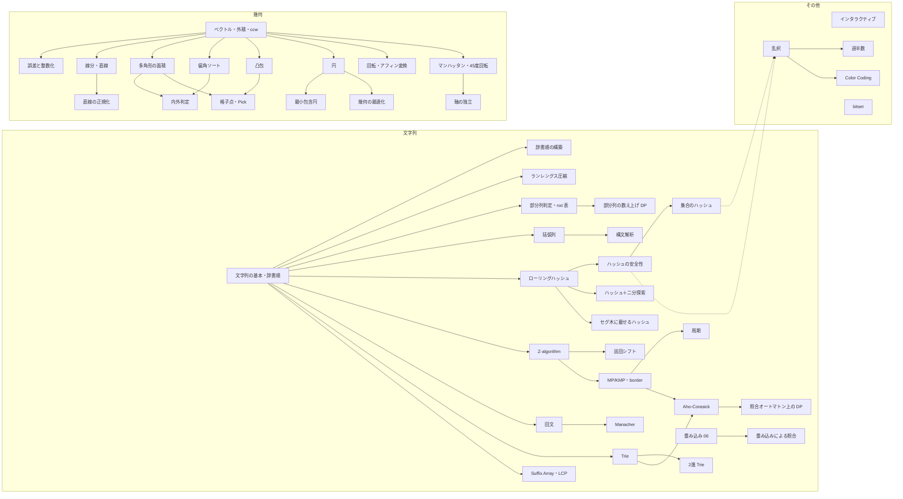

# 08 文字列・幾何・その他（string-geo）調査レポート

担当範囲：文字列（ハッシュ・線形時間の照合・回文・Trie・接尾辞構造・複数パターン）、幾何（外積と向き・線分・多角形・凸包・偏角ソート・円・座標変換・マンハッタン距離・誤差）、その他（インタラクティブ・乱択・bitset・定数倍）。項目は [08-string-geo.topics.yaml](08-string-geo.topics.yaml) に 56 件、例題・練習問題は延べ 195 件（重複を除き 157 問）を載せた。

**調べ方の要約**

- 問題の実在・タイトル・difficulty はすべて `tools/ap.py` で確認した（2026-10-21 のキャッシュ）。atcoder.jp とそのサブドメインのページは開いていない
- 内容の裏付けには、けんちょん（drken）のブログの記事、ikatakos.com のコンテスト記録、merom686 の参加記、典型90問の作問者の GitHub（問題文・想定解・解説画像）などを使った。drken のブログのカテゴリ一覧（約1000カテゴリ）と、ikatakos.com の ABC126〜480 のページを機械的に取得してキーワードを数え、担当分野の問題を洗い出した（ikatakos.com に節がある問題は 2498 問中 751 問）
- Web 検索はセッション全体で共有の上限に早い段階で達したため、URL が分かる資料（cp-algorithms・USACO Guide・OI Wiki・Library Checker・ライブラリの GitHub・cppreference・各ブログのアーカイブ）を直接読んだ。検索は計 6 回（上限に達する前の 3 回と、枠が少し戻った後の確認 3 回）だけ使った
- **Codeforces は使っていない。** 手引きの指示どおり noai 指定のため資料にしていない（取得を試みた1件も 403 で中身は読んでいない）。dacin21 の anti-hash の記事など、ハッシュの攻撃について Codeforces に詳しい記事があるが未読である。その代わりに mod 2^64 が破られる理由は自分で導出し、計算で確かめた（§4.2）

---

## 1. 調べた資料

### 1.1 一次資料・定番の解説

| 資料名 | URL | 何の参考にしたか |
| --- | --- | --- |
| AtCoder Library ドキュメント（手元、CC0） | `~/lib/ac-library-master/document_ja/string.md`、`appendix.md` | `suffix_array`・`lcp_array`・`z_algorithm` の多重定義・制約・計算量。テンプレート引数を推論させる書き方 |
| AtCoder Library のソース（手元） | `~/lib/ac-library-master/atcoder/string.hpp`、`test/example/sa_practice.cpp` | SA-IS が n<10 で愚直、n<40 でダブリングに切り替わること、`z[0]=n`、`lcp_array` の長さ n−1 と Kasai 法、異なる部分文字列の数の使用例 |
| snuke「文字列の頭良い感じの線形アルゴリズムたち」1〜3 | https://snuke.hatenablog.com/entry/2014/12/01/235807 、https://snuke.hatenablog.com/entry/2014/12/02/235837 、https://snuke.hatenablog.com/entry/2014/12/03/214243 | MP の配列の定義と償却 O(N) の理由、Manacher の鏡のコピーと区切り文字、Z の Z-box と O(N) の理由（日本語の定番） |
| keymoon「安全で爆速なRollingHashの話」 | https://qiita.com/keymoon/items/11fac5627672a6d6a9f6 | mod 2^61−1 の利点、乗算と剰余の高速化、base を実行時に乱択する理由、文字に 0 を割り当てない理由、mod 2^64 は base を乱択しても破られること |
| cp-algorithms: String Hashing | https://cp-algorithms.com/string/string-hashing.html | 衝突確率の目安（10^9 程度の mod では 10^6 個の全ペア比較でほぼ確実に衝突）、二重ハッシュ、2^64 を勧めない理由 |
| cp-algorithms: Prefix function / Z-function | https://cp-algorithms.com/string/prefix-function.html 、https://cp-algorithms.com/string/z-function.html | π と z の定義（cp-algorithms の Z は z[0]=0 の流儀）、O(n) の理由、周期・出現回数・異なる部分文字列の応用 |
| cp-algorithms: Suffix Array / Aho-Corasick / Suffix Automaton / Lyndon factorization | https://cp-algorithms.com/string/suffix-array.html 、https://cp-algorithms.com/string/aho_corasick.html 、https://cp-algorithms.com/string/suffix-automaton.html 、https://cp-algorithms.com/string/lyndon_factorization.html | SA のダブリング O(n log n) と応用（部分文字列の比較・LCP・異なる部分文字列）、AC の出力リンクと集計、SAM の状態数 2n−1・遷移数 3n−4、Duval O(n) と最小回転 |
| cp-algorithms: Convex hull / Point in convex polygon / Check if two segments intersect | https://cp-algorithms.com/geometry/convex-hull.html 、https://cp-algorithms.com/geometry/point-in-convex-polygon.html 、https://cp-algorithms.com/geometry/check-segments-intersection.html | Graham・Andrew の O(N log N)、同一直線上の点の扱い、凸多角形の O(log N) 内外判定、線分交差を整数で判定する方法 |
| Competitive Programmer's Handbook（Laaksonen） | https://cses.fi/book/book.pdf | 26章（Trie・ハッシュの衝突の3つの場面と表・Z）、29章（複素数・点と直線・面積・距離関数と 45 度回転）、30章（平面走査・最近点対・凸包）、10章（ビット最適化。2500×2500 の数え上げが 29.6 秒→1.7 秒） |
| USACO Guide | https://usaco.guide/gold/hashing 、https://usaco.guide/gold/hashmaps 、https://usaco.guide/plat/geo-pri 、https://usaco.guide/plat/bitsets 、https://usaco.guide/adv/interactive 、https://usaco.guide/adv/random | ハッシュの衝突の上界 n/M と誕生日の上界、unordered_map への攻撃とランダムな変位つきハッシュ、幾何の基本（交差・面積・内外・Pick・偏角の尺取り。例題に abc442_e と abc366_e）、bitset の典型、インタラクティブの考え方（回数の上限から方針を逆算）、乱択の失敗確率 |
| OI Wiki（中国語） | https://github.com/OI-wiki/OI-wiki/blob/master/mkdocs.yml 、https://oi-wiki.org/misc/rand-technique/ 、https://oi-wiki.org/geometry/distance/ | 文字列・計算幾何・雑項の目次で網羅性を確認（序列自動機＝次の出現位置、最小表示法、Main–Lorentz、主元素問題、表達式求値、Kahan 和など）。乱択の分類と確率の評価、マンハッタン⇔チェビシェフの変換 |
| noshi91「アルゴリズム事典」 | https://noshi91.github.io/algorithm-encyclopedia/aho-corasick 、https://noshi91.github.io/algorithm-encyclopedia/rabin-karp 、https://noshi91.github.io/algorithm-encyclopedia/boyer-moore-majority-vote-algorithm | Aho–Corasick と Rabin–Karp の計算量の正確な言い方、Boyer–Moore の過半数投票（O(N)・O(1) 空間・候補の検証が必要・N/(k+1) への一般化） |
| Library Checker（問題リポジトリ） | https://github.com/yosupo06/library-checker-problems | 文字列（suffixarray, zalgorithm, enumerate_palindromes, aho_corasick, eertree, lyndon_factorization, runenumerate, wildcard_pattern_matching, number_of_substrings など）と幾何（sort_points_by_argument, static_convex_hull, closest_pair, furthest_pair, minimum_enclosing_circle, manhattanmst など）の問題一覧。自作ライブラリの動作確認先 |
| ライブラリ（Nyaan・ei1333・maspy） | https://github.com/NyaanNyaan/library 、https://github.com/ei1333/library 、https://github.com/maspypy/library | 文字列・幾何の部品の一覧（ハッシュのセグ木・2次元ハッシュ・逆 Manacher・最小回転・全ペア LCP・偏角ソートの比較関数の流儀 (−π, π]・最小包含円・マンハッタン MST など）。maspy の max_norm_sum が abc139_f を例に挙げている |
| cppreference | https://en.cppreference.com/w/cpp/io/basic_ios/tie 、https://en.cppreference.com/w/cpp/utility/bitset | cin は既定で cout に tie されており入力の前に cout が flush されること、bitset のサイズはコンパイル時定数で実行時に決めるなら vector<bool> 等 |

### 1.2 問題の洗い出しと内容の裏付けに使ったもの

| 資料名 | URL | 何の参考にしたか |
| --- | --- | --- |
| けんちょんの競プロ精進記録（カテゴリ一覧と個別記事） | https://drken1215.hatenablog.com/ （例：https://drken1215.hatenablog.com/archive/category/ローリングハッシュ） | ローリングハッシュ・Z法・KMP法・SuffixArray・trie木・BinaryTrie・回文・辞書順・ランレングス圧縮・カッコ列・構文解析・計算幾何・偏角ソート・凸包・円・誤差・マンハッタン距離・変数変換：45度回転する・インタラクティブ・bitベクター高速化などのカテゴリの記事一覧から候補を作り、個別記事を裏付けにした |
| ikatakos.com のコンテスト記録 | https://ikatakos.com/pot/programming_algorithm/contest_history/atcoder | ABC126〜480 の各ページを取得し、問題の節ごとに手法のキーワード（Z・ハッシュ・Manacher・Trie・Aho・外積・偏角・凸包・45度・bitset・乱択など）を数えて候補を洗い出した。各問題の「解法」の節を裏付けにした |
| merom686 の参加記 | https://merom686.hatenablog.com/ | 日付別アーカイブから ABC の記事をたどり、問題の節を裏付けにした。abc339_f（固定の mod が落とされた記録）、abc385_f（double の桁落ち）など実戦の落とし穴の証言としても使った |
| AtCoder Tags | https://atcoder-tags.herokuapp.com/explain | String（Rolling-Hash・Z-Algorithm・Suffix-Array・Trie・Manacher・Parsing）、Geometry（Convex-Hull・Declination-Sorting・Three-D 等）、Technique/Randomized-Algorithm の問題一覧を洗い出しに使った（裏付けには使っていない） |
| 競プロ典型 90 問（作問者 E869120 の GitHub） | https://github.com/E869120/kyopro_educational_90 | typical90_b・f・h・i・aj・ao・au の問題文（problem-txt）・想定解（sol）・解説画像（editorial）で内容と手法を確認 |
| はまやん「競技プログラミングにおける文字列アルゴリズム問題まとめ」 | https://blog.hamayanhamayan.com/entry/2017/03/25/005452 | アルゴリズムごとの問題の対応（ARC055 C、ARC060 F、ARC087 E Prefix-free Game など） |
| Scrapbox「インタラクティブ問題まとめ」（kyopuro-ryusuke920） | https://scrapbox.io/kyopuro-ryusuke920/%E3%82%A4%E3%83%B3%E3%82%BF%E3%83%A9%E3%82%AF%E3%83%86%E3%82%A3%E3%83%96%E5%95%8F%E9%A1%8C%E3%81%BE%E3%81%A8%E3%82%81 | 易しいインタラクティブ問題の並べ方（abc244_c → abc299_d → abc019_4） |
| kyopro_friends「AtCoder practice contest B問題 Interactive Sorting」 | https://kyopro-friends.hatenablog.com/entry/2020/12/29/133303 | 3つの小課題の解き方と、N=5・7回の情報量の議論（128 通り ≥ 120 通り） |
| picomikan「双方向パイプを使ってAtCoderのインタラクティブ問題を実験してみた！」 | https://picomikan.net/atcoder-interactive/ | 手元でインタラクティブ問題を試す方法（mkfifo の名前付きパイプ、tee でログ、Python の subprocess） |
| note（anoconne）「AtCoder Beginner Contest反省会 ~入緑編~」 | https://note.com/anoconne/n/n26b5912e1e9c | abc268_h の貪欲の方針（検索結果の要約で確認。本文は未読） |

### 1.3 自分で確かめたこと

- **mod 2^64 の多項式ハッシュの崩れ方**：Thue–Morse 列とその反転（a と b を入れ替えたもの）について、ランダムな奇数の base 200 個で衝突を数えた。長さ 256 で 26/200、512 で 61/200、**1024 で 200/200、2048 で 200/200** が衝突した。偶数の base は B^64≡0 なので末尾 64 文字しか効かない（別の崩れ方）。同じ列で mod 2^61−1・ランダムな base は 0/200（導出は §4.2）
- **衝突確率の数値**（§4.2 の表）：(L−1)/p の上界と、一様とみなした誕生日の近似を計算した
- **ABC の規模**：キャッシュ中の ABC の問題は 2906 問（ABC001〜480）

---

## 2. 分野の全体像

### 2.1 サブ分野の構造

- **文字列** は「道具の性質」で3層に分かれる。(1) 文字列を値として扱う基本（辞書順・連結・回転・RLE・部分列・括弧列）、(2) 一致判定の道具（ハッシュ・Z・KMP・Manacher）、(3) 多数の文字列や全部分文字列の構造（Trie・Suffix Array・Aho–Corasick・発展の SAM・回文木）。数え上げ（照合オートマトン上の DP、部分列 DP）は (2)(3) の上に DP（02）を載せたもの
- **幾何** は外積（向き）が土台で、ほぼすべてがそこから派生する。ABC で出る型は (a) 外積の符号の判定、(b) 整数での扱い（座標の整数倍・gcd による方向の正規化・分数の比較）、(c) 偏角ソート、(d) マンハッタン距離の 45 度回転と軸の独立、(e) 回転・アフィン変換、(f) 円と二分探索・Union-Find、(g) 凸包（黄）、(h) 実数の最適化（三分探索・候補点）に絞られる
- **その他** の3つ（インタラクティブ・乱択・bitset）は互いに独立で、ほかの分野の手法と組み合わせて使う「形式」や「加速の技」である

### 2.2 手法ごとに「何が O(N)・O(N log N) で分かるか」（文字列の早見表）

N は文字列の長さ、M はパターンの長さ（総和）、σ は文字の種類数。

| 手法 | 前処理 | 1回の問い合わせ | 分かること | 確実性 | ACL |
| --- | --- | --- | --- | --- | --- |
| ローリングハッシュ | O(N) | O(1) | 任意の2つの部分文字列が等しいか | 確率的（モンテカルロ） | なし |
| ハッシュ＋二分探索 | O(N) | O(log N) | 任意の2位置からの LCP、部分文字列どうしの辞書順の比較 | 確率的 | なし |
| セグ木に載せたハッシュ | O(N) | O(log N)（更新も） | 1文字更新ありの一致判定・回文判定 | 確率的 | `segtree` に載せる |
| 集合のハッシュ（Zobrist） | O(N) | O(1) | 2つの区間（接頭辞）の集合・多重集合が等しいか | 確率的 | なし |
| Z-algorithm | O(N) | — | 各 i の LCP(S, S[i:])。S+区切り+T で T の各位置と S の LCP。p が周期 ⇔ z[p]=N−p | 決定的 | `z_algorithm` |
| MP/KMP | O(N) | — | 各接頭辞の最長 border（π）。border の全列挙（π の連鎖）。最小周期 N−π[N−1]。パターンの全出現 O(N+M)。照合オートマトン O(σM) | 決定的 | なし |
| Manacher | O(N) | O(1) | 各中心の最長回文の半径。任意の区間が回文か。回文の部分文字列の総数 | 決定的 | なし |
| 次の出現位置の表 | O(σN) | T の長さに比例 | T が部分列か、辞書順最小の部分列、部分列でない最短の文字列 | 決定的 | なし |
| Trie | O(ΣL) | O(L) | 接頭辞を共有する文字列の数、全ペアの LCP の和、接頭辞に持つかの判定 | 決定的 | なし |
| Suffix Array＋LCP＋RMQ | O(N)（SA-IS）＋O(N log N)（Sparse Table） | O(1) | 全接尾辞の辞書順、任意2接尾辞の LCP、異なる部分文字列の数、パターンの出現回数 O(M log N)、部分文字列の辞書順 K 番目 | 決定的 | `suffix_array`・`lcp_array` |
| Aho–Corasick | O(σM) | テキスト全体で O(N) | 多数のパターンの出現をまとめて数える、照合オートマトン（DP・行列累乗に使う） | 決定的 | なし |
| 畳み込み | O((N+M) log(N+M)) | — | 全シフトの一致数・ハミング距離、ワイルドカード照合 | 決定的 | `convolution` |
| Suffix Automaton（発展） | O(N)（σ 定数） | — | 異なる部分文字列の数・出現回数・2文字列の最長共通部分文字列（オンラインで文字を追加できる） | 決定的 | なし |

### 2.3 混同されやすいもの

| 組 | 違い |
| --- | --- |
| 部分文字列と部分列 | 部分文字列は連続、部分列は連続でなくてよい。部分列はハッシュ・Z・SA の対象外で、次の出現位置の表と DP で扱う |
| Z と KMP | Z は「各位置から先頭と何文字一致するか」（接頭辞の側から見る）、KMP は「各位置で終わる部分が先頭と最長何文字一致するか」（接尾辞の側から見る）。どちらも O(N) で互いに変換できる。ACL には Z しかない |
| ローリングハッシュと集合のハッシュ | 前者は順序を含む（多項式）、後者は順序を無視（要素ごとの乱数の XOR または和）。集合は XOR、多重集合は和を使う（XOR は同じ要素2個で打ち消す） |
| 多項式ハッシュの乱択と値のハッシュの乱択 | 多項式ハッシュは base を乱択すれば mod は固定（2^61−1）でよい。値そのものを mod p で比べるハッシュ（巨大整数の比較など）は乱択の要素がないので、mod（素数）自体を乱択しないと狙い撃ちされる（abc339_f） |
| Trie と Suffix Array | Trie は「与えられた多数の文字列」の接頭辞構造、SA は「1つの文字列の全接尾辞」の順序。全ペア LCP の和は、多数の文字列なら Trie、1つの文字列の接尾辞どうしなら SA＋LCP＋単調スタック |
| マンハッタン距離とチェビシェフ距離 | (x, y)→(x+y, x−y) でマンハッタンがチェビシェフになる。逆向きは ((x+y)/2, (x−y)/2)。偶奇がそろわない点が出ることに注意 |
| 偏角ソートと atan2 | atan2 は手軽だが、座標 10^9 規模では区別できない角度差が出る。整数座標なら上下の半平面に分けて外積で比べる |
| 凸包と Convex Hull Trick | 凸包は点集合を囲む図形、CHT は直線群の下側（上側）の包絡線（02 担当）。双対の関係にある（点 (a, b) と直線 y=ax+b）。abc244_h はその接点 |
| 乱択と「ランダムな入力」 | 乱択はプログラム側が乱数を使うこと。入力がランダムに生成される問題（abc344_g など）とは別 |

---

## 3. 項目一覧

56 項目（文字列 30・幾何 20・その他 6）。レベルの内訳は 基礎 9・水 21・青 14・黄 6・発展 6。詳細（別名・問題のサイン・使い分け・図の案・問題）は topics.yaml にある。key が 05 と同じもの（binary-trie、hashing-for-sets）は統合時にどちらかへ寄せる（§7.4）。

#### 文字列

| 項目（key） | レベル | 根拠の問題と difficulty | 前提 | ACL での対応 | ページ分割の案 |
| --- | --- | --- | --- | --- | --- |
| 文字列の基本操作と辞書順（`string-basics`） | 基礎 | abc110_c (diff 949) 文字の置換の一貫性、abc042_b (616) 辞書順最小の連結、abc286_c (565) 回転と回文。ABC の A〜D で常連 | sorting | — | own |
| 辞書順最小の構築と辞書順 K 番目（`lexicographic-greedy`） | 基礎 | abc202_d (966)、arc097_a (1108) は基礎帯。実現可能性の判定が重いもの（abc009_3 参考値 1915、abc225_f 2612）は青以上 | string-basics, binomial-coefficient | — | own |
| ランレングス圧縮（連続する同じ文字の塊）（`run-length-encoding`） | 基礎 | abc136_d (794)、abc140_d (1074)、abc124_d (1138) が基礎帯。abc421_d (1321) で水。道具として abc452_g (2255) でも使う | two-pointers | — | own |
| 部分列判定と次の出現位置テーブル（`subsequence-matching`） | 水 | typical90_f（★5＝1200〜1599 相当）、abc452_d (903)、abc324_e (1153)。応用は abc346_f (1840)、arc081_c (2072) | string-basics, binary-search | — | own |
| 部分列の数え上げ（照合位置の DP・異なる部分列）（`subsequence-dp`） | 青 | abc104_d (1739)、abc214_f (1973)。基本の照合位置 DP は typical90_h（★4） | dp-basics, subsequence-matching | — | section-of:subsequence-matching |
| 括弧列（`bracket-sequence`） | 水 | 基本は基礎帯（abc307_d 666、abc312_d 964）。順序の工夫やセグ木での判定は水〜青（abc407_e 1531、abc223_f 1641、abc167_f 1961） | prefix-sum, stack-techniques | atcoder::lazy_segtree（区間加算・区間 min で区間の判定） | own |
| 構文解析（再帰下降・式の評価）（`parsing`） | 青 | ABC では稀。文法に沿った DP が abc403_f (1733)、本格的な構文解析が abc338_g (2573)。易しい字句解析は A/B（abc380_b 27） | recursion, dp-basics | — | own |
| 文字列へのクエリ（文字ごとの BIT・セグ木）（`string-queries-ds`） | 水 | abc341_e (1223)、abc157_e (1443)、abc285_f (1876) | segment-tree, fenwick-tree | atcoder::segtree / atcoder::fenwick_tree / atcoder::lazy_segtree | section-of:segment-tree-monoids |
| ローリングハッシュ（`rolling-hash`） | 水 | abc141_e (1459)、abc284_f (1575)、typical90_au（★7。考察込み）。別解として abc430_e (1109)、abc150_f (2281)、abc135_f (2388) | mod-arithmetic, prefix-sum, string-basics | — | own |
| ハッシュの衝突確率と安全な設計（mod の選び方・ハック対策）（`hash-safety`） | 水 | ハッシュを使う水の問題（abc141_e 1459 など）から必要。固定の mod が落とされた例として abc339_f (1716) | rolling-hash | — | own |
| ハッシュ＋二分探索（LCP・辞書順比較・最長の繰り返し）（`hash-lcp-binary-search`） | 水 | abc141_e (1459)。回文判定の前後ハッシュは abc398_f (1033) の別解 | rolling-hash, binary-search | — | section-of:rolling-hash |
| セグ木に載せるローリングハッシュ（更新ありの一致・回文判定）（`hash-segment-tree`） | 青 | abc331_f (1666)。05 の segment-tree-monoids でも同じ問題を例に挙げている | rolling-hash, segment-tree | atcoder::segtree（要素を (ハッシュ, B^長さ) の組にし、op で H(L)·B^len(R)+H(R)） | section-of:rolling-hash |
| 集合・多重集合のハッシュ（Zobrist hashing）（`hashing-for-sets`） | 水 | abc250_e (1421)、abc424_f (1521)、abc367_f (1540)。応用 abc238_g (2254)、発展 abc455_g (3092) | prefix-sum, randomized | — | own |
| Z-algorithm（各位置からの最長共通接頭辞）（`z-algorithm`） | 水 | abc430_e (1109)、abc141_e (1459)、abc284_f (1575)。応用は abc257_g (2078)、abc343_g (2114) | string-basics | atcoder::z_algorithm（z[0]=n を返す。string と vector<T> に対応、O(n)） | own |
| 巡回シフト（A+A の技・最小回転）（`cyclic-shift`） | 基礎 | abc286_c (565)、abc430_e (1109)。比較が絡むと abc150_f (2281)、abc272_f (2238) | z-algorithm | atcoder::z_algorithm / atcoder::suffix_array | section-of:z-algorithm |
| MP / KMP 法（失敗関数と border）（`kmp`） | 青 | パターン検索だけなら Z・ハッシュで代用でき水で足りる。border の連鎖やオートマトンとして使うのは青〜黄（abc419_f 1726 と abc458_f 1744 は一般化した Aho-Corasick、abc150_f 2281、abc135_f 2388） | z-algorithm | — | own |
| 文字列の周期と繰り返し（`string-period`） | 青 | abc304_f (1619)。最小の繰り返し単位への分解は abc312_h (2477)、arc060_d (2804) | kmp, divisor-enum | atcoder::z_algorithm（p が周期 ⇔ z[p]=n−p） | section-of:kmp |
| パターンを含む・含まない文字列の数え上げ（照合オートマトン上の DP）（`string-automaton-dp`） | 青 | abc419_f (1726)、abc458_f (1744)、abc305_g (1989)。単純な照合状態は abc122_d (1533)・typical90_h | dp-basics, kmp, aho-corasick, matrix-power | — | own |
| 回文の扱い（`palindrome`） | 水 | abc359_d (1381)、abc394_e (1403)、abc290_e (1485)。基礎帯に abc468_d (683)、abc206_d (879)、応用は abc197_f (1945)、abc175_f (2512) | string-basics, bfs | — | own |
| Manacher のアルゴリズム（各中心の最長回文）（`manacher`） | 水 | abc398_f (1033) が最長の回文接尾辞を求める典型（Z・ハッシュでも代用可）。Manacher が本質の ABC 問題は少ない | palindrome | — | own |
| Trie（文字列の集合を接頭辞で共有する木）（`trie`） | 水 | abc353_e (1217)、abc437_e (1279)、abc403_e (1447)。abc287_e (1093) は基礎帯、応用 abc377_g (1782)、abc268_g (2311) | string-basics, dfs | — | own |
| 2進 Trie（XOR の最小・最大）（`binary-trie`） | 青 | abc281_f (1714)、abc308_g (2008)、abc425_g (2205)。05 と同じ key（05 は own ページ案） | trie, bit-operations | — | own |
| Suffix Array と LCP 配列（`suffix-array`） | 黄 | abc433_g (2060)、abc213_f (2215)、abc272_f (2238)、abc452_g (2255)。abc362_g (1625) は別解 | sorting, sparse-table, monotonic-stack | atcoder::suffix_array（string は O(n)、vector<T> は O(n log n)、vector<int>+upper は O(n+upper)）、atcoder::lcp_array（長さ n−1、O(n)） | own |
| Aho–Corasick 法（複数パターンの同時照合）（`aho-corasick`） | 青 | abc362_g (1625)、abc419_f (1726)、abc458_f (1744)。応用 abc268_h (2560) | trie, bfs, kmp | — | own |
| 畳み込みによる文字列照合（ワイルドカード・ハミング距離）（`fft-string-matching`） | 黄 | abc196_f (2274) | convolution-ntt | atcoder::convolution | own |
| Suffix Automaton（発展）（`suffix-automaton`） | 発展 | ABC で必須の確認例はなし。SA＋LCP で代用できることが多い。異なる部分文字列・出現回数・最長共通部分文字列に使う | suffix-array | — | overview |
| 回文木 eertree（発展）（`palindromic-tree`） | 発展 | ABC で必須の確認例はなし。Library Checker の eertree・回文の種類数・回文の出現回数に使う | manacher | — | overview |
| Lyndon 分解と最小回転（発展）（`lyndon-factorization`） | 発展 | ABC で必須の確認例はなし。最小回転は S+S の SA・Z・ハッシュで代用できる（abc272_f 2238 は SA で解く） | cyclic-shift | — | overview |
| Run の列挙・繰り返しの検出（発展）（`run-enumeration`） | 発展 | ABC で必須の確認例はなし。Library Checker の Run Enumeration | string-period, z-algorithm | — | overview |
| 文字列アルゴリズムの逆問題（発展）（`inverse-string-problems`） | 発展 | 回文半径から辞書順最小の文字列を復元する型が ABC の G に出たとされる（abc349_g 2655、内容は未確認）。maspy のライブラリに inverse_manacher / inverse_z_algorithm がある | manacher, z-algorithm, union-find | — | overview |

#### 幾何

| 項目（key） | レベル | 根拠の問題と difficulty | 前提 | ACL での対応 | ページ分割の案 |
| --- | --- | --- | --- | --- | --- |
| ベクトル・内積・外積と向き判定（ccw）（`geometry-vectors`） | 基礎 | abc181_c (274)、abc224_c (301)、abc266_c (516)。以降のすべての幾何の土台 | — | — | own |
| 誤差の扱いと整数での処理（`geometry-precision`） | 水 | 小数入力の整数化は基礎帯（abc169_c 597）。整数化しないと解けない・桁落ちで WA になるのは青〜黄（abc385_f 1905、abc191_d 1953、abc296_g 2241） | geometry-vectors | — | own |
| 線分の交差判定・点と直線の距離（`segment-intersection`） | 水 | abc016_4（参考値 1305）。応用 abc373_g (2377) | geometry-vectors | — | own |
| 多角形の面積（座標の公式）（`polygon-area`） | 水 | 公式自体は基礎だが単独の出題は少なく、凸包・Pick・尺取りと組んで黄（abc250_f 2044、typical90_ao ★7） | geometry-vectors | — | own |
| 点の多角形内外判定（`point-in-polygon`） | 黄 | abc296_g (2241)、abc251_g (2468) | geometry-vectors, binary-search, argument-sort | — | own |
| 凸包（`convex-hull`） | 黄 | typical90_ao（★7）、agc021_b (2130)、abc341_g (2208)。発展 abc202_f (2905)、abc356_g (3022) | geometry-vectors, sorting | — | own |
| 偏角ソート（`argument-sort`） | 水 | abc442_e (1355) が水。typical90_i（★6）、abc225_e (1678) が青、abc139_f (2034)、abc207_d (2074) が黄 | geometry-vectors, sorting | — | own |
| 格子点と Pick の定理（`lattice-points`） | 黄 | typical90_ao（★7）、abc202_f (2905) | polygon-area, gcd-lcm | atcoder::floor_sum（格子点の数え上げの別解） | own |
| 円（位置関係・交点・円が絡む探索）（`circle-geometry`） | 青 | abc191_d (1953)、abc181_f (2009)。基礎帯に abc259_d (947)、発展 abc157_f (2525)、abc314_h (2938) | geometry-vectors, geometry-precision, union-find | atcoder::dsu（円のつながり） | own |
| 最小包含円（`min-enclosing-circle`） | 青 | abc151_f (1671)。応用 abc157_f (2525) | circle-geometry | — | section-of:circle-geometry |
| 回転・平行移動・アフィン変換（`rotation-transform`） | 水 | abc189_e (1526)。基礎帯に abc259_b (180)、abc197_d (831)、黄に abc207_d (2074) | geometry-vectors, matrix-power | — | own |
| グリッドの回転・転置・反転（`grid-rotation`） | 基礎 | ABC の B〜C で出る（abc298_b は difficulty なし）。01 の2次元配列の扱いとの境界 | — | — | section-of:rotation-transform |
| 三角関数と角度の基本（`trig-angle`） | 基礎 | abc168_c (230)、abc144_d (714)。応用 abc292_f (1522) | — | — | section-of:rotation-transform |
| 直線・方向の正規化（gcd と符号）（`line-normalization`） | 水 | abc418_e (1282)、abc248_e (1292)。応用 abc220_g (2439) | gcd-lcm, geometry-vectors | — | own |
| マンハッタン距離・チェビシェフ距離と45度回転（`manhattan-chebyshev`） | 水 | abc437_f (1332)、typical90_aj（★5）。基礎帯に abc178_e (1054)、青に abc351_e (1627)、黄以上に abc265_f (2290)、arc103_b (2677) | geometry-vectors | atcoder::segtree（x+y と x−y の最大・最小を管理） | own |
| x と y を独立に扱う（マンハッタン距離の和・絶対値の外し方）（`axis-independence`） | 水 | abc210_d (1507)、abc366_e (1515)。応用 abc330_f (1718)、abc127_e (1938) | manhattan-chebyshev, prefix-sum, binary-search | — | section-of:manhattan-chebyshev |
| 盤面の斜めを r+c・r−c で扱う（`diagonal-coordinates`） | 基礎 | abc184_c (782)。応用 abc377_f (2232) | manhattan-chebyshev | — | section-of:manhattan-chebyshev |
| 3次元の基本（直方体の共通部分・体積）（`3d-geometry`） | 基礎 | abc361_b (299)、abc144_d (714)。応用 abc343_e (1802) | geometry-vectors | — | own |
| 幾何の最適化（候補点の列挙・二分探索・三分探索）（`geometry-optimization`） | 青 | abc292_f (1522)、abc151_f (1671)、abc181_f (2009)、abc130_f (2240)、発展 abc314_h (2938) | binary-search-answer, ternary-search, circle-geometry | — | own |
| 発展の幾何（動的凸包・回転キャリパー・最近点対・半平面交差など）（`advanced-geometry`） | 発展 | abc244_h (2878) が動的な上側凸包。ほかは ABC での確認例が少ない（Library Checker の furthest_pair、closest_pair、manhattanmst など） | convex-hull | — | overview |

#### その他

| 項目（key） | レベル | 根拠の問題と difficulty | 前提 | ACL での対応 | ページ分割の案 |
| --- | --- | --- | --- | --- | --- |
| インタラクティブ問題（`interactive`） | 水 | 形式そのものは灰〜茶（abc244_c 165、abc299_d 684）から。設計の工夫が要るのは水〜黄（abc305_f 1420、abc313_d 1630、abc282_f 1734、abc286_f 1841、abc355_e 2299） | binary-search | — | own |
| 乱択アルゴリズム（`randomized`） | 青 | abc339_f (1716)、abc272_g (2187)、abc238_g (2254)、abc447_g (2391)。水に abc422_e (1580) | expected-value | — | own |
| 過半数の扱い（Boyer–Moore の投票・ランダムな代表）（`majority-element`） | 青 | abc422_e (1580)、abc272_g (2187) | randomized | — | section-of:randomized |
| Color Coding（乱択で状態を減らす）（`color-coding`） | 黄 | abc447_g (2391) | randomized, bit-dp | — | section-of:randomized |
| bitset による高速化（`bitset-speedup`） | 青 | abc258_g (1944)、abc348_f (1955)。黄に arc070_b (2015)、abc350_g (2058)、agc020_c (2259)、発展 abc221_g (2914) | bit-operations, dp-basics, complexity-estimation | — | own |
| 実行時間の見積もりと定数倍（08 から見た補足）（`constant-factor`） | 水 | abc258_g (1944) と abc348_f (1955) は愚直でも定数倍しだいで通るという記録がある。01（計算量の見積もり）と 09（C++）との境界 | complexity-estimation | — | section-of:complexity-estimation |

---

## 4. 項目ごとのメモ

各項目について「何ができるか・なぜ正しいか／つまずき・バグ／図／確認問題／問題のサイン／使い分け」を書く。問題の一覧と裏付けは §5、短い要約は topics.yaml にある。

### 4.1 文字列の基本

#### string-basics：文字列の基本操作と辞書順（基礎）

- **何ができるか**：辞書順の定義（最初に異なる位置で比べ、片方が尽きたら短い方が小さい）を正確に使えば、多くの B〜D 問題は全探索と比較だけで解ける。`std::string` の比較は O(min(|s|,|t|))
- **なぜ**：辞書順は「先頭から1文字ずつ比べる」全順序で、接頭辞は必ずそれ以上の長さの文字列より小さい。このため「先頭をできるだけ小さく決める」貪欲（lexicographic-greedy）が成り立つ
- **つまずき**：(1) 長さの違う文字列を連結して辞書順最小にするとき、単純な辞書順ソートでは誤る（"b" と "ba" は "bab" < "bba" なので "ba" が先）。比較関数 a+b<b+a が正しい（推移性があることは要証明。abc042_b は長さが同じなので普通のソートでよい）、(2) `substr` や `+` は新しい文字列を作るので O(長さ) かかり、ループの中で使うと O(N^2) になる、(3) `std::string::find` の計算量は規格で決まっていないので、長いパターンを大量に探すと最悪 O(NM) になりうる。線形時間が必要なら Z・KMP を使う、(4) 文字の置換で「S→T の対応」だけでなく「T→S の対応」も一意か（全単射か）を確かめ忘れる（abc110_c）
- **図**：2つの文字列を縦に並べて先頭から比較し、最初に異なる列に印を付ける図
- **確認問題**：「"ab" と "abc" はどちらが小さいか。理由は？」「長さが違う文字列の連結で a+b<b+a を使う理由を、"b" と "ba" で説明せよ」「S の文字を一斉に置き換える操作で S→T にできる条件は？（片方向の一意性だけでは足りない例を作れ）」
- **サイン**：辞書順で最小・最大、文字を一斉に置き換える、回転して一致
- **使い分け**：巡回シフトは cyclic-shift（A+A の技）、辞書順の構築は lexicographic-greedy

#### lexicographic-greedy：辞書順最小の構築と辞書順 K 番目（基礎）

- **何ができるか**：「条件を満たすもののうち辞書順最小」を、先頭から1文字ずつ「小さい文字から試し、残りで条件を満たせるならその文字に確定」で作る。辞書順 K 番目は、先頭の文字ごとに「その文字で始まるものの個数」を数え、K と比べて決める
- **なぜ**：辞書順は先頭の文字が小さい方が必ず小さいので、先頭をできるだけ小さくするのが最適。ただし「残りで実現できるか」の判定（feasibility check）を正しく速く行えることが条件で、ここが問題の本体になる（typical90_f は「残りの文字数が足りるか」、abc009_3 は「残りの文字で違う位置を K 個以下にできるか」）
- **つまずき**：(1) 実現可能性を確かめずに貪欲に進めて行き止まる、(2) K 番目で個数が巨大になりオーバーフロー（K で打ち切る）、(3) 連結順の比較関数を誤る（abc225_f は a+b<b+a で並べた後に DP が必要で、貪欲だけでは誤るという参加記の証言がある）
- **図**：候補の木（先頭の文字で枝分かれ）に各部分木の個数を書き、K を減らしながら降りる図
- **確認問題**：「a が 2 個、b が 2 個の文字列の辞書順 4 番目を、先頭から決める手順で求めよ」「長さ K の部分列の辞書順最小で、i 文字目に選べる位置の右端はどこか」
- **サイン**：辞書順最小を出力（なければ −1）、辞書順で K 番目、文字列を並べて連結
- **使い分け**：数え上げ（二項係数）は 07、部分列の構築は subsequence-matching の表を使う

#### run-length-encoding：ランレングス圧縮（基礎）

- **何ができるか**：同じ文字の連続を（文字, 長さ）の組にまとめる。塊の数・長さで考えると操作の効果が見えやすくなる（反転1回で塊が最大2個減る、0 の塊 K 個を窓にした尺取り）
- **なぜ**：多くの操作は塊の内部では一様に働き、境界でだけ変化する。状態数が「文字数」から「塊の数」に減る
- **つまずき**：(1) 最後の塊を出力し忘れる（ループの後に追加）、(2) 先頭や末尾が 0 か 1 かで窓の取り方が変わる（番兵として長さ 0 の塊を入れると楽）
- **図**：文字列の下に色の帯を描き、帯ごとに長さを書く
- **確認問題**：「区間反転を1回すると塊の数は最大いくつ減るか。それはなぜか」「0 の塊を K 個まで反転して連続する 1 を最長にする窓は、塊の列で何個分か」
- **サイン**：同じ文字の連続、連続する 1 を最長に、ランレングス形式の入力（abc421_d）、圧縮して部分文字列の種類を数える（abc452_g）
- **使い分け**：尺取り（01）と組み合わせることが多い

#### subsequence-matching：部分列判定と次の出現位置テーブル（水）

- **何ができるか**：T が S の部分列かは、S を左から見て T の文字を貪欲に拾えば O(|S|+|T|) で分かる。さらに `nxt[i][c]`＝「位置 i 以降で文字 c が最初に現れる位置」を後ろから O(σN) で作ると、各 T を O(|T|) で判定でき、辞書順最小の部分列（typical90_f）、部分列でない最短の文字列（arc081_c、後ろからの DP）にも使える
- **なぜ**：部分列の照合では「できるだけ左で拾う」のが常に最善（後の選択肢を最も多く残す）。nxt はその「左で拾う」を表引きにしたもの（OI Wiki の目次では序列自動機＝部分列オートマトンと呼ぶ）
- **つまずき**：(1) 表の大きさ 26×(N+1) を忘れて番兵 N を置かない、(2) 「部分文字列」と取り違える、(3) 繰り返した文字列（S を N 回）の部分列は、文字ごとの累積個数と割り算で位置を飛ばす（abc346_f）
- **図**：nxt の表を後ろから埋めるステップ送りと、T の文字ごとに右へ跳ぶ矢印
- **確認問題**：「S= abcab、T= ab の照合で、なぜ最初の a を使ってよいのか」「nxt を後ろから作ると O(σN) になる理由は」
- **サイン**：部分列として含むか、部分列でない最短の文字列、辞書順最小の部分列、文字ごとの個数で位置を飛ばす
- **使い分け**：数え上げは subsequence-dp、連続する部分の一致はハッシュ・Z

#### subsequence-dp：部分列の数え上げ（青、02 との境界）

- **何ができるか**：「何文字目まで照合したか」を状態にすると、特定の文字列を部分列として取り出す方法の数（typical90_h）や、? を含む全通りの和（abc104_d）が数えられる。異なる部分列の個数は「同じ文字列を一度だけ数える」ために、各文字列を「最も左で拾う取り方」で代表させる（abc214_f）
- **なぜ**：照合の状態は「T のどこまで一致したか」だけで将来が決まる（マルコフ性）。異なる部分列は、取り方を nxt に沿った一意な代表に限れば重複なく数えられる
- **つまずき**：同じ文字列を異なる取り方で二重に数える。代表の取り方を決めずに DP を立てる
- **図**：dp 表（行＝S の位置、列＝照合位置）
- **確認問題**：「aab から ab を取り出す方法は何通りか。異なる部分列として ab は何回数えるべきか」
- **サイン**：部分列として何通り、異なる部分列の数、? を置き換えた全通りの和
- **使い分け**：パターンを部分文字列（連続）として含む・含まないは string-automaton-dp。**02（DP）との境界**：DP の章に置くのが自然で、08 からは nxt の表との関係だけを相互リンクする案を推す

#### bracket-sequence：括弧列（水）

- **何ができるか**：( を +1、) を −1 とした累積和で、「途中で一度も負にならず、最後が 0」が正しい括弧列の必要十分条件。これを (1) スタックによる対応、(2) 開いている数を状態にした DP（abc312_d）、(3) 区間の（合計, 累積和の最小値）を載せたセグ木・累積和に区間加算と区間最小の遅延セグ木（abc223_f）、(4) 括弧列を（最小値, 合計）に要約して並べる順序の貪欲（abc167_f）、(5) 「先頭 i 文字に ( が ⌈i/2⌉ 個以上」という言い換えと優先度付きキューの貪欲（abc407_e）に使う
- **なぜ**：累積和はいま開いている括弧の数で、負になると対応する ( がない ) がある。連結では、後ろの列の最小値に前の列の合計を足したものが全体の最小値になるので、（合計, 最小値）がモノイドになる
- **つまずき**：(1) 複数種類の括弧は累積和では判定できずスタックが要る（abc394_d）、(2) 並べる順序で「合計が正のもの」と「負のもの」を分けずに1つの基準でソートして誤る（abc167_f）、(3) 区間の判定で、区間の最小値は「累積和の値 − 区間の左端の累積和」で比べる
- **図**：累積和の折れ線グラフ。0 の線を下回る点で失敗。連結は折れ線をつなぐ図
- **確認問題**：「)( は累積和の条件のどちらに違反するか」「(最小値, 合計) が (−2, +1) の列と (0, +2) の列はどちらを先に置くべきか」
- **サイン**：正しい括弧列か、括弧列を並べ替えて正しくできるか、区間が正しい括弧列か（更新あり）
- **使い分け**：数え上げ（カタラン数）は 07、セグ木の設計は 05（segment-tree-monoids）と相互リンク

#### parsing：構文解析（青、ABC では稀）

- **何ができるか**：BNF（式＝項 {(+|−) 項}、項＝因子 {(*|/) 因子}、因子＝数 | '(' 式 ')'）の各規則を関数にし、読み取り位置を共有して再帰的に読む（再帰下降構文解析）。演算子の優先順位と括弧が自然に扱える。ABC では「文法に沿った DP」（abc403_f：括弧が要るかを状態に持つ）や、式として正しい部分文字列の総和（abc338_g）として現れる
- **なぜ**：文法の規則が「どの順に何を読むか」を一意に決めるので、規則ごとの関数がそのまま構文木を作る
- **つまずき**：(1) 読み取り位置を参照で共有しない、(2) 単項マイナスや空白などの例外を忘れる、(3) 深い入れ子で再帰が深くなる（10^5 段ならスタックに注意）
- **図**：式の構文木と、関数呼び出しの木が一致する様子
- **確認問題**：「1+2*3 で、なぜ 2*3 が先にまとまるのかを BNF から説明せよ」「(1+1)*(1+1) を 1+1+1+1 と比べて短いのはどちらか（abc403_f の考え方）」
- **サイン**：数式の文字列、+ と * と括弧、入れ子の構造
- **使い分け**：括弧の対応だけならスタック（bracket-sequence）。DP（02）との境界

#### string-queries-ds：文字列へのクエリ（水、05 との境界）

- **何ができるか**：文字ごとの BIT（26本）や、文字の集合をビットで持つセグ木で、1文字更新と区間の問い合わせ（種類数・個数・昇順か）に答える（abc157_e、abc285_f、abc341_e）
- **つまずき**：文字ごとにセグ木を 26 本持つとメモリと定数倍が重い。集合を 26 ビットの整数にして OR で結合すると1本で済む
- **使い分け**：一致・回文の判定はハッシュのセグ木（hash-segment-tree）。05 の segment-tree-monoids の節に置く案

### 4.2 ハッシュ

#### rolling-hash：ローリングハッシュ（水）

- **何ができるか**：文字列 s を多項式 H(s)＝Σ s_i·B^(n−1−i) mod p で数にし、接頭辞のハッシュ h と B の冪を O(N) で前計算すると、部分文字列 s[l, r) のハッシュが h[r] − h[l]·B^(r−l) で O(1) に求まる。連結は H(XY)＝H(X)·B^|Y|＋H(Y)。逆向きのハッシュと比べれば回文判定もできる
- **なぜ正しいか**：異なる2つの文字列（長さ L 以下）の差は、B についての 0 でない L−1 次以下の多項式で、素数 p の体の上では根が L−1 個以下しかない。だから B を [2, p−2] から一様に選べば、衝突の確率は (L−1)/p 以下（Schwartz–Zippel の特別な場合。USACO Guide も n/M の形で書いている）
- **何に使うか**：任意の部分文字列どうしの一致を大量に判定する、長さを二分探索して最長の繰り返しを探す（abc141_e）、ずらした文字列の一致（typical90_au、abc284_f）、巡回シフトの検索（abc430_e）
- **つまずき・バグ**：(1) 文字を 0 に対応させると、長さの違う "a" と "aa" が同じ値になる（1 以上に対応させる）、(2) 引き算で負になるのを mod に戻し忘れる（p を足してから引く）、(3) 掛け算のオーバーフロー（2^61−1 なら `__int128` か上位・下位に分けた積）、(4) base を固定したり mod 2^64 の自然なオーバーフローに任せたりする（§ hash-safety）、(5) 異なる長さの部分文字列を比べてしまう（長さもそろえるか、長さを含めて比べる）
- **図**：接頭辞のハッシュの表から引き算で部分を取り出す図。窓をずらすステップ送り
- **確認問題**：「s[l, r) のハッシュの式で B^(r−l) を掛ける理由は」「'a' を 0 にすると何が困るか」「abc141_e で答えの長さを二分探索できるのはなぜか（単調性）」
- **サイン**：部分文字列どうしの一致判定を大量に、N≤10^5〜10^6 で同じ部分が現れるか、回文判定を多数、最長の〜を二分探索
- **使い分け**：決定的に済むなら Z・KMP・Manacher・SA を優先する。ハッシュが本命になるのは「更新あり」「2次元」「任意の2部分の比較を大量に」「集合の比較」

##### ハッシュで代用できる場面とできない場面

| 目的 | ハッシュでの代用 | 計算量の目安 | 決定的な方法 |
| --- | --- | --- | --- |
| パターン1つの全出現 | できる | O(N+M) | Z・KMP（O(N+M)） |
| 任意2位置の LCP | できる（二分探索） | 1回 O(log N) | Z（先頭とだけ）、SA＋LCP＋RMQ（1回 O(1)） |
| 区間が回文か | できる（前向きと後ろ向きの比較） | 1回 O(1) | Manacher（O(N) 前処理、1回 O(1)） |
| 周期 p を持つか | できる（s[0, N−p) と s[p, N) の比較） | 1回 O(1) | KMP の π、Z |
| 1文字更新ありの一致・回文 | できる（セグ木） | 1回 O(log N) | 決定的な簡単な方法はない。ハッシュが本命 |
| 集合・多重集合の一致 | できる（Zobrist・和） | 1回 O(1) | ソートや個数の比較（遅い） |
| 全接尾辞の辞書順 | 一応できる（LCP の二分探索を比較関数にしたソート） | O(N log^2 N) | SA（O(N)） |
| 異なる部分文字列の数 | 不向き（長さごとに数えて O(N^2)） | O(N^2) | SA＋LCP（O(N)）、SAM |
| 部分文字列の辞書順 K 番目 | 不向き | — | SA＋LCP、SAM |
| 多数のパターン（総長 M）の出現 | 条件付き（長さの種類は O(√M) 種類なので長さごとに走査） | O(N√M) | Aho–Corasick（O(N+M)） |
| ワイルドカード・ハミング距離 | できない（一致かどうかしか分からない） | — | 畳み込み |
| 部分列（連続でない） | できない | — | nxt の表、DP |
| 編集距離・LCS | できない | — | DP（02） |
| 答えが1回でも誤ると困る・比較が 10^12 回以上 | 危険（衝突確率が無視できない） | — | 決定的な方法 |

#### hash-safety：ハッシュの衝突確率と安全な設計（水）

**衝突確率の計算例**（p＝2^61−1≈2.31×10^18、自分で計算した値）

| 状況 | 確率の目安 |
| --- | --- |
| 長さ L＝10^6 の2文字列を1回比べる（厳密な上界 (L−1)/p） | ≤ 4.3×10^-13 |
| 同じ条件で 10^6 回比べる（和の上界） | ≤ 4.3×10^-7 |
| N＝2×10^5 で二分探索の比較を 3.6×10^6 回 | ≤ 3.1×10^-7 |
| 10^6 個のハッシュの全ペア（5×10^11 組）を一様分布とみなした近似 | 約 2.2×10^-7 |
| 同じ全ペアを厳密な上界 (L−1)/p で評価（L＝10^6） | ≤ 0.22（上界が緩いだけで、実際は上の近似に近い） |
| mod 約 10^9 の1つで 10^5 個のハッシュの全ペア（約 5×10^9 組） | 衝突する組の期待値が約 5。ほぼ確実に衝突する |

CPH の表（一様分布を仮定）でも、mod 約 10^9 で 10^6 個の全ペアの衝突確率は 1.000000、mod 約 10^18 で 0.000001 である。**比較の回数ではなく「比べ合うハッシュの組の数」が効く**（誕生日のパラドックス）ことを強調する。

**mod 2^64（unsigned long long の自然なオーバーフロー）が破られる理由**（自分で導出し、計算で確認）

- Thue–Morse 列を t_0＝a、t_{k+1}＝t_k＋(t_k の a と b を入れ替えたもの) で作る。t_k と、その a・b を入れ替えた列 t̄_k の多項式ハッシュの差を D_k とすると、D_{k+1}＝D_k·(B^(2^k)−1) となり、D_k＝±Π_{i=0}^{k−1}(B^(2^i)−1)
- B が奇数なら B−1 は偶数、i≥1 では B^(2^i)−1＝(B−1)(B+1)(B^2+1)…(B^(2^(i−1))+1) が 2^(i+2) で割り切れる。よって D_k は 2^(1+Σ_{i=1}^{k−1}(i+2)) で割り切れ、k＝10（長さ 1024）でこの指数がちょうど 64 になる。**どんな奇数の base でも、長さ 1024 の2つの文字列が mod 2^64 で衝突する**（ランダムな奇数 base 200 個で 200/200 衝突を確認）
- B が偶数なら B^64≡0 なので、末尾 64 文字が同じ文字列はすべて衝突する
- 典型90問 047 の作問者の解説も「p＝2^64 ではどんな b でも衝突させられる」と注意している

**AtCoder でのハックの条件**

- コンテスト中のハックはない。テストは事前に固定されているので、狙われるのは「誰でも使いそうな固定の選択」（mod 2^64、よく使われる素数と base の組）である。base を実行時に乱択した多項式ハッシュは、事前に作ったテストでは狙えない
- 実例：abc339_f（巨大整数の積の一致）で、値そのものを mod 2^61−1 や mod 2^64 で比べたハッシュが落ち、別の大きな素数2つで通ったという参加記の記録がある。この種のハッシュには base がないので、**乱択すべきなのは mod（素数）の方**
- abc141_e でも、固定の mod と base の組で衝突し、base を変えて回避したという記録がある

**推奨する設計**

- 多項式ハッシュ：mod＝2^61−1（素数）、base は `mt19937_64` を `random_device` や時刻で初期化して [2, p−2] から選ぶ。積は `__int128` で取り、x＝(x>>61)+(x & (2^61−1))、x≥p なら x−p で剰余を取る（除算を避ける）。文字は 1 以上に対応させる
- 二重ハッシュ（10^9 程度の素数2つ、base はそれぞれ乱択）でもよいが、計算が倍になる（keymoon の計測でも 2^61−1 の1本の方が速い）
- 値のハッシュ（巨大整数の比較など）：大きい素数を実行時に乱択する（複数個）
- unordered_map：整数の既定のハッシュは恒等写像（USACO Guide）なので、狙われるとバケットが偏って1回 O(N) になる。AtCoder ではまず `map`・ソート・座標圧縮を検討し、使うなら実行時の乱数を混ぜたカスタムハッシュにする（09 の担当と相互リンク）

- **図**：比べるハッシュの個数と衝突確率のグラフ（mod 10^9 と 2^61−1）。Thue–Morse 列の作り方のステップ送り
- **確認問題**：「10^5 個の部分文字列のハッシュを set に入れて重複を数える。mod 10^9+7 の1つで足りるか（いいえ。期待値で約5組が衝突）」「mod 2^64 でも base をランダムにすれば安全か（いいえ）」「巨大整数の積の一致を mod で比べるとき、何を乱択すべきか（mod の素数）」
- **サイン**：ハッシュ値を set・map に大量に入れる、全ペアを比べる、固定の mod で値を比べる
- **使い分け**：乱択一般は randomized、集合のハッシュは hashing-for-sets

#### hash-lcp-binary-search：ハッシュ＋二分探索（水、rolling-hash の節）

- **何ができるか**：「長さ m の一致」は m について単調（m 文字一致すれば m−1 文字も一致）なので、一致長（LCP）を二分探索で O(log N) で求められる。LCP の次の1文字を比べれば辞書順の比較もできる。「長さ m の繰り返しがある」も単調なので答えの長さで二分探索できる（abc141_e）
- **つまずき**：二分探索の判定に重なりの条件などを入れ忘れる（abc141_e は重ならないこと）
- **確認問題**：「最長の回文の部分文字列の長さで二分探索するとき、偶数長と奇数長を分ける理由は」（長さ m の回文があっても m−1 の回文があるとは限らないが、m−2 はある）
- **使い分け**：Z は「先頭との LCP」だけ、SA＋LCP＋RMQ は任意2接尾辞の LCP を O(1)

#### hash-segment-tree：セグ木に載せるローリングハッシュ（青、rolling-hash の節）

- **何ができるか**：セグ木の要素を（ハッシュ, B^長さ）の組にし、結合を (h1, q1)·(h2, q2)＝(h1·q2＋h2, q1·q2) とすれば、1文字更新と区間のハッシュが O(log N)。前向きと後ろ向きの2本で回文判定（abc331_f）
- **なぜ**：連結のハッシュは左のハッシュを右の長さぶんずらして足すだけなので結合法則が成り立ち、単位元は (0, 1)
- **つまずき**：長さ（または B^長さ）を持たずに結合しようとして行き詰まる（参加記でもそこで止まった記録がある）
- **ACL**：`segtree<S, op, e>` に載せられる。逆向きは添字を N−1−i にした別のセグ木
- **使い分け**：05 の segment-tree-monoids と同じ例題（abc331_f）を共有しているので、08 側は「ハッシュの性質」、05 側は「何を載せるか」の視点で書き分ける

#### hashing-for-sets：集合・多重集合のハッシュ（水、05 と同じ key）

- **何ができるか**：値ごとに独立な 64 ビットの乱数 r(x) を割り当て、集合は XOR、多重集合は和（mod 2^64）でハッシュにする。順序に依存しないので、接頭辞の累積を取れば「先頭 x 項の集合」（abc250_e）や「区間の多重集合」（abc367_f）を O(1) で比べられる。「各値が偶数個」（XOR が 0）や「各値が 3 の倍数個」（指数 mod 3 を符号化、abc238_g）も判定できる。円周の弦の交差を区間の端点がそろうかに言い換えて XOR ハッシュと BIT で判定する応用もある（abc424_f）
- **なぜ**：異なる2つの集合では、XOR の差は少なくとも1つの r(x) を含むので、一致する確率は 2^-64。和の場合も、個数の差が奇数の値があれば確率は 2^-64（差が偶数ばかりでもせいぜい少し悪くなるだけ）
- **つまずき**：(1) 集合の比較で XOR を使うのに、同じ値が2回入ると打ち消される（集合として扱うなら初出だけ入れる。多重集合なら和）、(2) 値そのもの（x）を足してしまう（{1, 4} と {2, 3} が衝突。乱数を割り当てる）、(3) 乱数を `rand()` で作る（範囲が狭い。`mt19937_64`）
- **図**：値ごとの乱数の表と、先頭からの XOR の累積の表
- **確認問題**：「{1,4} と {2,3} を値の和で比べると何が起きるか」「多重集合の比較で XOR がだめな理由は」
- **サイン**：集合（多重集合）として等しいか、並べ替えて一致するか、区間の各値が偶数個か
- **使い分け**：**05 との境界**：05 は「衝突確率の説明は 08 に任せ、集合の一致判定の道具として扱う」案を出している。08 の意見は、乱数の割り当てと衝突確率はハッシュの章で一度に説明し（rolling-hash・hash-safety と並べる）、05 の DS の文脈（区間クエリ）からリンクするのがよい

### 4.3 線形時間の照合

#### z-algorithm：Z-algorithm（水）

- **何ができるか**：Z 配列 z[i]＝LCP(S, S[i:]) を O(N) で求める。(1) P＋区切り＋T の Z で、T の各位置に P が現れるか（z≥|P|）、(2) S＋区切り＋T で、T の各位置から S の接頭辞が何文字続くか（abc257_g の DP の材料）、(3) p が周期 ⇔ z[p]＝N−p、(4) 反転と組み合わせて回文の接尾辞（abc398_f の別解）
- **なぜ O(N)**：これまでに見つけた一致区間のうち右端が最も右のもの [l, r)（Z-box）を覚える。i が箱の中なら、z[i−l] の値をそのまま使える（はみ出す分は r まで）。比較が成功するたびに r が右に進み、r は N を超えないので比較の合計は O(N)
- **ACL**：`atcoder::z_algorithm(s)` は **z[0]＝n** を返す（ACL の実装と snuke の記事の流儀）。cp-algorithms の Z-function は z[0]＝0 とする流儀なので、他の解説のコードと混ぜると境界で誤る。string と `vector<T>`（int, uint, ll, ull）に使え、n≤10^8
- **つまずき**：(1) 区切り文字が S や T に現れる文字と重なる（`vector<int>` にして −1 を区切りにすると安全）、(2) z[0] の流儀の違い、(3) Z を各接尾辞に何度も適用すると O(N^2)（abc141_e は N≤5000 なので可）
- **図**：Z-box を左から右へ動かし、箱の内側は鏡の位置の値をコピー、はみ出した分だけ比較するステップ送り（比較が成功したマスだけ色を付けると O(N) が見える）
- **確認問題**：「aabxaab の Z 配列を書け」「z[i] を z[i−l] からコピーするとき、r−i で上限を取る理由は」「S が周期 p を持つことを Z で判定する式は」
- **サイン**：各位置から先頭と何文字一致するか、接頭辞の連結で表す、パターンの全出現、境界（border）や周期
- **使い分け**：KMP は「各位置で終わる最長の border」、ハッシュは「任意2部分の比較」。ACL にあるので、照合はまず Z で考えるのを推す

#### cyclic-shift：巡回シフト（基礎、z-algorithm の節）

- **何ができるか**：A を回転して B にできるかは、A+A の中に B が現れるかで判定できる（abc430_e）。回転したものどうしの比較は S+S の接尾辞（長さ N で切る）の比較になる（abc272_f の S+S+T+T の SA）。差分の列にすると「回転＋XOR」も検索に落ちる（abc150_f）
- **つまずき**：A+A の最後の1文字（長さ 2N の位置 N）を含めると、回転 N 回（＝0 回）を二重に数える
- **使い分け**：辞書順最小の回転そのものは Lyndon 分解・Booth（発展）でも求まるが、ABC では SA・Z・ハッシュで足りる

#### kmp：MP / KMP 法（青）

- **何ができるか**：π[i]＝S[0..i] の最長の真の border（接頭辞かつ接尾辞）の長さを O(N) で求める。border は π の連鎖（π[i], π[π[i]−1], …）ですべて列挙でき、最小周期は N−π[N−1]（N が割り切れるとき S はその長さの繰り返し）。パターン照合では、失敗したら π の値までずらすことで O(N+M)。π から「状態×文字→次の状態」の照合オートマトンが作れる
- **なぜ O(N)**：j（現在の照合長）は1回の文字で高々1増え、while で必ず減り、0 未満にならないので、減る回数の合計も N 以下（snuke の記事、cp-algorithms）
- **MP と KMP の違い**：MP は失敗関数に最長の border を使う。KMP は「次の文字も同じなら意味がない」ずらしを飛ばす改良で、1文字あたりの最悪の遅延が改善されるが、全体の計算量は同じ O(N+M)。競プロでは MP（π 配列）を KMP と呼ぶことが多い
- **ACL**：ACL には KMP はない。Z からも border と周期は求まる（p が周期 ⇔ z[p]＝N−p）
- **つまずき**：(1) 0-indexed と 1-indexed、π[0] を −1 にする流儀（snuke）と 0 にする流儀（cp-algorithms）の混在、(2) 最小周期 N−π[N−1] が N を割り切らないときは「繰り返しで書けない」
- **図**：照合に失敗したときにパターンを π の値だけ戻してずらすステップ送り。border の入れ子の図
- **確認問題**：「abacaba の π を書け」「abcabcab の最小周期は。繰り返しで書けるか」「border の連鎖を辿ると全 border が得られる理由は」
- **サイン**：接頭辞と接尾辞が一致する最長の長さ、最小周期、パターンを含まない文字列の数え上げ（オートマトン）
- **使い分け**：単一パターンの検索なら Z で十分。KMP が必要になるのは border の連鎖、オンライン（文字が1つずつ来る）、照合オートマトン（DP）。複数パターンなら Aho–Corasick

#### string-period：文字列の周期と繰り返し（青、kmp の節）

- **何ができるか**：p が周期 ⇔ N−p が border。最小周期 d が N を割り切るとき、S は長さ d の「原始的な」単位の N/d 回の繰り返しで、その単位は一意（abc312_h はすべての文字列を単位に直して処理する）。N の約数 M を周期に持つ条件の数え上げでは、約数どうしの重なりを包除（メビウス）で除く（abc304_f）
- **なぜ一意か**：周期 p と q を持ち p+q≤N なら gcd(p, q) も周期（弱周期定理）。だから N を割り切る周期の中で最小のものが他の周期を割り切る
- **つまずき**：周期の約数性を確かめずに「最小周期の倍数は全部周期」と思い込む（N を割り切らない周期もありうる）
- **使い分け**：周期の数え上げの包除は 07 と相互リンク

#### manacher：Manacher（水）

- **何ができるか**：各中心について最長の回文の半径を O(N) で求める。偶数長は文字の間に区切り文字を挟む（a#b#a …）か、奇数用・偶数用の2つの配列を持つ。求めた半径から、任意の区間が回文かを O(1)、回文の部分文字列の総数、最長の回文接頭辞・接尾辞（abc398_f）が分かる
- **なぜ O(N)**：右端が最も右の回文の中心 c と右端 r を覚え、i が r の内側なら鏡の位置 2c−i の半径をコピーする（r からはみ出さない範囲）。比較が成功するたびに r が右に進み、戻らない
- **つまずき**：(1) 区切り文字を挟んだ後の半径を元の長さに換算する式、(2) 区間 [l, r) の判定で、中心の位置と偶奇を取り違える
- **図**：最も右まで届く回文の内側で鏡の値をコピーし、はみ出した分だけ比較するステップ送り（Z と並べて「同じ考え方」と見せる）
- **確認問題**：「abaaababa の各位置の半径を書け」「鏡の値をコピーするとき r−i で上限を取るのはなぜか」
- **サイン**：すべての中心の最長回文、回文の部分文字列の総数（N が大きい）、最長の回文接頭辞・接尾辞
- **使い分け**：ABC では Z（反転を連結）やハッシュで代用できることが多く、Manacher が本質の問題は少ない（abc398_f も3通りで解ける）。異なる回文の種類・出現回数なら回文木（発展）

### 4.4 回文

#### palindrome：回文の扱い（水）

- **何ができるか**：回文の問題は「対称な位置の組」を見るのが基本。型は (1) 中心から伸ばす O(N^2)（abc468_d、1文字の不一致まで許す）、(2) 対称な位置を同じにする必要があるので Union-Find でまとめる（abc206_d）、(3) 対称な組ごとの寄与を数える（abc290_e）、(4) 直前の K−1 文字を状態にした DP で「長さ K の回文を作らない」（abc359_d）、(5) グラフの歩道が回文 → 頂点の組を状態にして両端から同じ文字で進む BFS（abc197_f、abc394_e）、(6) 文字列を左右に置いていき余りを状態にした最短路（abc175_f）、(7) 回文の数（の約数）を外側から組み立てる（abc363_f）
- **なぜ**：回文は「外側の1組をはがしても回文」という再帰構造を持つので、両端から作る・中心から伸ばすのどちらでも状態が小さくなる
- **つまずき**：(1) 奇数長と偶数長の中心を両方扱う、(2) グラフの回文で長さの偶奇（真ん中が頂点か辺か）の終了条件、(3) 回文の部分文字列の数を数えるのに N^3 の判定をしてしまう
- **図**：対称な位置を弧で結ぶ図。グラフ上で両端から同じ文字の辺を進む2つの駒
- **確認問題**：「長さ K の回文を作らないために直前 K−1 文字だけ覚えればよい理由は」「回文の歩道で、2つの駒が同じ頂点で出会うときと隣り合う頂点で出会うときの違いは」
- **サイン**：回文にする最小操作、回文の部分文字列の数、歩道の文字列が回文、回文を含まない
- **使い分け**：大量の区間判定は Manacher・ハッシュ、種類数は回文木（発展）

### 4.5 Trie・接尾辞構造・複数パターン

#### trie：Trie（水）

- **何ができるか**：文字列の集合を、共通の接頭辞を共有する木に入れる（節点数は Σ|S_i|＋1 以下、挿入は O(|S|)）。各節点に通過数を持てば、(1) 全ペアの LCP の和＝Σ_{根以外の節点} C(通過数, 2)（abc353_e）、(2) 各文字列と他の最長の LCP＝通過数 ≥2 の最も深い節点（abc287_e）、(3) 接頭辞に持つ文字列の数、(4) 集合を辞書順に DFS（abc437_e は数列の Trie）、(5) 節点に DP 値を持つ（abc377_g）、(6) 確率・期待値（abc268_g）、(7) Trie 上のゲーム（arc087_c、Grundy は 07）
- **なぜ**：2つの文字列の LCP は、Trie で両方が通る最も深い節点の深さ。全ペアの和は「節点ごとに、そこを通る組の数」の和に組み替えられる（主客転倒）
- **つまずき**：(1) 子を `map` で持つと遅い、`array<int, 26>` で持つとメモリが 26×節点数、(2) 節点を `vector` で確保しつつ参照を保持して、再確保で参照が無効になる、(3) 終端の印と通過数の区別
- **図**：文字列を1つずつ挿入して節点の通過数が増えるステップ送り
- **確認問題**：「abc, abd, b の Trie を描け。全ペアの LCP の和は」「ソートして隣どうしの LCP だけ見れば各文字列の最大 LCP が分かるのはなぜか」
- **サイン**：多数の文字列の共通接頭辞、全ペアの LCP の和、接頭辞に持つか、文字列の集合を辞書順に
- **使い分け**：ソート＋隣接の LCP で代用できる問題も多い（abc287_e、abc353_e の参加記もソートと再帰で解いている）。1つの文字列の接尾辞なら SA

#### binary-trie：2進 Trie（青、05 と同じ key）

- **何ができるか**：整数を上位ビットから辿る Trie。XOR の最小化・最大化（同じビットの側を優先して降りる）、XOR した後の k 番目、多重集合の管理ができる（abc308_g、abc425_g）。上位ビットで集合を分ける再帰そのものが「明示的に作らない 2進 Trie」になっている（abc281_f）
- **つまずき**：節点数＝要素数×ビット数（2×10^5×30＝6×10^6）になるので配列で確保する
- **使い分け**：**05 との境界**：05 は Binary Trie を own ページとし「文字列の Trie（08）と構造は同じなので 08 に Trie のページを置き相互リンク」という案。08 の意見も同じで、08 の Trie から 05 の Binary Trie へリンクする。XOR の線形代数（掃き出し）は 06（xor-basis）

#### suffix-array：Suffix Array と LCP 配列（黄）

- **何ができるか**：全接尾辞を辞書順に並べた添字の列 sa と、隣どうしの LCP の配列 lcp を作る。(1) 異なる部分文字列の数＝N(N+1)/2−Σlcp（practice2_i）、(2) 任意2接尾辞の LCP＝lcp の区間最小（Sparse Table で O(1)）、(3) パターンの出現回数＝sa 上の二分探索で得る範囲の幅（O(M log N)、abc362_g）、(4) 全ペアの LCP の和＝lcp 上の単調スタック（abc213_f）、(5) 巡回シフトの比較（S+S+T+T、abc272_f）、(6) 部分文字列の辞書順 K 番目（abc280_h）、(7) 包含関係の判定（abc354_g）
- **なぜ LCP は区間最小か**：辞書順に並んだ接尾辞では、離れた2つの LCP は間にある隣どうしの LCP の最小値になる（先頭が一致する範囲は連続している）
- **ACL の対応**（手元のドキュメントとソースで確認）
  - `suffix_array(string s)`：O(n)。`suffix_array(vector<T> s)`（T は int, uint, ll, ull）：座標圧縮してから SA-IS、O(n log n)。`suffix_array(vector<int> s, int upper)`：0≤s_i≤upper、O(n+upper)。n≤10^8
  - `lcp_array(s, sa)`：**長さ n−1** の配列で、i 番目は sa[i] と sa[i+1] の LCP（Kasai 法、O(n)）。n≥1 が必要
  - 内部の SA-IS は n<10 で愚直、n<40 でダブリングに切り替える
  - テンプレート引数は推論させる（`suffix_array<int>(v)` ではなく `suffix_array(v)`。appendix の注意）
- **つまずき**：(1) lcp の添字が「sa の i 番目と i+1 番目」であること、(2) rank（sa の逆写像）を作り忘れる、(3) 複数の文字列を連結するとき区切りを入れないと境界をまたいだ一致を数える（`vector<int>` で区切りに大きな値）、(4) 部分文字列の比較では長さの扱い
- **図**：接尾辞を辞書順に並べた表と、隣どうしの LCP を棒グラフで並べた図（任意2接尾辞の LCP＝間の棒の最小）。単調スタックの全ペア和はヒストグラムの最大長方形と同じ構造
- **確認問題**：「banana の SA と LCP を書け」「異なる部分文字列の数の式が N(N+1)/2−Σlcp になる理由は」「sa 上の二分探索でパターンの出現回数が範囲の幅になる理由は」
- **サイン**：異なる部分文字列の数、全接尾辞の辞書順、任意2位置の LCP を大量に、全ペアの LCP の和、K 番目の部分文字列
- **使い分け**：ハッシュ＋二分探索でも比較はできるが、異なる部分文字列の数・K 番目は SA が本命。自作するならダブリング O(N log^2 N)（ソート）→ O(N log N)（基数ソート）→ SA-IS の順

#### aho-corasick：Aho–Corasick（青）

- **何ができるか**：パターンの Trie に失敗リンク（最長の真の接尾辞で Trie にある節点へのリンク）を BFS 順に張り、全文字の遷移を埋めたオートマトンにする（構築 O(σM)）。テキストを流すと、各位置で終わるパターンが分かる。出現回数は「各状態の訪問回数」を失敗リンクの木で葉から根へ足し込むと O(N+M)（abc362_g）。オートマトンとしては DP や行列累乗に使う（abc419_f、abc458_f）。禁止語を含まないように最少の書き換えをする貪欲にも使う（abc268_h）
- **なぜ**：失敗リンクは KMP の π を Trie に一般化したもの。BFS 順なら親の失敗リンクが先に決まっているので、子の失敗リンクを遷移でたどって O(σ) で決められる
- **つまずき**：(1) 出力のたびに失敗リンクを根までたどると O(N×出現数) になり TLE（ikatakos の記録に TLE する例：S＝aaa…、T＝a, aa, aaa, … が載っている）。集計は失敗リンクの木の上で後からまとめる、(2) 終端の印を失敗リンク先から受け継ぎ忘れる（DP で「どれかを含んだか」の判定）、(3) テキストを1回走査するだけなら失敗リンクをその場でたどっても償却で O(N) だが、DP や行列で「全状態×全文字」の遷移を引く場合は償却が効かないので、遷移を表に埋めておく
- **図**：Trie に失敗リンク（破線）を BFS 順に張るステップ送りと、テキストを流すときの状態の移動
- **確認問題**：「パターン he, she, his, hers の失敗リンクを描け」「出現回数の集計を失敗リンクの木で後から足すと、なぜ重複も漏れもなく数えられるか」
- **サイン**：多数のパターンの出現をまとめて、どのパターンも含まない（全部含む）文字列の数え上げ、禁止語
- **使い分け**：パターンが1つなら KMP・Z。出現回数の集計だけなら SA の二分探索でもよい（abc362_g）。ハッシュは長さの種類ごとに走査すれば O(N√M) で代用できるが重い

#### fft-string-matching：畳み込みによる文字列照合（黄）

- **何ができるか**：パターンを反転して畳み込むと、各ずらし位置での「一致数」が1つの係数に集まる。0/1 の文字列なら Σ s_{i+j}·t_j と Σ (1−s)(1−t) で一致数、ハミング距離が全シフトで O((N+M) log) に求まる（abc196_f）。ワイルドカードを含む照合は Σ t_j·s_{i+j}·(t_j−s_{i+j})^2 の形の畳み込み3回で判定できる（Library Checker の wildcard_pattern_matching）
- **つまずき**：(1) ACL の `convolution` は mod 998244353 なので、係数が mod を超えないか（一致数は M 以下なので通常は大丈夫）、(2) 反転の添字のずれ、(3) σ 種類の文字なら文字ごとに畳み込むと σ 倍
- **使い分け**：畳み込みそのものは 06。08 では「一致しない数を数えたい・ワイルドカード」というサインからの入口を置く

### 4.6 数え上げ

#### string-automaton-dp：照合オートマトン上の DP（青、02 との境界）

- **何ができるか**：KMP（1パターン）や Aho–Corasick（複数パターン）の状態を DP の状態にすると、「長さ N の文字列で、どのパターンも含まない（すべて含む）ものの数」が O(N×状態数×σ) で数えられる。N が 10^9〜10^18 なら遷移行列の累乗（abc305_g、abc458_f）、すべて含むなら「含んだ集合」の bit を状態に足す（abc419_f）。パターンが短く少ないなら「直前の数文字」を状態にした簡易版でもよい（abc122_d）
- **なぜ**：照合オートマトンの状態は「いまの接尾辞のうちパターンの接頭辞になっている最長のもの」で、次の文字だけで次の状態が決まる（マルコフ性）
- **つまずき**：(1) 終端の判定を失敗リンク先から受け継がない、(2) 行列の大きさ（状態数）^3 log N の見積もり、(3) 包除で解こうとしてパターンの重なりで破綻する（abc458_f の解説が理由を説明している）
- **図**：状態を頂点、文字を辺にしたグラフ上で DP の値が流れる図
- **確認問題**：「AGC を含まない文字列を数えるのに、直前の3文字で足りる理由は」「パターン abab の KMP オートマトンで、状態 3 から a が来たら次の状態は」
- **サイン**：長さ N の文字列でパターンを含まない・全部含む、N が非常に大きい
- **使い分け**：**02 との境界**：DP の技法としては 02、オートマトンの作り方は 08。08 に own ページを置き、DP の章から参照する案を推す（照合の状態を作れることがこの問題の本質なので）

### 4.7 発展の文字列（概要ページ）

- **suffix-automaton**：全部分文字列を状態数 2N−1 以下・遷移数 3N−4 以下の DFA で表す（O(N)）。異なる部分文字列の数・出現回数・2文字列の最長共通部分文字列・文字を追加しながらの処理に強い。ABC では SA＋LCP で代用できることが多く、必須の確認例はない
- **palindromic-tree**（回文木・eertree）：異なる回文の部分文字列（高々 N 個）を木で表し、各回文の出現回数や文字を追加しながらの回文を管理する。Library Checker の eertree
- **lyndon-factorization**：Duval で O(N)・O(1) 追加メモリ。辞書順最小の巡回シフトは S+S の Lyndon 分解から求まる。ABC では SA・Z・ハッシュで代用できる
- **run-enumeration**：極大な繰り返し（run）は O(N) 個しかなく、Main–Lorentz 法や Lyndon を使って列挙できる。Library Checker の runenumerate
- **inverse-string-problems**：Z 配列・回文半径・SA から条件を満たす辞書順最小の文字列を作る逆問題。maspy のライブラリに inverse_manacher・inverse_z_algorithm があり、inverse_z_algorithm は yahoo-procon2018-final-open の D を参照している。ABC349 G がこの型（回文半径から）とされるが、内容は未確認なので候補から外した
- **その他の未採用**：2次元ローリングハッシュ（Nyaan・maspy のライブラリにある。格子のパターン照合）、Boyer–Moore の文字列検索（OI Wiki にある。競プロでは不要）、Suffix Tree（SA＋LCP と同等）、文字列の木（Trie）上のハッシュ（木のハッシュは 04）

### 4.8 幾何

#### ABC での出現頻度と、出る型

- AtCoder Tags の幾何のタグ（Other・Convex-Hull・Declination-Sorting・Three-D・Voronoi）が付いた ABC の問題は約 20 問で、ABC の全問題 2906 問の 1% 未満である（タグは有志の投票なので網羅的ではない）
- この調査で裏付けを取った幾何寄りの ABC の問題（座標変換・マンハッタン距離を含む）は 47 問で、difficulty の帯は 基礎 12・水 9・青 8・黄 10・発展 7・なし 1。けんちょんの「計算幾何」カテゴリ（全コンテスト）は 78 記事。**ABC では数コンテストに1問程度**で、出るとしても外積の符号・整数での扱い・偏角・45 度回転・回転の行列・円と二分探索の組み合わせがほとんどである
- 凸包・内外判定・Pick の定理は黄、回転キャリパー・最近点対・半平面交差・ボロノイは ABC ではほぼ見ない（発展の概要で足りる）
- このため、幾何の章は「外積の土台を短く確実に」「整数で扱う技を重点的に」「凸包以降は黄・発展として必要最小限」の方針を推す

#### geometry-vectors：ベクトル・内積・外積と向き判定（基礎）

- **何ができるか**：外積 cross(a, b)＝a.x·b.y−a.y·b.x の符号で b が a の左（正）・右（負）・同じ直線上（0）かが分かり、絶対値は a と b が作る平行四辺形の面積。内積の符号で角が鋭角（正）・直角（0）・鈍角（負）。ccw(p, q, r)＝cross(q−p, r−p) で3点の回り方、一直線上の判定（abc181_c、abc224_c）、凸性の判定（abc266_c）
- **なぜ**：cross(a, b)＝|a||b| sin θ。θ の符号が回転の向きを表す。座標が整数なら外積も整数で、誤差なく判定できる
- **つまずき**：(1) オーバーフローの見積もり（座標 |x|≤10^9 なら差は 2×10^9、積は 4×10^18、外積は 8×10^18 で long long にぎりぎり入る。さらに足すなら `__int128`）、(2) 外積の引数の順と符号の対応を取り違える、(3) 3点の内に同じ点があると外積が 0 になる
- **std::complex の流儀**：点を `complex<double>` で表すと回転（積）や偏角（arg）が短く書けるが、整数の判定には向かない。整数座標の構造体（x, y を long long）を基本にする案を推す
- **図**：2つのベクトルを回すと外積の符号と平行四辺形の面積が変わる動く図
- **確認問題**：「(1,0) から見て (0,1) は左か右か。外積の値は」「3点が一直線上にあるかを、割り算を使わずに判定する式は」「座標が 10^9 のとき外積はなぜ long long に収まるか。座標が 2×10^9 なら」
- **サイン**：一直線上、左に曲がるか右に曲がるか、凸か、三角形の面積
- **使い分け**：角度そのものが要らない判定は必ず外積・内積で行い、三角関数は使わない

#### geometry-precision：誤差の扱いと整数での処理（水、横断的）

- **何ができるか（方針）**：(1) 小数で与えられた入力は 10^k 倍して整数にする（abc169_c、abc191_d）、(2) 比較はできるだけ外積・内積・距離の2乗で行い、sqrt・atan2・除算を避ける、(3) 傾きは既約分数（gcd で約分し符号をそろえる）で比べる、(4) どうしても実数なら long double と EPS、(5) 二分探索・三分探索は回数（例：100 回）で打ち切る
- **数値の目安**：double の仮数は 53 ビット（約 16 桁、相対誤差 約 2.2×10^-16）。値が 10^9 規模なら絶対誤差は 10^-7 程度で、そこから引き算で値が 1 程度に小さくなると、許容誤差 10^-9 を超えうる（abc385_f の参加記に、この桁落ちで WA になった具体例と原因の分析がある）。atan2 では、座標 10^9 規模の2方向の角度差（10^-18 ラジアン程度）を区別できない
- **つまずき**：(1) `(int)(a*b)` の切り捨てで 1 ずれる（abc169_c の 1.10 などは2進で正確に表せない）、(2) EPS を固定値にして、値の大きさに見合わない（相対誤差で考える）、(3) 境界上の点の判定を実数で行い WA（abc296_g の参加記）、(4) 出力の桁数が足りない（`printf("%.15f")` 等。09 との境界）
- **図**：数直線上で double が表せる点の間隔が、値が大きいほど広がる図
- **確認問題**：「1.10 を 100 倍して int にすると 109 になりうるのはなぜか。正しい整数化の方法は」「(x1, y1) と (x2, y2) の傾きを、割り算を使わずに比べる式は」
- **サイン**：小数第 k 位までの入力、境界上か・整数か、絶対誤差または相対誤差 10^-6〜10^-9
- **使い分け**：整数で書けるかをまず考え、書けないときだけ実数（最適化・円の交点など）

#### segment-intersection：線分の交差判定・点と直線の距離（水）

- **何ができるか**：線分 AB と CD が交わる ⇔ C と D が直線 AB の両側（または上）にあり、A と B が直線 CD の両側（または上）にある。これは外積の符号の積が 0 以下かで整数のまま判定できる。4点が一直線上のときは x・y の区間の重なりで判定する（cp-algorithms）。点と直線の距離は |cross|/|AB|、射影・反射は内積で求める
- **ABC での型**：多角形を線分で切ったときの個数（交差数/2＋1、abc016_4）、交わらないように結ぶ（交差していれば組み替えると長さの和が減る、abc373_g）
- **つまずき**：端点で接する・同一直線上で重なる場合の扱い（問題がどちらを「交わる」とするか）、交点の座標は一般に整数にならない
- **図**：互いの端点が相手の直線の両側にあるかを外積の符号で示す図。4つの場合（交差・接する・離れる・同一直線）
- **確認問題**：「同一直線上の2線分で、外積の判定だけでは何が困るか」「交点の座標を求めず、交わるかだけを整数で判定できる理由は」
- **使い分け**：直線の同一判定・数え上げは line-normalization

#### polygon-area：多角形の面積（水）

- **何ができるか**：頂点を順に並べた多角形の面積の2倍は Σ cross(p_i, p_{i+1})（座標の公式・靴紐公式）。符号で頂点の向き（反時計回りが正）も分かる。2倍のまま整数で扱うと誤差がない（abc250_f は面積の2倍で尺取り）
- **なぜ**：原点と各辺で作る三角形の符号付き面積を足すと、多角形の外側の部分が打ち消し合う
- **つまずき**：(1) 途中の和のオーバーフロー（座標 10^9 の多角形では各項が 2×10^18 になりうる。基準点からの差で計算するか `__int128`）、(2) 絶対値を取る位置、(3) 凹多角形でも公式は使えるが、自己交差する多角形では使えない
- **図**：原点と各辺の三角形を正負で塗り分け、外側が打ち消し合う動く図
- **確認問題**：「頂点を時計回りに並べると公式の値はどうなるか」「面積の2倍が奇数のとき、面積は整数か」
- **サイン**：多角形の面積、面積を等分、面積の偶奇（abc202_f）
- **使い分け**：格子点の数は lattice-points（Pick）

#### point-in-polygon：点の多角形内外判定（黄）

- **何ができるか**：凸多角形なら、基準の頂点から扇形に三角形分割し、点がどの扇形に入るかを外積で二分探索して O(log N)（cp-algorithms、abc296_g）。各辺について「辺の左側にあるか」を全部確かめれば O(N)（abc251_g は辺の向きごとに最大値を前計算）。一般の多角形は半直線との交差数の偶奇（または回転数）
- **つまずき**：境界上の扱い、double の偏角で二分探索すると境界付近で誤る（abc296_g の参加記）。整数座標なら外積だけで書ける
- **図**：扇形の三角形分割と、点の入る扇形を二分探索で絞る図
- **確認問題**：「凸多角形で、点がすべての辺の左側にあれば内部と言えるのはなぜか（凹多角形ではなぜだめか）」
- **使い分け**：凸包を作ってから内外判定することが多い

#### convex-hull：凸包（黄）

- **何ができるか**：点を (x, y) でソートし、左から右へ下側凸包、右から左へ上側凸包を、スタックの末尾2点と新しい点が右に曲がる（凹む）間は末尾を取り除いて作る（Andrew の monotone chain、O(N log N)）。応用は (1) Pick の定理と組んで格子点（typical90_ao）、(2) 「比（傾き）の最大」は凸包の上の接線（abc341_g：区間の平均＝累積和の点を結ぶ傾き、上側凸包をスタックで保つ）、(3) 凸包の上の点だけが効く確率（agc021_b）、(4) 凸包の上の DP（abc202_f、発展）、(5) クエリの最適値（abc356_g、abc244_h、発展）
- **なぜ**：凸包の辺はすべて同じ向きに曲がる。左に曲がらない点は、内側にあるので凸包に入らない
- **つまずき**：(1) 一直線上の点を含めるか（外積が 0 のときに取り除くかどうか）、(2) すべての点が一直線上のときの重複（cp-algorithms が注意している）、(3) 重複点、(4) 外積のオーバーフロー
- **図**：Andrew 法のステップ送り（点を x 順に見て、凹んだらスタックから取り除く）。凸包と CHT の双対の図（点 (a, b) と直線 y＝ax+b）
- **確認問題**：「一直線上の3点を凸包に含めたくないとき、外積の条件の不等号はどちら向きか」「区間の平均の最大がなぜ上側凸包で求まるか」
- **サイン**：すべての点を囲む、外側の点だけが効く、傾き・比の最大、平均の最大
- **使い分け**：直線群の最小値は CHT（02）。動的な凸包・回転キャリパーは発展

#### argument-sort：偏角ソート（水）

- **何ができるか**：点（ベクトル）を原点から見た角度の順に並べる。整数座標では、(1) 上半平面（y>0、または y＝0 かつ x>0）と下半平面に分け、(2) 同じ半平面の中では外積の符号で比べる（cross(a, b)>0 なら a が先）。これで誤差なく O(N log N)（abc442_e、USACO Guide の例題）。並べた後は、角度の区間の点の数（累積和）、反対方向に最も近い点の二分探索（typical90_i）、連続する範囲だけを試す最適化（abc139_f）、角度の区間のスケジューリング（abc225_e）、図形の照合（abc207_d）に使う
- **なぜ**：外積の符号は「180 度未満の範囲での向き」しか表さないので、全周を一度に比べると推移律が壊れる。半平面に分けると各半平面の中では角度が 180 度未満に収まり、外積の比較が正しい全順序になる
- **つまずき**：(1) atan2 で並べて同じ角度の判定を誤る（§ geometry-precision）、(2) 原点そのものの点、同じ方向の点の扱い、(3) 一周を扱うために配列を2周分にする（尺取り）、(4) 半平面の境界（x 軸の正と負の向き）の所属の決め方（maspy のライブラリは (−π, π] と決めて、下側・原点・上側を −1・0・1 で分類している）
- **図**：原点のまわりで半直線を回し、通過した点に番号が付く動く図。上下の半平面を色分けする
- **確認問題**：「(1,0) と (−1,0) と (0,1) と (0,−1) を、上半平面から反時計回りに並べよ」「全周を外積だけで比べると推移律が壊れる例を挙げよ」
- **サイン**：原点から見た方向、回転する光線、角度の範囲、ベクトルを選んで和の長さを最大化
- **使い分け**：凸包の構成（Graham）も偏角ソートを使うが、ABC では Andrew 法で十分

#### lattice-points：格子点と Pick の定理（黄）

- **何ができるか**：端点が格子点の線分上の格子点は gcd(|dx|, |dy|)+1 個。頂点が格子点の多角形の面積 S、辺上の格子点 b、内部の格子点 i について S＝i＋b/2−1（Pick の定理）。面積の2倍を整数で求めれば i が整数のまま求まる（typical90_ao）。別解として floor_sum（06、ACL `floor_sum`）で数えることもできる
- **つまずき**：面積の2倍のまま式を変形しないと割り算で誤る、頂点を b に二重に数える
- **確認問題**：「(0,0)-(4,6) の線分上の格子点は何個か」「面積 S と b から i を整数で求める式は」
- **使い分け**：直線の下の格子点の数は floor_sum（06）

#### circle-geometry：円（青）と min-enclosing-circle：最小包含円（青）

- **何ができるか**：2円の位置関係は中心間の距離 d と半径 r1, r2 で決まり、共有点がある ⇔ |r1−r2|≤d≤r1+r2。これは2乗して整数のまま判定できる（abc259_d は Union-Find と組む）。円の内部の格子点は y ごとに x の範囲を求めて数える（abc191_d、整数化が要点）。「半径（時刻）を二分探索し、円どうし・壁を Union-Find でつなぐ」（abc181_f）、「候補点（2点の中点・3点の外心・円の交点）を全部試す」（abc151_f、abc157_f）が ABC の典型
- **最小包含円**：最適な円は、2点を直径とする円か、3点の外接円のどちらか。N≤50 程度なら全候補を試す O(N^4)（abc151_f）。大きい N では Welzl の乱択（点をランダムに並べると期待 O(N)）や、中心を三分探索（入れ子）する方法がある
- **つまずき**：(1) 接する場合の判定を実数で行う（2乗の整数比較にする）、(2) 内包する場合を忘れる（|r1−r2|≤d の条件）、(3) 外心の計算で3点が一直線上（分母 0）
- **図**：2円の5つの位置関係（離れる・外接・交わる・内接・内包）を d と r1, r2 で並べた図。最小包含円の候補が絞られていく動く図
- **確認問題**：「2円が共有点を持つ条件を、平方根を使わずに書け」「最小包含円が2点の直径の円になるのはどんなときか（鈍角三角形）」
- **サイン**：円周を伝う、円どうしが交わる、半径の二分探索、すべての点を含む最小の円
- **使い分け**：最適化の一般論は geometry-optimization

#### rotation-transform：回転・平行移動・アフィン変換（水）、grid-rotation（基礎）、trig-angle（基礎）

- **何ができるか**：原点まわりの θ の回転は (x cos θ − y sin θ, x sin θ + y cos θ)。中心 c のまわりは「c を原点に移す→回す→戻す」（abc197_d）。90 度の回転は (x, y)→(−y, x) で整数のまま。回転・反転・平行移動は (x, y, 1) に 3×3 行列を掛ける形（アフィン変換）で表せ、操作列の合成は行列の積の累積になる（abc189_e）。点集合が合同か（回転と平行移動で一致するか）は重心をそろえて照合する（abc207_d）
- **グリッドの回転**：N×N の盤面の 90 度回転は (i, j)→(j, N−1−i)。4通り試す（abc298_b）。01 の2次元配列の扱いとの境界
- **三角関数**：度はラジアンに直す（π は acos(−1)）。時計の針の距離は余弦定理（abc168_c）、傾けた水筒は場合分けと tan（abc144_d）
- **つまずき**：(1) 回転の向き（反時計回りが正）、(2) 行列の掛ける順（後の操作を左から掛ける）、(3) 平行移動を 2×2 行列で表そうとする（3×3 にする）、(4) 度とラジアン
- **図**：(x, y, 1) に行列を順に掛ける動く図。グリッドの添字の対応を矢印で示す図
- **確認問題**：「x 軸に関する反転の後に 90 度回転する操作を1つの行列で書け」「90 度の回転を整数だけで書く式は」
- **サイン**：θ 度回転、回転・反転の操作列、回転と平行移動で重なるか、盤面の回転
- **使い分け**：45 度回転（マンハッタン距離）は manhattan-chebyshev。行列累乗そのものは 06

#### line-normalization：直線・方向の正規化（水）

- **何ができるか**：2点の差 (dx, dy) を g＝gcd(|dx|, |dy|) で割り、向きを1つにそろえる（dx>0、dx＝0 なら dy>0）と、方向（傾き）が整数の組で一意に表せる。直線は ax+by+c＝0 を既約にして符号をそろえる（abc248_e）。同じ方向の組を map で数えれば平行な組（台形、abc418_e）、中点と方向で数えれば等脚台形（abc220_g、座標を2倍して中点を整数に）
- **なぜ**：既約な表現は一意なので、map のキーとして同値類が正しく作れる。実数の傾きでは誤差で同じ傾きが別のキーになる
- **つまずき**：符号の正規化を忘れて (1, −1) と (−1, 1) を別扱い、垂直な直線（dx＝0）、c の正規化
- **確認問題**：「(2, −4) と (−1, 2) を同じ方向として扱う正規化の手順は」「中点を整数にするために何をするか」
- **サイン**：一直線上の点の数、平行な組、傾きごとに数える
- **使い分け**：実数の傾きを使わない（geometry-precision）

#### manhattan-chebyshev：マンハッタン距離と 45 度回転（水）、axis-independence（水）、diagonal-coordinates（基礎）

- **何ができるか**：u＝x+y、v＝x−y とすると、|Δx|+|Δy|＝max(|Δu|, |Δv|)（マンハッタン距離がチェビシェフ距離になる）。逆に max(|Δx|, |Δy|) は ((x+y)/2, (x−y)/2) でマンハッタン距離になる（OI Wiki、CPH 29章。CPH は (x+y, y−x) で書いている）。これで (1) 最遠点対＝max(u)−min(u) と max(v)−min(v) の大きい方（abc178_e、typical90_aj、更新ありはセグ木 abc437_f）、(2) ひし形の領域が軸に平行な正方形になり2次元の累積和や BIT が使える（abc265_f は斜めの累積和）、(3) 斜め移動の距離（チェビシェフ）を2軸独立に（abc351_e、arc103_b、abc221_g は bitset と組む）
- **軸の独立（axis-independence）**：マンハッタン距離の和は x と y で別々に計算できる。距離の和の最小は中央値、和が D 以下の格子点は軸ごとの寄与を組み合わせる（abc366_e）、正方形の大きさの二分探索も軸ごと（abc330_f）、全通りの和は軸ごとの寄与（abc127_e）。絶対値を外すには向き（右下など）を固定して場合分けし、盤面を反転してもう一度（abc210_d）
- **盤面の斜め（diagonal-coordinates）**：マス (r, c) の斜めの列は r+c と r−c で番号付けでき、斜めにしか動けない駒は r+c の偶奇（市松模様の色）を保つ（abc184_c）。クイーンの利きは縦・横・2方向の斜めの4本の直線（abc377_f）
- **なぜ**：|a|+|b|＝max(|a+b|, |a−b|)（a と b の符号が同じなら a+b、違えば a−b が効く）
- **つまずき**：(1) 回転後の座標は u と v の偶奇が等しい点だけが元の格子点に対応する（チェビシェフ→マンハッタンの逆変換で 1/2 が出る。偶奇で2グループに分ける、abc351_e）、(2) 回転後の座標の範囲が2倍になる（配列の大きさ）、(3) どちらの変換をしたかの取り違え
- **図**：マンハッタン距離の等距離線（ひし形）が回転で正方形になる動く図。偶奇で2つの格子に分かれる様子
- **確認問題**：「(1,0) と (3,3) のマンハッタン距離を回転後の座標で求めよ」「チェビシェフ距離の和を求めるには、どちらの変換をすればよいか」「斜めにしか動けない駒が行けるマスの条件は」
- **サイン**：マンハッタン距離の最大・和、斜め移動、ひし形の範囲、|x|+|y|
- **使い分け**：マンハッタン MST は発展（advanced-geometry）。2次元の数え上げのデータ構造は 05

#### 3d-geometry：3次元の基本（基礎）

- **何ができるか**：軸に平行な直方体の共通部分は、各軸の区間の共通部分の積（abc361_b）。3つの立方体の重なりの体積も同じ考え方で、配置は枝刈りした全探索（abc343_e）。傾けた容器の問題は断面（2次元）に落とす（abc144_d）
- **使い分け**：一般の3次元計算幾何（外積が3次元ベクトルになる、平面と直線）は ABC ではほぼ出ない

#### geometry-optimization：幾何の最適化（青）

- **何ができるか**：実数の位置・時刻・半径を最適化する型は、(1) 最適解が少数の点で決まることを示して候補を列挙（最小包含円＝2点か3点、abc151_f・abc157_f、外接長方形の面積の変わり目の時刻、abc130_f）、(2) 答えで二分探索して判定問題に（半径→Union-Find、abc181_f、時刻→円の交点、abc157_f）、(3) 凸関数を三分探索（入れ子なら2変数、abc314_h）の3つ
- **つまずき**：(1) 三分探索は凸（単峰）でない関数に使えない。abc130_f は幅と高さが区間ごとに1次関数で、その積は各区間の端点で最小になるので、変わり目の時刻だけを調べる方が安全、(2) 実数の二分探索は回数で打ち切る、(3) 候補点の列挙で一直線上の3点など退化した場合
- **使い分け**：二分探索・三分探索そのものは 01。08 では「幾何で最適解の形を絞る」考え方を扱う

#### advanced-geometry：発展の幾何（概要）

- 動的な凸包（点の追加と ax+by の最大、abc244_h）、回転キャリパー（凸包上の最遠点対）、最近点対（分割統治・平面走査で O(N log N)、CPH 30章）、半平面交差、ボロノイ図・ドロネー三角形分割（agc021_b はボロノイの考え方を凸包で処理）、ミンコフスキー和、マンハッタン MST、反転（円の反転）
- ABC での必須の確認例は abc244_h（2878）のみ。Library Checker（furthest_pair・closest_pair・manhattanmst・convex_layers 等）で自作ライブラリを確かめる入口として、概要ページに一覧を置く案を推す
- 平面走査（長方形の和の面積・点の数え上げ）は 05 の `sweep-line-2d` に任せる（abc327_f、abc360_f などはそちらの例題と重なる）。線分の交点の列挙（Bentley–Ottmann）は発展としてここに名前だけ置く

### 4.9 その他

#### interactive：インタラクティブ問題（水）

- **何ができるか（形式）**：プログラムの出力（質問）に対してジャッジが入力（答え）を返す。質問回数の上限 Q から方針を逆算するのが第一歩（USACO Guide）。情報量の下界は「答えの種類 k の質問を q 回で区別できるのは k^q 通りまで」で、2択なら ⌈log2(候補数)⌉ 回（N＝2×10^5 の二分探索は 18 回、比較ソートは ⌈log2 N!⌉ 回で、5!＝120 ≤ 2^7＝128 なので N＝5 は 7 回が下界、practice_2）
- **ABC での型**：(1) 二分探索（abc299_d、2次元は行と列を別々に abc269_e）、(2) 2進表記で質問を設計（abc337_e：⌈log2 N⌉ 人に番号の各ビットを割り当てる）、(3) 未知のグラフの探索（DFS の行き帰りで 2N 回、abc305_f）、(4) 連立方程式（K が奇数の XOR、abc313_d）、(5) 先に構造を出力して後から答える（Sparse Table と同じ区間、abc282_f）、(6) 中国剰余定理（互いに素な長さの閉路、abc286_f）、(7) 質問回数の最小化そのものが問題（区間の端点のグラフの最短路、abc355_e）、(8) 古典：距離の質問で木の直径（abc019_4）、ゲームの対戦（abc244_c）
- **C++ の作法**：出力のたびに flush する。`endl` は flush するが `'\n'` はしない。cin は既定で cout に tie されていて、入力の前に cout が flush される（cppreference）が、高速化のために `cin.tie(nullptr)` を書いているとこの自動の flush が止まるので、`cout << flush` か `endl` を明示する。flush を忘れると質問がジャッジに届かず、互いに相手を待って止まるので TLE（実行時間超過）として返ることが多い。不正な質問や回数超過の合図（−1 など）を受けたらすぐ終了する（問題文に従う）
- **適応的ジャッジ**：答えを最初に固定せず、これまでの答えと矛盾しない範囲で不利に変えるジャッジがある。乱択や「運よく当たる」方針は通用せず、最悪の場合の回数で考える必要がある
- **手元でのテスト**：ジャッジ役のプログラムを書き、名前付きパイプ（mkfifo）で双方向につなぐか、Python の subprocess で両方を起動して行ごとに中継する（picomikan の記事。tee でやりとりを記録できる）。00 の「コンテストの戦い方」「ストレステスト」とも相互リンク
- **図**：ジャッジとのやりとりのシーケンス図（Mermaid の sequenceDiagram）。二分探索で候補が半分ずつ減る図
- **確認問題**：「`cin.tie(nullptr)` を書いたままインタラクティブ問題を解くと何が起きるか」「N＝1000 本のジュースから1本を特定するのに最低何人必要か。なぜ」「5 個を 7 回の比較で並べられるのはなぜ（情報量の観点で）」
- **サイン**：問題文の「インタラクティブ」「質問は Q 回まで」、入出力の例が対話の形
- **使い分け**：方針の多くは二分探索（01）・CRT（06）・グラフ探索（03）の応用。08 には形式・作法・回数の考え方・型の一覧を置き、各手法へリンクする

#### randomized：乱択アルゴリズム（青）、majority-element（青）、color-coding（黄）

- **何ができるか**：(1) **モンテカルロ法**（一定の確率で誤るが速い。ハッシュ、Freivalds の行列積の検査）と**ラスベガス法**（常に正しいが実行時間が確率的。ランダムな順序の最小包含円、乱択クイックソート）の2種類、(2) 「半数以上が条件を満たす」ならランダムに選ぶと確率 1/2 で当たり、2つ選んで両方当たる確率は 1/4 以上。これを k 回繰り返すと失敗確率は (3/4)^k（k＝100 で約 3×10^-13）。過半数の点を通る直線（abc422_e）、過半数が合同になる M（abc272_g）、(3) ハッシュの乱択（mod や base を実行時に決める。abc339_f、集合のハッシュ abc238_g）、(4) Color Coding：K 個の要素を選ぶ条件を、要素にランダムな色を割り当てて状態の小さい DP に落とし、正解の配置に色が合う確率（abc447_g の解説では 1/64、割り当ての偏りを工夫すると改善）から試行回数を決める
- **なぜ（確率の評価）**：失敗確率 q の試行を独立に k 回すると全部失敗する確率は q^k ≤ e^(−(1−q)k)。Schwartz–Zippel の補題（0 でない d 次の多項式に、S から一様に選んだ値を代入して 0 になる確率は d/|S| 以下）はハッシュと Freivalds の根拠
- **Boyer–Moore の過半数投票**：異なる2要素を打ち消し合う操作を1回の走査で行い、O(N) 時間・O(1) 空間で過半数の候補が得られる。過半数がない場合もあるので、最後にもう一度数えて確かめる（noshi91 の事典。N/(k+1) を超える要素への一般化もある）
- **C++ の作法**：`mt19937_64 rng(random_device{}())` または時刻で初期化し、`uniform_int_distribution` で範囲を取る。`rand()` は RAND_MAX が 32767 の環境もあり範囲・品質ともに不十分。シードを固定すると再現性は得られるが狙い撃ちに弱い（OI Wiki）。時間いっぱい試行を繰り返すなら `chrono` で経過時間を測る（09 との境界）
- **つまずき**：(1) 成功確率の見積もりをせずに回数を決める、(2) 適応的ジャッジ・固定テストへの狙い撃ちを考えない、(3) 乱数の範囲が狭い（`rand() % N` の偏り）
- **図**：試行回数と失敗確率のグラフ。過半数投票の打ち消しのステップ送り
- **確認問題**：「成功確率 1/4 の試行を何回繰り返せば失敗確率が 10^-9 以下になるか（(3/4)^k≤10^-9 より 73 回）」「Boyer–Moore の投票で得た候補を最後に数え直す必要があるのはなぜか」
- **サイン**：過半数・半分以上、決定的な方法が重く確率的でよい、固定の選択が狙われそう
- **使い分け**：ハッシュ関係は hashing-for-sets・hash-safety、期待値の計算は 07。**焼きなまし・山登りなどのヒューリスティックは AHC（マラソン）の範囲で ABC では扱わない**と明記する案（けんちょんの「山登り法」カテゴリの ABC の例は abc151_f・abc314_h で、いずれも凸性を使った最適化として解ける）

#### bitset-speedup：bitset による高速化（青）

- **何ができるか**：bool を 64 個ずつ1語に詰め、AND・OR・XOR・シフトを語単位で行うと、計算量がおおむね 1/64 になる（ワード並列）。(1) 部分和 DP のシフト OR（dp |= dp << a、arc070_b、agc020_c、abc221_g）、(2) 共通の隣接頂点・三角形の数（隣接行列の行の AND の popcount、abc258_g は N≤3000 で約 4.2×10^8 語演算、abc350_g）、(3) 偶奇だけ分かればよい集計（XOR、abc348_f）、(4) 推移閉包（到達可能性）、(5) F_2 の掃き出し法（06 の xor-basis と相互リンク）、(6) ビット並列の LCS（発展）
- **目安**：CPH の計測では 2500×2500 の格子の数え上げ（O(n^3)）が 29.6 秒から 64 ビット語で 1.7 秒になった。O(N^3/64) は N が数千まで現実的。メモリは N 本の N ビットで N^2/8 バイト（N＝3×10^4 で約 112MB）
- **C++ の作法**：`std::bitset<N>` の N はコンパイル時定数（cppreference）。実行時に大きさを決めたいなら最大値で確保するか `vector<bool>`・`boost::dynamic_bitset`。`_Find_first` / `_Find_next` は libstdc++ の非標準の拡張（09 との境界）
- **つまずき**：(1) 範囲外のビットのシフトで不要なビットが残る、(2) bitset の配列を局所変数にしてスタックを溢れさせる、(3) 定数倍が 1/64 でも計算量の次数は変わらない
- **図**：64 個の bool を1語に詰める図と、シフト OR で作れる部分和の集合が広がるステップ送り
- **確認問題**：「部分和 DP を dp |= dp << a で書けるのはなぜか」「N＝3000 の三角形の数え上げの語演算の回数を見積もれ」
- **サイン**：N≤2000〜5000 で O(N^3) が少し間に合わない、部分和が作れるか（和の上限 10^5〜10^6）、共通の隣接頂点、偶奇だけ
- **使い分け**：bitDP（集合を添字にする DP、02）とは別物（ikatakos の記録でも bitDP のコードの変数名に bitset が出てくるので、検索のときに混同しやすい）

#### constant-factor：実行時間の見積もりと定数倍（水、01・09 との境界）

- 08 から見た補足だけを置く：同じ計算量でも、bitset（1/64）、メモリの連続性（`vector<vector<>>` より1次元配列）、`unordered_map` より配列・ソート、`endl` の多用を避ける（インタラクティブ以外）などで実行時間が大きく変わる。abc258_g（O(N^3) の愚直が最適化オプションでぎりぎり）と abc348_f（O(N^2 M) の愚直でも C++ なら通るという記録）は「定数倍の差」の具体例になる
- 計算量の見積もりそのもの（1秒あたりの演算回数の目安）は 01、コンパイラのオプションや入出力の速さは 09 に置く案

---

## 5. 例題・練習問題の候補

項目ごとに易しい順に並べた（延べ 195 件、重複を除き 157 問）。difficulty は AtCoder Problems の推定値（なしは典型90問・練習用コンテストなど推定値のないもの）。裏付けの URL は内容（何を問い、どの手法で解けるか）を確認した第三者の記事で、「（検索結果で確認）」は検索結果の要約だけで確認したもの。典型90問は作問者の GitHub の解説・想定解で確認した。

#### 文字列

**文字列の基本操作と辞書順（`string-basics`）**

| 問題ID | タイトル | difficulty | 役割 | 何を問う問題か・使う手法 | 裏付けの URL |
| --- | --- | --- | --- | --- | --- |
| abc042_b | B. Iroha Loves Strings (ABC Edition) | 616 | 例題 | 同じ長さの文字列を全部つないだ結果を辞書順最小にする（ソートして連結。長さが違うと a+b<b+a の比較が必要） | https://drken1215.hatenablog.com/entry/2024/08/04/012109 |
| abc286_c | C. Rotate and Palindrome | 565 | 練習 | 回転（コスト A）と書き換え（コスト B）で回文にする最小コスト。回転回数を全探索 | https://drken1215.hatenablog.com/entry/2023/01/29/201129 |
| abc076_c | C. Dubious Document 2 | 846 | 練習 | ? を埋めて T を含む辞書順最小の文字列を作る。T を置く位置を全部試し残りの ? は a | https://drken1215.hatenablog.com/entry/2025/01/22/125627 |
| abc110_c | C. String Transformation | 949 | 例題 | 文字の一斉置換を繰り返して S を T にできるか。文字の対応が両方向に一意（全単射）かを調べる | https://ikatakos.com/pot/programming_algorithm/contest_history/atcoder/2018/0923_abc110 |

**辞書順最小の構築と辞書順 K 番目（`lexicographic-greedy`）**

| 問題ID | タイトル | difficulty | 役割 | 何を問う問題か・使う手法 | 裏付けの URL |
| --- | --- | --- | --- | --- | --- |
| abc202_d | D. aab aba baa | 966 | 例題 | a が A 個・b が B 個の文字列の辞書順 K 番目。先頭を a にしたときの個数（二項係数）と K を比べて1文字ずつ決める | https://ikatakos.com/pot/programming_algorithm/contest_history/atcoder/2021/0522_abc202 |
| arc097_a | C. K-th Substring | 1108 | 練習 | 異なる部分文字列の辞書順 K 番目（K≤5）。長さ K 以下の部分文字列だけ列挙すれば十分と気づく | https://drken1215.hatenablog.com/entry/2018/06/06/174000 |
| typical90_f | 006. Smallest Subsequence（★5） | なし | 例題 | 長さ K の部分列の辞書順最小。先頭から『残りで K 文字取れる範囲の最小の文字』を次の出現位置の表で選ぶ | https://drken1215.hatenablog.com/entry/2021/10/10/195200 |
| abc009_3 | C. 辞書式順序ふたたび | 1915 | 練習 | 並べ替えで元と異なる位置が K 個以下の辞書順最小。各位置で小さい文字から試し、残りで実現できるかを数で判定 | https://drken1215.hatenablog.com/entry/2023/05/06/013800 |
| abc225_f | F. String Cards | 2612 | 練習 | K 個選んで連結した辞書順最小。a+b<b+a で並べた後に後ろから DP（単純な貪欲は誤り） | https://merom686.hatenablog.com/entry/2021/10/30/235859 |

**ランレングス圧縮（連続する同じ文字の塊）（`run-length-encoding`）**

| 問題ID | タイトル | difficulty | 役割 | 何を問う問題か・使う手法 | 裏付けの URL |
| --- | --- | --- | --- | --- | --- |
| abc380_c | C. Move Segment | 223 | 例題 | 0/1 の列で K 番目の 1 の塊を K−1 番目の直後へ移す。塊の列として扱う | https://drken1215.hatenablog.com/entry/2024/11/17/012903 |
| abc136_d | D. Gathering Children | 794 | 練習 | R/L のマスで子どもが移動を繰り返した後の人数。RL の境目ごとに塊の長さの偶奇で振り分ける | https://drken1215.hatenablog.com/entry/2020/12/29/190100 |
| abc140_d | D. Face Produces Unhappiness | 1074 | 練習 | 区間反転を K 回して幸福な人を最大化。1回の反転で塊の数が最大2減ることに着目 | https://drken1215.hatenablog.com/entry/2020/05/16/005300 |
| abc124_d | D. Handstand | 1138 | 例題 | 区間反転 K 回で連続する 1 を最長に。ランレングスにして 0 の塊 K 個分の窓を尺取り | https://drken1215.hatenablog.com/entry/2019/04/14/222900 |
| abc421_d | D. RLE Moving | 1321 | 練習 | ランレングスで与えられた2人の移動で同じマスにいる回数を数える。塊ごとにまとめて処理 | https://ikatakos.com/pot/programming_algorithm/contest_history/atcoder/2025/0830_abc421 |

**部分列判定と次の出現位置テーブル（`subsequence-matching`）**

| 問題ID | タイトル | difficulty | 役割 | 何を問う問題か・使う手法 | 裏付けの URL |
| --- | --- | --- | --- | --- | --- |
| abc452_d | D. No-Subsequence Substring | 903 | 例題 | T を部分列として含まない部分文字列の数。各位置から各文字の次の出現位置を前計算して始点ごとに数える | https://merom686.hatenablog.com/entry/2026/04/05/005148 |
| abc324_e | E. Joint Two Strings | 1153 | 練習 | S_i+S_j が T を部分列に含む組の数。S_i で T の先頭から、S_j で末尾から何文字照合できるかを求めて数える | https://drken1215.hatenablog.com/entry/2023/10/21/181937 |
| typical90_f | 006. Smallest Subsequence（★5） | なし | 例題 | 長さ K の部分列の辞書順最小を次の出現位置の表と貪欲で作る | https://drken1215.hatenablog.com/entry/2021/10/10/195200 |
| abc346_f | F. SSttrriinngg in StringString | 1840 | 練習 | S を N 回並べた中に、T の各文字を k 回ずつ並べたものが部分列で入る最大の k。k を二分探索し文字ごとの累積個数で照合 | https://merom686.hatenablog.com/entry/2024/03/24/023206 |
| arc081_c | E. Don't Be a Subsequence | 2072 | 練習 | A の部分列でない最短の文字列の辞書順最小。次の出現位置の表で後ろから DP | https://drken1215.hatenablog.com/entry/2018/09/22/201000 |

**部分列の数え上げ（照合位置の DP・異なる部分列）（`subsequence-dp`）**

| 問題ID | タイトル | difficulty | 役割 | 何を問う問題か・使う手法 | 裏付けの URL |
| --- | --- | --- | --- | --- | --- |
| typical90_h | 008. AtCounter（★4） | なし | 例題 | S から atcoder を部分列として取り出す方法の数。何文字目まで照合したかを状態にする DP | https://drken1215.hatenablog.com/entry/2022/04/01/121700 |
| abc104_d | D. We Love ABC | 1739 | 練習 | ? を A/B/C に置き換えた全通りで ABC という部分列の数の和。照合位置を状態にした DP | https://drken1215.hatenablog.com/entry/2018/08/05/224100_1 |
| abc214_f | F. Substrings | 1973 | 練習 | 隣り合わない文字を選んでできる文字列の種類数。同じ文字列を二重に数えない異なる部分列の DP | https://merom686.hatenablog.com/entry/2021/08/14/235615 |

**括弧列（`bracket-sequence`）**

| 問題ID | タイトル | difficulty | 役割 | 何を問う問題か・使う手法 | 裏付けの URL |
| --- | --- | --- | --- | --- | --- |
| typical90_b | 002. Encyclopedia of Parentheses（★3） | なし | 例題 | 長さ N の正しい括弧列を辞書順に全部出力。bit 全探索で作り累積和で判定 | https://drken1215.hatenablog.com/entry/2021/06/12/151200 |
| abc394_d | D. Colorful Bracket Sequence | 253 | 練習 | 3種類の括弧の列が正しいか。スタックで対応をとる | https://merom686.hatenablog.com/entry/2025/02/23/001649 |
| abc307_d | D. Mismatched Parentheses | 666 | 練習 | 対応する括弧とその中身を取り除き続けた結果。開き括弧の位置をスタックで覚える | https://drken1215.hatenablog.com/entry/2024/06/10/020153 |
| abc312_d | D. Count Bracket Sequences | 964 | 練習 | ? を埋めて正しい括弧列にする方法の数。開いている括弧の数を状態にした DP | https://merom686.hatenablog.com/entry/2023/07/30/020536 |
| abc407_e | E. Most Valuable Parentheses | 1531 | 例題 | 値の和が最大になる正しい括弧列。先頭 i 文字に必要な ( の数の条件で言い換え、優先度付きキューで貪欲 | https://ikatakos.com/pot/programming_algorithm/contest_history/atcoder/2025/0524_abc407 |
| abc223_f | F. Parenthesis Checking | 1641 | 例題 | 2文字の交換と区間が正しい括弧列かの判定。累積和に区間加算・区間最小値の遅延セグ木 | https://ikatakos.com/pot/programming_algorithm/contest_history/atcoder/2021/1017_abc223 |
| abc167_f | F. Bracket Sequencing | 1961 | 練習 | N 個の括弧列を並べて正しくできるか。各列を（最小の累積和, 合計）に要約し、並べる順を工夫 | https://ikatakos.com/pot/programming_algorithm/contest_history/atcoder/2020/0510_abc167 |

**構文解析（再帰下降・式の評価）（`parsing`）**

| 問題ID | タイトル | difficulty | 役割 | 何を問う問題か・使う手法 | 裏付けの URL |
| --- | --- | --- | --- | --- | --- |
| abc380_b | B. Hurdle Parsing | 27 | 練習 | \|---\|-\| のような記号列を区切って長さを並べる（易しい字句解析） | https://drken1215.hatenablog.com/entry/2024/11/17/011832 |
| arc061_a | C. Many Formulas | 1089 | 例題 | 数字の間に + を入れる全通りの式の値の合計。bit 全探索で式を作って評価 | https://drken1215.hatenablog.com/entry/2020/04/11/171900 |
| abc403_f | F. Shortest One Formula | 1733 | 例題 | 1 と + と * と括弧で N を表す最短の式。式・項・因子の文法に沿った DP（括弧が要るかを状態に持つ） | https://ikatakos.com/pot/programming_algorithm/contest_history/atcoder/2025/0427_abc403 |
| abc338_g | G. evall | 2573 | 練習 | 数字と + と * の式の、式として正しい部分文字列すべての値の和。項と因子の構造に沿って寄与を数える | https://drken1215.hatenablog.com/entry/2024/01/29/231906 |

**文字列へのクエリ（文字ごとの BIT・セグ木）（`string-queries-ds`）**

| 問題ID | タイトル | difficulty | 役割 | 何を問う問題か・使う手法 | 裏付けの URL |
| --- | --- | --- | --- | --- | --- |
| abc341_e | E. Alternating String | 1223 | 練習 | 0/1 列の区間反転と、区間内で隣り合う文字がすべて異なるかの判定。隣接の一致を 0/1 にして遅延セグ木 | https://merom686.hatenablog.com/entry/2024/02/18/020947 |
| abc157_e | E. Simple String Queries | 1443 | 例題 | 1文字の更新と区間の文字の種類数。文字の集合をビットで持つセグ木 | https://merom686.hatenablog.com/entry/2020/03/01/233522 |
| abc285_f | F. Substring of Sorted String | 1876 | 練習 | 1文字の更新と、区間が全体をソートした文字列の部分文字列か。文字ごとの BIT で個数と昇順かを確かめる | https://merom686.hatenablog.com/entry/2023/01/16/011510 |

**ローリングハッシュ（`rolling-hash`）**

| 問題ID | タイトル | difficulty | 役割 | 何を問う問題か・使う手法 | 裏付けの URL |
| --- | --- | --- | --- | --- | --- |
| abc430_e | E. Shift String | 1109 | 練習 | A を何回回転すると B になるか。A+A の中で B を最初に見つける（ハッシュ・Z・KMP のどれでも） | https://ikatakos.com/pot/programming_algorithm/contest_history/atcoder/2025/1101_abc430 |
| abc141_e | E. Who Says a Pun? | 1459 | 例題 | 重ならずに2回現れる部分文字列の最大長（N≤5000）。長さを二分探索しハッシュで重複判定。DP・Z・SA でも解ける比較用の題材 | https://drken1215.hatenablog.com/entry/2019/09/16/014600 |
| abc284_f | F. ABCBAC | 1575 | 例題 | T＝S の前半＋S の反転＋S の後半となる S と位置。位置ごとに部分文字列の一致を O(1) で判定（ハッシュか Z） | https://ikatakos.com/pot/programming_algorithm/contest_history/atcoder/2023/0107_abc284 |
| typical90_au | 047. Monochromatic Diagonal（★7） | なし | 練習 | 色の決まり方を言い換えて『ずらした文字列の一致』に帰着しローリングハッシュで判定（Z でも可） | https://github.com/E869120/kyopro_educational_90/blob/main/editorial/047-02.jpg |
| abc150_f | F. Xor Shift | 2281 | 練習 | b が a の巡回シフトを x で XOR したものになる (k,x) の列挙。隣接 XOR の列にして文字列検索 | https://drken1215.hatenablog.com/entry/2020/01/12/115800 |
| abc135_f | F. Strings of Eternity | 2388 | 練習 | t の繰り返しが s の繰り返しに含まれる最大回数。一致位置をハッシュで求め、遷移の閉路を判定 | https://ikatakos.com/pot/programming_algorithm/contest_history/atcoder/2019/0727_abc135 |

**ハッシュの衝突確率と安全な設計（mod の選び方・ハック対策）（`hash-safety`）**

| 問題ID | タイトル | difficulty | 役割 | 何を問う問題か・使う手法 | 裏付けの URL |
| --- | --- | --- | --- | --- | --- |
| typical90_au | 047. Monochromatic Diagonal（★7） | なし | 例題 | 作問者の解説が、mod 2^64 ではどの基数でも衝突するテストを作れると明記している | https://github.com/E869120/kyopro_educational_90/blob/main/editorial/047-02.jpg |
| abc141_e | E. Who Says a Pun? | 1459 | 練習 | 固定の mod・基数でテストに衝突した記録がある（mod を変えても衝突し、基数を変えて回避） | https://ikatakos.com/pot/programming_algorithm/contest_history/atcoder/2019/0915_abc141 |
| abc339_f | F. Product Equality | 1716 | 例題 | 最大1000桁の A_i×A_j=A_k の組を数える。値を mod p で比べるハッシュで、固定の 2^61−1 や 2^64 は落ち、別の素数で通った記録（mod を乱択すべき例） | https://merom686.hatenablog.com/entry/2024/02/04/021920 |

**ハッシュ＋二分探索（LCP・辞書順比較・最長の繰り返し）（`hash-lcp-binary-search`）**

| 問題ID | タイトル | difficulty | 役割 | 何を問う問題か・使う手法 | 裏付けの URL |
| --- | --- | --- | --- | --- | --- |
| abc141_e | E. Who Says a Pun? | 1459 | 例題 | 答えの長さを二分探索し、長さ固定の部分文字列のハッシュに重複があるかを調べる | https://drken1215.hatenablog.com/entry/2019/09/16/014600 |
| abc398_f | F. ABCBA | 1033 | 練習 | 最長の回文接尾辞を前向き・後ろ向きのハッシュの一致で求める（Manacher・Z でも可） | https://ikatakos.com/pot/programming_algorithm/contest_history/atcoder/2025/0322_abc398 |

**セグ木に載せるローリングハッシュ（更新ありの一致・回文判定）（`hash-segment-tree`）**

| 問題ID | タイトル | difficulty | 役割 | 何を問う問題か・使う手法 | 裏付けの URL |
| --- | --- | --- | --- | --- | --- |
| abc331_f | F. Palindrome Query | 1666 | 例題 | 1文字の更新と区間が回文かのクエリ。前向きと後ろ向きのハッシュ（長さ付き）をセグ木に載せる | https://merom686.hatenablog.com/entry/2023/12/03/001625 |

**集合・多重集合のハッシュ（Zobrist hashing）（`hashing-for-sets`）**

| 問題ID | タイトル | difficulty | 役割 | 何を問う問題か・使う手法 | 裏付けの URL |
| --- | --- | --- | --- | --- | --- |
| abc250_e | E. Prefix Equality | 1421 | 例題 | a の先頭 x 項と b の先頭 y 項の集合が等しいか。値ごとの乱数の XOR（重複を除いた集合）の累積で比べる | https://merom686.hatenablog.com/entry/2022/05/09/022850 |
| abc424_f | F.  Adding Chords | 1521 | 練習 | 円周に弦を加え、既存の弦と交わるなら加えない。円を切り開いて区間にし、区間内の端点がそろうかを XOR ハッシュと BIT で判定 | https://ikatakos.com/pot/programming_algorithm/contest_history/atcoder/2025/0920_abc424 |
| abc367_f | F. Rearrange Query | 1540 | 例題 | A の区間と B の区間が並べ替えで一致するか。値ごとの乱数の和（多重集合のハッシュ）の累積で比べる | https://merom686.hatenablog.com/entry/2024/08/18/020931 |
| abc238_g | G. Cubic? | 2254 | 練習 | 区間の積が立方数か。素因数ごとの指数 mod 3 を乱数で符号化したハッシュの累積 | https://ikatakos.com/pot/programming_algorithm/contest_history/atcoder/2022/0205_abc238 |
| abc455_g | G. Balanced Subarrays | 3092 | 練習 | 区間の条件を、設計したハッシュの累積和の一致に帰着して数える（発展） | https://ikatakos.com/pot/programming_algorithm/contest_history/atcoder/2026/0425_abc455 |

**Z-algorithm（各位置からの最長共通接頭辞）（`z-algorithm`）**

| 問題ID | タイトル | difficulty | 役割 | 何を問う問題か・使う手法 | 裏付けの URL |
| --- | --- | --- | --- | --- | --- |
| abc430_e | E. Shift String | 1109 | 例題 | A+A の中で B を最初に見つけて回転回数を求める（B+区切り+A+A の Z 配列） | https://ikatakos.com/pot/programming_algorithm/contest_history/atcoder/2025/1101_abc430 |
| abc141_e | E. Who Says a Pun? | 1459 | 練習 | 各開始位置の接尾辞に Z を適用して O(N^2) で重ならない最長の繰り返しを求める | https://drken1215.hatenablog.com/entry/2019/09/16/014600 |
| abc284_f | F. ABCBAC | 1575 | 例題 | T の前半と後半を反転して Z を取り、各区切り位置で両側の一致を O(1) で確かめる | https://ikatakos.com/pot/programming_algorithm/contest_history/atcoder/2023/0107_abc284 |
| abc257_g | G. Prefix Concatenation | 2078 | 例題 | T を S の接頭辞の連結に分ける最小個数。S+区切り+T の Z 配列で各位置から伸ばせる長さを得て DP | https://ikatakos.com/pot/programming_algorithm/contest_history/atcoder/2022/0625_abc257 |
| abc343_g | G. Compress Strings | 2114 | 練習 | N≤20 個の文字列を全部含む最短の文字列。含まれるものを除き、重なりの長さを求めて bitDP | https://ikatakos.com/pot/programming_algorithm/contest_history/atcoder/2024/0302_abc343 |
| arc055_c | C. ABCAC | 2392 | 練習 | S＝A+B+C+A+C となる分け方の数。先頭からと末尾からの一致長を Z で求めて数える | https://drken1215.hatenablog.com/entry/2023/08/07/004451 |

**巡回シフト（A+A の技・最小回転）（`cyclic-shift`）**

| 問題ID | タイトル | difficulty | 役割 | 何を問う問題か・使う手法 | 裏付けの URL |
| --- | --- | --- | --- | --- | --- |
| abc286_c | C. Rotate and Palindrome | 565 | 例題 | 回転回数を全探索して回文にするコストを比べる | https://drken1215.hatenablog.com/entry/2023/01/29/201129 |
| abc430_e | E. Shift String | 1109 | 例題 | A+A の中で B を探して必要な回転回数を求める | https://ikatakos.com/pot/programming_algorithm/contest_history/atcoder/2025/1101_abc430 |
| abc150_f | F. Xor Shift | 2281 | 練習 | XOR の差分列にして、a 側を2周させた列の中で b 側の列を検索 | https://drken1215.hatenablog.com/entry/2020/01/12/115800 |
| abc272_f | F. Two Strings | 2238 | 練習 | S の回転と T の回転の大小の組を数える。S+S+T+T の Suffix Array で並べる | https://merom686.hatenablog.com/entry/2022/10/09/013149 |

**MP / KMP 法（失敗関数と border）（`kmp`）**

| 問題ID | タイトル | difficulty | 役割 | 何を問う問題か・使う手法 | 裏付けの URL |
| --- | --- | --- | --- | --- | --- |
| abc150_f | F. Xor Shift | 2281 | 例題 | 差分の列に変換して KMP（または Z）で全出現位置を求める | https://drken1215.hatenablog.com/entry/2020/01/12/115800 |
| abc135_f | F. Strings of Eternity | 2388 | 練習 | s の繰り返しの中の t の出現位置を求め、出現からの遷移の閉路を判定（KMP・Z・ハッシュ） | https://ikatakos.com/pot/programming_algorithm/contest_history/atcoder/2019/0727_abc135 |
| arc060_d | F. Best Representation | 2804 | 練習 | 周期を持たない文字列への最小分割とその方法の数。各接頭辞・接尾辞が周期を持つかを判定（発展） | https://drken1215.hatenablog.com/entry/2018/09/07/190100 |

**文字列の周期と繰り返し（`string-period`）**

| 問題ID | タイトル | difficulty | 役割 | 何を問う問題か・使う手法 | 裏付けの URL |
| --- | --- | --- | --- | --- | --- |
| abc304_f | F. Shift Table | 1619 | 例題 | N の約数 M を周期に持つ条件のシフト表の数。約数ごとに数え、包除（メビウス）で重複を除く | https://drken1215.hatenablog.com/entry/2023/06/07/153403 |
| abc312_h | Ex. snukesnuke | 2477 | 練習 | 各文字列を最小の繰り返し単位の何回繰り返しかに直し、単位ごとに使った回数を管理（Z で高速化） | https://merom686.hatenablog.com/entry/2023/07/30/020536 |
| arc060_d | F. Best Representation | 2804 | 練習 | 周期を持つかどうかの判定を全接頭辞・接尾辞について行う（発展） | https://drken1215.hatenablog.com/entry/2018/09/07/190100 |

**パターンを含む・含まない文字列の数え上げ（照合オートマトン上の DP）（`string-automaton-dp`）**

| 問題ID | タイトル | difficulty | 役割 | 何を問う問題か・使う手法 | 裏付けの URL |
| --- | --- | --- | --- | --- | --- |
| typical90_h | 008. AtCounter（★4） | なし | 例題 | 照合位置を状態にする最も単純な形（部分列版） | https://drken1215.hatenablog.com/entry/2022/04/01/121700 |
| abc122_d | D. We Like AGC | 1533 | 練習 | AGC を含まず隣接交換でも含まない長さ N の文字列の数。直前の3文字を状態にした DP | https://drken1215.hatenablog.com/entry/2019/04/23/120400 |
| abc419_f | F. All Included | 1726 | 例題 | N≤8 個の短い文字列をすべて含む長さ L の文字列の数。Aho-Corasick の状態と含んだ集合の bit を持つ DP | https://ikatakos.com/pot/programming_algorithm/contest_history/atcoder/2025/0816_abc419 |
| abc458_f | F. Critical Misread | 1744 | 例題 | 長さ N≤10^9 で K 個の文字列をどれも含まないものの数。Aho-Corasick の遷移を行列とみてダブリング | https://ikatakos.com/pot/programming_algorithm/contest_history/atcoder/2026/0516_abc458 |
| abc305_g | G. Banned Substrings | 1989 | 練習 | a/b の長さ N≤10^18 で禁止部分文字列を含まないものの数。照合状態の遷移行列を累乗 | https://merom686.hatenablog.com/entry/2023/06/11/005610 |

**回文の扱い（`palindrome`）**

| 問題ID | タイトル | difficulty | 役割 | 何を問う問題か・使う手法 | 裏付けの URL |
| --- | --- | --- | --- | --- | --- |
| abc468_d | D. Pre-Palindrome | 683 | 例題 | 1文字以下の書き換えで回文になる部分文字列の数。各中心から不一致を1回まで許して伸ばす O(N^2) | https://ikatakos.com/pot/programming_algorithm/contest_history/atcoder/2026/0725_abc468 |
| abc206_d | D. KAIBUNsyo | 879 | 練習 | 値の一斉置換で数列を回文にする最小回数。対称な位置の値を Union-Find でつなぐ | https://drken1215.hatenablog.com/entry/2021/06/26/165800 |
| abc359_d | D. Avoid K Palindrome | 1381 | 練習 | ? を埋めて長さ K の回文の部分文字列を作らない方法の数。直前 K−1 文字を状態にした DP | https://merom686.hatenablog.com/entry/2024/06/23/014345 |
| abc394_e | E. Palindromic Shortest Path | 1403 | 例題 | 文字付きの有向グラフで、各頂点対を結ぶ回文の最短の歩道。頂点の組を状態にして両端から BFS | https://ikatakos.com/pot/programming_algorithm/contest_history/atcoder/2025/0222_abc394 |
| abc290_e | E. Make it Palindrome | 1485 | 練習 | 全部分列（連続）を回文にする操作回数の和。対称な位置の組ごとの寄与を数える | https://ikatakos.com/pot/programming_algorithm/contest_history/atcoder/2023/0219_abc290 |
| abc197_f | F. Construct a Palindrome | 1945 | 練習 | 1 から N への歩道で辺の文字列が回文の最短。頂点の組 (u,v) から両端で同じ文字の辺をたどる BFS | https://ikatakos.com/pot/programming_algorithm/contest_history/atcoder/2021/0327_abc197 |
| abc363_f | F. Palindromic Expression | 1913 | 練習 | N を数字と * の回文の式で表す。反転しても約数になる組を外側から重ねる | https://merom686.hatenablog.com/entry/2024/07/21/020359 |
| abc175_f | F. Making Palindrome | 2512 | 練習 | 文字列を並べて回文を作る最小コスト。左右の余りを状態にしたダイクストラ | https://drken1215.hatenablog.com/entry/2020/08/16/032500 |

**Manacher のアルゴリズム（各中心の最長回文）（`manacher`）**

| 問題ID | タイトル | difficulty | 役割 | 何を問う問題か・使う手法 | 裏付けの URL |
| --- | --- | --- | --- | --- | --- |
| abc398_f | F. ABCBA | 1033 | 例題 | S の後ろに文字を足して最短の回文を作る。最長の回文接尾辞を Manacher（または Z・ハッシュ）で求める | https://ikatakos.com/pot/programming_algorithm/contest_history/atcoder/2025/0322_abc398 |

**Trie（文字列の集合を接頭辞で共有する木）（`trie`）**

| 問題ID | タイトル | difficulty | 役割 | 何を問う問題か・使う手法 | 裏付けの URL |
| --- | --- | --- | --- | --- | --- |
| abc287_e | E. Karuta | 1093 | 例題 | 各文字列と他の文字列の最長共通接頭辞の最大。Trie の通過数（またはソートして隣と比べる） | https://merom686.hatenablog.com/entry/2023/01/28/234655 |
| abc353_e | E. Yet Another Sigma Problem  | 1217 | 例題 | 全組の最長共通接頭辞の長さの和。各節点の通過数 c について C(c,2) を足す（先頭文字で分ける再帰でも可） | https://merom686.hatenablog.com/entry/2024/05/12/015723 |
| abc437_e | E. Sort Arrays | 1279 | 練習 | 前の数列に1要素を足して作る数列たちを辞書順に並べる。Trie に入れて辞書順に DFS | https://ikatakos.com/pot/programming_algorithm/contest_history/atcoder/2025/1220_abc437 |
| abc403_e | E. Forbidden Prefix | 1447 | 練習 | X と Y に文字列を加えるたび、X のどれも接頭辞に持たない Y の要素数。Trie で通過数を管理し X の節点以下を消す | https://merom686.hatenablog.com/entry/2025/04/28/015126 |
| abc377_g | G. Edit to Match | 1782 | 練習 | 末尾の削除と追加で前の文字列に一致させる最小コスト。各節点に伸ばして一致させる最小コストを持つ | https://ikatakos.com/pot/programming_algorithm/contest_history/atcoder/2024/1026_abc377 |
| abc268_g | G. Random Student ID | 2311 | 練習 | 文字の順序がランダムなときの辞書順の順位の期待値。Trie で接頭辞関係とそれ以外（確率 1/2）を数える | https://merom686.hatenablog.com/entry/2022/09/11/000905 |

**2進 Trie（XOR の最小・最大）（`binary-trie`）**

| 問題ID | タイトル | difficulty | 役割 | 何を問う問題か・使う手法 | 裏付けの URL |
| --- | --- | --- | --- | --- | --- |
| abc281_f | F. Xor Minimization | 1714 | 例題 | x を選んで max(a_i xor x) を最小化。上位ビットで集合を分ける再帰（2進 Trie の考え方） | https://drken1215.hatenablog.com/entry/2022/12/13/144200 |
| abc308_g | G. Minimum Xor Pair Query | 2008 | 練習 | 追加・削除のたびに任意2要素の XOR の最小値。2進 Trie（またはソート順の隣接組を multiset で） | https://merom686.hatenablog.com/entry/2023/07/02/004802 |
| abc425_g | G. Sum of Min of XOR | 2205 | 練習 | x=0..M−1 の min_i (x xor A_i) の総和。2進 Trie を明示的に作らず再帰で数える | https://ikatakos.com/pot/programming_algorithm/contest_history/atcoder/2025/0927_abc425 |

**Suffix Array と LCP 配列（`suffix-array`）**

| 問題ID | タイトル | difficulty | 役割 | 何を問う問題か・使う手法 | 裏付けの URL |
| --- | --- | --- | --- | --- | --- |
| practice2_i | I. Number of Substrings | なし | 例題 | 異なる部分文字列の個数＝n(n+1)/2−ΣLCP（ACL の練習問題） | https://drken1215.hatenablog.com/entry/2022/12/15/022900 |
| abc362_g | G. Count Substring Query | 1625 | 練習 | S の中の各 T_i の出現回数。SA 上の二分探索で範囲を求める（Aho-Corasick でも可） | https://ikatakos.com/pot/programming_algorithm/contest_history/atcoder/2024/0713_abc362 |
| abc433_g | G. Substring Game | 2060 | 練習 | 文字を後ろに足していくゲーム。SA と LCP で今の文字列を接頭辞に持つ接尾辞の集合を扱う | https://ikatakos.com/pot/programming_algorithm/contest_history/atcoder/2025/1122_abc433 |
| abc213_f | F. Common Prefixes | 2215 | 例題 | 各 i について Σ_j LCP(S[i:], S[j:])。SA と LCP 配列の上で単調スタック | https://drken1215.hatenablog.com/entry/2021/08/12/012000 |
| abc272_f | F. Two Strings | 2238 | 練習 | S の回転と T の回転の組で S 側が辞書順以下のものの数。S+S+T+T の SA で並べて数える | https://merom686.hatenablog.com/entry/2022/10/09/013149 |
| abc452_g | G. 221 Substring | 2255 | 練習 | 条件を満たす連続部分列の種類数。ランレングスで言い換えて異なる部分文字列の数え上げに帰着 | https://ikatakos.com/pot/programming_algorithm/contest_history/atcoder/2026/0404_abc452 |
| abc280_h | Ex. Substring Sort | 3307 | 練習 | 複数の文字列の全部分文字列（重複込み）の K 番目。SA と LCP（発展） | https://drken1215.hatenablog.com/entry/2023/01/02/070100 |

**Aho–Corasick 法（複数パターンの同時照合）（`aho-corasick`）**

| 問題ID | タイトル | difficulty | 役割 | 何を問う問題か・使う手法 | 裏付けの URL |
| --- | --- | --- | --- | --- | --- |
| abc362_g | G. Count Substring Query | 1625 | 例題 | S の中の各 T_i の出現回数。訪問回数を失敗リンクの木の上で後からまとめて足す（素直に出力リンクをたどると遅い） | https://ikatakos.com/pot/programming_algorithm/contest_history/atcoder/2024/0713_abc362 |
| abc419_f | F. All Included | 1726 | 練習 | N≤8 個の文字列をすべて含む長さ L の文字列の数。Aho-Corasick の状態×含んだ集合の DP | https://ikatakos.com/pot/programming_algorithm/contest_history/atcoder/2025/0816_abc419 |
| abc458_f | F. Critical Misread | 1744 | 練習 | 長さ N≤10^9 でどのパターンも含まない文字列の数。Aho-Corasick の遷移行列をダブリング | https://ikatakos.com/pot/programming_algorithm/contest_history/atcoder/2026/0516_abc458 |
| abc268_h | Ex. Taboo | 2560 | 練習 | S の文字を最少個数だけ * に変えてどの T_i も含まないようにする。走査して一致したら終端を * にして状態を根に戻す貪欲 | https://note.com/anoconne/n/n26b5912e1e9c（検索結果で確認） |

**畳み込みによる文字列照合（ワイルドカード・ハミング距離）（`fft-string-matching`）**

| 問題ID | タイトル | difficulty | 役割 | 何を問う問題か・使う手法 | 裏付けの URL |
| --- | --- | --- | --- | --- | --- |
| abc196_f | F. Substring 2 | 2274 | 例題 | 0/1 の T を S のどこかと一致させる最少の書き換え数。全シフトのハミング距離を畳み込みで一度に計算 | https://ikatakos.com/pot/programming_algorithm/contest_history/atcoder/2021/0320_abc196 |

#### 幾何

**ベクトル・内積・外積と向き判定（ccw）（`geometry-vectors`）**

| 問題ID | タイトル | difficulty | 役割 | 何を問う問題か・使う手法 | 裏付けの URL |
| --- | --- | --- | --- | --- | --- |
| abc181_c | C. Collinearity | 274 | 例題 | 一直線上にある3点があるか。外積が 0 かで判定 | https://drken1215.hatenablog.com/entry/2020/11/02/030500 |
| abc224_c | C. Triangle? | 301 | 練習 | 三角形ができる3点の選び方の数。外積が 0 でない組を数える | https://merom686.hatenablog.com/entry/2021/10/24/000901 |
| abc266_c | C. Convex Quadrilateral | 516 | 例題 | 四角形が凸か。各頂点で隣り合う辺の外積の符号がそろうか | https://merom686.hatenablog.com/entry/2022/08/28/011604 |

**誤差の扱いと整数での処理（`geometry-precision`）**

| 問題ID | タイトル | difficulty | 役割 | 何を問う問題か・使う手法 | 裏付けの URL |
| --- | --- | --- | --- | --- | --- |
| abc169_c | C. Multiplication 3 | 597 | 例題 | 整数と小数第2位までの数の積の切り捨て。小数を100倍した整数として扱う | https://drken1215.hatenablog.com/entry/2020/05/31/224300 |
| abc385_f | F. Visible Buildings | 1905 | 例題 | 隣り合うビルの頂点を結ぶ直線の傾きの比較。double で計算すると桁落ちで許容誤差を超える落とし穴 | https://merom686.hatenablog.com/entry/2024/12/22/165012 |
| abc191_d | D. Circle Lattice Points | 1953 | 例題 | 小数第4位までの円の内部の格子点の数。10^4 倍して整数で判定 | https://ikatakos.com/pot/programming_algorithm/contest_history/atcoder/2021/0206_abc191 |
| abc296_g | G. Polygon and Points | 2241 | 練習 | 凸多角形の内外判定を double の偏角で行い境界の判定で WA を重ねた記録（整数の外積で行うべき例） | https://merom686.hatenablog.com/entry/2023/04/01/235440 |

**線分の交差判定・点と直線の距離（`segment-intersection`）**

| 問題ID | タイトル | difficulty | 役割 | 何を問う問題か・使う手法 | 裏付けの URL |
| --- | --- | --- | --- | --- | --- |
| abc016_4 | D. 一刀両断 | 1305 | 例題 | 多角形を線分で切って分かれる個数。各辺との交差を外積で判定し、交差数/2+1 | https://drken1215.hatenablog.com/entry/2023/06/08/041900 |
| abc373_g | G. No Cross Matching | 2377 | 練習 | 2つの点集合を線分が交わらないように結ぶ。交差する組をつなぎ替えると長さの和が減る性質を使う | https://drken1215.hatenablog.com/entry/2024/09/29/034410 |

**多角形の面積（座標の公式）（`polygon-area`）**

| 問題ID | タイトル | difficulty | 役割 | 何を問う問題か・使う手法 | 裏付けの URL |
| --- | --- | --- | --- | --- | --- |
| abc250_f | F. One Fourth | 2044 | 例題 | 凸多角形を対角線で切り片側を全体の 1/4 に近づける。面積の2倍を整数で尺取り | https://drken1215.hatenablog.com/entry/2023/06/06/010500 |
| typical90_ao | 041. Piles in AtCoder Farm（★7） | なし | 練習 | 凸包の面積と辺上の格子点から Pick の定理で内部の格子点を数える | https://github.com/E869120/kyopro_educational_90/blob/main/editorial/041-03.jpg |

**点の多角形内外判定（`point-in-polygon`）**

| 問題ID | タイトル | difficulty | 役割 | 何を問う問題か・使う手法 | 裏付けの URL |
| --- | --- | --- | --- | --- | --- |
| abc296_g | G. Polygon and Points | 2241 | 例題 | 凸多角形に対する多数の点の内外判定。内部の点から見た頂点の偏角で辺を二分探索 | https://merom686.hatenablog.com/entry/2023/04/01/235440 |
| abc251_g | G. Intersection of Polygons | 2468 | 練習 | M 通りに平行移動した凸多角形すべての内部か。辺ごとに外積の最大値を前計算して判定 | https://ikatakos.com/pot/programming_algorithm/contest_history/atcoder/2022/0514_abc251 |

**凸包（`convex-hull`）**

| 問題ID | タイトル | difficulty | 役割 | 何を問う問題か・使う手法 | 裏付けの URL |
| --- | --- | --- | --- | --- | --- |
| typical90_ao | 041. Piles in AtCoder Farm（★7） | なし | 例題 | 凸包を求め、Pick の定理で周上と内部の格子点を数える | https://github.com/E869120/kyopro_educational_90/blob/main/editorial/041-03.jpg |
| agc021_b | B. Holes | 2130 | 練習 | 遠くの一様な点に最も近い穴の確率。凸包上の点だけが正の確率を持ち、外角を 2π で割る | https://drken1215.hatenablog.com/entry/2019/04/02/225600 |
| abc341_g | G. Highest Ratio | 2208 | 例題 | 各 i から始まる区間の平均の最大。累積和の点の上側凸包をスタックで保ち、傾きの最大を求める | https://ikatakos.com/pot/programming_algorithm/contest_history/atcoder/2024/0217_abc341 |
| abc202_f | F. Integer Convex Hull | 2905 | 練習 | 凸包の面積の2倍が偶数になる点の部分集合の数。凸包の構成に沿った DP（発展） | https://ikatakos.com/pot/programming_algorithm/contest_history/atcoder/2021/0522_abc202 |
| abc356_g | G. Freestyle | 3022 | 練習 | 2種類の泳法の配分の最小時間のクエリ。点集合の凸包上で答える（発展） | https://drken1215.hatenablog.com/entry/2024/06/02/034334 |

**偏角ソート（`argument-sort`）**

| 問題ID | タイトル | difficulty | 役割 | 何を問う問題か・使う手法 | 裏付けの URL |
| --- | --- | --- | --- | --- | --- |
| abc442_e | E. Laser Takahashi | 1355 | 例題 | 原点から見た方向でモンスターを並べ、2方向の間にいる数のクエリ。整数の偏角ソートと累積和 | https://ikatakos.com/pot/programming_algorithm/contest_history/atcoder/2026/0124_abc442 |
| typical90_i | 009. Three Point Angle（★6） | なし | 例題 | ∠ABC の最大。各 B について他の点を偏角ソートし、反対方向に最も近い点を二分探索 | https://github.com/E869120/kyopro_educational_90/blob/main/sol/009.cpp |
| abc225_e | E. 7 | 1678 | 練習 | 原点から見える図形の最大数。各図形を傾きの区間にし、分数で比べる区間スケジューリング | https://merom686.hatenablog.com/entry/2021/10/30/235859 |
| abc139_f | F. Engines | 2034 | 練習 | ベクトルを選んで和の長さを最大化。偏角順に並べ、連続する範囲だけを試す | https://ikatakos.com/pot/programming_algorithm/contest_history/atcoder/2019/0901_abc139 |
| abc207_d | D. Congruence Points | 2074 | 練習 | 点集合が回転と平行移動で一致するか。重心を原点に移し、偏角と距離でそろえて比べる | https://drken1215.hatenablog.com/entry/2023/07/25/143000 |

**格子点と Pick の定理（`lattice-points`）**

| 問題ID | タイトル | difficulty | 役割 | 何を問う問題か・使う手法 | 裏付けの URL |
| --- | --- | --- | --- | --- | --- |
| typical90_ao | 041. Piles in AtCoder Farm（★7） | なし | 例題 | 辺上の格子点は gcd(\|dx\|,\|dy\|)+1、面積と Pick の定理で内部の格子点を求める | https://github.com/E869120/kyopro_educational_90/blob/main/editorial/041-03.jpg |
| abc202_f | F. Integer Convex Hull | 2905 | 練習 | 凸包の面積の偶奇（＝格子点の性質）で部分集合を数える（発展） | https://ikatakos.com/pot/programming_algorithm/contest_history/atcoder/2021/0522_abc202 |

**円（位置関係・交点・円が絡む探索）（`circle-geometry`）**

| 問題ID | タイトル | difficulty | 役割 | 何を問う問題か・使う手法 | 裏付けの URL |
| --- | --- | --- | --- | --- | --- |
| abc259_d | D. Circumferences | 947 | 例題 | 円周を伝って2点を行き来できるか。2円の共有点の有無を距離の2乗で整数判定し Union-Find | https://merom686.hatenablog.com/entry/2022/07/10/002150 |
| abc191_d | D. Circle Lattice Points | 1953 | 練習 | 円の内部の格子点の数を y ごとに x の範囲を求めて数える（整数化が要点） | https://ikatakos.com/pot/programming_algorithm/contest_history/atcoder/2021/0206_abc191 |
| abc181_f | F. Silver Woods | 2009 | 例題 | 壁と点を避けて通れる円の最大半径。半径を二分探索し、近い点どうし・壁を Union-Find でつなぐ | https://drken1215.hatenablog.com/entry/2020/11/02/013900 |
| abc157_f | F. Yakiniku Optimization Problem | 2525 | 練習 | K 枚の肉が焼ける最小時刻。時刻を二分探索し、重み付きの円の交点を候補として調べる | https://ikatakos.com/pot/programming_algorithm/contest_history/atcoder/2020/0301_abc157 |
| abc314_h | Ex. Disk and Segments | 2938 | 練習 | すべての線分と交わる円の最小半径。凸な関数を入れ子の三分探索（発展） | https://drken1215.hatenablog.com/entry/2023/08/12/231800 |

**最小包含円（`min-enclosing-circle`）**

| 問題ID | タイトル | difficulty | 役割 | 何を問う問題か・使う手法 | 裏付けの URL |
| --- | --- | --- | --- | --- | --- |
| abc151_f | F. Enclose All | 1671 | 例題 | N≤50 点を含む最小の円。2点の中点か3点の外心を候補に全部試す（三分探索・乱択でも可） | https://ikatakos.com/pot/programming_algorithm/contest_history/atcoder/2020/0112_abc151 |
| abc157_f | F. Yakiniku Optimization Problem | 2525 | 練習 | 最小包含円と同じ考え方で、重み付きの距離について候補点を絞る | https://ikatakos.com/pot/programming_algorithm/contest_history/atcoder/2020/0301_abc157 |

**回転・平行移動・アフィン変換（`rotation-transform`）**

| 問題ID | タイトル | difficulty | 役割 | 何を問う問題か・使う手法 | 裏付けの URL |
| --- | --- | --- | --- | --- | --- |
| abc259_b | B. Counterclockwise Rotation | 180 | 例題 | 点を原点中心に d 度回転。度をラジアンに直して回転の式 | https://merom686.hatenablog.com/entry/2022/07/10/002150 |
| abc197_d | D. Opposite | 831 | 例題 | 正 N 角形の向かいの2頂点から隣の頂点。中心を求め、中心まわりに 360/N 度回転 | https://ikatakos.com/pot/programming_algorithm/contest_history/atcoder/2021/0327_abc197 |
| abc189_e | E. Rotate and Flip | 1526 | 例題 | 回転・反転の操作列を何回か適用した点の位置のクエリ。操作を 3×3 のアフィン変換行列にして累積 | https://ikatakos.com/pot/programming_algorithm/contest_history/atcoder/2021/0123_abc189 |
| abc207_d | D. Congruence Points | 2074 | 練習 | 回転と平行移動で点集合が一致するか。重心をそろえ、回転角の候補を絞って照合 | https://drken1215.hatenablog.com/entry/2023/07/25/143000 |

**グリッドの回転・転置・反転（`grid-rotation`）**

| 問題ID | タイトル | difficulty | 役割 | 何を問う問題か・使う手法 | 裏付けの URL |
| --- | --- | --- | --- | --- | --- |
| abc298_b | B. Coloring Matrix | なし | 例題 | 行列 A を 90 度ずつ回転させて条件を満たすか。回転の添字の式で4通り試す | https://merom686.hatenablog.com/entry/2023/04/16/020333 |

**三角関数と角度の基本（`trig-angle`）**

| 問題ID | タイトル | difficulty | 役割 | 何を問う問題か・使う手法 | 裏付けの URL |
| --- | --- | --- | --- | --- | --- |
| abc168_c | C. : (Colon) | 230 | 例題 | 時計の長針と短針の先端の距離。角度の差から余弦定理 | https://drken1215.hatenablog.com/entry/2020/05/20/083600 |
| abc144_d | D. Water Bottle | 714 | 練習 | 水筒を傾けてこぼれない最大角度。水の量で2つの場合に分けて tan を使う | https://drken1215.hatenablog.com/entry/2020/04/26/193500 |
| abc292_f | F. Regular Triangle Inside a Rectangle | 1522 | 練習 | 長方形に入る正三角形の最大の一辺。三角形を回したときに先に当たる壁で場合分け | https://merom686.hatenablog.com/entry/2023/03/04/234139 |

**直線・方向の正規化（gcd と符号）（`line-normalization`）**

| 問題ID | タイトル | difficulty | 役割 | 何を問う問題か・使う手法 | 裏付けの URL |
| --- | --- | --- | --- | --- | --- |
| abc418_e | E. Trapezium | 1282 | 例題 | 台形の数。2点の方向を gcd で約分し符号をそろえ、同じ向きの組の数から数える | https://ikatakos.com/pot/programming_algorithm/contest_history/atcoder/2025/0809_abc418 |
| abc248_e | E. K-colinear Line | 1292 | 例題 | K 点以上を通る直線の数。直線を ax+by+c=0 の既約で符号をそろえた形にして数える | https://ikatakos.com/pot/programming_algorithm/contest_history/atcoder/2022/0416_abc248 |
| abc220_g | G. Isosceles Trapezium | 2439 | 練習 | 等脚台形の重みの最大。座標を2倍して中点を整数にし、中点と方向でまとめる | https://merom686.hatenablog.com/entry/2021/09/27/012056 |

**マンハッタン距離・チェビシェフ距離と45度回転（`manhattan-chebyshev`）**

| 問題ID | タイトル | difficulty | 役割 | 何を問う問題か・使う手法 | 裏付けの URL |
| --- | --- | --- | --- | --- | --- |
| abc178_e | E. Dist Max | 1054 | 例題 | 2点間のマンハッタン距離の最大。x+y と x−y それぞれの最大と最小の差 | https://drken1215.hatenablog.com/entry/2020/10/31/192400 |
| typical90_aj | 036. Max Manhattan Distance（★5） | なし | 例題 | 各クエリ点から最も遠い点の距離。45 度回転した座標の最大・最小の4通りの差 | https://github.com/E869120/kyopro_educational_90/blob/main/sol/036.cpp |
| abc437_f | F. Manhattan Christmas Tree 2 | 1332 | 練習 | 点の更新と、ある点から最も遠い点の距離のクエリ。x+y と x−y の最大・最小をセグ木で管理 | https://ikatakos.com/pot/programming_algorithm/contest_history/atcoder/2025/1220_abc437 |
| abc351_e | E. Jump Distance Sum | 1627 | 練習 | 斜め移動だけでの全ペアの距離の和。座標を回転して偶奇で分け、各軸を独立にソートして和 | https://merom686.hatenablog.com/entry/2024/04/28/004200 |
| abc265_f | F. Manhattan Cafe | 2290 | 練習 | N 次元で2点からのマンハッタン距離がともに D 以下の格子点の数。斜め方向の累積和で DP を高速化 | https://drken1215.hatenablog.com/entry/2023/07/15/021500 |
| arc103_b | D. Robot Arms | 2677 | 練習 | ロボットアームの腕の長さを決めて全点に届かせる。45 度回転で2軸を独立にし、2 の冪の長さで構成（発展） | https://drken1215.hatenablog.com/entry/2018/09/30/002900 |

**x と y を独立に扱う（マンハッタン距離の和・絶対値の外し方）（`axis-independence`）**

| 問題ID | タイトル | difficulty | 役割 | 何を問う問題か・使う手法 | 裏付けの URL |
| --- | --- | --- | --- | --- | --- |
| abc210_d | D. National Railway | 1507 | 例題 | C_a+C_b+A×(マンハッタン距離) の最小。向きを固定して絶対値を外し2次元 DP（盤面を反転してもう一度） | https://ikatakos.com/pot/programming_algorithm/contest_history/atcoder/2021/0717_abc210 |
| abc366_e | E. Manhattan Multifocal Ellipse | 1515 | 例題 | N 点への距離の和が D 以下の格子点の数。x と y の寄与を別々に求めて二分探索で組み合わせる | https://merom686.hatenablog.com/entry/2024/08/11/012818 |
| abc330_f | F. Minimize Bounding  Square | 1718 | 練習 | K 回の移動で全点を覆う正方形の最小の一辺。一辺を二分探索し、x と y の必要回数を独立に計算 | https://drken1215.hatenablog.com/entry/2023/11/27/154100 |
| abc127_e | E. Cell Distance | 1938 | 練習 | 盤面に K 個置く全通りのコストの和。x 方向と y 方向の差の寄与を別々に数える | https://drken1215.hatenablog.com/entry/2019/06/15/111500 |

**盤面の斜めを r+c・r−c で扱う（`diagonal-coordinates`）**

| 問題ID | タイトル | difficulty | 役割 | 何を問う問題か・使う手法 | 裏付けの URL |
| --- | --- | --- | --- | --- | --- |
| abc184_c | C. Super Ryuma | 782 | 例題 | 特殊な駒の最小手数。r+c の偶奇（市松模様）と斜め移動の性質で場合分け | https://ikatakos.com/pot/programming_algorithm/contest_history/atcoder/2020/1122_abc184 |
| abc377_f | F. Avoid Queen Attack | 2232 | 練習 | クイーンに取られないマスの数。縦・横・2方向の斜めの直線の交点を包除で数える | https://ikatakos.com/pot/programming_algorithm/contest_history/atcoder/2024/1026_abc377 |

**3次元の基本（直方体の共通部分・体積）（`3d-geometry`）**

| 問題ID | タイトル | difficulty | 役割 | 何を問う問題か・使う手法 | 裏付けの URL |
| --- | --- | --- | --- | --- | --- |
| abc361_b | B. Intersection of Cuboids | 299 | 例題 | 2つの直方体の共通部分の体積が正か。各軸の区間が重なるか | https://drken1215.hatenablog.com/entry/2024/07/07/035814 |
| abc144_d | D. Water Bottle | 714 | 練習 | 直方体の水筒を傾けてこぼれない最大角度（断面で考える） | https://drken1215.hatenablog.com/entry/2020/04/26/193500 |
| abc343_e | E. 7x7x7 | 1802 | 練習 | 3つの立方体の重なりの体積が条件どおりの配置。枝刈りして全探索し、共通部分は軸ごとの区間の積 | https://ikatakos.com/pot/programming_algorithm/contest_history/atcoder/2024/0302_abc343 |

**幾何の最適化（候補点の列挙・二分探索・三分探索）（`geometry-optimization`）**

| 問題ID | タイトル | difficulty | 役割 | 何を問う問題か・使う手法 | 裏付けの URL |
| --- | --- | --- | --- | --- | --- |
| abc292_f | F. Regular Triangle Inside a Rectangle | 1522 | 練習 | 長方形に入る正三角形の最大の一辺。傾ける角度で場合分け | https://merom686.hatenablog.com/entry/2023/03/04/234139 |
| abc151_f | F. Enclose All | 1671 | 例題 | 最小包含円を候補の列挙で求める（三分探索の別解も） | https://ikatakos.com/pot/programming_algorithm/contest_history/atcoder/2020/0112_abc151 |
| abc181_f | F. Silver Woods | 2009 | 例題 | 半径を二分探索して判定問題（Union-Find）にする | https://drken1215.hatenablog.com/entry/2020/11/02/013900 |
| abc130_f | F. Minimum Bounding Box | 2240 | 練習 | 動く点の外接長方形の面積の最小。面積の式が変わる時刻を候補に試す | https://drken1215.hatenablog.com/entry/2019/06/22/022600 |
| abc314_h | Ex. Disk and Segments | 2938 | 練習 | 凸な関数を入れ子の三分探索で最小化（発展） | https://drken1215.hatenablog.com/entry/2023/08/12/231800 |

**発展の幾何（動的凸包・回転キャリパー・最近点対・半平面交差など）（`advanced-geometry`）**

| 問題ID | タイトル | difficulty | 役割 | 何を問う問題か・使う手法 | 裏付けの URL |
| --- | --- | --- | --- | --- | --- |
| abc244_h | Ex. Linear Maximization | 2878 | 練習 | 点の追加と ax+by の最大のクエリ。上側凸包を動的に保ち二分探索（CHT の考え方） | https://ikatakos.com/pot/programming_algorithm/contest_history/atcoder/2022/0320_abc244 |

#### その他

**インタラクティブ問題（`interactive`）**

| 問題ID | タイトル | difficulty | 役割 | 何を問う問題か・使う手法 | 裏付けの URL |
| --- | --- | --- | --- | --- | --- |
| practice_2 | B. Interactive Sorting | なし | 例題 | 比較の質問で N 個を並べる。N=26 は Q≤100 でマージソート、N=5 は Q≤7 で専用の手順（7回で 128 通り ≥ 5!＝120 通り） | https://kyopro-friends.hatenablog.com/entry/2020/12/29/133303 |
| abc244_c | C. Yamanote Line Game | 165 | 練習 | 1〜2N+1 を交互に言い合うゲームをジャッジと行う（入出力の作法の練習） | https://drken1215.hatenablog.com/entry/2025/02/08/111105 |
| abc299_d | D. Find by Query | 684 | 例題 | S_1=0、S_N=1 の 0/1 列で隣と値が異なる位置を、少ない回数（log2 N 程度）の質問で探す。二分探索 | https://scrapbox.io/kyopuro-ryusuke920/%E3%82%A4%E3%83%B3%E3%82%BF%E3%83%A9%E3%82%AF%E3%83%86%E3%82%A3%E3%83%96%E5%95%8F%E9%A1%8C%E3%81%BE%E3%81%A8%E3%82%81 |
| abc269_e | E. Last Rook | 1030 | 練習 | 盤面で置けるマスを、長方形内のルーク数の質問 20 回で探す。行と列を別々に二分探索 | https://merom686.hatenablog.com/entry/2022/09/17/232100 |
| abc337_e | E. Bad Juice | 1155 | 例題 | N 本中1本の腐ったジュースを最少人数で特定。番号の2進表記の各ビットを友人に割り当てる（⌈log2 N⌉ 人） | https://merom686.hatenablog.com/entry/2024/01/21/020110 |
| abc019_4 | D. 高橋くんと木の直径 | 1378 | 練習 | 2頂点間の距離の質問で木の直径を求める。ある頂点から最も遠い頂点を探し、そこから再び最も遠い頂点 | https://drken1215.hatenablog.com/entry/2021/06/14/001500 |
| abc305_f | F. Dungeon Explore | 1420 | 例題 | 隣接頂点だけ分かるグラフで 2N 回以内の移動で頂点 N へ。DFS の行きと帰りで各辺を高々2回 | https://drken1215.hatenablog.com/entry/2023/06/12/122200 |
| abc313_d | D. Odd or Even | 1630 | 練習 | ちょうど K 個（奇数）の XOR の質問 N 回で全要素を特定。最初の K+1 個を1つずつ除いた質問で連立 | https://drken1215.hatenablog.com/entry/2023/08/06/010000 |
| abc282_f | F. Union of Two Sets | 1734 | 練習 | 先に区間を出力し、後から来る [L,R] を2区間の和で答える。Sparse Table と同じ長さ 2^k の区間 | https://drken1215.hatenablog.com/entry/2022/12/29/112939 |
| abc286_f | F. Guess The Number 2 | 1841 | 練習 | 関数グラフを出力し K 回たどった結果から N を当てる。互いに素な長さの閉路と中国剰余定理 | https://merom686.hatenablog.com/entry/2023/01/21/233759 |
| abc355_e | E. Guess the Sum | 2299 | 練習 | 二進区間の和だけ聞けるとき最少回数で区間和を求める。区間の端点を頂点とするグラフの最短路（引き算も使う） | https://ikatakos.com/pot/programming_algorithm/contest_history/atcoder/2024/0525_abc355 |

**乱択アルゴリズム（`randomized`）**

| 問題ID | タイトル | difficulty | 役割 | 何を問う問題か・使う手法 | 裏付けの URL |
| --- | --- | --- | --- | --- | --- |
| abc422_e | E. Colinear | 1580 | 例題 | 過半数の点を通る直線があるか。ランダムな2点がその直線上にある確率は 1/4 以上なので繰り返して検証 | https://merom686.hatenablog.com/entry/2025/09/08/001908 |
| abc339_f | F. Product Equality | 1716 | 例題 | 巨大整数の積の一致を数える。ランダムな大きい素数の mod で比較（固定の mod は対策されていた） | https://merom686.hatenablog.com/entry/2024/02/04/021920 |
| abc272_g | G. Yet Another mod M | 2187 | 練習 | 半数を超える要素が mod M で合同になる M≥3。ランダムな2要素の差の約数を試す（隣接ペアの決定的解法も） | https://merom686.hatenablog.com/entry/2022/10/09/013149 |
| abc238_g | G. Cubic? | 2254 | 練習 | 区間積が立方数か。素因数ごとに乱数を割り当てたハッシュの累積和 | https://ikatakos.com/pot/programming_algorithm/contest_history/atcoder/2022/0205_abc238 |
| abc447_g | G. Div. 1 & Div. 2 | 2391 | 練習 | 要素にランダムな色を割り当てて条件を単純にし DP する（Color Coding） | https://ikatakos.com/pot/programming_algorithm/contest_history/atcoder/2026/0228_abc447 |

**過半数の扱い（Boyer–Moore の投票・ランダムな代表）（`majority-element`）**

| 問題ID | タイトル | difficulty | 役割 | 何を問う問題か・使う手法 | 裏付けの URL |
| --- | --- | --- | --- | --- | --- |
| abc422_e | E. Colinear | 1580 | 例題 | 過半数の点を通る直線をランダムな2点から探す | https://merom686.hatenablog.com/entry/2025/09/08/001908 |
| abc272_g | G. Yet Another mod M | 2187 | 練習 | 過半数が同じ余りになる M をランダムな2要素の差から探す | https://merom686.hatenablog.com/entry/2022/10/09/013149 |

**Color Coding（乱択で状態を減らす）（`color-coding`）**

| 問題ID | タイトル | difficulty | 役割 | 何を問う問題か・使う手法 | 裏付けの URL |
| --- | --- | --- | --- | --- | --- |
| abc447_g | G. Div. 1 & Div. 2 | 2391 | 例題 | ランダムな色分けが正解の配置に合う確率（1/64 など）を見積もり、繰り返して DP する | https://ikatakos.com/pot/programming_algorithm/contest_history/atcoder/2026/0228_abc447 |

**bitset による高速化（`bitset-speedup`）**

| 問題ID | タイトル | difficulty | 役割 | 何を問う問題か・使う手法 | 裏付けの URL |
| --- | --- | --- | --- | --- | --- |
| abc258_g | G. Triangle | 1944 | 例題 | N≤3000 頂点のグラフの三角形の数。隣接行列の行を bitset にして AND の popcount | https://merom686.hatenablog.com/entry/2022/07/02/233918 |
| abc348_f | F. Oddly Similar | 1955 | 例題 | 同じ値の列が奇数個ある行の組の数。(列, 値) ごとの行集合を bitset にして XOR で偶奇を集計 | https://ikatakos.com/pot/programming_algorithm/contest_history/atcoder/2024/0406_abc348 |
| arc070_b | D. No Need | 2015 | 練習 | 不要なカードの枚数。部分和を bitset のシフト OR で（単調性と二分探索の解法も） | https://drken1215.hatenablog.com/entry/2020/10/06/113600 |
| abc350_g | G. Mediator | 2058 | 練習 | 森への辺の追加と2頂点の共通の隣接頂点のクエリ。隣接集合の bitset の AND（親を管理する解法も） | https://drken1215.hatenablog.com/entry/2024/04/21/014200 |
| agc020_c | C. Median Sum | 2259 | 練習 | 全非空部分集合の和の中央値。bitset で作れる部分和を求め、総和の半分以上で最小のもの | https://drken1215.hatenablog.com/entry/2019/04/03/224800 |
| abc221_g | G. Jumping sequence | 2914 | 練習 | 45 度回転で2軸を独立にし、bitset の部分和 DP と復元（発展） | https://ikatakos.com/pot/programming_algorithm/contest_history/atcoder/2021/1002_abc221 |

**実行時間の見積もりと定数倍（08 から見た補足）（`constant-factor`）**

| 問題ID | タイトル | difficulty | 役割 | 何を問う問題か・使う手法 | 裏付けの URL |
| --- | --- | --- | --- | --- | --- |
| abc258_g | G. Triangle | 1944 | 練習 | O(N^3) の愚直がぎりぎり通り、最適化オプションで約2倍速くなった記録（bitset が本筋） | https://merom686.hatenablog.com/entry/2022/07/02/233918 |
| abc348_f | F. Oddly Similar | 1955 | 練習 | O(N^2 M) の愚直でも C++ なら間に合うという記録（bitset で定数倍を軽くするのが本筋） | https://ikatakos.com/pot/programming_algorithm/contest_history/atcoder/2024/0406_abc348 |

---

## 6. 横断ページへの材料

### 6.1 逆引き辞典（制約・言い回し → 手法）

| 制約・言い回し | 疑う手法（key） |
| --- | --- |
| 部分文字列どうしが等しいかを大量に判定、N≤10^5〜10^6 | rolling-hash、z-algorithm、suffix-array |
| 「最長の〜」で長さに単調性がある（繰り返し・共通部分） | hash-lcp-binary-search |
| 各位置から、先頭（別の文字列）と何文字一致するか | z-algorithm（S＋区切り＋T） |
| T を S の接頭辞の連結で表す | z-algorithm＋DP（abc257_g） |
| 回転して一致するか・何回回転すれば一致するか | cyclic-shift（A+A の中で検索） |
| 回転したものどうしの大小を数える | cyclic-shift＋suffix-array（S+S+T+T） |
| 接頭辞と接尾辞が一致する最長、最小周期、繰り返しで書けるか | kmp、string-period |
| N の約数 M を周期に持つ文字列を数える | string-period＋包除（07） |
| 回文を多数判定、最長の回文接頭辞・接尾辞 | manacher、rolling-hash（前後の比較） |
| グラフの歩道の文字列が回文 | palindrome（頂点の組の BFS） |
| 長さ K の回文を含まないように埋める | palindrome（直前 K−1 文字の DP） |
| 多数の文字列の共通接頭辞、全ペアの LCP の和 | trie（またはソート＋隣接） |
| 接頭辞に持つ文字列の数（追加あり） | trie |
| XOR の最小・最大、XOR した k 番目 | binary-trie |
| 異なる部分文字列の数、部分文字列の辞書順 K 番目 | suffix-array |
| 1つの文字列の接尾辞どうしの LCP の和 | suffix-array＋単調スタック |
| 多数のパターンそれぞれの出現回数 | aho-corasick（または SA の二分探索） |
| 長さ N（10^9〜10^18）でどのパターンも含まない文字列の数 | string-automaton-dp＋行列累乗 |
| すべてのパターンを含む長さ L の文字列の数（パターン数 ≤8 程度） | string-automaton-dp（Aho の状態×bit） |
| 全部のパターンを含む最短の文字列（N≤20） | 重なりの長さ（Z・KMP）＋bitDP |
| ずらしたときの不一致の数、? を含むパターンの照合 | fft-string-matching |
| T を部分列として含むか、部分列でない最短の文字列 | subsequence-matching（次の出現位置の表） |
| 部分列として何通り取り出せるか、異なる部分列の数 | subsequence-dp |
| 辞書順最小（なければ −1）、辞書順 K 番目 | lexicographic-greedy |
| 文字列を並べて連結した結果を最小に | lexicographic-greedy（a+b<b+a） |
| 同じ文字の連続、区間を反転して連続する 1 を最長に | run-length-encoding |
| 正しい括弧列（並べ替え・区間・更新あり・? の埋め方） | bracket-sequence |
| 数式の文字列、+ と * と括弧 | parsing |
| 区間（接頭辞）の集合・多重集合が等しいか、並べ替えて一致するか | hashing-for-sets |
| 区間の各値が偶数個（3 の倍数個）か | hashing-for-sets（XOR・乱数の符号化） |
| 1000 桁程度の巨大な数の積・和の一致 | hash-safety（乱択した素数の mod） |
| 1文字の更新と、区間が回文か・一致するか | hash-segment-tree |
| 3点が一直線上か、左右どちらに曲がるか、凸か | geometry-vectors |
| 座標が小数第 k 位まで与えられる | geometry-precision（10^k 倍して整数に） |
| 線分が交わるか、多角形を線分で切る | segment-intersection |
| K 点以上を通る直線の数、平行な組の数（台形） | line-normalization |
| 多角形の面積、面積を等分 | polygon-area |
| 多数の点が凸多角形の内部か | point-in-polygon |
| すべての点を囲む、外側の点だけが効く、比・平均の最大 | convex-hull |
| 原点から見た方向の順、回転する光線、角度の範囲 | argument-sort |
| 多角形の内部の格子点の数 | lattice-points（Pick） |
| 円周を伝って移動、円どうしが交わる | circle-geometry（＋Union-Find） |
| すべての点を含む最小の円 | min-enclosing-circle |
| θ 度回転、回転・反転の操作列のクエリ | rotation-transform（アフィン変換の行列） |
| 盤面を 90 度回転 | grid-rotation |
| マンハッタン距離の最大、斜め移動の距離、ひし形の範囲 | manhattan-chebyshev（45 度回転） |
| マンハッタン距離の和、x と y の条件が分かれている | axis-independence |
| 斜めに動く駒、市松模様の色 | diagonal-coordinates |
| 直方体・立方体の重なり | 3d-geometry |
| 実数の位置・半径・時刻を最適化、誤差 10^-6 まで許容 | geometry-optimization |
| 問題文に「インタラクティブ」「質問は Q 回まで」 | interactive（Q と log2(候補数) を比べる） |
| 過半数・半分以上が条件を満たす | randomized、majority-element |
| N≤2000〜5000 で O(N^3) が少し間に合わない、部分和が作れるか | bitset-speedup |

### 6.2 似た手法の使い分け

**文字列の一致判定の道具**

| 目的 | 第一候補 | 代わりの方法 | 選ぶ理由 |
| --- | --- | --- | --- |
| 1つのパターンの全出現 | Z（ACL） | KMP、ハッシュ | ACL にあり決定的 |
| 任意の2部分の比較（大量） | ハッシュ | SA＋LCP＋RMQ | 実装が軽い。決定的にしたいなら SA |
| 回文の判定（大量・更新なし） | Manacher | ハッシュ | 決定的・O(N) |
| 回文の判定（更新あり） | ハッシュのセグ木 | — | ほかに簡単な方法がない |
| 周期・border | KMP（π の連鎖） | Z（z[p]＝N−p）、ハッシュ | border の列挙は π が自然 |
| 多数パターン | Aho–Corasick | SA の二分探索、ハッシュ（長さの種類ごと） | O(N+M) |
| 全接尾辞の順序・異なる部分文字列 | SA＋LCP（ACL） | SAM（発展） | ACL にある |
| 多数の文字列の接頭辞 | Trie | ソート＋隣接の LCP | 動的な追加・削除は Trie |

**集合の比較**：集合は XOR、多重集合は和、偶奇（各値が偶数個か）は XOR、「k の倍数個か」は乱数を k 進の各桁に割り当てる（abc238_g）。決定的に比べたいならソートや個数の配列だが、区間クエリには向かない。

**幾何の判定**：角度・傾きの比較は外積（atan2・実数の傾きを使わない）。距離の比較は2乗。実数が避けられないのは、円の交点・回転の角度が任意・最適化の答え。

**幾何の最適化**：最適解の形（2点・3点で決まる）が分かれば候補の列挙、判定が単調なら答えの二分探索、凸なら三分探索。

**乱択の2つの型**：モンテカルロ（速いが誤りうる。ハッシュ・Freivalds・過半数の乱択）とラスベガス（常に正しいが時間が確率的。ランダムな順序の最小包含円）。

### 6.3 早見表に入れる項目

- **外積の値の大きさと型**：座標 |x|, |y|≤10^9 なら差は 2×10^9、外積は 8×10^18 以下で long long（約 9.22×10^18 まで）に入る。座標が 2×10^9 なら 1.6×10^19 で溢れるので `__int128`。多角形の面積の和も途中で溢れうる
- **double の精度**：仮数 53 ビット（相対誤差 約 2.2×10^-16）、値 10^9 規模で絶対誤差 10^-7 程度。long double（x86-64 の GCC）は仮数 64 ビット
- **公式**：外積 a.x·b.y−a.y·b.x、内積 a.x·b.x+a.y·b.y、三角形の面積の2倍＝|cross(b−a, c−a)|、多角形の面積の2倍＝Σcross(p_i, p_{i+1})、線分上の格子点＝gcd(|dx|,|dy|)+1、Pick S＝i+b/2−1、点と直線の距離＝|cross(b−a, p−a)|/|b−a|、マンハッタン→チェビシェフ (x+y, x−y)、チェビシェフ→マンハッタン ((x+y)/2, (x−y)/2)、回転 (x cos θ−y sin θ, x sin θ+y cos θ)、90 度回転 (−y, x)
- **ACL の文字列**：`suffix_array`（string：O(n)、vector<T>：O(n log n)、vector<int>＋upper：O(n+upper)）、`lcp_array`（長さ n−1、O(n)）、`z_algorithm`（z[0]＝n、O(n)）。いずれも n≤10^8
- **ハッシュの衝突確率**：§4.2 の表（比べるハッシュの組の数が効く。mod 約 10^9 の1つは全ペアの比較に使えない）
- **インタラクティブの回数の下界**：2択の質問なら ⌈log2(候補数)⌉、比較ソートなら ⌈log2 N!⌉
- **乱択の回数**：成功確率 p の試行を k 回で失敗確率 (1−p)^k ≤ e^(−pk)。p＝1/4 なら 73 回で 10^-9 以下、100 回で約 3×10^-13
- **bitset**：計算量はおおむね 1/64。N 本の N ビットは N^2/8 バイト

### 6.4 用語集に入れる項目

辞書順、接頭辞（prefix）、接尾辞（suffix）、部分文字列、部分列、LCP（最長共通接頭辞）、border、周期、原始的な文字列（繰り返しで書けない）、失敗関数（π 配列）、Z 配列、回文半径、ローリングハッシュ、ハッシュの衝突、誕生日のパラドックス、Zobrist hashing、Trie、失敗リンク（Aho–Corasick）、Suffix Array、LCP 配列、照合オートマトン、ランレングス圧縮、正しい括弧列、BNF、再帰下降構文解析、外積、内積、ccw、偏角、偏角ソート、凸包、格子点、Pick の定理、最小包含円、アフィン変換、マンハッタン距離、チェビシェフ距離、45 度回転、EPS、桁落ち、インタラクティブ問題、flush、適応的ジャッジ、モンテカルロ法、ラスベガス法、過半数投票、Color Coding、bitset、ワード並列

---

## 7. 設計への提言

### 7.1 ページの分け方の案

**文字列の章**（基礎→水→青→黄の順に並べると、学習者の現状（D 安定・E 時々）から無理なく進める）

1. 文字列の基本と辞書順（string-basics、cyclic-shift の入口）
2. 辞書順の構築（lexicographic-greedy）
3. ランレングス圧縮（run-length-encoding）
4. 部分列（subsequence-matching。subsequence-dp は節にするか 02 に置く）
5. 括弧列（bracket-sequence）・構文解析（parsing）
6. ローリングハッシュ（rolling-hash。hash-lcp-binary-search・hash-segment-tree を節に）
7. ハッシュの安全性（hash-safety。衝突確率・mod の選び方・ハック・unordered_map）
8. 集合のハッシュ（hashing-for-sets。05 と統合）
9. Z-algorithm（z-algorithm。cyclic-shift を節に）
10. KMP と周期（kmp。string-period を節に）
11. 回文と Manacher（palindrome、manacher。1ページにまとめてもよい）
12. Trie（trie。binary-trie は 05 の own ページへリンク）
13. Suffix Array と LCP（suffix-array）
14. Aho–Corasick（aho-corasick）
15. 照合オートマトン上の DP（string-automaton-dp）
16. 畳み込みによる照合（fft-string-matching。短く）
17. 発展の文字列アルゴリズム（SAM・回文木・Lyndon・Run・逆問題を1つの概要ページに）

**幾何の章**：(1) ベクトルと外積、(2) 誤差と整数化（横断ページへもリンク）、(3) 線分と直線（segment-intersection と line-normalization をまとめてもよい）、(4) 多角形の面積と内外判定、(5) 凸包、(6) 偏角ソート、(7) 格子点と Pick、(8) 円と最小包含円、(9) 回転とアフィン変換（グリッドの回転・三角関数を節に）、(10) マンハッタン距離と 45 度回転（軸の独立・斜めの座標を節に）、(11) 3次元の基本（短く）、(12) 幾何の最適化、(13) 発展の幾何（概要）

**その他の章**：インタラクティブ問題、乱択（過半数・Color Coding を節に）、bitset による高速化。定数倍は 01 の計算量の見積もりの節

### 7.2 レベルの割り当てで迷う点

- **Manacher を水にするか青にするか**：根拠の abc398_f (1033) は Z やハッシュでも解け、Manacher が本質の ABC 問題は少ない。「回文の章（水）の中の節」にして、独立ページにするなら青でもよい
- **Z（水）と KMP（青）**：パターン検索は Z で足りる（ACL にもある）ので、Z を先に水で教え、KMP は border・周期・オートマトンの道具として青に置く案を推す。KMP を水に置く教材も多いので、設計で統一したい
- **多角形の面積（水）**：公式は基礎だが、ABC で必要になるのは凸包や尺取りと組む黄の問題。短いページにして基礎にする選択肢もある
- **偏角ソート（水）**：abc442_e (1355) は水だが、まとまって現れるのは青〜黄（typical90_i ★6、abc225_e 1678、abc139_f 2034）。「基本の並べ方は水、応用は青」で1ページに節を分ける案
- **インタラクティブ（水）**：形式は灰〜茶で出るが、設計が要る問題は水〜黄に散らばる。ページは水にして、易しい型から順に並べる
- **Suffix Array（黄）**：ACL で手軽に使えるが、使う問題は黄に集中する（abc362_g 1625 は別解）。「ACL があるので水色でも使える」と注記する案
- **Aho–Corasick（青）**：最近の ABC の F（abc419_f 1726、abc458_f 1744）で出ており、以前の感覚（黄〜発展）より下がっている

### 7.3 見落としやすい項目（ページや注意として必ず入れたいもの）

- 多項式ハッシュの乱択（base）と、値のハッシュの乱択（mod）の違い（abc339_f）
- 集合のハッシュの XOR と和の使い分け（多重集合に XOR は使えない）
- インタラクティブで `cin.tie(nullptr)` を書いたまま flush を忘れる
- 整数での偏角ソート（半平面に分けて外積）と、atan2 の限界
- double の桁落ち（abc385_f）と、小数入力の整数化（abc169_c、abc191_d）
- 方向・直線の正規化の符号（(1,−1) と (−1,1)）
- A+A の技（回転の検索）と S+S+T+T（回転の比較）
- 次の出現位置の表（部分列オートマトン）
- 括弧列の（合計, 最小値）のモノイド（05 と共有）
- ACL の `z_algorithm` の z[0]＝n と、`lcp_array` の長さ n−1
- 45 度回転後の偶奇（u と v の偶奇がそろう点だけが元の格子点）
- 焼きなまし等のヒューリスティックは ABC の範囲外（AHC）であることの明記

### 7.4 ほかの担当との境界

| 項目 | 相手 | 意見 |
| --- | --- | --- |
| binary-trie | 05 | 05 の own ページを正とし、08 の Trie から相互リンク（05 の案と一致） |
| hashing-for-sets | 05 | 衝突確率・乱数の割り当てはハッシュの章（08）で説明し、05 の区間クエリの文脈からリンク。ページの持ち主は設計で決める（08 に置く案を推す） |
| hash-segment-tree・括弧列のセグ木 | 05（segment-tree-monoids） | 同じ例題（abc331_f、abc223_f）を共有。08 は「ハッシュ・括弧の性質」、05 は「何を載せるか」の視点 |
| 平面走査 | 05（sweep-line-2d） | 05 に任せる。08 の発展の幾何に線分の交点の列挙の名前だけ置く |
| string-queries-ds | 05 | 05 のセグ木の節として置き、08 の逆引きからリンク |
| subsequence-dp・string-automaton-dp | 02 | 部分列 DP は 02 に置く案、照合オートマトンの DP は作り方が本質なので 08 に置く案 |
| 編集距離・LCS | 02 | 02 に任せる（08 のハッシュの「代用できない」表からリンク） |
| 凸包と CHT・Li Chao | 02 | CHT は 02。凸包のページに双対の関係を書いて相互リンク |
| 畳み込み・gcd・CRT・行列累乗・floor_sum・掃き出し法（F_2） | 06 | 道具は 06。08 は使い方の入口（fft-string-matching、lattice-points、interactive の CRT、bitset の掃き出し） |
| 括弧列の数え上げ（カタラン数）、周期の包除、Trie 上のゲーム、乱択の期待値 | 07 | 07 に任せ相互リンク |
| 木のハッシュ | 04 | 04 に任せる（hashing-for-sets・hash-safety からリンク） |
| 二分探索・三分探索、グリッドの回転、計算量の見積もり | 01 | 道具は 01。08 は幾何の最適化・インタラクティブ・定数倍の補足からリンク |
| 入出力の flush、`__int128`、乱数生成器、bitset の API、浮動小数点の出力 | 09 | 09 に C++ の作法を置き、08 から参照（インタラクティブ・乱択・誤差のページ） |
| ストレステスト、手元でのインタラクティブのテスト | 00 | 00 の「コンテストの戦い方」に置き、08 のインタラクティブからリンク |

### 7.5 却下・未確認にした問題

| 問題 | 理由 |
| --- | --- |
| abc349_g（Palindrome Construction, 2655） | 回文半径からの復元（逆 Manacher）とされるが、第三者の解説で内容を確認できなかった。inverse-string-problems の注記にだけ残した |
| abc033_d（三角形の分類, 参考値 2248） | AtCoder Tags で偏角ソートの分類があるだけで、解説で確認できなかった |
| abc022_d（Big Bang, 参考値 1857）、abc286_h（Don't Swim, 2526）、abc254_h（2499）、abc240_h（3184） | AtCoder Tags の分類のみで、解説を確認できなかった |
| abc036_b・abc004_2（回転） | グリッドの回転の基本だが、第三者の解説を確認できなかった（代わりに abc298_b を採用） |
| abc019_2（文字列圧縮, 参考値 534） | ランレングス圧縮そのものだが、解説を確認できなかった（drken の RLE カテゴリの問題で代替） |
| abc233_h（Manhattan Christmas Tree, 2530） | 45 度回転の応用とみられるが未確認 |
| abc460_f（Farthest Pair Query, 1987） | タイトルから幾何を疑ったが、解説を読むと木の問題だった |
| abc410_g、abc389_e、abc182_f など | キーワードの集計で「円」が当たったが、通貨の「円」や円環の問題で幾何ではなかった |
| abc423_f、abc432_f、abc442_g、abc464_f、abc480_f | 「bitset」が当たったが、bitDP のコードの変数名で bitset による高速化ではなかった |
| abc448_f（1719） | 乱択の記述は「意図的な最悪ケースを避けるために始点をずらす」程度で、乱択が本質ではない |
| arc087_c（Prefix-free Game, 2431） | はまやんの問題まとめで「Trie 上の DFS」と確認したが、Grundy 数が本質（07）なので Trie の例題からは外した |
