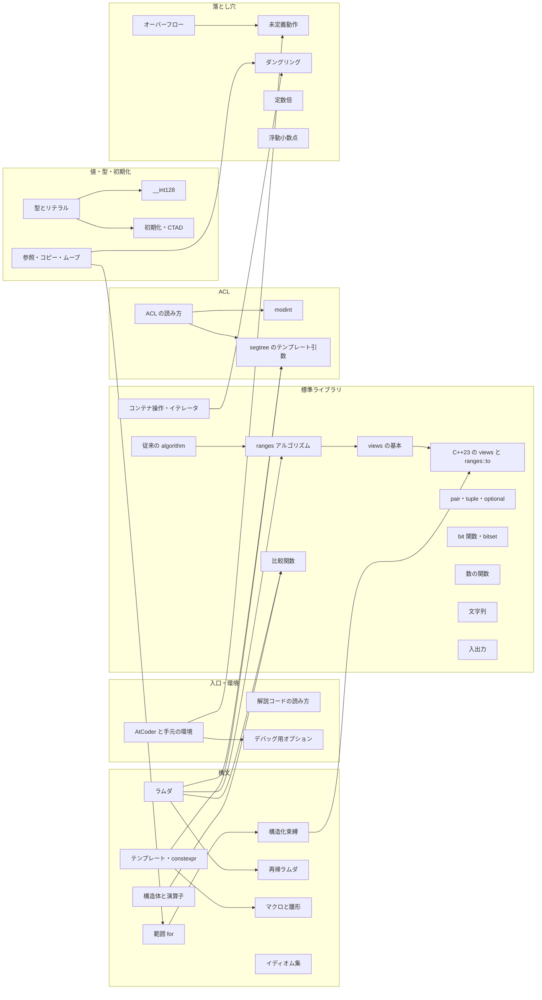

# 09 C++ 調査レポート

- 担当：09 cpp（C++）
- 調査日：2026-10-21
- 成果物：本ファイルと [09-cpp.topics.yaml](09-cpp.topics.yaml)（50項目。単独ページ 36、他ページの節 14）

## 0. 調査の方法と前提

- atcoder.jp とそのサブドメインのページは一切開いていない。公式解説のコードは読めないので、解説コードでの書き方の頻度は、要件定義書の例・第三者のライブラリの雛形・ブログ記事から推定した。推定であることは本文で明記する。
- 規格の版と GCC の対応版は cppreference・GCC のリリースノート・libstdc++ の対応表で調べ、そのうえで手元で実際にコンパイル・実行して確かめた。使った処理系は次のとおり。
  - g++-13 13.4.0：`-std=c++23`（以前の手元の設定）と `-std=gnu++23`
  - g++-15 15.2.0（AtCoder と同じ版。2026-10-21 に導入済み）：AtCoder に近い `-std=gnu++23 -O2 -Wall -Wextra -ftrivial-auto-var-init=zero -DATCODER -DONLINE_JUDGE -march=native` と、厳格な `-std=c++23 -O2`
- 本文の「確認済み」は、上の組み合わせで小さなプログラムを動かした結果である。検証用のコードはリポジトリの外（作業用の一時フォルダ）に置き、リポジトリには残していない。要点のコード片は本文に載せた。時間の数値は手元（WSL2）での1回か2回の計測で、目安である。
- 調査の途中で、セッション全体で共有している Web 検索の回数の上限に達した。以後は既知の URL（cppreference・cpprefjp・GCC のドキュメント・各ライブラリのリポジトリなど）を直接読むことと手元の検証で進めた。英語の資料は cppreference・GCC 公式・Red Hat Developer・USACO Guide・GitHub が中心である。
- Codeforces（codeforces.com）は noai 指定があるため資料にしていない。再帰ラムダ・ranges・入出力の速さなどを扱うブログ記事が Codeforces にあるが、未読である（AI 利用の指定を確かめるために一度だけ取得を試みたところボット確認のページが返り、内容は読んでいない）。本文に Codeforces の内容を根拠にした箇所はない。
- §1 の資料は、使う前にページの robots メタタグと X-Robots-Tag を確かめ、noai などの指定がないことを確認した。
- 調査中に手元の環境が更新された（g++-15 の導入、cph の設定を `g++-15 -std=gnu++23 -O2 -Wall -Wextra` に変更、`~/pch` の作り直し）。本文の「手元」は更新後の設定を指し、必要に応じて以前の g++-13 の結果も併記する。

## 1. 調べた資料

| 資料 | URL | 何の参考にしたか |
| --- | --- | --- |
| GCC 13 Release Series: Changes | https://gcc.gnu.org/gcc-13/changes.html | GCC 13 で入った C++23 の views・ranges アルゴリズム・`std::format`・static `operator()`・`[[assume]]` |
| GCC 14 Release Series: Changes | https://gcc.gnu.org/gcc-14/changes.html | deducing this・`std::print`・`ranges::to`・`std::generator`、`-lstdc++exp` が要るのは Windows の `print` など一部だけであること |
| GCC 15 Release Series: Changes | https://gcc.gnu.org/gcc-15/changes.html | 範囲 for の一時オブジェクトの寿命延長（P2718R0）・`std` モジュール・`flat_map`・範囲の書式化・`from_range` 構築・C++26 の `views::concat` |
| libstdc++ Implementation Status | https://gcc.gnu.org/onlinedocs/libstdc++/manual/status.html | C++20/23 のライブラリ機能ごとの実装版（`ranges::starts_with` と `mdspan` は GCC 16 など） |
| cppreference: Compiler support for C++17 / C++20 / C++23 / C++26 | https://en.cppreference.com/w/cpp/compiler_support/17 （同じく /20 /23 /26） | 言語機能・ライブラリ機能ごとの GCC の対応版 |
| cppreference: std::ranges::iota_view | https://en.cppreference.com/w/cpp/ranges/iota_view | `views::iota(0, size())` が型の不一致でコンパイルできない例、C++26 の `views::indices` |
| cpprefjp: C++23 | https://cpprefjp.github.io/lang/cpp23.html | 日本語の機能名と、教材からリンクする候補のページ |
| Red Hat Developer "New C++ features in GCC 15"（2025-04-24） | https://developers.redhat.com/articles/2025/04/24/new-c-features-gcc-15 | GCC 15 の既定が `-std=gnu++17` のままであること、P2718 と `-frange-for-ext-temps` |
| AC Library のドキュメント（手元、CC0） | `~/lib/ac-library-master/document_ja/`（index.md・appendix.md・segtree.md） | 共通の約束（explicit・既定コンストラクタ・半開区間）、expander.py の説明、segtree の引数 |
| AC Library のソース（手元） | `~/lib/ac-library-master/atcoder/`（segtree.hpp・lazysegtree.hpp・modint.hpp）、`expander.py`、`test/example/` | テンプレート引数が `auto op` であること、expander の動作、公式の使用例の書き方（`scanf`・関数名を渡す segtree） |
| AC Library Releases | https://github.com/atcoder/ac-library/releases | v1.5（広い関数型を受け付ける・C++20 対応）と v1.6（`val()` の型の変更・expander が元の行番号を出せる） |
| AC Library PR #160・#178 | https://github.com/atcoder/ac-library/pull/160 ・ https://github.com/atcoder/ac-library/pull/178 | ラムダを渡せる変更（2023-04-06 マージ）、`val()` から unsigned を外す変更（2025-04-19 マージ） |
| AC Library v1.6 のソース | https://github.com/atcoder/ac-library/archive/refs/tags/v1.6.zip | 手元（2023-11 の master）との差分を取った |
| traP「【非公式】[C++] AtCoder ジャッジアップデート (2024–2025) について」（2025-06-04） | https://trap.jp/post/2589/ | 新ジャッジの C++ で使える機能・ライブラリの一覧（非公式・GCC 15.1 時点）、`import std`、ACL 1.6 でラムダ |
| traP「競プロ用マクロ」（2021-03-12） | https://trap.jp/post/1224/ | 引数の数でマクロを切り替える技法（maspy の雛形が参照している） |
| Qiita reika727「AtCoder をやるときはスタックサイズを調整しとけ」（2023-06-24） | https://qiita.com/reika727/items/8fa6f5944b183c0a28f9 | AtCoder のスタック上限（当時 1 GiB）と手元の 8 MiB の差 |
| note Diary@競プロ「言語アップデートで使えるようになる競プロ向けC++20/23新機能」（2023-08-05） | https://note.com/diary_kyopro/n/n12f48f4d5b1f | 競プロで使う C++20/23 機能の洗い出し |
| Qiita Chippppp「競プロで役立つC++20新機能」（2022-04-06、2023-08-07 更新） | https://qiita.com/Chippppp/items/620d2e5229f5c7e93f0c | 射影・views・CTAD・ラムダの既定構築などの洗い出し |
| すいバカ日誌「競プロでも使える C++ の便利機能」（2019-03） | https://suikaba.hatenablog.com/entry/2019/03/14/171910 | C++11〜20 の便利機能、再帰に `std::function` を使うと遅いという指摘 |
| note plasma「AtCoderで使える！便利テクニック」（2019-04-05） | https://note.com/plasma_parse/n/n38a6c3faaa06 | 入出力の高速化・小数の出力・デバッグ用の分岐などの古典的な定型 |
| yohhoy の日記「自己再帰するラムダ式 @ C++23」 | https://yohhoy.hatenadiary.jp/entry/20211025/p1 | deducing this による再帰と、従来の書き方・不動点コンビネータとの比較 |
| USACO Guide "Lambda Expressions" | https://usaco.guide/general/lambda-funcs?lang=cpp | キャプチャと再帰ラムダの3方式（英語圏の教え方） |
| maspy/library の my_template.hpp | https://github.com/maspypy/library/blob/main/my_template.hpp | 雛形のマクロ・型の別名・INF・2つの型を取る chmin・pragma |
| NyaanNyaan/library の template | https://github.com/NyaanNyaan/library/tree/master/template | `each`/`each2`（`auto&&` と構造化束縛）・`long long` の rep・入力マクロ |
| ei1333/library の template.hpp | https://github.com/ei1333/library/blob/master/template/template.hpp | 入出力を初期化する構造体・`make_v`・不動点コンビネータ `FixPoint`/`MFP` |
| E869120/kyopro_educational_90 の解答例 | https://github.com/E869120/kyopro_educational_90 （sol/001.cpp・003.cpp） | 従来型の書き方（グローバル配列・`vector<int> G[1 << 18]`） |
| online-judge-tools/verification-helper | https://github.com/online-judge-tools/verification-helper | `oj-bundle`（`#include "..."` の展開）と `oj-verify` |
| competitive-verifier | https://github.com/competitive-verifier/competitive-verifier | verification-helper の流れをくむ検証ツール（GitHub Actions・ドキュメント生成） |
| ユーザーの cph フォーク | `/home/yuuki/projects/kyopro2/lib/_cph/cph-fork.patch` | 「提出用にコピー（ライブラリを展開）」の実装（bundler.ts・copyBundled.ts・テスト） |
| ユーザーの VS Code 設定 | `/home/yuuki/projects/kyopro2/.vscode/`（settings.json・tasks.json・c_cpp_properties.json）、`~/pch/bits/` | 手元のコンパイルオプション、プリコンパイル済みヘッダ |
| decisions.md | [../decisions.md](../decisions.md) | AtCoder の C++ 環境（GCC 15.2.0、オプション、ACL 1.6 など） |

## 2. 分野の全体像

### 2.1 この章の役割

- 学習者は基本文法を知っているが、解説コードの現代的な書き方に不慣れである。C++ 章の目的は2つ。
  1. 解説コードの1行を見て、その意味を引ける（読むための章）
  2. 自分のコードで C++ に由来する事故（WA・RE・TLE・CE）を起こさない（落とし穴の章）
- 各ページの中心は「この書き方は何をしているか」「同じことを素朴に書くとどうなるか」「どの版から使えるか」「どこで事故が起きるか」の4点にする。言語の網羅的な解説は cpprefjp に任せてリンクする。

### 2.2 サブ分野の構造

### 2.3 前提関係の要点

- 参照（`&`・`const&`・`&&`）が、範囲 for・構造化束縛・ダングリングの土台である。`views::enumerate` や `views::zip` の要素が「参照を含む組」であることを理解するには、範囲 for と構造化束縛の両方が要る。
- ラムダが、ranges アルゴリズムの述語と射影、比較関数、ACL のテンプレート引数、再帰ラムダの土台である。
- 型とリテラル → オーバーフロー → `__int128` の順に積み上がる。
- 従来の `<algorithm>`（イテレータの組を渡す）→ ranges アルゴリズム（コンテナを直接渡す・射影）→ views（遅延評価）→ C++23 の views と `ranges::to` の順に積み上がる。
- 環境のページが、未初期化変数・スタック・版の差・デバッグ用オプションの説明の土台になる。

### 2.4 混同されやすいもの

- `std::iota`（配列を連番で埋めるアルゴリズム）、`views::iota`（連番を生み出す view）、`ranges::iota`（C++23。前者の ranges 版）
- `std::reverse`・`ranges::reverse`（並べ替える）と `views::reverse`（逆順に見るだけ）
- `unique`（重複を前に詰めて新しい終端を返すだけで、消さない）と `erase`
- `accumulate`（初期値の型で計算する）、`reduce`（初期値を省くと要素の型の既定値）、`ranges::fold_left`
- `.size()`（符号なし）と `ssize()`（符号付き）
- `auto`・`auto&`・`const auto&`・`auto&&`
- `std::function`（型消去を通る。遅い）と `auto` で受けたラムダ
- `pair`・`tuple`・`struct`・`array`
- `cout`・`printf`・`std::format`・`std::print`
- `set` のメンバ `lower_bound`（O(log N)）と `std::lower_bound(st.begin(), st.end(), x)`・`ranges::lower_bound(st, x)`（O(N)）
- `map[k]`（なければ挿入する）と `find`・`contains`・`at`
- `push_back` と `emplace_back`
- `endl`（改行して毎回フラッシュ）と `'\n'`
- `memset`（バイト単位で埋める）と `fill`・`assign`
- `priority_queue` の比較関数（`greater` で最小が先頭）と `sort` の比較関数（`greater` で降順）
- C++ の「テンプレート」（`template`）と競プロの「テンプレート」（雛形ファイル）
- `#define ll long long` と `using ll = long long;`
- `__builtin_popcount`（`int` を受ける）と `std::popcount`（符号なし整数だけ）
- `-std=c++23` と `-std=gnu++23`

### 2.5 版の地図（何がいつから使えるか）

- C++17（GCC 7 以降）：構造化束縛・初期化式付き if・CTAD・`optional`・`gcd`/`lcm`・`clamp`・畳み込み式（fold expression）。今の環境ではすべて使える。
- C++20（GCC 8〜11 で順次。`std::format` だけ GCC 13）：範囲 for の初期化式・`<=>`・コンセプト・`auto` 引数・ranges と views・`<bit>`・`contains`・`erase_if`・ラムダの既定構築・クラス型の非型テンプレート引数（ACL の segtree にラムダを渡せる根拠）。
- C++23：GCC 11〜13 で大半がそろう（`views::enumerate`・`zip`・`chunk_by` などの views と `ranges::fold_left`・`contains` は GCC 13）。GCC 14 で deducing this・`std::print`・`ranges::to`・`std::generator`、GCC 15 で範囲・pair・tuple の書式化・`flat_map`・`from_range`・範囲 for の一時オブジェクトの寿命延長・`import std`。`ranges::starts_with` と `mdspan` は GCC 16 で、AtCoder の GCC 15.2 にはない（確認済み）。
- C++26：GCC 15 にも一部あるが（`views::concat`・飽和演算 `add_sat`・構造化束縛を条件に使う書き方）、AtCoder は `-std=gnu++23` なので使えない（確認済み）。例外として、名前のない変数 `_` を同じ場所で複数宣言する書き方は、GCC 15 なら C++23 モードでも警告つきで通る（確認済み）。

### 2.6 解説コードの3つの流派

解説コードの書き方は書き手によって大きく違う。C++ 章は3つとも読めるようにする必要がある。

1. **従来型**：グローバル配列、`vector<int> G[1 << 18]` のような配列の vector、`const int INF = (1 << 29)`、`scanf`/`printf`、素朴な for。典型90問の解答例（E869120）や ACL の公式の使用例（`scanf` と、関数名を渡す segtree）がこの形である。
2. **雛形型**：ライブラリ製作者の雛形に由来するマクロと補助関数が多い。maspy の雛形には `FOR` マクロ（引数の数で切り替え）・`ll`・`vc`/`vvc`・`all`・2つの型を取る `chmin`・`i128`・`pq_min`・`#pragma GCC optimize` がある。Nyaan の雛形には `each(x, v)`（`for (auto&& x : v)`）・`each2(x, y, v)`（`for (auto&& [x, y] : v)`）・`long long` の `rep`・入力マクロがある。ei1333 の雛形には入出力を初期化する構造体・多次元 vector を作る `make_v`・再帰ラムダ用の `FixPoint`/`MFP` がある。
3. **現代型**：`std::` を省かない、ranges と views、構造化束縛、ラムダ、`std::print`。要件定義書の例 `for (const auto& [i, component] : scc.scc() | views::enumerate)` はこの形である。AtCoder の C++ が GCC 15.2 になったので、deducing this・`std::print`・`ranges::to` を使うコードは今後増えると推定する（推定。公式解説は確認していない）。

## 3. 項目一覧

詳細は topics.yaml にある。レベルは「その書き方が解説コードで目に入り始める帯」の目安で、C++ 章ではほとんどが基礎になる（§7.2）。「根拠」は推定を含む。

| 項目（key） | レベル | 根拠（帯の目安） | 前提 | ACL | ページ案 |
| --- | --- | --- | --- | --- | --- |
| 解説コードの読み方（cpp-reading-guide） | 基礎 | 要件定義書の例。章の入口 | なし | - | 単独（章の入口） |
| AtCoder と手元の環境（cpp-environment） | null | 環境の知識 | なし | - | 単独 |
| 版と GCC の対応表（cpp-version-matrix） | null | 環境の知識 | 環境 | - | 環境の節 |
| 再帰の深さとスタック（cpp-stack-depth） | 基礎 | N ≤ 2×10^5 の再帰 DFS は茶〜緑から | 環境 | - | 環境の節 |
| import std（cpp-import-std） | null | 環境の知識 | 環境 | - | 環境の節 |
| 型とリテラル（cpp-types-literals） | 基礎 | どの帯にも出る | なし | - | 単独 |
| `__int128`（cpp-int128） | 基礎 | 推定：茶〜青で散発的 | 型、オーバーフロー | - | 単独 |
| INF の決め方（cpp-numeric-limits-inf） | 基礎 | 最短路・DP の初期値 | 型 | - | 型の節 |
| 初期化（cpp-initialization） | 基礎 | DP 表・グリッド（灰〜茶） | 型 | - | 単独 |
| CTAD（cpp-ctad） | 基礎 | 現代型の DP 表の宣言 | 初期化 | - | 初期化の節 |
| 参照・コピー・ムーブ（cpp-references） | 基礎 | どの帯にも出る | なし | - | 単独 |
| 範囲 for（cpp-range-for） | 基礎 | 灰から | 参照 | - | 単独 |
| 構造化束縛（cpp-structured-bindings） | 基礎 | 要件定義書の例、灰から | 範囲 for | - | 単独 |
| 初期化式（cpp-init-statements） | 基礎 | map の検索（灰〜茶） | 構造化束縛 | - | イディオム集の節 |
| イディオム集（cpp-idioms） | 基礎 | 出力整形・更新関数（灰〜茶） | なし | - | 単独 |
| ラムダ（cpp-lambda） | 基礎 | 比較関数・判定関数（茶） | 参照 | - | 単独 |
| 再帰ラムダ（cpp-recursive-lambda） | 基礎 | DFS・メモ化再帰（茶〜緑） | ラムダ | - | 単独 |
| テンプレート・constexpr（cpp-templates-constexpr） | 基礎 | chmin・定数（灰） | なし | - | 単独 |
| マクロと雛形（cpp-macros-template-file） | 基礎 | 雛形由来（どの帯にも） | テンプレート | - | 単独 |
| 名前空間（cpp-namespaces） | 基礎 | `std::` を付ける流儀 | なし | - | マクロと雛形の節 |
| 構造体と演算子（cpp-struct-operators） | 基礎 | 複数キーのソート（茶） | 初期化 | - | 単独 |
| 従来の algorithm（cpp-algorithms-classic） | 基礎 | 灰〜茶 | イテレータ | - | 単独 |
| ranges アルゴリズム（cpp-ranges-algorithms） | 基礎 | 現代型では灰から | 従来の algorithm、ラムダ | - | 単独 |
| views の基本（cpp-views-basics） | 基礎 | 現代型では灰から | 範囲 for、ラムダ | - | 単独 |
| C++23 の views（cpp-views-cpp23） | 基礎 | 要件定義書の例 | views の基本、構造化束縛 | - | 単独 |
| ranges::to（cpp-ranges-to） | 基礎 | views と同時に出る | C++23 の views | - | C++23 の views の節 |
| コンテナ操作（cpp-container-idioms） | 基礎 | set・map（茶〜緑） | イテレータ | - | 単独 |
| イテレータ（cpp-iterators） | 基礎 | lower_bound・set（茶） | なし | - | コンテナ操作の節 |
| 比較関数（cpp-comparators） | 基礎 | ダイクストラ（緑）・ソート | ラムダ、構造体 | - | 単独 |
| pair・tuple・optional（cpp-optional-tuple） | 基礎 | 茶 | 構造化束縛 | - | 単独 |
| bit 関数（cpp-bit-functions） | 基礎 | bit 全探索（茶） | 型 | - | 単独 |
| bitset（cpp-bitset） | null | 手法の帯は 08 に従う | bit 関数 | - | bit 関数の節 |
| 数の関数（cpp-math-functions） | 基礎 | 灰〜茶 | 型 | - | 単独 |
| 文字列（cpp-string-api） | 基礎 | 灰 | なし | - | 単独 |
| 入出力（cpp-io） | 基礎 | 全問。10^5〜10^6 の入出力で差 | なし | - | 単独 |
| 乱数と時間計測（cpp-random-chrono） | null | 手法の帯は 08 に従う | なし | - | 単独（短い） |
| ACL の読み方（acl-reading） | 基礎 | dsu・modint（茶〜緑） | テンプレート | atcoder 全体 | 単独 |
| modint（acl-modint） | 基礎 | mod 998244353 の数え上げ（茶〜緑） | ACL の読み方、06 の mod | modint998244353 ほか | 単独 |
| segtree のテンプレート引数（acl-segtree-template） | 水 | セグ木は水から（05 の根拠）。遅延セグ木は青 | ACL の読み方、ラムダ、05 のセグ木 | segtree・lazy_segtree | 単独 |
| ACL のその他の部品（acl-other-components） | null | 各手法の担当に従う | ACL の読み方 | dsu・fenwick_tree・scc_graph など | ACL の読み方の節 |
| オーバーフロー（cpp-integer-overflow） | 基礎 | 灰〜茶から | 型 | - | 単独 |
| 未定義動作（cpp-undefined-behavior） | 基礎 | 帯に依存しない | オーバーフロー | - | 単独 |
| ダングリング（cpp-dangling） | 基礎 | ダイクストラ（緑） | 参照、範囲 for | - | 単独 |
| 未初期化変数（cpp-uninitialized-variables） | 基礎 | 帯に依存しない | 環境 | - | 未定義動作の節 |
| 定数倍（cpp-performance） | 基礎 | 茶〜 | 入出力 | - | 単独 |
| 浮動小数点（cpp-floating-point） | 基礎 | 灰〜茶 | 型 | - | 単独 |
| デバッグ用オプション（cpp-debug-build） | null | 道具の知識 | 環境 | - | 単独 |
| コンパイルエラーの読み方（cpp-compile-errors） | 基礎 | どの帯でも起きる | なし | - | デバッグ用オプションの節 |
| 自作ライブラリ（self-library） | null | 横断ページ | テンプレート、ACL の読み方 | - | 単独（横断） |
| バンドル（library-bundling） | null | 横断ページの節 | 自作ライブラリ | expander.py | 自作ライブラリの節 |

## 4. 項目ごとのメモ

各項目について「できること・なぜ」「つまずき（確認済みの事実を含む）」「図」「確認問題」「サイン（解説コードでの見た目・症状）」「使い分け」を書く。C++ 章では「問題のサイン」の代わりに「コードの見た目」と「症状」を逆引きの鍵にする。

### 4.1 解説コードの読み方（cpp-reading-guide）

- **できること**：解説コードの1行を部品に分け、部品ごとにこの章のページへ案内する入口のページ。§6.1 の「コードの見た目からの逆引き表」を本体にする。
- **分解の例**（要件定義書の例）：`for (const auto& [i, component] : scc.scc() | views::enumerate)`
  1. `scc.scc()`：ACL の `scc_graph::scc()`。強連結成分をトポロジカル順に並べた `vector<vector<int>>` を返す（確認済み：辺 0→1、1→0、1→2、3→2 で `{3}`、`{0,1}`、`{2}` の順）。
  2. `| views::enumerate`：C++23 の view。各要素に添字を付けた組（添字, 要素への参照）を順に作る。添字の型は `ptrdiff_t`（64bit の Linux では `long`）。
  3. `[i, component]`：構造化束縛。組の中身に名前を付ける。
  4. `const auto&`：範囲 for の受け方。受けるのは「その場で作られる組」で、const 参照で受けると組の寿命がループ1回分に延びる。`component` の型は `vector<int>&` で const は付かない。const が付くのは組のほうで、組が持つ参照の先ではないからである（`static_assert` で確認済み）。`auto&` にするとコンパイルエラーになる（確認済み）。
  5. `scc.scc()` の戻り値は一時オブジェクトだが、右辺値をパイプに流すと view の中に移される（`owning_view`）ので、ループの間は生きている（AddressSanitizer で問題が出ないことを確認済み）。
- **教え方の案**：1行を「何を回しているか（範囲）」「何を受け取っているか（要素の型）」「どう受け取っているか（コピーか参照か）」の3つに分けて読む手順をページの冒頭に置く。
- **図**：1行を部品に分け、部品ごとに該当ページへ矢印を引いた分解図。
- **確認問題**：「この行で `component` を書き換えると何が変わるか」「`const auto&` を `auto&` にするとなぜコンパイルできないか」「`i` と `int` の変数を `max` で比べるとどうなるか（型が違ってコンパイルエラー）」

### 4.2 AtCoder の C++ 環境と手元の環境（cpp-environment）

**AtCoder と手元の比較**（AtCoder の値は decisions.md、手元は 2026-10-21 更新後の cph の設定）

| 項目 | AtCoder（C++23 (GCC 15.2.0)） | 手元（cph） | 結果に差が出る場面 |
| --- | --- | --- | --- |
| コンパイラ | GCC 15.2.0 | g++-15 15.2.0 | 同じ |
| 規格 | `-std=gnu++23` | `-std=gnu++23` | 同じ（以前は `-std=c++23` で差があった。後述） |
| 最適化 | `-O2` | `-O2`（VS Code のビルドタスクは `-g` だけで最適化なし） | 最適化なしのビルドでは未定義動作の現れ方が変わる |
| 警告 | `-Wall -Wextra` | `-Wall -Wextra` | 同じ |
| `-march=native` | あり | なし | 速さだけ。`#pragma GCC target` は AtCoder では不要 |
| `-ftrivial-auto-var-init=zero` | あり | なし | 未初期化の局所変数が AtCoder では 0、手元では不定 |
| `-DATCODER -DONLINE_JUDGE` | あり | なし | デバッグ出力の切り替えに使える |
| `-fmodules` | あり | なし | `import std;` を使うときだけ |
| `-lstdc++exp` | あり | なし | `<stacktrace>` などを使うときだけ。`std::print` には不要（手元で確認） |
| ACL | 1.6 | 1.5 系（2023-11-08 の master） | `modint::val()` の型（1.6 は `int`、手元は `unsigned int`） |
| スタック | 大きい（2023-06 の第三者の確認で 1 GiB。2025-10 の新ジャッジでは未確認） | Linux の既定は 8 MiB が多い（`ulimit -s` で確認する） | 深い再帰が手元だけで落ちる |
| プリコンパイル済みヘッダ | なし | `~/pch`（同じオプションのときだけ使われる） | コンパイル時間だけ |

**オプションの意味と確認した挙動**

- `-std=gnu++23`：C++23 に GNU 拡張を加えたもの。厳格な `-std=c++23` との差を確認した。
  - `typeof` は gnu モードでだけ使える（`-std=c++23` では「‘typeof’ was not declared」）。
  - `std::is_integral_v<__int128>` は gnu モードで true、厳格モードで false。そのため厳格モードでは `std::gcd(__int128, __int128)` と `std::abs(__int128)` がコンパイルエラーになる。gnu モードでは通る。
  - 可変長配列 `int a[n];`・`a ?: b`・`case 1 ... 5:` はどちらでも通る（拡張。`-Wpedantic` で警告）。`M_PI` はどちらでも使える。
  - 以前の手元の設定（g++-13 `-std=c++23`）では、AtCoder で通るコードがコンパイルエラーになる場面があった。現在の設定は AtCoder と同じ gnu モードなので解消している。
- `-ftrivial-auto-var-init=zero`：初期化していない自動変数（関数内の変数・配列）を 0 で埋める。確認したこと：
  - 未初期化の `long long s;` と `int cnt[5];` を読む関数が、フラグなしでは 9895225500946201 のようなゴミの値を返し、フラグありでは正しい値（601）を返した（g++-13・g++-15 の両方、`-O0`・`-O2` の両方）。
  - `-Wall` は `s` について「may be used uninitialized」と警告したが、配列 `cnt` については警告しなかった。
  - 対象は自動変数だけで、グローバル変数はもともと 0 で初期化される。`new` や `malloc` で取った領域はこのフラグの対象外である。
  - 結果として「AtCoder では AC、手元では WA」（またはその逆）が起こりうる。規格上は未定義動作のままなので、初期化を書く習慣で防ぐ。
- `-march=native`：ジャッジの CPU の命令を使う。手元の g++-13 では `#pragma GCC target("avx2,popcnt")` を `#include <bits/stdc++.h>` より前に書くとコンパイルエラーになった（「inlining failed in call to ‘always_inline’ ... target specific option mismatch」）。g++-15 では通った。maspy の雛形は対策として `<bits/allocator.h>` を先に読み込んでいる。
- `-fmodules`：`import std;` を使えるようにする（§4.5）。
- `-DATCODER -DONLINE_JUDGE`：ジャッジでだけ定義されるマクロ。`#ifndef ONLINE_JUDGE` でデバッグ出力を手元だけにできる。手元で `-DLOCAL` を付けて `#ifdef LOCAL` とする流儀もある。
- 2026-06 に `-flto=auto` が外された（decisions.md）。教材では触れなくてよい。
- 同じ AtCoder でも Clang 21.1.0（libc++）を選ぶと、使えるライブラリ機能が変わる（traP の記事では、Clang 側に views::zip 系がない時期があった）。教材では GCC を選ぶよう勧める。

**プリコンパイル済みヘッダ（PCH）**：`~/pch/bits/stdc++.h.gch` は、作ったときと同じオプション（`-std=gnu++23 -O2`）のときだけ使われる。違うと黙って無視される。`-Winvalid-pch` を付けると理由が出る（確認：`-std=c++23` では「not used because ‘unix’ not defined」、`-g` では「created with 'none' debug info」）。使われたときのコンパイル時間は 0.4 秒、使われないときは 1.1 秒だった。

**つまずき**：手元と AtCoder で結果が違うとき、原因はほぼ「未初期化変数」「未定義動作（最適化の差）」「スタック」「ACL の版」のどれかである。この順に疑う手順をページに置く。

**図**：AtCoder と手元のオプションを並べた比較表（上の表）に、差が出る行の印を付ける。

**確認問題**：「`long long sum;` と書いて足し始めたコードが AtCoder で AC した。手元で答えが変になる理由は？」「手元でだけ Segmentation fault になる典型的な原因を2つ挙げよ」

### 4.3 C++ の版と GCC の対応（cpp-version-matrix）

○ は使える、× は使えない。「手元 g++-13」は以前の設定（`-std=c++23`）で、今は g++-15 に移ったが、ほかの環境（古いジャッジ・他人の環境）で解説コードを動かすときの目安として残す。すべて確認済み（GCC の版は cppreference と GCC のリリースノートによる）。

| 機能 | 規格 | GCC | g++-13 | AtCoder（GCC 15.2・gnu++23） |
| --- | --- | --- | --- | --- |
| 構造化束縛・初期化式付き if・CTAD・`optional`・`gcd`/`lcm`・`clamp` | C++17 | 7 | ○ | ○ |
| 範囲 for の初期化式・テンプレート構文のラムダ・指示付き初期化 | C++20 | 8〜9 | ○ | ○ |
| `<=>`・コンセプト・`auto` 引数・括弧による集成体初期化・構造化束縛のキャプチャ | C++20 | 10 | ○ | ○ |
| ranges・views（基本）・`span`・`numbers`・`ssize` | C++20 | 10 | ○ | ○ |
| `<bit>`・`contains`・`starts_with`/`ends_with`（string）・`erase_if`・`midpoint` | C++20 | 9 | ○ | ○ |
| ラムダの既定構築（`set<int, decltype(cmp)>`）・未評価文脈のラムダ | C++20 | 9 | ○ | ○ |
| クラス型の非型テンプレート引数（ACL の segtree にラムダ） | C++20 | 9〜11 | ○ | ○ |
| `std::format` | C++20 | 13 | ○ | ○ |
| `string::contains`・`uz` リテラル・`to_underlying` | C++23 | 11 | ○ | ○ |
| `expected`・`unreachable`・`byteswap`・`auto(x)`・多次元の添字演算子 | C++23 | 12 | ○ | ○ |
| `views::enumerate`/`zip`/`zip_transform`/`adjacent`/`pairwise`/`chunk`/`slide`/`chunk_by`/`stride`/`cartesian_product`/`repeat`/`join_with`/`as_const` | C++23 | 13 | ○ | ○ |
| `ranges::fold_left`/`contains`/`iota`/`find_last`・static ラムダ・`[[assume]]` | C++23 | 13 | ○ | ○ |
| deducing this（`this auto&& self`）・`std::print`/`println`（引数なしの `println()` も）・`ranges::to`・`std::generator` | C++23 | 14 | × | ○ |
| 範囲 for の一時オブジェクトの寿命延長（P2718） | C++23 | 15 | ×（未定義動作になる） | ○ |
| 範囲・pair・tuple の書式化（`println("{}", v)`）・`flat_map`/`flat_set`・`from_range`/`insert_range`/`append_range`・`import std` | C++23 | 15 | × | ○ |
| 名前のない変数 `_` の複数宣言 | C++26 | 14 | × | △（警告つきで通る） |
| `views::concat`・`add_sat` などの飽和演算・構造化束縛を条件に使う | C++26 | 14〜15 | × | ×（`-std=c++26` が必要） |
| `ranges::starts_with`/`ends_with`・`mdspan`・`views::indices` | C++23/26 | 16 | × | × |

### 4.4 再帰の深さとスタックサイズ（cpp-stack-depth）

- **なぜ落ちるか**：関数を呼ぶたびに引数・局所変数・戻り先がスタックに積まれる。深さ D の再帰はおよそ D × 1フレーム分を使う。
- **確認済み**：一直線の木（パス）を再帰 DFS する素朴なコードを `ulimit -s 8192`（8 MiB）で動かすと、`-O2` では深さ 10^5 は通り、2×10^5 で Segmentation fault になった。最適化なし（`-O0`）では深さ 10^5 でも落ちた。スタックを広げる（`ulimit -s 1048576` や `unlimited`）と深さ 10^6 でも通った。
- **AtCoder 側**：第三者がコードテストで `ulimit -s` を実行した結果は 1048576 KiB（1 GiB。2023-06-24 の記事）だった。2025-10 の新ジャッジでの値は確かめられていない（WebSearch の上限のため）。教材では「AtCoder ではスタックが大きいので深い再帰も通ることが多いが、手元では落ちる」と書き、新ジャッジの値は「未確認」とする。
- **対策**：手元で試すときは端末で `ulimit -s unlimited` してから実行する。cph は VS Code の拡張機能からプログラムを起動するので、VS Code を起動したシェルの上限を引き継ぐ（推定）。根本的には、BFS 順で処理する・明示的なスタックで書き直す。
- **つまずき**：大きな局所配列（`int a[10000000];` を関数内に置く）もスタックを使い切る。グローバルに置けばスタックを使わない。
- **図**：コールスタックが1段ずつ積み上がり、上限を超えたところで落ちるアニメーション。
- **確認問題**：「同じコードが `-O0` だと浅い深さで落ちる理由は？」（フレームが大きい）
- **症状**：手元でだけ RE（Segmentation fault）。N ≤ 2×10^5 の木を再帰で回している。パスのような細長い入力でだけ落ちる。

### 4.5 import std; とモジュール（cpp-import-std）

- **できること**：`#include` の代わりに `import std;` で標準ライブラリ全体を読み込む（C++23）。AtCoder の GCC では `-fmodules` が付いており、traP の非公式記事によれば `import std;` が使える（部分的な対応）。
- **手元での確認**：g++-15 では、先に `g++-15 -std=gnu++23 -O2 -fmodules -fsearch-include-path -c bits/std.cc` で `gcm.cache/std.gcm` を作っておくと、`import std;` のコードがコンパイルできた（作るのに 2.6 秒）。コンパイル時間は `bits/stdc++.h`（PCH なし）の 2.7 秒に対して 1.8 秒だった。`--compile-std-module` は GCC 15 にはない。
- **つまずき**：モジュールはマクロを持ち込まないので、`INT_MAX` や `assert` が使えない（「‘INT_MAX’ was not declared」を確認）。`numeric_limits<int>::max()` は使える。traP の記事は、`#include` と併用するときは `import` を後に書くよう注意している。
- **教材での扱い**：解説コードに `import std;` が出ても「`#include <bits/stdc++.h>` と同じ役割」と読めれば足りる。学習者に勧める必要はない。

### 4.6 型とリテラル（cpp-types-literals）

- **できること**：整数の型（`int`・`long long`・`unsigned`・`size_t`・`int64_t`）、リテラルの接尾辞（`LL`・`ULL`）、桁区切り `1'000'000'007`（C++14）、2進リテラル `0b1010`（C++14）、`size_t` のリテラル `0uz`（C++23、GCC 11。g++-13 で確認）、文字列リテラル `"abc"s`・`"abc"sv`、型の別名 `using ll = long long;`。
- **auto の推論**（確認済み）：`auto x = 0;` は `int`、`auto x = 0LL;` は `long long`、`auto n = v.size();` は `size_t`（符号なし）、`auto INF = 1e18;` は `double`。
- **つまずき**：
  - `#define ll long long` だと `ll(d)` のような関数形式のキャストが `long long(d)` になってコンパイルエラーになる（確認済み）。`using ll = long long;` なら通る。
  - `(long long)1e18 + 1` は 1000000000000000001 だが、`(long long)(1e18 + 1)` は 1000000000000000000 になる（double の精度。確認済み）。
- **図**：32/64/128 bit 整数と double が正確に表せる範囲を1本の数直線に並べた図（int は約 2.1×10^9、long long は約 9.2×10^18、double が整数を正確に表せるのは 2^53 ≈ 9.0×10^15 まで）。
- **確認問題**：「`auto INF = 1e18;` の型は？ `INF + 1` は正確か？」
- **見た目**：`1LL << 60`、`1'000'000'007`、`0b1010`、`0uz`、`static_cast<long long>(x)`

### 4.7 __int128（cpp-int128）

- **できること**：GCC の拡張の 128bit 整数。約 ±1.7×10^38 まで表せるので、10^18 程度の数どうしの積を正確に持てる。
- **なぜ要るか**：`long long` どうしの積は約 9.2×10^18 を超えるとオーバーフロー（未定義動作）になる。積を `__int128` で計算してから比べる。
- **つまずき**（確認済み）：
  - `cout << x` はコンパイルエラー（「ambiguous overload for ‘operator<<’」）。10 で割りながら文字列にする関数を自作するか、`std::format("{}", x)`（GCC 13 以降）・`println("{}", x)`（GCC 14 以降）を使う。両方とも動いた。
  - `cin >> x` もできない。文字列で読んで変換する。リテラルもないので `(__int128)1 << 100` のように書く。
  - 厳格な `-std=c++23` では `is_integral_v<__int128>` が false で、`std::gcd`・`std::abs` に渡せない。AtCoder（gnu++23）では渡せる。`numeric_limits<__int128>` はどちらのモードでも使える。
- **ほかの方法との使い分け**：「積が上限を超えるか」だけを知りたいなら、`a > LIMIT / b` と割り算で判定する方法、GCC の組み込み関数 `__builtin_mul_overflow(a, b, &c)`（あふれたら true。確認済み）がある。`long double`（x86-64 の GCC では仮数部 64bit。確認済み）が整数を正確に表せるのは 2^64（約 1.8×10^19）までなので、10^18 どうしの積のような大きな値は丸められ、境界付近の比較を誤りうる。
- **確認問題**：「a, b ≤ 10^18 のとき `a * b <= 10^18` を正しく判定する方法を2つ」
- **見た目**：`__int128`、`i128`、`(__int128)a * b`

### 4.8 numeric_limits と INF の決め方（cpp-numeric-limits-inf、型の節）

- **できること**：`numeric_limits<long long>::max()` で型の最大値を得る。最短路や DP の「到達できない」を表す INF の値を決める。
- **INF の候補と性質**

| 書き方 | 値 | INF + INF | 備考 |
| --- | --- | --- | --- |
| `numeric_limits<int>::max()`・`INT_MAX` | 約 2.1×10^9 | あふれる | `dist[u] + w` の時点で未定義動作 |
| `1 << 30` | 約 1.07×10^9 | あふれる（2^31） | int で使うなら足し算に注意 |
| `0x3f3f3f3f` | 1061109567 | int に収まる | `memset(d, 0x3f, sizeof d)` で配列を埋められる |
| `1LL << 60` | 約 1.15×10^18 | long long に収まる | よく使われる |
| `numeric_limits<long long>::max()` | 約 9.2×10^18 | あふれる | 足さない用途（最小値の初期値）に限る |
| `1e18` | double | - | `long long INF = 1e18;` なら正確だが、`auto` だと double になる |

- ライブラリの雛形の例：maspy は `long long` の INF に 2.02×10^18、Nyaan は 4004004004004004004（2倍しても収まる）、ei1333 は `(1LL << 62) - 1` を使う。
- **確認問題**：「`INF = INT_MAX` のとき `dist[u] + w < dist[v]` はどうなるか」

### 4.9 初期化の書き方（cpp-initialization）と CTAD（cpp-ctad）

- **できること**（確認済み）：
  - `vector<int> a(n);` は 0 で n 個。`vector<int> a(n, x);` は x で n 個。
  - 多次元：`vector<vector<long long>> dp(n + 1, vector<long long>(m + 1, -1));`、3次元は入れ子を1段深くする。
  - `array<int, 26> cnt{};`（`{}` で 0 になる）、`vector<array<int, 3>> v(n);`（要素は 0）。
  - グローバル変数・配列は 0 で初期化される。関数内の `int a[5];` は初期化されない（AtCoder でだけ 0 になる。§4.36）。
  - 構造体の既定値 `struct E { int to; long long cost = 0; };`、指示付き初期化 `E{.to = 3}`（C++20。メンバの宣言順に書く）。
  - C++20 から、集成体（コンストラクタのない構造体）にも `es.emplace_back(to, cost);` が使える（C++17 ではコンパイルエラー。確認済み）。
- **CTAD**（クラステンプレートの実引数推論。C++17）：型引数を省き、括弧の中身から型を決める。確認した例：
  - `vector dp(n, vector(m, 0LL));` は `vector<vector<long long>>`。`0` にすると `int` になる。
  - `vector d4 = vector(2, vector(3, vector(4, 0)));` は3次元。
  - `pair p{1, 2.5};` は `pair<int, double>`、`tuple t{1, 'a', 2LL};`、`array a{1, 2, 3};` は `array<int, 3>`。
  - `priority_queue pq(greater<int>{}, vector<int>{});` は最小ヒープ。
- **つまずき**（確認済み）：
  - `vector<int> a{n};` は「n という値が1個」の vector になる。`vector x{3, 0};` は2要素、`vector y(3, 0);` は 0 が3個。
  - `vector w{v.begin(), v.end()};` は `v` の要素の vector ではなく、**イテレータ2個の vector**（`vector<vector<int>::iterator>`）になる。警告も出ない。丸括弧 `vector w(v.begin(), v.end());` なら `vector<int>` になる。
  - `memset` はバイト単位で埋めるので、使えるのは 0・-1・`0x3f` などに限る。`memset(c, 1, sizeof c)` は 16843009（0x01010101）になる。
  - 2次元の C 配列を埋めるには `fill(&g[0][0], &g[0][0] + H * W, v);`。vector の各行は `ranges::fill(row, 0)` か `assign`。
- **図**：3次元 vector の入れ子を箱で描き、括弧と次元の対応を色分けした図。CTAD は「0LL → long long → vector<long long> → vector<vector<long long>>」と内側から型が決まる流れ。
- **確認問題**：「`vector<int> a{n};` の大きさは？」「`vector dp(n, vector(m, 0));` の要素の型は？」「`vector w{v.begin(), v.end()};` の `w.size()` は？」
- **使い分け**：DP 表は vector の入れ子（大きさが入力で決まる）、小さな固定長は `array`、グローバルな固定長は C 配列（従来型）。

### 4.10 参照・コピー・ムーブ（cpp-references）

- **できること**：`T&`（別名）、`const T&`（書き換えない別名。コピーしない）、`T&&` と `auto&&`（何でも受けられる参照）、`std::move`（中身を移す）、`swap`。
- **なぜ大事か**：
  - 関数に `vector` を値渡しすると、呼ぶたびに全体がコピーされる。再帰の引数で値渡しすると O(N) × 呼び出し回数になり TLE・MLE の原因になる。`const vector<int>&` で渡す。
  - `swap(dp, ndp)` は中身のポインタを入れ替えるだけで O(1)。`dp = ndp` は O(N) のコピー。DP の配列を入れ替えるときに効く。
  - `[=]` でキャプチャしたラムダは、作った時点で vector を丸ごとコピーする。
- **つまずき**：`auto& row = g[i];` のあとで `g.push_back(...)` すると、vector の再確保で `row` が消えた領域を指す（AddressSanitizer で heap-use-after-free を確認。§4.37）。
- **図**：変数名と実体の箱を描き、コピー（箱が増える）・参照（矢印）・ムーブ（中身が移り、元は空になる）を並べた図。
- **確認問題**：「再帰関数の引数を `vector<int> v` から `const vector<int>& v` にすると何が変わるか」

### 4.11 範囲 for（cpp-range-for）

- **4通りの受け方**

| 書き方 | コピー | 元を書き換え | 使いどころ |
| --- | --- | --- | --- |
| `for (auto x : v)` | する | できない | int などの小さな値 |
| `for (auto& x : v)` | しない | できる | 書き換える（入力を読み込む `for (auto& a : A) cin >> a;`） |
| `for (const auto& x : v)` | しない | できない | 大きな要素（string・vector）を読むだけ |
| `for (auto&& x : v)` | しない | できる | 何でも受ける。views や `vector<bool>` の要素（代わりの小さな物）も受けられる |

- **つまずき**（確認済み）：
  - `vector<bool>` は要素を1bit ずつ詰めた特殊な型で、要素の参照の代わりに小さな物（プロキシ）を返す。`for (auto& b : vb)` はコンパイルエラーになる。`auto&&` なら通る。`auto y = vb[0]; y = false;` と書くと、`y` がコピーではなくプロキシなので **`vb[0]` が書き換わる**。
  - ループの中で同じ vector に `push_back` してはいけない（再確保で壊れる）。
  - 範囲が「一時オブジェクトのメンバや添字」のときの寿命は、§4.37 の P2718 を参照（`for (int v : d.groups()[0])` は GCC 15 の C++23 モードより前では壊れる）。`for (auto x : f())` のように関数の戻り値そのものを回すのは、どの版でも安全である。
  - 範囲 for の初期化式（C++20）`for (int i = 0; auto x : v)` は、`i` の更新を自分で書く必要がある（書き忘れやすい）。
- **図**：4通りの宣言を「コピーが起きるか」「元を書き換えられるか」の2軸の表に置いた図。
- **確認問題**：「`for (auto x : v) x *= 2;` で v は変わるか」「`vector<bool>` を `auto&` で回せない理由」
- **見た目**：`for (auto&& [u, v] : es)`、`for (const auto& s : strs)`、`for (int i = 0; auto x : v)`

### 4.12 構造化束縛（cpp-structured-bindings）

- **できること**：pair・tuple・構造体・配列・`array` の中身に名前を付けて取り出す（C++17）。確認した形：`auto [a, b] = p;`、`for (auto [to, cost] : es)`（構造体）、`auto [p, q, r] = arr;`、`auto [s0, s1] = raw;`（C 配列）、`for (auto& [k, v] : mp)`、`if (auto [it, ok] = mp.emplace(k, v); ok)`。
- **なぜ動くか**：見えない変数に右辺を受け、その各メンバに名前を付けている。`auto` なら見えない変数はコピー、`auto&` なら参照になる。名前はメンバの宣言順に付き、数が合わないとエラーになる。
- **つまずき**（確認済み）：
  - **`const auto& [d, v] = pq.top(); pq.pop();` は壊れる**。参照が指していた先頭の場所に別の要素が移ってくるので、`d`・`v` が別の値になる。手元の例では (5, 1) を取り出したつもりが (7, 2) が出た。AddressSanitizer・`_GLIBCXX_DEBUG`・警告のどれでも検出されなかった。`auto [d, v] = pq.top();`（コピー）なら正しい。ダイクストラで頻出する事故。
  - map を `auto& [k, v]` で回すと `k` は const、`v` を書き換えると map が変わる。`auto [k, v]` なら map は変わらない。
  - `views::enumerate`・`views::zip` の要素は「参照を含む組」なので、`auto [i, x]` と書いても `x` は元の要素への参照になる（§4.23）。
  - 構造化束縛した名前をラムダでキャプチャするのは C++20 から（GCC 10）。g++-13 は C++17 モードでも拡張として通した。
  - 使わない名前には `_` を使える。同じ場所で `_` を2回使うのは C++26（GCC 14 以降、AtCoder の GCC 15 では警告つきで通る。g++-13 ではエラー）。
- **図**：pair・tuple・構造体の箱から名前へ線を引き、`auto`（コピー）と `auto&`（参照）で線の種類を変えた図。pq.top() の事故は、ヒープの配列で pop の前後を並べたステップ送り。
- **確認問題**：「`const auto& [d, v] = pq.top(); pq.pop();` のあと `d` は何を指すか」「`auto [k, v]` で map を回して `v` を書き換えたら map は変わるか」
- **使い分け**：取り出すだけなら構造化束縛、一部だけ代入し直すなら `tie`（§4.26）。

### 4.13 if・switch・範囲 for の初期化式（cpp-init-statements、イディオム集の節）

- **できること**：`if (auto it = mp.find(k); it != mp.end()) { ... }` のように、条件の前に変数の宣言を置ける（C++17）。変数の有効範囲が if 文（else を含む）の中に限られる。範囲 for にも初期化式を置ける（C++20）。
- **確認済み**：`if (auto [it, ok] = mp.emplace("y", 2); ok)` の形も通る。
- **つまずき**：C++26 の「構造化束縛そのものを条件にする」書き方（`if (auto [p, ec] = from_chars(...))`）は、AtCoder の gnu++23 では使えない（確認済み）。

### 4.14 よく見る短い書き方（cpp-idioms）

確認済みのもの：

- `cout << a[i] << " \n"[i == n - 1];`：文字列リテラル `" \n"` の0文字目（空白）か1文字目（改行）を選ぶ。最後の要素の後だけ改行する。
- `return a < b && (a = b, true);`：カンマ演算子。左を評価してから右を値にする。chmax を1行で書く形（ei1333 の雛形）。
- `cond ? "Yes" : "No"`：三項演算子。
- `x & -x`（最下位の1のビット）、`x & (x - 1)`（最下位の1を消す）、`for (int s = m; s > 0; s = (s - 1) & m)`（m の部分集合を大きい順に。空集合は別に扱う）。ビット演算としての意味は 01 担当。
- `c - 'a'`、`char('a' + i)`、`c - '0'`：文字と数の変換。
- `prev = exchange(cur, nxt);`：`cur` に `nxt` を入れて、前の値を返す。
- `tie(f0, f1) = pair{f1, f0 + f1};`：右辺を先に作ってから代入するので、フィボナッチの更新が1行で書ける（10回で 55 になった）。
- **`tie(a, b) = tie(b, a);` は入れ替えにならない**：a に b を入れてから b に（新しい）a を入れるので、両方 b になる（「22」と出た）。`swap(a, b)` か `tie(a, b) = pair{b, a};` を使う。
- `const int k = [&] { ... return r; }();`：その場で呼ぶラムダ。複雑な初期化をした値を const にできる。
- `max({a, b, c})`：3つ以上の最大値。
- `while (cin >> x)`：入力の終わりまで読む。
- `assert(条件);`：AtCoder では `NDEBUG` が付かないので有効。WA を RE に変えて気づきやすくする。
- **確認問題**：「`tie(a, b) = tie(b, a)` の後の a, b は？」「`" \n"[i == n - 1]` は何をしているか」

### 4.15 ラムダ式（cpp-lambda）

- **できること**（確認済み）：
  - キャプチャ：`[&]`（参照）、`[=]`（コピー）、`[x = std::move(v)]`（初期化つきキャプチャ）、`[this]`。
  - `mutable`：コピーしてきた値を書き換えられるようにする。
  - 引数に `auto`（ジェネリックラムダ。C++14）：中身はテンプレート。
  - テンプレート構文 `[]<class T>(const vector<T>& x) { ... }`（C++20）。
  - `static` ラムダ ` static { return a * b; }`（C++23、GCC 13）。
  - その場で呼ぶ `[&] { ... }()`。
  - 比較関数として渡す：`sort(v.begin(), v.end(),  { ... })`。
  - C++20 からキャプチャのないラムダは既定構築できるので、`set<int, decltype(cmp)> s;` や `priority_queue<int, vector<int>, decltype(cmp)> pq;` と型だけ書ける。C++17 では `pq(cmp)` と渡す必要がある（C++17 ではコンパイルエラーを確認）。`set<T, decltype( { ... })>` と型の中に直接書くこともできる（C++20）。
  - キャプチャのないラムダは非型テンプレート引数に渡せる（C++20）。ACL の segtree にラムダを渡せるのはこのため（§4.34）。キャプチャのあるラムダは渡せない。
- **つまずき**：
  - `[=]` は作った時点の値をコピーする。後で元の変数を変えても、ラムダの中の値は変わらない（確認済み）。
  - 参照キャプチャしたラムダを、変数の寿命より長く使うと壊れる。
  - ラムダは自分の名前で自分を呼べない（§4.16）。
- **図**：外側の変数とクロージャの箱を描き、`[&]` は矢印でつながり、`[=]` は作った時点の値が箱に入る図。
- **確認問題**：「`int k = 10; auto f = [=] { return k + 1; }; k++;` の後 `f()` は？」
- **使い分け**：一度しか使わない短い処理はラムダ、何度も使う・再帰するなら普通の関数か再帰ラムダ。

### 4.16 再帰ラムダ（cpp-recursive-lambda）

- **なぜ特別な書き方が要るか**：`auto f = [&](int n) -> int { ... f(n - 1) ... };` は「use of ‘f’ before deduction of ‘auto’」でコンパイルエラーになる（確認済み）。`f` の型はラムダ式が終わるまで決まらないからである。
- **4つの書き方**

| 書き方 | 呼び方 | 版 | 速さ（手元の計測） |
| --- | --- | --- | --- |
| `function<void(int)> dfs = [&](int v) { ... dfs(to); };` | `dfs(0)` | C++11 | 遅い |
| `auto dfs = [&](auto&& self, int v) -> void { ... self(self, to); };` | `dfs(dfs, 0)` | C++14 | 速い |
| `auto dfs = [&](this auto&& self, int v) -> void { ... self(to); };`（deducing this） | `dfs(0)` | C++23、GCC 14 | 速い |
| 不動点コンビネータ（ei1333 の `FixPoint`/`MFP` など） | `MFP([&](auto rec, int v) -> void { ... })(0)` | C++14 | 速い |

- **速さの計測**（g++-15 `-O2`）：フィボナッチ数の素朴な再帰（n = 35）で、普通の関数・`auto&& self`・deducing this が 8〜9 ms、`std::function` が 45 ms だった（約5倍）。木の DFS（頂点数 2×10^6 のランダムな木）では `std::function` が 173 ms、`auto&& self` が 131 ms だった（約1.3倍）。`std::function` は呼び出しのたびに型消去された関数を間接的に呼ぶので遅い。軽い処理を大量に再帰するほど差が開く。
- **つまずき**（確認済み）：
  - 戻り値の型の推論：再帰呼び出しより前に型の決まる `return` があれば推論できる（`if (n == 0) return 0; return self(self, n - 1) + 1;` は通る）。三項演算子の中で再帰すると推論できずエラーになる。迷ったら `-> int`・`-> void` を書く。
  - deducing this は g++-13 では「expected identifier before ‘this’」でエラー。AtCoder の GCC 15 では使える。
  - `this auto self`（値で受ける）でも動くが、呼ぶたびにクロージャをコピーする。参照キャプチャだけなら小さいので問題は少ないが、`auto&&` を勧める。
  - 深い再帰はスタックを使い切る（§4.4）。
- **図**：3つの書き方を並べ、呼び出しの経路（`std::function` は型消去を通る間接呼び出し、`self` は直接呼び出し）を矢印で示す図。
- **確認問題**：「`dfs(dfs, 0)` と自分自身を渡す理由は？」「`-> void` を消すとコンパイルできなくなるのはどんなときか」
- **使い分け**：AtCoder 向けなら deducing this か `auto&& self`。`std::function` は読みやすいが遅い。普通の関数（グローバル変数を使う）も十分に速い。

### 4.17 関数テンプレート・auto 引数・コンセプト・constexpr・属性（cpp-templates-constexpr）

- **できること**（確認済み）：
  - 関数テンプレート `template <class T> T power(T a, long long n)`。
  - 引数に `auto` を書く省略形（C++20）`auto sq(auto x) { return x * x; }`。
  - コンセプトで型を制限する `template <integral T> T floor_div(T a, T b)`、`requires`。ライブラリのコードで見る。
  - `constexpr` の定数・関数、コンパイル時に表を作る `constexpr auto TABLE = make_table();`（maspy の `TEN` も同じ考え方）。
  - `static_assert`、`if constexpr`、畳み込み式でデバッグ出力を書く `((cerr << xs << ' '), ...);`。
  - 属性 `[[maybe_unused]]`・`[[nodiscard]]`・`[[likely]]`・`[[assume]]`（GCC 13）。
- **つまずき**（確認済み）：
  - 型推論の失敗：`template <class T> bool chmin(T& a, const T& b)` に `long long a` と `3` を渡すと、T が決まらずコンパイルエラーになる。maspy・Nyaan・ei1333 の雛形はどれも、2つの型引数を取る形（`template <class T, class U>`）にしてこれを避けている。
  - `max<long long>(a, b)` のように型を明示すると混ざった型を渡せる。
  - 「テンプレート」という言葉は、C++ の `template` と、競プロのコードの雛形の両方を指す。ページの冒頭で区別する。
- **確認問題**：「`chmin(a, 3)` が `long long a` でコンパイルエラーになる理由と直し方」

### 4.18 マクロと「テンプレート（雛形）」（cpp-macros-template-file）と名前空間（cpp-namespaces）

- **よく見るマクロ**：`rep(i, n)`、`all(v)`（`v.begin(), v.end()`）、`fi`/`se`、`eb`（`emplace_back`）、`#define int long long` と `signed main()`、chmin/chmax、`vc<T>`/`vvc<T>`、入力マクロ（Nyaan の `ini(a, b)`、maspy の `INT(a, b)`）、`#ifdef LOCAL` のデバッグ出力、`#pragma GCC optimize("O3,unroll-loops")`・`#pragma GCC target("avx2")`、`#if __has_include(<atcoder/all>)`（ei1333）。
- **仕組み**：マクロは文字の置き換えで、型や有効範囲を知らない。maspy の `FOR` は、引数の数によって5番目の引数を選ぶ補助マクロで `FOR1`〜`FOR3` を呼び分けている（traP の記事の技法）。
- **つまずき**（確認済み）：
  - `#define int long long` のとき `int main()` は「‘::main’ must return ‘int’」でエラーになるので `signed main()` と書く。`scanf("%d")` などとも食い違う。
  - `#define ll long long` は `ll(x)` の形が使えない（§4.6）。
  - `#pragma GCC target` を `#include` の前に置くと、g++-13 ではコンパイルエラーになる（§4.2）。
  - `rep` の中の `(int)(n)` のキャストが n を int に落とす。Nyaan の rep は `long long` でループする。
- **名前空間**：
  - 現代型の解説は `std::` を省かずに書くことが多い。`using namespace std;` のもとでは `views::iota`・`ranges::sort` と書ける。
  - `using namespace std;` と `<bits/stdc++.h>` のもとで、グローバル変数に `count`・`y1` などの名前を付けると衝突する（確認済み：`count` は「reference to ‘count’ is ambiguous」、`y1` は数学関数 `y1` と衝突して「redeclared as different kind of entity」）。関数内の局所変数なら衝突しない。
  - ACL は `atcoder::` の中にある。`using namespace atcoder;` で省ける。
- **確認問題**：「`#define int long long` のとき `main` をどう書くか、なぜか」

### 4.19 構造体と演算子（cpp-struct-operators）

- **できること**（確認済み）：
  - `auto operator<=>(const Item&) const = default;`（C++20）で、6つの比較演算子がメンバの宣言順の辞書順で作られる。`sort`・`set`・`==` がそのまま使える。
  - 従来の書き方 `bool operator<(const Seg& o) const { return r < o.r; }`。メンバ関数には `const` が必要。
  - メンバの既定値、コンストラクタ、`explicit`（ACL の構造体は modint 以外のコンストラクタが explicit なので、`dsu d = 5;` はコンパイルエラー。`dsu d(5);` と書く）。
- **つまずき**：比較が厳密弱順序になっていないと、sort が壊れる（§4.25）。
- **使い分け**：比較だけなら `pair`/`tuple`、意味のある名前を付けたいなら構造体と `<=>`。

### 4.20 従来の `<algorithm>`・`<numeric>` の定型（cpp-algorithms-classic）

- **定型**（確認済み）：`sort`、`v.erase(unique(v.begin(), v.end()), v.end())`（ソート済みが前提）、`lower_bound(...) - v.begin()`（添字）、`upper_bound`、`equal_range`、`binary_search`、`accumulate`、`reduce`、`partial_sum`、`inclusive_scan`、`adjacent_difference`、`iota`（連番で埋める）、`next_permutation`（ソートした状態から始める）、`max_element`（イテレータを返す）、`count`（`ptrdiff_t` を返す）、`min`/`max`、`max({a, b, c})`、`clamp`。
- **つまずき**（確認済み）：
  - `accumulate(a.begin(), a.end(), 0)` は初期値 `0` の型（int）で足していく。`long long` の 10^9 を3つ足すと -1294967296 になった。double の配列に `0` を渡すと、1回ごとに小数が切り捨てられて 0 になった。`0LL`・`0.0` を渡す。`reduce` は初期値を省くと要素の型の既定値から足すので、`long long` の配列なら正しい。
  - `min(1, x)`（x が long long）は型が違ってコンパイルエラー。`min<long long>(1, x)` か `min(1LL, x)`。
  - `set` に `std::lower_bound(st.begin(), st.end(), x)` を使うと、set のイテレータはランダムアクセスできないので O(N) かかる。要素数 2×10^4 の set に 2×10^4 回問い合わせると約 2 秒かかった（メンバの `st.lower_bound(x)` は 0 ms）。
- **確認問題**：「`unique` だけでは要素が減らないのはなぜか」「`accumulate` の初期値を `0` にすると誤る条件は？」

### 4.21 ranges アルゴリズムと射影（cpp-ranges-algorithms）

- **できること**（確認済み）：
  - コンテナを直接渡す：`ranges::sort(v);`、`ranges::reverse(v);`、`ranges::max(v)`、`ranges::count(v, 3)`、`ranges::any_of(v, pred)`。
  - 射影（比べる前に各要素に適用する関数）：`ranges::sort(ps, {}, &P::score);`（score で比べる。`{}` は既定の比較 `ranges::less`）、`ranges::sort(pr, greater{}, &pair<int, int>::second);`、`ranges::max(ps, {}, &P::score)` は score が最大の要素そのものを返す。
  - `ranges::sort(v, greater{});`（降順）。
  - `ranges::unique(v)` は「後ろの不要部分」を `subrange` で返すので、`v.erase(ranges::unique(v).begin(), v.end());` と書く。
  - `auto [mn, mx] = ranges::minmax(v);`、`ranges::fold_left(v, 0LL, plus{})`・`ranges::contains(v, x)`・`ranges::find_last(v, x)`（GCC 13）。
- **安全装置**：一時オブジェクトを渡して、その中を指すイテレータを返そうとすると、戻り値が `ranges::dangling` という型になり、使おうとした時点でコンパイルエラーになる（`*ranges::max_element(make())` で確認）。
- **つまずき**（確認済み）：
  - `ranges::lower_bound(st, x)` も set では O(N)（約 2 秒、上と同じ条件）。set・map にはメンバの `lower_bound` を使う。
  - `ranges::count` の戻り値は `ptrdiff_t` なので、`int` の変数と `max` で比べるとコンパイルエラーになる。
  - `ranges::starts_with` は GCC 16 からで、AtCoder では使えない。
- **図**：射影の図。要素の箱から score だけを取り出して比べ、要素ごと並べ替える様子。
- **確認問題**：「`ranges::sort(v, {}, &P::score)` の `{}` は何か」「`ranges::unique` の戻り値をどう使うか」

### 4.22 views の基本（cpp-views-basics）

- **できること**：view は元の範囲を「見る方法」だけを持つ軽い物で、要素は取り出されるときに初めて計算される（遅延評価）。`|` で変換をつなぐ。確認したもの：`views::iota(a, b)`（a 以上 b 未満）、`views::iota(a)`（無限）、`views::reverse`、`views::filter`、`views::transform`、`views::take`/`drop`/`take_while`/`drop_while`、`views::keys`/`values`/`elements<N>`、`views::split(' ')`（各部分は `string_view(w)` で文字列にできる）、`views::join`（vector の vector を平らにする）、`views::common`。
- **速さ**：`for (int i : views::iota(0, n))` の二重ループは、普通の for と同じ速さだった（`-O2` で 49 ms 対 49 ms）。
- **つまずき**（確認済み）：
  - **`views::iota(0, v.size())` はコンパイルエラー**。開始（int、符号付き）と終端（size_t、符号なし）の符号が違うと型を決められない。`views::iota(0, (int)v.size())`、`views::iota(0, ssize(v))`、`views::iota(0uz, v.size())` なら通る。C++26 の `views::indices(n)` はこのための物だが、GCC 16 からで AtCoder にはない。
  - **`views::iota(0, n)` で n が long long のとき、i は int になる**。n が 2^31 を超えると i があふれる。`views::iota(0LL, n)` と書く。
  - `filter` の後ろの `transform` ではなく、`transform` の後ろに `filter` を置くと、残った要素について変換の関数が2回呼ばれる（5要素のうち3要素が残る例で、関数が8回呼ばれた）。重い関数や副作用のある関数を transform に入れない。
  - 古い形のコンストラクタ（イテレータの組を取る）に渡すには、begin と end の型がそろっている必要がある。`take_while` などはそろっていないので、`| views::common` を挟む（挟まないとコンパイルエラー）。
  - view が指す元のコンテナより長く view を使うと壊れる。右辺値のコンテナをパイプに流す場合は、view の中に移されるので安全（§4.1）。
- **図**：パイプを流れる要素を1個ずつ取り出すステップ送り（必要になって初めて計算される様子、transform が2回呼ばれる場合）。
- **確認問題**：「`views::iota(0, v.size())` がコンパイルできない理由」「`views::reverse` と `ranges::reverse` の違い」
- **使い分け**：添字が要るループは普通の for か `views::iota`。並べ替えた結果を残したいなら `ranges::` のアルゴリズム、見るだけなら views。

### 4.23 C++23 の views（cpp-views-cpp23）と ranges::to（cpp-ranges-to）

- **できること**（すべて g++-13 と g++-15 で確認済み）

| view | 何を作るか | 例（3 1 4 1 5 9 2 6 に対して） |
| --- | --- | --- |
| `views::enumerate` | （添字, 要素への参照） | (1, 1) など。添字は `ptrdiff_t` |
| `views::zip(a, b)` | 各範囲の同じ位置の要素の組。短いほうに合わせる | 長さ 8 と 3 を zip すると 3 組 |
| `views::pairwise`・`views::adjacent<3>` | 隣り合う2個・3個の組 | (3,1)、(3,1,4) から始まる |
| `views::pairwise_transform(f)` | 隣り合う2個に f を適用 | 差 `q - p` で -2 から始まる |
| `views::zip_transform(f, a, b)` | 同じ位置の要素に f を適用 | |
| `views::chunk(k)` | k 個ずつの塊 | 3, 3, 2 個 |
| `views::slide(k)` | 長さ k の窓（ずらしながら） | 314, 141, ... |
| `views::chunk_by(pred)` | 隣どうしで pred が成り立つ間を1つにまとめる | `less_equal` で [3] [1,4] [1,5,9] [2,6] |
| `views::stride(k)` | k 個おき | 3, 1, 2 |
| `views::cartesian_product(r1, r2)` | 直積（二重ループ） | 3 × 4 = 12 組 |
| `views::repeat(x, n)` | x を n 回 | |
| `views::join_with(sep)` | 区切りを挟んで平らにする | "ab", "cd" → "ab,cd" |
| `views::as_const` | 書き換えられないようにする | |

  - よく使う形：ランレングス圧縮 `s | views::chunk_by(equal_to{})`（"aaabccdd" → a3 b1 c2 d2 を確認）、グリッドの全マス `views::cartesian_product(views::iota(0, h), views::iota(0, w))`、差分 `a | views::pairwise_transform(...)`。
  - `ranges::to`（GCC 14）：`views::iota(0, 5) | views::transform(...) | ranges::to<vector>()`、`| ranges::to<set>()`、入れ子 `ranges::to<vector<vector<int>>>()`。
  - GCC 15 から、コンテナに範囲から作るコンストラクタ `vector v(from_range, r);` と `st.insert_range(v)`・`v.append_range(r)` がある。
  - g++-13 での代わり：`vector<int> v(r.begin(), r.end());`（begin と end の型がそろっているとき）、そろっていなければ `auto c = r | views::common;` を挟む。
- **つまずき**（確認済み）：
  - **要素は参照を含む組**：`for (auto [i, x] : v | views::enumerate) x *= 2;` で v が書き換わる。`for (auto [a, b] : views::zip(v, w)) b += a;` で w が書き換わる。`auto` と書いてもコピーされるのは組だけで、組の中の参照は元の要素を指したままだからである。
  - `for (auto& [i, x] : v | views::enumerate)` はコンパイルエラー（その場で作る組を非 const の参照で受けられない）。`auto`・`const auto&`・`auto&&` で受ける。`const auto&` でも `x` の型は `int&` で、書き換えを防げない。
  - enumerate の添字は `ptrdiff_t`（`long`）なので、`int` の変数と `max(best, i)` で比べるとコンパイルエラー。添字を int にしたいなら `views::zip(views::iota(0), v)` と書く（i が int になるのを確認）。
  - 範囲の書式化：`println("{}", v)` は `[1, 2, 3]`、`{:n}` は `1, 2, 3` と出る（GCC 15）。AtCoder の出力形式（空白区切り）にはならないので、出力はループで書く。
  - `views::concat`（C++26）は AtCoder では使えない。
- **図**：同じ配列に chunk・slide・chunk_by・stride・adjacent をかけた結果を、色付きの区切りで並べる「views 図鑑」。
- **確認問題**：「`for (auto [i, x] : v | views::enumerate) x = 0;` で v は変わるか」「`a | views::chunk_by(equal_to{})` は何を作るか」「`views::slide(3)` と `views::chunk(3)` の違い」

### 4.24 コンテナ操作の定型（cpp-container-idioms）とイテレータ（cpp-iterators）

- **定型**（確認済み）：
  - `erase(v, x)`・`erase_if(v, pred)`（C++20）：消した個数を返す。vector・deque・string のほか、set・map にも使える。
  - `contains`（C++20、set・map）、`string::contains`（C++23）。
  - `mp[k]` は k がなければ既定値で挿入する。存在を調べるだけなら `contains`・`find` を使う。`at` はなければ例外。
  - `ms.erase(x)` は x を**全部**消す。1個だけ消すには `ms.erase(ms.find(x))`（`find` が `end()` でないことを確かめてから）。
  - `emplace_back(args...)` は要素をその場で作る。`push_back({u, v})` とほぼ同じ意味。
  - `unordered_map<pair<int, int>, int>` はハッシュがないのでコンパイルエラー。map を使うか、キーを1つの整数にまとめる。
  - set・map の `lower_bound` はメンバを使う（§4.20）。
- **イテレータ**：`begin()` は先頭、`end()` は最後の要素の**次**。`*prev(st.end())`・`*st.rbegin()` は最後の要素。`it - v.begin()` は添字（vector のみ）。`next(it)`・`prev(it)`。`st.erase(it)` は次のイテレータを返す（`it = st.erase(it);`）。`distance` は set では O(N)。
- **無効化**：vector の `push_back` は再確保が起きると全部のイテレータ・参照を無効にする。set・map は消した要素のイテレータだけが無効になる。
- **境界**：どのコンテナを選ぶか・各操作の計算量は 05 担当の「STL コンテナの使いどころ」に任せる。C++ 章は書き方と事故を扱う。
- **図**：配列と set の上でイテレータが指す位置を描き、end() が最後の次を指すことを示す図。
- **確認問題**：「multiset から x を1個だけ消す書き方」「`if (mp[k] > 0)` の何が問題か」

### 4.25 比較関数と順序（cpp-comparators）

- **約束**：sort・set・map・priority_queue の比較関数は「a が b より前（小さい）なら true」を返し、厳密弱順序（a と a を比べたら false、など）を満たす必要がある。
- **つまずき**（確認済み）：
  - **比較関数に `<=` を書くと sort が壊れる**。同じ値が 10^5 個並んだ配列で Segmentation fault になった。AddressSanitizer は 17 個でも配列外の読み込みを検出し、`_GLIBCXX_DEBUG` は比較関数の誤りとして止めた。
  - **priority_queue の向き**：比較関数が「a のほうが優先度が低い」を表すので、既定の `less` は最大が先頭、`greater` は最小が先頭になる。` { return a > b; }` を渡すと最小ヒープ（top が 2 になるのを確認）。sort に同じ関数を渡すと降順になり、向きが逆に見える。
  - **set の比較関数は「同じ」も決める**：second だけで比べる set に {1,5} と {2,5} を入れると、second が等しいので同じとみなされ、1個しか残らない（確認済み）。
  - `greater<>`（型を省いた版）は異なる型どうしも比べられる。`greater{}` は CTAD で `greater<void>` になる。
  - 複数のキーで比べるには `tie(a.x, a.y) < tie(b.x, b.y)` か構造体の `<=>`。
- **図**：比較関数と取り出される順の対応表（sort・set は true を返す側が前、priority_queue は逆に「最後」が top）。
- **確認問題**：「最小ヒープを作る書き方を2つ」「second で比べる set に second の等しい2要素を入れるとどうなるか」

### 4.26 pair・tuple・tie・optional（cpp-optional-tuple）

- **できること**（確認済み）：pair・tuple は辞書順で比べられる。`get<2>(t)`、`apply(f, t)`（組の中身を引数にして呼ぶ）、`tie(a, b) = ...`（既存の変数にまとめて代入）、`tie(x1, y1) < tie(x2, y2)`、`std::ignore`、`make_pair`/`make_tuple` と CTAD の `pair{}`/`tuple{}`。
- `optional<T>`（C++17）：値がないことを表す。`nullopt`、`has_value()`、`value_or(既定値)`、`*o`（空のときに使うと未定義動作）、`if (auto r = f())`。
- `array<int, 3>` は添字で触れる軽い組として使える（構造化束縛もできる）。
- **つまずき**：`tie(a, b) = tie(b, a)` は入れ替えにならない（§4.14）。
- **使い分け**：2〜3個の値を一時的にまとめるなら pair・tuple、意味のある名前が欲しいなら構造体、同じ型を添字で扱うなら array。

### 4.27 `<bit>` とビット操作の組み込み関数（cpp-bit-functions）と bitset（cpp-bitset）

- **できること**（x = 12 で確認）：`popcount` 2、`countr_zero` 2、`countl_zero` 28（32bit）、`bit_width` 4、`bit_ceil` 16、`bit_floor` 8、`has_single_bit` 0（false）、`rotl(x, 1)` 24。境界：`bit_width(0u)` は 0、`bit_ceil(0u)` は 1、`countr_zero(0u)` は 32（定義されている）。GCC の組み込み関数 `__builtin_popcount`・`__builtin_popcountll`・`__builtin_ctz`・`__builtin_clzll`、`__lg(x)`（⌊log2 x⌋、12 で 3）。
- **つまずき**（確認済み）：
  - **`std::popcount` などは符号なし整数しか受け付けない**。`popcount(s)`（s が int）は「no matching function for call to ‘popcount(int&)’」でエラー。`popcount((unsigned)s)` か `popcount((unsigned long long)s)`。
  - 負の int を `unsigned long long` にすると上位も1で埋まる（-1 の popcount は 64、`unsigned` にすると 32）。
  - `__builtin_ctz(0)`・`__builtin_clz(0)` は未定義。`std::countr_zero(0u)` は 32 と決まっている。
  - `bit_width(x) - 1` は `__lg(x)` と同じ（x > 0 のとき）。
  - AtCoder は `-march=native` なので popcount は1命令になる。
- **bitset**：大きさ N はコンパイル時の定数でなければならない。`count()`、シフト、`dp |= dp << w`（部分和の集合を一度に更新。{3, 5} から 8 が作れることを確認）、GCC の拡張 `_Find_first()`・`_Find_next(i)`、`to_ullong()`。bitset による高速化（何倍速くなるか、どの問題で使うか）は 08 担当。
- **図**：2進表記の上で popcount・countr_zero・countl_zero・bit_width が数えている部分を色分けした図。
- **確認問題**：「`popcount(5)` がコンパイルエラーになる理由」「`bit_width(x) - 1` は何を表すか」
- **使い分け**：`std::` の関数（型が厳しい・0 で定義済み）と `__builtin_*`（int を受ける・0 で未定義）。

### 4.28 数の関数（cpp-math-functions）

- **できること**（確認済み）：
  - `gcd`・`lcm`（C++17）：異なる整数型を混ぜられる（`gcd(12, 18LL)`）。負の数は絶対値で計算する（`gcd(-12, 18)` は 6）。`lcm` はあふれやすいので `a / gcd(a, b) * b` の順に計算する。`__gcd` は GCC の古い関数。
  - `midpoint(a, b)`（C++20）：あふれずに中点を求める。端数は第1引数の側に丸める（`midpoint(1, 4)` は 2）。
  - **整数の割り算は 0 に向かって切り捨てる**：`-7 / 2` は -3、`-7 % 2` は -1。負の数の床関数は補助関数で書く（`floor_div(-7, 2)` は -4）。maspy の雛形には floor・ceil・bmod・divmod がある。正の数の切り上げは `(a + b - 1) / b`。
  - `pow` は double を返すので整数のべき乗には使わない（繰り返し二乗法か modint の `pow`）。
  - `sqrt` は大きな long long で誤差が出る。結果を ±1 調べて直すか、`sqrtl` を使う。C++ に整数の平方根の関数はない。
  - `numbers::pi`（C++20）、`M_PI`（POSIX）、`acos(-1)`。
  - `__builtin_mul_overflow`（§4.7）。
- **図**：数直線上で、0 に向かう切り捨て（C++ の `/`）と負の無限大に向かう切り捨て（floor）の違いを示す図。
- **確認問題**：「`-7 / 2` と `floor(-7 / 2.0)` の違い」
- **境界**：gcd の理論・拡張ユークリッドは 06 担当。

### 4.29 文字列の操作（cpp-string-api）

- **できること**：`s.substr(i, len)`（O(len) のコピー）、`s.find(t)`（見つからないと `string::npos`）、`s += c`、`string(n, c)`、`to_string(x)`（double は小数点以下6桁になる）、`stoi`/`stoll`、`starts_with`/`ends_with`（C++20）、`contains`（C++23）、`string_view`（コピーしない部分文字列）、`views::split`、`c - '0'`。
- **つまずき**（確認済み）：
  - **`s = s + c` は毎回文字列全体をコピーする**。2×10^5 回で 542 ms かかった（`s += c` は 0 ms）。先頭に足す `s = c + s` も 307 ms。後ろに足して最後に `reverse` する。
  - `string_view` に一時的な string を入れると、その string が消えて壊れる（AddressSanitizer で heap-use-after-free を確認）。
  - `cin >> s` は空白で区切る。`getline` を `cin >>` の後に使うと、残った改行を読んでしまう。
- **境界**：文字列アルゴリズム（ローリングハッシュ・Z・KMP など）は 08 担当。

### 4.30 入出力（cpp-io）

- **速さの計測**（10^6 個の整数を読み、10^6 行を書く。ファイルへの出力。g++-15 `-O2`）

| 設定 | 時間 |
| --- | --- |
| 同期あり、`'\n'` | 0.19 秒 |
| 同期あり、`endl` | 0.41 秒 |
| `ios::sync_with_stdio(false); cin.tie(nullptr);`、`'\n'` | 0.04 秒 |
| 同期なし、`endl` | 0.26 秒 |

  `endl` は改行のたびに書き出す（フラッシュ）ので、10^6 行で約 0.2 秒余計にかかる。同期を切ると入力も速くなる。
- **`std::print`/`println`**（GCC 14 以降、AtCoder で使える）：`println("{} {}", a, b)`、`print("{:.5f}\n", x)`、引数なしの `println()` で改行（C++26 の機能だが GCC 15 は C++23 モードでも通した）、`println(stderr, ...)` でエラー出力。2×10^6 行（整数と小数）の出力で、`println` が 0.20 秒、`printf` が 0.31 秒、`cout`（同期なし）が 0.42 秒、`cout << format(...)` が 0.18 秒だった。
- **`std::format`**（GCC 13 以降）の書式（確認済み）：`{:5}`（幅）、`{:<5}`（左寄せ）、`{:05}`（0 埋め）、`{:b}`（2進）、`{:08b}`、`{:x}`（16進）、`{:.3f}`、`{:>8.2f}`、`{0} {1} {0}`（位置の指定）。
- **つまずき**（確認済み）：
  - **同期を切った後に `println`・`printf` と `cout` を混ぜると順番が入れ替わる**：`cout`、`println`、`printf`、`cout` の順に書いたのに、`cout` の2行が先に出て、`println`・`printf` の行は最後に出た。`println` は C の `stdout` に書き、`cout` は別のバッファに書くからである。同期を切らなければ順番どおり。`println(cout, ...)` なら `cout` に書くので混ざらない。
  - **小数の出力**：`cout << x` は有効数字6桁で、123456789.0 が `1.23457e+08` と出る（WA になる）。`cout << fixed << setprecision(15)`、`println("{:.15f}", x)`、`printf("%.15f\n", x)` を使う。`println("{}", x)` は元の値に戻せる最短の表記（`123456789`、`0.3333333333333333`）だが、1e18 は `1e+18` と出る。
  - **インタラクティブ問題**：出力をすぐに相手に届けるにはフラッシュが要る。標準出力がパイプのとき、`println` と `cout << '\n'` だけでは届かず、`cout << endl` と `println` の後の `fflush(stdout)` では届いた（相手が読むまで待つプログラムで確認）。
  - `modint` と `__int128` は `cout <<` で出せない。modint は `.val()`、`__int128` は `format`/`println` か自作の関数（§4.7、§4.33）。
- **図**：出力バッファに溜めて一度に書き出す様子と、`endl` で毎回書き出す様子を比べるアニメーション。
- **確認問題**：「`println` と `cout` を混ぜて使うときに必要な条件」「インタラクティブ問題で `endl` を使う理由」
- **使い分け**：普段は `cout` + `'\n'`（同期なし）か `println`。小数は桁を指定する。インタラクティブはフラッシュする。

### 4.31 乱数と時間計測（cpp-random-chrono）

- **できること**：`mt19937_64 rng(random_device{}());`（または時刻で種を決める）、`uniform_int_distribution<long long>(l, r)(rng)`（両端を含む）、`shuffle(v.begin(), v.end(), rng)`、`chrono::steady_clock::now()` で時間を測る。
- **つまずき**：`rand()` は質が低く範囲も処理系による。種を固定すると毎回同じ乱数になる（再現には便利）。
- **境界**：乱択アルゴリズム・ハッシュ（衝突の確率など）は 08 担当。このページは書き方だけにする（短いページ）。

### 4.32 ACL の読み方（acl-reading）とその他の部品（acl-other-components）

- **共通の約束**（ACL のドキュメント、手元で確認）：
  - `#include <atcoder/all>` か個別（`<atcoder/segtree>` など）。`using namespace atcoder;` か `atcoder::` を付ける。
  - 区間はすべて半開区間 `[l, r)`、添字は 0 始まり。
  - コンストラクタは modint 以外 explicit なので、`dsu d = n;` はエラー（確認済み）。`dsu d(n);`。
  - 引数なしで作った物は、後で代入するまで使ってはいけない（`scc_graph g;` → `g = scc_graph(n);`）。
  - 制約の違反は `assert` で止まる。AtCoder では `NDEBUG` がないので RE になる（modint の 0 での割り算で `Assertion '_v' failed` を確認）。
  - `ATCODER_` で始まるマクロ名を使わない。
- **版**：AtCoder は 1.6。手元は 1.5 系で、違いは `modint::val()` の型（1.6 は `int`）と、assert の追加・メッセージの修正程度（差分を確認済み）。1.5（2023-04）から segtree・lazy_segtree が `const S&` の引数の関数やラムダ（C++20）を受け付ける。
- **他のジャッジへの提出**：AtCoder には ACL が入っているので展開は不要。他のジャッジには `expander.py` で1ファイルにする（§4.41）。
- **その他の部品の定型**（確認済み）：`dsu`（`merge`・`same`・`leader`・`size`・`groups()`。`groups()` は vector の vector を返すので、`for (int v : d.groups()[0])` は GCC 15 の C++23 モードより前では壊れる。§4.37）、`fenwick_tree<long long> fw(n);`（`add(p, x)`・`sum(l, r)`）、`scc_graph`（`scc()` はトポロジカル順）、`two_sat`、`mf_graph<Cap>`、`mcf_graph<Cap, Cost>`、`convolution`（既定は mod 998244353）・`convolution_ll`、`suffix_array`・`lcp_array`・`z_algorithm`、`floor_sum`、`crt`、`inv_mod`、`pow_mod`。各手法の意味は担当分野（03・05・06・08）のページの囲みに書く。

### 4.33 modint（acl-modint）

- **できること**（確認済み）：`using mint = modint998244353;`（法が固定。`modint1000000007`、`static_modint<M>` も同じ）、`modint::set_mod(m)`（法を実行時に決める。10 を法 7 で 3）、四則演算（割り算は逆元を掛ける）、`pow(n)`、`inv()`、`mint::mod()`、`mint(-1)` は 998244352 に直される、`mint::raw(x)` は直さずに入れる（0 ≤ x < mod のとき）、`vector<mint> dp(n + 1);` は 0 で埋まる。
- **つまずき**（確認済み）：
  - `cout << x` も `println("{}", x)` もコンパイルエラー。`x.val()` を出す。
  - `val()` の型：AtCoder（ACL 1.6）は `int`、手元（1.5 系）は `unsigned int`。x = 0 のとき `x.val() - 1` は AtCoder で -1、手元で 4294967295 になる。`max(x.val(), 0)` は手元でだけコンパイルエラーになる。
  - `==` と `!=` はあるが `<` はないので、mint を直接ソートしたり set に入れたりできない。
  - 0（法の倍数）で割ると assert で止まる。法が素数でない `modint` で割るときは、互いに素でなければならない。
- **境界**：mod の理論（逆元・フェルマーの小定理）は 06 担当、数え上げは 07 担当。
- **確認問題**：「`mint` の値を出力する書き方」「`x.val() - 1` が手元と AtCoder で違う理由」

### 4.34 segtree・lazy_segtree のテンプレート引数（acl-segtree-template）

- **形**：`segtree<S, op, e>` の S は要素の型、op は `S op(S a, S b)`（結合的な演算）、e は `S e()`（単位元）。`lazy_segtree<S, op, e, F, mapping, composition, id>` は、さらに F（作用の型）、`S mapping(F f, S x)`（作用を要素に適用）、`F composition(F f, F g)`（f∘g。g を先に適用した後に f）、`F id()`（何もしない作用）を取る。
- **渡し方**（確認済み）：
  - 従来：名前空間の関数の名前を渡す（ACL のドキュメント・公式の使用例の形）。
  - C++20 以降：キャプチャのないラムダを直接渡せる。`segtree<int,  { return min(x, y); }, [] { return INT_MAX; }> s(a);`。lazy_segtree の7引数もラムダで渡せた。C++17 では「lambda-expression in template-argument only available with -std=c++20」でエラー。
  - `constexpr auto add =  { return x + y; };` のように名前を付けたラムダも渡せる（`constexpr` を付けなくても GCC は通したが、付けておくのが安全）。
  - **キャプチャのあるラムダは渡せない**（「is not a constant expression」）。外の値を使いたいときは、値を S に持たせるか、グローバル変数にする。
  - `max_right(l, f)`・`min_left(r, f)` の判定関数は普通の引数なので、キャプチャのあるラムダ `[&](int v) { return v < k; }` を渡せる（確認済み）。f(e()) が true で、f が単調であることが必要。
  - S を構造体にする：区間の和と長さを持つ `struct S { long long sum; int len; };` で区間加算・区間和の遅延セグ木が動いた。
- **つまずき**：引数の形が合わないと、`static_assert` の「op must work as S(S, S)」などで止まる。手元の 1.5 系はメッセージに誤記がある（`mapping must work as F(F, S)`、正しくは S(F, S)。1.6 で修正）。int の和はあふれやすい。
- **図**：テンプレート引数（S・op・e・F・mapping・composition・id）が、モノイドと作用のどの部分に当たるかを線で結ぶ図。
- **確認問題**：「区間 min の segtree の e は何を返すべきか」「composition(f, g) はどちらを先に適用するか」「キャプチャのあるラムダを op に渡せない理由」
- **境界**：セグ木そのものの仕組みと、どんな S・F を設計するかは 05 担当。このページは「解説コードの `segtree<...>` の行を読む」ことに絞る。

### 4.35 整数オーバーフローと型の落とし穴（cpp-integer-overflow）

- **つまずき**（確認済み）：
  - `long long p = a * b;`（a, b は int）は、int どうしで掛けてから long long に入れるので、掛けた時点であふれる。`1LL * a * b` か `(long long)a * b`。
  - **未定義動作は他の行まで壊す**：`long long p1 = a * b;`（あふれる）と、正しい `long long p2 = 1LL * a * b;`、`long long p3 = (long long)a * b;` を並べると、`-O2` では p2・p3 まで 1410065408 になった（a = b = 100000）。p1 の行を消すと p2・p3 は 10000000000 になる。`-O0` では p1 だけが誤る。「あふれない」と仮定した最適化が、同じ式の計算を使い回したためと考えられる。警告は出なかった。`-fsanitize=undefined` は「signed integer overflow: 100000 * 100000 cannot be represented in type 'int'」と報告した。
  - `1 << 40` は `-Wshift-count-overflow` の警告が出て、値は 0 になった。`1LL << 40`。
  - `accumulate(..., 0)`（§4.20）、`auto x = 0;`（int）、`views::iota(0, n)` の i は int（§4.22）。
  - **`size()` は符号なし**：空の vector で `v.size() - 1` は 18446744073709551615 になる。`-1 < v.size()` は false（-1 が巨大な符号なしの値に変わる）。`-Wall -Wextra` で「comparison of integer expressions of different signedness」と警告が出る。`(int)v.size() - 1` か `ssize(v) - 1`。`for (size_t i = n - 1; i >= 0; i--)` は終わらない。
  - `min(1, x)`（x が long long）はコンパイルエラー（§4.20）。
  - INF + INF のあふれ（§4.8）、`abs(INT_MIN)`、`INT_MIN / -1`。
- **図**：32bit 整数を時計の文字盤のような円で描き、最大値を超えると負の側へ回り込む様子のアニメーション。
- **確認問題**：「`long long x = a * b;` で a, b が int のときの問題と直し方」「答えに関係のない行を消したら答えが変わった。何を疑うか」
- **症状**：小さいケースは合うが大きいケースで WA。答えが負になる。

### 4.36 未定義動作とその見つけ方（cpp-undefined-behavior）と未初期化変数（cpp-uninitialized-variables）

- **未定義動作とは**：規格が結果を決めていない操作。何が起きてもよく、最適化の前提に使われるので、`-O2` と `-O0`、手元と AtCoder で結果が変わる。
- **主なもの**：符号付き整数のあふれ（§4.35）、配列外の読み書き（既定では検出されない。範囲外に書いても止まらなかった）、未初期化変数の読み出し、ダングリング（§4.37）、比較関数の誤り（§4.25）、型の幅以上のシフト、`__builtin_ctz(0)`、ループ中のコンテナの変更。
- **未初期化変数**：AtCoder の `-ftrivial-auto-var-init=zero` で局所変数が 0 になる（§4.2）。手元では不定なので、同じコードの結果が変わる。C++26 ではこの読み出しを「誤った動作（erroneous behaviour）」として扱う変更があるが、GCC 16 からで AtCoder には関係しない。
- **見つける道具**（確認済み）

| 道具 | 見つけたもの | 見つけなかったもの |
| --- | --- | --- |
| `-Wall -Wextra` | 未初期化の変数（配列以外）、符号の違う比較、`1 << 40` | 配列外、ダングリング、pq.top() の参照 |
| `-D_GLIBCXX_ASSERTIONS` | vector の範囲外（`__n < this->size()`） | |
| `-D_GLIBCXX_DEBUG` | vector の範囲外、sort の比較関数の誤り | pq.top() の参照 |
| `-fsanitize=address` | 範囲外、use-after-free（再確保・string_view・範囲 for の一時オブジェクト）、sort の誤った比較関数 | pq.top() の参照 |
| `-fsanitize=undefined` | 符号付き整数のあふれ | |

- **確認問題**：「`-O0` では合うのに `-O2` では答えが変わる。考えられる原因は？」
- **症状**：手元と AtCoder で結果が違う、関係のない行を足すと答えが変わる、`cerr` を足すと答えが変わる。

### 4.37 ダングリング（cpp-dangling）

確認済みの4つの型：

1. **`const auto& [d, v] = pq.top(); pq.pop();`**：§4.12。どの道具でも検出されない。値で受ける。
2. **再確保による無効化**：`auto& row = g[0]; g.push_back({2}); row.push_back(3);` は AddressSanitizer で heap-use-after-free。
3. **範囲 for の一時オブジェクト**：`for (int v : d.groups()[0])` は、`groups()` が返した一時的な vector の中を指す参照でループするが、C++20 までの規則では一時的な vector がループの前に消える。g++-13（C++23 モード）と g++-15（C++20 モード）では AddressSanitizer が heap-use-after-free を報告し、g++-15 の C++23 モード（AtCoder と同じ）では正しく動いた。C++23 の P2718 がこの寿命を延ばし、GCC 15 で実装された（`-frange-for-ext-temps` で切り替えられる）。警告は出なかった。どの版でも安全にするには `auto groups = d.groups();` と変数に受けてから回す。
4. **`string_view` に一時的な string**：`string_view sv = make();` は heap-use-after-free。

- ranges のアルゴリズムは一部の事故をコンパイル時に防ぐ（`ranges::dangling`、§4.21）。
- **図**：vector の再確保で要素が新しい領域へ移り、古い領域を指す参照が取り残されるステップ送り。priority_queue の pop で先頭の場所に別の要素が入る様子。
- **確認問題**：「`for (int v : d.groups()[0])` が手元の古いコンパイラで壊れて AtCoder では動く理由」

### 4.38 定数倍と TLE の原因（cpp-performance）

確認・計測したもの：

| 原因 | 計測（手元、g++-15 `-O2`） | 直し方 |
| --- | --- | --- |
| `endl` を大量に使う | 10^6 行で約 +0.2 秒 | `'\n'` |
| 入出力の同期 | 10^6 個の入力で約 +0.15 秒 | `ios::sync_with_stdio(false); cin.tie(nullptr);` |
| `std::function` で再帰 | fib(35) で約5倍、木 DFS で約1.3倍 | `auto&& self`・deducing this |
| set に `std::lower_bound`・`ranges::lower_bound` | 2×10^4 回で約 2 秒（メンバなら 0 ms） | `st.lower_bound(x)` |
| `s = s + c` | 2×10^5 回で 542 ms（`+=` は 0 ms） | `s += c` |
| vector の値渡し | 呼ぶたびに O(N) | `const&` |
| `views::iota` のループ | 普通の for と同じ（49 ms 対 49 ms） | 気にしなくてよい |

- `#pragma GCC optimize("O3,unroll-loops")` は雛形でよく見る。`Ofast` は浮動小数点の計算の約束を変えるので注意する。AtCoder は `-march=native` なので `target` の指定は不要。
- **境界**：WA・TLE の原因チェックリスト全体は 00 担当（コンテストの戦い方）。このページは C++ 側の原因を提供する。

### 4.39 浮動小数点数の扱い（cpp-floating-point）

- **事実**：double の仮数部は 53bit なので、整数を正確に表せるのは 2^53（約 9.0×10^15）まで。x86-64 の GCC の `long double` は 80bit の拡張精度（仮数部 64bit）。`1e18` は double のリテラル。`(long long)(1e18 + 1)` は 1000000000000000000 になる（確認済み）。
- **つまずき**：出力の桁（§4.30）、`sqrt` と `pow` の誤差（§4.28）、`==` で比べない（誤差を許すか、整数で計算する）、入力の小数は文字列で読んで整数に直す（例：小数点以下2桁の数を 100 倍して整数として扱う）。
- `<stdfloat>` の `float128_t`（GCC 13 以降）は解説コードではほとんど見ない。
- **境界**：幾何での誤差の扱い（eps の決め方・偏角ソート）は 08 担当。

### 4.40 デバッグ用のコンパイルオプション（cpp-debug-build）とコンパイルエラーの読み方（cpp-compile-errors）

- **手元での使い分けの案**：
  - AtCoder と同じ条件で試す：`g++-15 -std=gnu++23 -O2 -Wall -Wextra -ftrivial-auto-var-init=zero -march=native -DATCODER -DONLINE_JUDGE`
  - 不具合を探す：`g++-15 -std=gnu++23 -O1 -g -Wall -Wextra -D_GLIBCXX_DEBUG -fsanitize=address,undefined -DLOCAL`（遅くなる。`_GLIBCXX_DEBUG` と別のマクロを付けると `~/pch` は使われない）
  - 深い再帰を試す前に `ulimit -s unlimited`。
- **デバッグ出力**：`#ifdef LOCAL` で `cerr` に出す関数を有効にし、提出時は空にする。`println(stderr, ...)` も使える。
- **コンパイルエラーの読み方**：最初の `error:` の行を読む。テンプレートのエラーは長いので、`required from here` で自分のコードの行を探す。よく出るメッセージと原因は §6.2 の表にまとめた（すべて手元で再現したもの）。

### 4.41 自作ライブラリ（self-library）とバンドル（library-bundling）

§6.6 にまとめた。

## 5. 例題・練習問題の候補

C++ 章のページは、特定の問題を解くための手法ではないので、ページごとの例題は原則として置かない（topics.yaml の problems は空）。代わりに、落とし穴のページに「この問題でこの事故が起きやすい」という実例を少し添えると効果がある。次の候補は `tools/ap.py` でタイトルと difficulty だけを確認したもので、**問題の内容は第三者の資料で確認できていない（未確認）**。採用する場合は、設計の段階で裏付けを取ること。

| 問題 ID | タイトル | difficulty | 使う知識（想定） | 何を問う問題か（想定・未確認） | 裏付け |
| --- | --- | --- | --- | --- | --- |
| abc169_b | Multiplication 2 | 352 | オーバーフロー・`__int128`・割り算での判定 | 多数の積が上限を超えるかを判定する | 未確認 |
| abc169_c | Multiplication 3 | 597 | 浮動小数点・小数の入力を整数に直す | 小数を含む掛け算を誤差なく計算する | 未確認 |
| abc400_c | 2^a b^2 | 702 | `sqrt` の誤差・整数の平方根 | 10^18 までの数え上げで平方根を正確に求める | 未確認 |
| abc138_d | Ki | 920 | 再帰 DFS とスタック・再帰ラムダ | 木の部分木への加算を DFS で配る | 未確認 |
| abc191_d | Circle Lattice Points | 1953 | 浮動小数点の誤差・小数を整数に直す | 小数で与えられた円の内部の格子点を数える | 未確認 |

## 6. 横断ページへの材料

### 6.1 コードの見た目からの逆引き（逆引き辞典の C++ 版）

逆引き辞典の「制約・言い回し → 手法」とは別に、「コードの見た目 → 意味 → ページ」の表を C++ 章の入口（cpp-reading-guide）に置くことを提案する。

| 見た目 | 意味（一言） | ページ |
| --- | --- | --- |
| `auto [a, b] = p;` | 構造化束縛 | cpp-structured-bindings |
| `for (auto&& x : v)` | 何でも受ける参照で回す | cpp-range-for |
| `for (const auto& x : v)` | コピーせずに読む | cpp-range-for |
| `for (int i = 0; auto x : v)` | 初期化式付きの範囲 for（C++20） | cpp-range-for |
| `if (auto it = mp.find(k); it != mp.end())` | 初期化式付き if | cpp-init-statements |
| `[&](int v) { ... }` | ラムダ（参照キャプチャ） | cpp-lambda |
| `[&] { ... }()` | その場で呼ぶラムダ | cpp-idioms |
| `[]<class T>(T x) { ... }` | テンプレート構文のラムダ | cpp-lambda |
| `(int a, int b) static` | static ラムダ（C++23） | cpp-lambda |
| `function<void(int)> dfs = ...` | std::function による再帰 | cpp-recursive-lambda |
| `[&](auto&& self, int v) -> void` | 自分を引数で渡す再帰 | cpp-recursive-lambda |
| `[&](this auto&& self, int v)` | deducing this（C++23、GCC 14） | cpp-recursive-lambda |
| `-> void`、`-> int` | 戻り値の型を後ろに書く | cpp-recursive-lambda |
| `vector dp(n, vector(m, 0LL));` | CTAD | cpp-ctad |
| `pair p{1, 2};`、`tuple t{...};` | CTAD | cpp-ctad |
| `array<int, 26> cnt{};` | 固定長の配列を 0 で | cpp-initialization |
| `Edge{.to = v, .cost = c}` | 指示付き初期化 | cpp-initialization |
| `1LL << 60`、`1'000'000'007`、`0uz` | リテラル | cpp-types-literals |
| `using ll = long long;` | 型の別名 | cpp-types-literals |
| `numeric_limits<long long>::max()` | 型の最大値 | cpp-numeric-limits-inf |
| `__int128`、`i128` | 128bit 整数 | cpp-int128 |
| `ranges::sort(v);` | ranges アルゴリズム | cpp-ranges-algorithms |
| `ranges::sort(v, {}, &T::x);` | 射影 | cpp-ranges-algorithms |
| `ranges::sort(v, greater{});` | 降順 | cpp-ranges-algorithms |
| `v.erase(ranges::unique(v).begin(), v.end());` | 重複の削除 | cpp-ranges-algorithms |
| `ranges::fold_left(v, 0LL, plus{})` | 畳み込み（総和） | cpp-ranges-algorithms |
| `views::iota(0, n)` | 0 から n-1 | cpp-views-basics |
| `a \| views::reverse` | 逆順に見る | cpp-views-basics |
| `v \| views::filter(f) \| views::transform(g)` | 絞り込み・変換 | cpp-views-basics |
| `views::keys(mp)` | map のキーだけ | cpp-views-basics |
| `s \| views::split(' ')` | 区切る | cpp-views-basics |
| `\| views::enumerate` | 添字を付ける | cpp-views-cpp23 |
| `views::zip(a, b)` | 並べて回す | cpp-views-cpp23 |
| `\| views::pairwise`、`\| views::adjacent<3>` | 隣り合う組 | cpp-views-cpp23 |
| `\| views::chunk_by(equal_to{})` | 同じ値の連続（ランレングス） | cpp-views-cpp23 |
| `\| views::chunk(k)`、`slide(k)`、`stride(k)` | 塊・窓・k 個おき | cpp-views-cpp23 |
| `views::cartesian_product(...)` | 直積（二重ループ） | cpp-views-cpp23 |
| `\| ranges::to<vector>()` | コンテナにする（GCC 14） | cpp-ranges-to |
| `erase_if(v, pred);` | 条件で消す | cpp-container-idioms |
| `st.contains(x)` | 含まれるか | cpp-container-idioms |
| `ms.erase(ms.find(x));` | multiset から1個消す | cpp-container-idioms |
| `*prev(st.end())`、`*st.rbegin()` | 最後の要素 | cpp-iterators |
| `lower_bound(...) - v.begin()` | 位置（添字） | cpp-algorithms-classic |
| `priority_queue<T, vector<T>, greater<T>>` | 最小ヒープ | cpp-comparators |
| `auto operator<=>(const T&) const = default;` | 比較の自動生成 | cpp-struct-operators |
| `tie(a, b) < tie(c, d)` | 辞書順の比較 | cpp-optional-tuple |
| `optional<int>`、`nullopt`、`value_or` | 値がないかもしれない | cpp-optional-tuple |
| `popcount(x)`、`countr_zero(x)`、`bit_width(x)` | ビットの関数 | cpp-bit-functions |
| `__builtin_popcountll(x)`、`__lg(x)` | GCC の組み込み関数 | cpp-bit-functions |
| `bitset<N>`、`dp \|= dp << w` | ビットの集合 | cpp-bitset |
| `gcd(a, b)`、`lcm(a, b)` | 最大公約数・最小公倍数 | cpp-math-functions |
| `" \n"[i == n - 1]` | 区切り文字を選ぶ | cpp-idioms |
| `(a = b, true)` | カンマ演算子 | cpp-idioms |
| `x & -x` | 最下位の1のビット | cpp-idioms |
| `exchange(a, b)` | 代入して前の値を返す | cpp-idioms |
| `println("{} {}", a, b);` | 書式つき出力（GCC 14） | cpp-io |
| `format("{:.10f}", x)` | 書式化（GCC 13） | cpp-io |
| `cin.tie(nullptr); ios::sync_with_stdio(false);` | 入出力の高速化 | cpp-io |
| `fixed << setprecision(15)` | 小数の桁 | cpp-io |
| `template <class T>` | テンプレート | cpp-templates-constexpr |
| `auto f(auto x)` | 省略形のテンプレート（C++20） | cpp-templates-constexpr |
| `template <integral T>`、`requires` | コンセプト | cpp-templates-constexpr |
| `constexpr`、`static_assert` | コンパイル時に決まる | cpp-templates-constexpr |
| `[[maybe_unused]]` | 属性 | cpp-templates-constexpr |
| `#define rep(i, n)`、`all(v)` | マクロ | cpp-macros-template-file |
| `#define int long long`、`signed main()` | int の置き換え | cpp-macros-template-file |
| `chmin(a, b)`、`chmax(a, b)` | 小さければ更新 | cpp-macros-template-file |
| `#ifdef LOCAL` | 手元だけのデバッグ | cpp-macros-template-file |
| `#pragma GCC optimize(...)` | 最適化の指定 | cpp-macros-template-file |
| `import std;` | モジュール | cpp-import-std |
| `std::move(v)`、`swap(a, b)` | ムーブ・入れ替え | cpp-references |
| `using mint = modint998244353;` | ACL の modint | acl-modint |
| `x.val()` | modint の値 | acl-modint |
| `segtree<S, op, e>` | ACL のセグ木 | acl-segtree-template |
| `lazy_segtree<S, op, e, F, mapping, composition, id>` | ACL の遅延セグ木 | acl-segtree-template |
| `seg.max_right(l, [&](S x) { ... })` | セグ木上の二分探索 | acl-segtree-template |
| `dsu`、`scc_graph`、`fenwick_tree` | ACL の部品 | acl-other-components |
| `mt19937_64 rng(...)` | 乱数 | cpp-random-chrono |

### 6.2 症状からの逆引き（WA・RE・TLE・CE）

**実行時の症状**

| 症状 | 疑うこと | ページ |
| --- | --- | --- |
| 手元でだけ Segmentation fault（AtCoder では AC） | 深い再帰とスタック | cpp-stack-depth |
| AtCoder では AC、手元では答えがおかしい（または逆） | 未初期化変数、未定義動作、ACL の版 | cpp-uninitialized-variables、cpp-undefined-behavior、acl-modint |
| `-O0` と `-O2` で答えが違う、関係のない行で答えが変わる | 未定義動作（あふれ・範囲外） | cpp-undefined-behavior |
| 小さいケースは合うが大きいケースで WA、答えが負 | オーバーフロー、INF + INF | cpp-integer-overflow |
| ダイクストラの距離がおかしい | `const auto& [d, v] = pq.top(); pq.pop();` | cpp-dangling |
| sort で RE | 比較関数に `<=` | cpp-comparators |
| 小数の答えが `1.23457e+08` のように出る | 出力の桁 | cpp-io |
| 出力の順番が入れ替わる | 同期を切った後の `println`・`printf` と `cout` の混在 | cpp-io |
| インタラクティブで応答が来ない・TLE | フラッシュ忘れ | cpp-io |
| 大きいケースで TLE | `endl`、`std::function`、set に `std::lower_bound`、`s = s + c`、値渡し | cpp-performance |
| set の要素が減っている | 比較関数が「同じ」とみなした | cpp-comparators |

**コンパイルエラー（すべて手元で再現）**

| メッセージの一部 | 原因 | ページ |
| --- | --- | --- |
| `‘print’ was not declared in this scope` | GCC 13 以前（`<print>` がない） | cpp-version-matrix |
| `‘to’ is not a member of ‘std::ranges’` | GCC 13 以前 | cpp-version-matrix |
| `expected identifier before ‘this’` | deducing this を GCC 13 以前で | cpp-version-matrix |
| `‘concat’ is not a member of ‘std::views’` | C++26 の機能（AtCoder でも不可） | cpp-version-matrix |
| `no match for call to ‘(const std::ranges::views::_Iota) (int, ...size_type)’` | `views::iota(0, v.size())` | cpp-views-basics |
| `no matching function for call to ‘max(int&, ...)’` | 型の違う値を `max`・`min` に | cpp-integer-overflow |
| `no matching function for call to ‘chmin(long long int&, int)’` | 1つの型引数の chmin | cpp-templates-constexpr |
| `cannot bind non-const lvalue reference ... to an rvalue` | views や `vector<bool>` を `auto&` で受けた | cpp-range-for |
| `use of ‘f’ before deduction of ‘auto’` | ラムダが自分の名前を呼んだ、戻り値の型を推論できない | cpp-recursive-lambda |
| `lambda-expression in template-argument only available with -std=c++20` | C++17 で ACL にラムダ | acl-segtree-template |
| `‘<lambda closure object>...’ is not a constant expression` | キャプチャのあるラムダを ACL に | acl-segtree-template |
| `ambiguous overload for ‘operator<<’ ... ‘__int128’` | `__int128` を cout に | cpp-int128 |
| `no match for ‘operator<<’ ... ‘mint’` | modint を cout に | acl-modint |
| `static assertion failed: std::formatter must be specialized` | format・print で出せない型（modint・GCC 14 以前の vector） | cpp-io |
| `no matching function for call to ‘popcount(int&)’` | `<bit>` の関数に符号付き整数 | cpp-bit-functions |
| `conversion from ‘int’ to non-scalar type ‘atcoder::dsu’ requested` | explicit なコンストラクタを `=` で | acl-reading |
| `no match for ‘operator*’ (operand type is ‘std::ranges::dangling’)` | 一時オブジェクトを ranges アルゴリズムに | cpp-ranges-algorithms |
| `reference to ‘count’ is ambiguous`、`‘int y1’ redeclared` | 名前の衝突 | cpp-namespaces |
| `‘::main’ must return ‘int’` | `#define int long long` | cpp-macros-template-file |
| `inlining failed in call to ‘always_inline’ ... target specific option mismatch` | g++-13 で `#pragma GCC target` を include の前に | cpp-environment |
| `use of deleted function ‘std::unordered_map<std::pair<...>...>’` | pair のハッシュがない | cpp-container-idioms |
| `‘typeof’ was not declared`、`std::gcd arguments must be integers`（`__int128`） | 厳格な `-std=c++23` | cpp-environment |

### 6.3 似たものの使い分け

- **範囲 for の受け方**：§4.11 の表。
- **再帰の書き方**：§4.16 の表（関数・`std::function`・`auto&& self`・deducing this・不動点コンビネータ）。
- **出力**：`cout`（同期なし + `'\n'`）・`printf`・`format`・`println`。小数は桁を指定、インタラクティブはフラッシュ、混ぜない。
- **添字付きのループ**：普通の for・`rep`・`views::iota`・`views::enumerate`（添字は ptrdiff_t）・`views::zip(views::iota(0), v)`（添字は int）。
- **重複の削除**：`sort` + `unique` + `erase`、`ranges::unique`、set に入れる。
- **総和**：`accumulate`（初期値の型に注意）・`reduce`・`ranges::fold_left`。
- **INF**：§4.8 の表。
- **あふれへの対処**：`long long`・`__int128`・割り算での判定・`__builtin_mul_overflow`・`long double`（不正確）。
- **ビットを数える**：`popcount`（符号なし）・`__builtin_popcount`・`bitset::count`。
- **比較の向き**：sort・set（true の側が前）と priority_queue（true の側が後ろ＝最後が top）。
- **組**：pair・tuple・構造体・array。

### 6.4 早見表に入れるもの

- 版と GCC の対応表（§4.3）
- AtCoder と手元の差（§4.2）
- 入出力の速さ（§4.30）と定数倍の原因（§4.38）
- INF の候補（§4.8）
- デバッグ用のオプションと検出できるもの（§4.36、§4.40）
- `<bit>` の関数の値と境界（§4.27）
- STL 操作の計算量の早見表（要件の「早見表」）は 05 担当と分担する。C++ 側からは「set に `std::lower_bound` は O(N)」「`distance` は set で O(N)」「`substr` は O(len)」「`s + c` は O(|s|)」を入れる。

### 6.5 用語集に入れる項目

構造化束縛、範囲 for 文、初期化式付き if、ラムダ式、キャプチャ、クロージャ、ジェネリックラムダ、再帰ラムダ、不動点コンビネータ、deducing this（明示的オブジェクト引数）、std::function（型消去）、テンプレート（C++ の機能）と雛形（競プロのテンプレート）、コンセプト、constexpr、CTAD（クラステンプレートの実引数推論）、推論ガイド、集成体、指示付き初期化、三方比較演算子（`<=>`）、射影、view、Range アダプタ、パイプ、遅延評価、イテレータ、半開区間、ダングリング、無効化、一時オブジェクト、寿命の延長、未定義動作、未初期化、符号なし整数、オーバーフロー、プロキシ（`vector<bool>`）、厳密弱順序、非型テンプレート引数、モノイド・単位元・作用（ACL の segtree）、modint、フラッシュ、同期（sync_with_stdio）、GNU 拡張、プリコンパイル済みヘッダ、サニタイザ、バンドル（展開）、インクルードガード、`#pragma once`。

### 6.6 自作ライブラリの横断ページへの材料（バンドル）

**なぜ展開が要るか**：提出は1ファイルなので、自作のヘッダを `#include "..."` したコードはそのままでは提出できない。AtCoder には ACL が入っているので `#include <atcoder/...>` はそのまま提出できるが、他のジャッジでは ACL も展開が要る。

**ACL の expander.py**（手元のソースを読み、実行して確認）

- `#include <atcoder/xxx>` と `#include "atcoder/xxx"` の行だけを、ACL のファイルの中身で置き換える（中の include も再帰的に展開し、同じファイルは1回だけ）。他の include（自作ライブラリを含む）はそのまま残す（確認済み）。
- ACL のファイルからは、`ATCODER_..._HPP` のインクルードガードの行、`#pragma once`、`//` で始まるコメントの行を除く。
- ファイルを探す場所は `--lib` で指定したフォルダ、環境変数 `CPLUS_INCLUDE_PATH`、現在のフォルダの順。出力は `combined.cpp`（`-c` で標準出力）。
- v1.6 で `--origname` が加わり、展開した後のコードに `#line` を入れて、コンパイルエラーの行番号を元のファイルの行に対応させられる（v1.6 のソースで実行して確認。手元の 1.5 系にはない）。

**ユーザーの cph フォークの「提出用にコピー（ライブラリを展開）」**（cph-fork.patch を読んで確認）

- コマンド `cph.copyForSubmit`（コマンドパレット）と、判定パネルのボタンから呼ぶ。保存していない編集中の内容も使う。結果はクリップボードに入る。
- 展開するのは `#include "..."`（二重引用符）だけで、`<...>` はそのまま残す。探す場所は、ソースファイルのフォルダ、次に設定 `cph.bundle.includePaths`（`${workspaceFolder}`・`~`・ワークスペースからの相対パスが使える。ユーザーの設定は `${workspaceFolder}/lib`）。ACL の場所は含めていないので、`#include <atcoder/...>` は残り、AtCoder でそのまま使える。
- 同じファイル（実際のパスで判定）は1回だけ展開する。循環した include でも止まる。見つからない include は残して警告する。
- 展開したファイルの `#pragma once` と、先頭の `#ifndef X` / `#define X` と末尾の `#endif` の組（インクルードガード）を取り除く。`#define X 100` のように値のある define はガードとみなさない。
- 目印 `// @impl`（設定 `cph.bundle.implMarker` で変更可）：ヘッダの中でこの行より上は include の位置に、下は main の後ろにまとめて出す。提出したコードの先頭近くに main が来て読みやすくなる。
- `#ifdef LOCAL` などの条件の中で include されたファイルは、分けずにその場に丸ごと展開する（分けると条件の外に出てしまうため）。条件の中の展開は「展開済み」とみなさないので、後で条件の外で include されれば、もう一度展開する。目印が `#if` の中にある場合は分けずに警告する。
- 展開したファイルの前後に `// ===== begin: xxx.hpp =====` と `// ===== end: ... =====`、main の後ろの部分に `// ===== impl: ... =====` を入れる。`#line` は入れない。
- C++ 以外の拡張子のファイルは、展開せずにそのままコピーする。

**`// @impl` で分けられるもの・分けられないもの**（展開後の形を手で作り、コンパイルして確認）

| main の後ろに置いたもの | 結果 |
| --- | --- |
| 普通の関数の定義 | 通る |
| 関数テンプレートの定義 | 通る |
| クラスのメンバ関数のクラス外での定義（クラステンプレートのメンバも） | 通る |
| 戻り値が `auto` の関数の定義 | エラー（use of ‘auto twice(int)’ before deduction of ‘auto’） |
| 定数式の中で使う `constexpr` 関数の定義 | エラー（used before its definition） |
| クラスの定義そのもの、定数、インライン変数 | 目印より上に置く必要がある |

**ほかのツール**：online-judge-verify-helper の `oj-bundle`（`#include "..."` を展開する。`-I` でライブラリの場所を指定。`#pragma once` を推奨し、インクルードガードへの対応は部分的）と `oj-verify`（Library Checker・AOJ の問題でライブラリを自動で検証。`#define PROBLEM "URL"` を書いたテストファイルを使う）。competitive-verifier は verification-helper の流れをくむ検証ツールで、GitHub Actions とドキュメントの生成に対応している。

**ライブラリを書くときの指針の案**（設計の材料）：

- ヘッダの先頭に `#pragma once`。自作のヘッダは `#include "..."` で読み込む（`<...>` にすると cph の展開の対象にならず、AtCoder でコンパイルエラーになる）。
- 名前空間に入れる（`using namespace std;` と ACL の名前と衝突しないように）。ヘッダの中でマクロを定義しない。
- ACL に合わせたインターフェース（0 始まり、半開区間、explicit なコンストラクタ、`assert` で前提を確かめる）にすると、ACL から乗り換えやすい。
- `// @impl` を使うなら、`auto` 戻り値の関数・`constexpr` 関数・クラスの定義は目印より上に置く。
- 動作確認は Library Checker の問題で行い、oj-verify か competitive-verifier で自動化する。

### 6.7 技術構成（10 担当）への材料

- コード片の検証は、AtCoder と同じ `g++-15 -std=gnu++23 -O2 -Wall -Wextra -ftrivial-auto-var-init=zero -march=native -DATCODER -DONLINE_JUDGE` でコンパイルし、加えて `-fsanitize=address,undefined` でも一度動かすとよい。落とし穴の実演のコード片は「期待する誤った出力」も検証の対象にする（例：`tie(a, b) = tie(b, a)` が 22 を出すこと）。
- 「GCC 14 以降」「C++26 なので AtCoder では不可」のような版の注記は、g++-13 と g++-15 の両方でコンパイルを試せば機械的に確かめられる。
- ACL は手元を 1.6 に更新しておくと、`val()` の型が AtCoder とそろう。

## 7. 設計への提言

### 7.1 ページの分け方

- **案A（細かく分ける、推奨）**：topics.yaml のとおり単独ページ 36・節 14。読者が解説コードの1行から引くので、ページのタイトルがそのまま「探す言葉」になる粒度がよい。1ページは短くてよい（基礎ページの方針と合う）。
- **案B（粗くまとめる）**：「環境」「型と初期化」「範囲 for と構造化束縛」「ラムダと再帰ラムダ」「テンプレートとマクロ」「ranges と views」「標準ライブラリの便利関数」「コンテナと比較関数」「入出力」「ACL の読み方」「落とし穴（オーバーフロー・未定義動作・ダングリング・定数倍・浮動小数点）」の 11〜15 ページ。ページ数は少ないが、1ページが長くなり、逆引きのリンク先が節になる。
- どちらの案でも、入口の「解説コードの読み方」と、§6.1・§6.2 の2つの逆引き表は必須にする。
- 1ページの構成の型（C++ 章で共通）：①一言でいうと ②素朴に書くとどうなるか（同じ意味のコード） ③版（いつから・AtCoder で使えるか） ④落とし穴（確認済みの実例） ⑤確認問題 ⑥関連ページ。

### 7.2 レベル割り当て

- ほとんどを基礎にした。C++ の書き方は難易度帯ではなく書き手の流儀で現れるので、帯に結びつけにくい。「その知識が主に必要になる帯」に合わせると、解説コードを読む前提として基礎・水の段階で早めに作るのがよい。
- 例外：ACL の segtree のテンプレート引数は水（遅延セグ木の部分は青。節で分けるか、05 のページの囲みに寄せるかは設計で判断）。環境・道具・横断のページは null。bitset と乱数は手法の担当（08）に帯を合わせる。

### 7.3 メタデータの追加案

- C++ のページに `cpp_std`（17/20/23/26）、`gcc_min`（例：13・14・15）、`atcoder`（使えるか）を持たせ、ページの先頭に「C++23・GCC 14 以降・AtCoder で使用可」のような目印を自動で付けることを提案する。§4.3 の表もこのメタデータから生成できる。topics.yaml は手引きの形式に合わせたので、これらの値はレポート本文（§4.3）にだけ書いた。

### 7.4 教材全体のコード片の書き方

- 本文のコード片は、AtCoder の GCC 15.2（gnu++23）で通る範囲で、読みやすさを優先して書くことを提案する。現代的な書き方（views・deducing this・`println`）を使う場合は C++ 章のページへリンクする。C++26 の機能は使わない。
- 学習者の普段の書き方（`bits/stdc++.h`・`using namespace std;`・素朴な for・`endl`）と、教材のコード片の書き方をどこまでそろえるかは、設計で決める必要がある（例：アルゴリズムのページでは素朴な for と構造化束縛まで、ラムダは比較関数と DFS だけ、など）。

### 7.5 ほかの分野との境界

- 05（データ構造）：「STL コンテナの使いどころ」と計算量は 05。C++ 章は書き方と事故（erase_if・contains・multiset の削除・比較関数・イテレータの無効化）。ACL の segtree の「テンプレート引数の読み方」は C++ 章、「S と F の設計」は 05。
- 01（基本テクニック）：ビット演算の考え方（部分集合の列挙など）は 01、`<bit>` の関数と組み込み関数は C++ 章。
- 06・07（数学）：modint の理論・逆元は 06、modint の書き方（`.val()`・出力・版の差）は C++ 章。
- 08（文字列・幾何・その他）：文字列アルゴリズム・幾何の誤差・乱択・bitset による高速化は 08、string の API・浮動小数点の型と出力・乱数の書き方・bitset の API は C++ 章。
- 00（全体構成）：WA・TLE の原因チェックリストとストレステストは 00。C++ 章は §6.2 の症状の表を材料として渡す。
- 10（技術構成）：コード片の検証の方法（§6.7）。
- 自作ライブラリの横断ページ：バンドルと設計の指針（§6.6）。

### 7.6 見落としやすい項目

- `const auto& [d, v] = pq.top(); pq.pop();` の事故（どの道具でも検出されない）
- 範囲 for の一時オブジェクトの寿命（GCC 15 の C++23 モードでだけ安全。古い環境では壊れる）
- `views::enumerate`・`zip` の `auto [i, x]` が元の要素への参照になること
- `vector w{v.begin(), v.end()}` がイテレータの vector になる CTAD の罠
- 未定義動作が他の行の計算まで壊すこと（`-O2`）
- 同期を切った後の `println` と `cout` の混在
- set の比較関数が「同じ」も決めること
- ACL の版の差（`val()` の型）と、キャプチャのあるラムダを segtree に渡せないこと
- `import std;` ではマクロ（`INT_MAX`・`assert`）が使えないこと

### 7.7 手元の環境についてユーザーに伝えるとよいこと（教材ではなく作業環境の話）

- ACL を v1.6 に更新すると、`modint::val()` の型が AtCoder とそろう。
- 深い再帰を手元で試すときは `ulimit -s unlimited`（または VS Code をそのシェルから起動する）。
- 不具合を探すときのビルド設定（`-D_GLIBCXX_DEBUG -fsanitize=address,undefined`）を、cph とは別に用意しておくと便利である。
- `-ftrivial-auto-var-init=zero` を手元に付けるかどうかは好みが分かれる。付ければ AtCoder と同じ結果になり、付けなければ初期化忘れに気づきやすい（`-Wall` の警告とあわせて）。
